# OpenShell Sandbox provisioning flow

## Overview

For service integration, see [managed provisioning](openshell-managed-workload.md).

## Entry Points

- Trigger: worker reconciliation with OpenShell Sandbox and Kubernetes Compute.
- Source: `apps/controller/src/drivers/sandbox/openshell.ts:ensureNamespace`
- Source: `apps/controller/src/drivers/sandbox/openshell.ts:provisionHarness`
- Source: `apps/controller/src/drivers/compute/kubernetes/index.ts:prepareRevision`
- Assumptions: `openshell` Backend; ready operator-mode Gateway; Namespace isolation
  [excludes Gateway authority](../reference/drivers/openshell-sandbox.md#gateway-kubernetes-authority).

## Flow

```mermaid
graph TD
  %%{init: {"flowchart": {"htmlLabels": true}}}%%
  A["<b>Reconcile Namespace</b><br/>Worker selects Drivers"] --> B["<b>Prepare Namespace</b><br/>Kubernetes isolation"]
  B --> C{"<b>Integration mode</b><br/>Installation setting"}
  C -- "service" --> X["<b>Reject configuration</b><br/>Before mutation"]
  C -- "legacy" --> D["<b>Reconcile resources</b><br/>Labels and workspace chart"]
  D --> G0["<b>Ensure configured gateway</b><br/>Owned resources and health"]
  G0 --> E["<b>Own Workspace</b><br/>Create or adopt"]
  E --> A0["<b>Namespace ready</b><br/>Deployment permitted"]
  A0 --> F["<b>Derive Harness</b><br/>Compute requirements"]
  F --> K0["<b>Start Agent Gateway</b><br/>Fail-closed transport"]
  K0 --> Y0{"<b>Node setup</b><br/>Material exists?"}
  Y0 -- "no" --> R0["<b>Retry preparation</b><br/>No provider or Sandbox"]
  Y0 -- "yes" --> Q["<b>Attach model source</b><br/>Credential provider"]
  Q --> G{"<b>Harness inputs valid?</b><br/>Provider files"}
  G -- "no" --> R["<b>Reject provisioning</b><br/>Candidate stays inactive"]
  G -- "yes" --> W["<b>Reconcile runtime provider</b><br/>Files and literal setup"]
  W --> W0{"<b>Native OpenClaw?</b>"}
  W0 -- "yes" --> W1["<b>Prepare writable subpaths</b><br/>Private ownership; retain entries"]
  W1 --> W2["<b>Stop preparer</b><br/>Deployment and Pods gone"]
  W2 --> H["<b>Create Sandbox</b><br/>Providers and exposure"]
  W0 -- "no" --> H
  H --> I["<b>Initialize workspace</b><br/>Private ExecSandbox stdin"]
  I --> V{"<b>Harness</b>"}
  V -- "Codex" --> J["<b>Resolve exposure</b><br/>Advertised WebSocket origin"]
  J --> K["<b>Prepare Gateway route</b><br/>When no predecessor owns it"]
  K --> C1{"<b>Read Codex requirements</b><br/>Harness readiness"}
  C1 -- "refused" --> R
  C1 -- "compatible" --> M["<b>Wait for Harness</b><br/>Compute readiness"]
  V -- "OpenClaw" --> T["<b>Sandbox ready</b><br/>No inbound exposure"]
  T --> M
  M --> Y{"<b>Workspace node</b><br/>Connected?"}
  Y -- "no" --> R1["<b>Retry node</b><br/>Relaunch after process exit"]
  R1 --> Y
  Y -- "yes" --> S{"<b>Attachment status</b><br/>All ready?"}
  S -- "failed, withheld, revoked" --> R
  S -- "ready" --> NG{"<b>Native OpenClaw?</b>"}
  NG -- "yes" --> NR["<b>Confirm Gateway</b><br/>Node binding and rollout"]
  NG -- "no" --> P1["<b>Publish revision</b><br/>Commit active selection"]
  NR --> P1
  P1 --> Z{"<b>Activate Harness</b>"}
  Z -- "Codex" --> C2{"<b>Recheck Codex readiness</b><br/>Before replacing Gateway"}
  C2 -- "refused" --> R2["<b>Fail deployment</b><br/>Published selection retained"]
  C2 -- "serving" --> L["<b>Run model turn</b><br/>Gateway to Codex"]
  Z -- "OpenClaw" --> U["<b>Run native turn</b>"]
  L -- "Git withdrawn" --> D1["<b>Fence delivery</b><br/>OCC commits intent"]
  D1 --> D2{"<b>Verify reduction</b><br/>Exact execution"}
  D2 -- "pending" --> D2
  D2 -- "withdrawn" --> L
  D2 -- "cannot prove" --> D3["<b>Request retirement</b><br/>Caller decides"]
  L --> N["<b>Delete Sandbox</b><br/>Version cleanup"]
  U --> N
  N --> O["<b>Delete Workspace</b><br/>Namespace cleanup"]
  O --> P0["<b>Delete owned gateway</b><br/>Operator resources retained"]
  P0 --> P["<b>Delete Namespace</b><br/>Compute cleanup"]

  classDef state fill:#EDF2F7,stroke:#879AB0,color:#25364A,stroke-width:1px
  classDef operation fill:#EBF3F0,stroke:#7F9D93,color:#2B4038,stroke-width:1px
  classDef gate fill:#F7F1E5,stroke:#B3A078,color:#514532,stroke-width:1px
  classDef blocked fill:#F3F4F6,stroke:#98A2AE,color:#44505F,stroke-width:1px
  class A,B,F,D1 state
  class D,E,I,Q,W,W1,W2,H,J,K,L,M,N,O,P,P1,R1,T,U,NR operation
  class C,C1,C2,G,S,V,Y,Y0,Z,W0,D2,NG gate
  class X,R,R0,R2,D3 blocked
  linkStyle default stroke:#8B949E,stroke-width:1px
```

## Execution Trace

### 0. Create the development control plane

`scripts/dev-up`, `internal/occdev/openshell_k3d.go:upK3d`,
`internal/occdev/openshell.go:prepareOpenShell`,
`internal/occdev/kubernetes.go:writeInstallation`

[downloadVerified](../../internal/occdev/openshell_assets.go) streams archives;
[launcher](../../internal/occdev/routing_manifest.go) and [CI](../../scripts/ci/routing.ts)
cap manifests at 32 MiB. Network/HTTP 408/429/5xx failures allow eight cancelable
60-second attempts starting within 120 seconds. Retries remove partial `0600`
archives, preserving existing files.

`prepareOpenShell`/[installAgentSandbox](../../scripts/ci/openshell.ts) validate cached/pulled native
manifest/config/CRI identity before apply (`Never`); CRI misses retry. Overrides remain intact.
[`importOpenShellImage`](../../internal/occdev/openshell_image.go) journals staging-tag/engine-ID intent before creation.
`imageCommand` accepts Podman 6 exit `125` only for the complete absence diagnostic
naming the requested image, with empty/`[]` stdout.
Return/rollback/`dev down` reconcile without clusters/Compose. Incomplete inspection
or uncertain/replaced tags retain state.

[first-agent](../../scripts/first-agent.ts) and the [operator check](../../internal/occdev/check.go)
share controller readiness diagnostics.

[captureAgentSandboxRollout](../../internal/occdev/agent_sandbox_rollout_diagnostics.go) reports Deployment,
UID-linked ReplicaSets/Pods and Warning reasons once, preserving rollback errors. It excludes
messages, environment, full labels and logs, marking unavailable/malformed/oversized results.
Limits: 15 seconds total, three seconds/256 KiB per command, 32 KiB per record, no retries.
The 200 ms drain cannot terminate descendants.

`network.providerHarness` identifies the Gateway ClusterIP and Pod selector.
Agent Gateways retain the HTTP Host and connect only to those Pods on TCP/8080.
`docs/snippets/openshell-quickstart/kubernetes/service-policies.py` grants that port
to the API, worker, supervisors and Agent Gateways using live ownership labels.
Supervisor grants accumulate per Namespace. Protected Git preserves DNS and API
egress through ready endpoints. Empty discovery warns and removes stale rules.
Failed discovery aborts. Uninstall removes recorded policies.

`internal/occdev/sandbox_network_policy.go:loadSandboxNetworkPolicies` validates
persisted policies (maximum 1 MiB) before adding them to generated rules.
Cleanup verifies cluster, project and volume ownership.
See [startup network policy](../guides/deploy/local-sandbox-network-policy.md).

### 0.1. Check Harness mode support

Before Agent writes transform Configuration, `packages/occ/src/index.ts:admitsOpenClawExecutionMode`
checks `supportsHarnessExecutionMode` from `apps/controller/src/drivers/sandbox/openshell.ts:constructor`,
native-worker support and provisioning requirements. Status reads the deployed revision's stored result.

### 1. Prepare the Namespace and OpenShell Workspace

`packages/occ/src/namespace-lifecycle.ts:reconcileNamespaceLifecycle`,
`apps/controller/src/composition/namespace-lifecycle.ts:sandboxNamespaceLifecycleBinding`

After Compute isolation, OCC invokes Sandbox with placement and cancellation.
`openshell-namespace-gateway.ts:reconcileNamespaceGateway` prepares configured gateways;
operator mode checks health and owns the Workspace.

`apps/controller/src/backends/openshell.ts:clientForNamespace` passes raw endpoints (including
bracketed IPv6) unchanged to gRPC. HTTP retains explicit port 80; HTTPS and nondefault ports are unchanged.

Compute names Workspaces `oce-` plus a 15-character digest (19 characters total).
The Driver creates missing Workspaces and rereads after `ALREADY_EXISTS`. Adoption requires
matching name, OCC Namespace ID, managed-by labels and active phase. Conflicts fail preparation.

### 2. Derive the provider-owned Harness request

`apps/controller/src/drivers/compute/kubernetes/index.ts:prepareRevision`

`harnessLaunch` prepares inputs; `sandboxRequirements` adds operator-mode PVC
mounts. The Agent Service remains inactive; Gateway transport fails closed.
Attachments and provider/Sandbox creation await Gateway readiness and the Agent-owned
setup Secret. `validateHarnessAuth` rejects projected identity at
`servicePrincipalCredentials.mode`: OpenShell cannot preserve the Agent ServiceAccount/token.

For `credential_source`, Compute uses the catalog login mode without a model
Secret; `requirements.credentialAttachments` carries version and
`attachForRevision` provider names. `chatgptAuthTokens` omits static
`CODEX_ACCESS_TOKEN` but retains account metadata. Codex gets only `APP_TOKEN_SHA`
from its Agent transport Secret. Compute renders the admitted plugin snapshot as
`runtime.json` and `config.toml`, removing their ConfigMap environment paths.

`configureAgent` sets full access/user review across login modes and removes `appServer.networkProxy`.
`deploy/runtime/openclaw-codex-full-access-profile.patch` sends the endpoint's
`:danger-full-access` profile for threads/turns; constrained threads fail
before a turn. First Agent warns that PAT `workspace-write` breaks shell tools; `--replace-key` deploys current policy.
OpenShell blocks nested bubblewrap; model readiness does not prove shell execution.

`KubernetesComputeDriver.admitRevision` persists the launch selection.
`codexLaunchEntrypoint` selects by revision, authentication, protection and workspace node.
Existing revisions retain encoding; new PAT/workspace setup children are packed on first use.

For a [PAT source](../reference/drivers/openshell-credential-gateway.md#source-type-catalog),
`prepareHarnessAuth` selects native login. Startup verifies login using a placeholder in private `auth.json`.
`openShellPatRecovery` requires exact upgrade refusals, a later same-thread HTTPS fallback,
then a nonempty answer and tool-free completion. Terminal HTTPS 401/403 leaves the Harness
unready with `AUTHENTICATION_FAILED`.
`requireModelSourceDestination` checks immutable `config.authorized_base_url` before binding
the [shared provider](../reference/drivers/kubernetes-compute/model-provider.md)
URL plus `/**`, preserving `/api/v1` prefixes. `attachForRevision` translates native
OpenClaw configuration and matches endpoints. For explicit Codex endpoints,
`apps/controller/src/drivers/compute/plugin-runtime.ts:codexConfigurationToml`
selects the named HTTPS Responses provider.

### 3. Validate and serialize the Sandbox

`apps/controller/src/drivers/sandbox/openshell.ts:provisionHarness`

`apps/controller/src/drivers/compute/kubernetes/index.ts:admitRevision` freezes
[scratch](../reference/drivers/kubernetes-compute/configuration.md#scratch-volumes).
The claim survives Agent cleanup. `verifyScratchVolume` checks it after shutdown.
`workspaceVolumeMounts` preserves writable `/sandbox/scratch`.

`sandboxDataMount` rejects scratch selection and overlapping paths.
`OpenShellGitRuntime.prepare` sets process-scoped `safe.directory` for the mount
and enables `push.negotiate`.

Dedicated Harnesses require Landlock. The Driver checks filesystem, process, and
[binary-scoped network policy](agent-sandbox-policy.md) before Kubernetes calls.
Labels outside `allowed_pod_labels` fail with `SANDBOX_POD_LABELS_NOT_PERMITTED`.

`provisionHarness` creates or adopts providers. Renewal checks the version and
updates only `node_setup_json`. `sandboxCommand` adds workspace links, setup wait,
and account bootstrap. When the serialized command exceeds 64 KiB, it packs
the prelude and program with Brotli for repository network policy and DEFLATE
for other revisions. OpenShell caps arguments at 32 KiB each and 256 KiB total.
`filesystemPolicy` grants read and execute access to `/opt/devtools` by default.
`verifyExistingSandbox` checks the full spec. A different spec requires
[revision recovery](../guides/topics/agent-troubleshoot.md#an-openshell-agent-stops-answering).
`openShellInstallationConfiguration` omits the development startup delay.
Compute rolls the Gateway before checking enrollment.

Dedicated Codex requires one lowercase `APP_TOKEN_SHA` and two runtime files,
each at most 65,536 bytes. `APP_SERVER_TOKEN` is forbidden. A second model proxy,
malformed files and other Secret-backed environment fail before Gateway mutation.

After login, `agentRuntimeEntrypoint` calls
`apps/controller/src/drivers/compute/kubernetes/codex-plugin-stdio.ts:withCodexPluginStdio`.
Clean exit permits verifier WebSocket startup; failure triggers group TERM/KILL.
Readiness does not attest HMAC plugin status.

`oce-codex-runtime` and `oce-openclaw-runtime` supply read-only setup and Gateway CA.
Only Codex accepts `runtime.json` and `config.toml`. `harnessRuntimeCredentials`
reads the projected Secret once.
`packages/utils/src/workspace-node-setup.ts:validateWorkspaceNodeSetupSecret`
checks ownership and setup material for `node-setup.json`, including `bootstrapToken`.
Provider output stays private. Failures raise `OpenShellSandboxConfigurationFailure`.
TLS-pinned setup requires `wss://` at admission and replacement because device
proofs sign the literal token. Renewal requires expired stored setup, later live
expiry, and the same endpoint, TLS fingerprint, runtime, and CA. Policy binds
the Gateway to `/usr/local/bin/node`. Foreign ownership or drift blocks creation.
Kubernetes Compute rejects a repository network policy with routed Workspace
node enrollment. OpenShell rejects the projected Workspace setup before
preparing Providers. The combination requires qualified inspected WebSocket
transport.

State uses `/sandbox/.openclaw-runtime`; subpaths use `/sandbox/.openclaw-mounts`.
Admitted `/home/node` paths relocate to `harnessHome` for hooks. Codex hooks
use provider-file Gateway CA and node-reachable routing.
`apps/controller/src/drivers/compute/kubernetes/runtime-entrypoints.ts:agentWithNodeEntrypoint`
and `NATIVE_WORKER_ENTRYPOINT` set `0700` and clear setgid before setup/migration;
permission failures stop startup. [Writable runtime state](../reference/drivers/openshell-sandbox.md#writable-runtime-state)
owns state-child isolation, retained permissions and temporary paths.

`prepareNativeWorkspace` creates missing scratch directories and requires
existing ones to be process-owned `0700`. Managed preparation uses a restricted
revision Deployment for other subpaths. It checks ownership and mode before
UID-fenced foreground deletion. Completed preparation exits successfully on
SIGTERM. Sandbox creation waits for all writer Pods. Admission requires
`userNamespaces: false`, one optional operator-mode ServiceAccount, and the pinned
Gateway's default identity. Preparation has no model credentials, ServiceAccount
tokens, capabilities, or direct Pod creation.

After readiness, `initializeWorkspace` validates the setup Secret's Namespace,
Agent, and setup identity. Authenticated `ExecSandbox` sends the initializer
and JSON stdin. Each attempt has 270 seconds to lock and initialize. With fewer
than 250 seconds left, it can only verify the completion marker. The worker
retries pending setup without a marker. The Harness waits for completion.
See [document initialization](workspace-files.md#2-deployment-initializes-storage-before-execution).

### 4. Call the versioned gateway contract

`apps/controller/src/drivers/sandbox/openshell-gateway-client.ts:createSandbox`

Send Workspace-scoped identity/spec, a unique name and `request_id` (revision UUID, then 15 derived IDs).
After `REQUEST_OUTCOME_UNCERTAIN`, `REQUEST_ID_PAYLOAD_MISMATCH` or `REQUEST_REPLAY_UNAVAILABLE`,
advance only if `getSandbox` confirms absence. At 1,000 live/unresolved records, `RESOURCE_EXHAUSTED`
([`SANDBOX_ADMISSION_LIMIT_REACHED`](../reference/drivers/openshell-sandbox.md#troubleshooting)) defers preparation until its deadline without spending attempts. Namespace work retries.
For [Sandbox startup refusals](../reference/drivers/openshell-sandbox/harness-providers.md#sandbox-startup-refusals),
`describePrepareRevisionFailure` passes the code and stage to `worker.compute-prepare-failed`.

Provisioning reads [sizing](../reference/drivers/openshell-sandbox.md#configuration);
Sandbox and preparation omit RuntimeClass and PSA exemptions. Adoption, including `ALREADY_EXISTS`, requires matching Workspace, labels,
annotations/spec and a Sandbox that is neither stopped nor deleting. Workspace `sandbox:write`
permits replacement. Each Harness has one unnamed bearer-passthrough
`APP_SERVER_PORT` exposure; only Codex returns a URL. Native held-failure exposure
ends after confirmed deletion through `withdrawHarnessExposure`, adoption or
recreation with `workspaceNodeEnrolled`.

After HTTP `400` or `404`, `observeHeldRepositoryGitPreview` and `enrollHarness`
require the recorded release acknowledgment and authenticated WebSocket. Other
non-`200` responses stay pending or refuse enrollment without an upgrade.

The Backend reuses clients and retries setup. Cancellation follows
setup/credential preparation; stalled initialization/file reads have no cancellation deadline.
After dispatch it stops local gRPC, but remote mutations may require recovery.

`GetService` separates control/workload addresses. `harnessEndpoint` returns the WebSocket
origin and `sandboxDataMount.mountPath` (default `/sandbox/enterprise`). Native hooks
use `harnessHome` (`0700`). Invalid or changed exposure fails closed.

`apps/controller/src/drivers/sandbox/openshell.ts:harnessStatus` calls
`apps/controller/src/drivers/sandbox/openshell-service-transport.ts:serviceCodexReadinessStatus`
on the exact Harness exposure. After bearer-authenticated initialization, `configRequirements/read`
denials fail preparation or activation with `RUNTIME_CODEX_PERMISSION_POLICY_INCOMPATIBLE`.
`worker.completed.failure` records fixed categories even when candidate stop defers.
Missing/malformed replies stay `starting`; null means no managed policy.
Requirements allow 1 MiB; other replies and notifications share 16 KiB. Each message and
exchange caps at 1 MiB + 16 KiB. Within that cap, complete correlated usable requirements over
1 MiB yield `RUNTIME_CODEX_REQUIREMENTS_TOO_LARGE`.

For `credential_source`/`codex_pat`, the same connection sends `getAuthStatus` with
`includeToken:false` and `refreshToken:false`. Only `personalAccessToken`, null `authToken`
and `requiresOpenaiAuth:true` permit serving; other replies stay `starting`. The Gateway checks
real thread grants. Native OpenClaw uses the authenticated WebSocket handshake. Unavailable WebSockets
permit held-failure reads. Timeouts yield transient `SANDBOX_GATEWAY_UNAVAILABLE`.

Provider files use reported absolute paths. Gateway failure blocks readiness.
Providers survive uncertain creates; cleanup deletes their Sandbox first.

Both control planes use the Gateway's scoped WSS node route. Envoy rewrites
worker-transfer paths and attributes clients. Policy binds executable/host/port.
On process-group `EPERM`, the supervisor signals the process directly.

### 5. Observe readiness or clean up

`apps/controller/src/drivers/compute/kubernetes/index.ts:prepareRevision`

Compute checks Namespace, Agent, ServicePrincipal and revision IDs. Codex
`harnessEndpoint` selects the App Server URL, workspace and permission profile.
Owned k3d pins the provider host. `gatewayConfigurationDocument` maps
`/home/node/workspace` to the Sandbox root without Harness mounts.
`gatewayNativeHookRelayConfiguration` uses `harnessHome` and the Compute relay.
Egress allows the provider peer and port. The direct Agent Service requires a
Harness route. On replacement the worker stops earlier dedicated runtimes before
preparation. `apps/controller/src/worker.ts:finalizeRevision` publishes the selection
before activation. Permanent refusal preserves the selection, Gateway and
predecessor. Codex without `harnessEndpoint` uses the Kubernetes transport and
`/home/node/workspace`. Native OpenClaw enrolls outbound.

Activation requires the Harness Pod and enrolled node. Retries preserve valid
Provider setup during projection outages. The Codex supervisor restarts
workspace-node one second after exit until shutdown.

`apps/controller/src/drivers/egress-proxy/openshell-request-hook-preview.ts:previewPolicyAndRecipient`
checks policy, recipient and launcher proof. Only strict grants require binding fields
and `PRE_CREDENTIALS`.

`apps/controller/src/drivers/sandbox/openshell.ts:admitRepositoryNetworkPolicy`
requires qualified protected defaults, in-scope grants and no Agent additions.
The network policy preserves the selected-repository token.

`apps/controller/src/drivers/egress-proxy/openshell-repository-policy-readback.ts:verifyOpenShellRepositoryPolicy`
checks the loaded source and effective Provider rules. For active Git and standing
succession on a managed Sandbox, the Sandbox Driver verifies the loaded source and
Sandbox owner against the launch spec it derives for that Agent revision.
The Gateway retains the creation policy in `GetSandbox.spec.policy`.

`apps/controller/src/drivers/egress-proxy/openshell-git-runtime.ts:observeHeldPreview`
checks loaded bootstrap policy and probes upload-pack discovery for the first
canonical grant with a fresh nonce and no credential. Compute signs the probe and
release for that path. The supervisor lease expires after 15 seconds. The runtime
rechecks the Git credential and revision deadlines before release. Compute can
retry an unsent release with a fresh observation. A lost acknowledgment blocks
the route. Qualification requires inspected TLS throughout.
See [credential egress](credential-source-egress.md).

Without explicit grants, the launcher sends credential-free discovery at
`/oce-observe-request/<nonce>.git/info/refs`. `git-write` prefixes the path with
`/<owner>/<repo>.git`. The authority handles the one-use denial before binding
lookup. Compute checks release separately.

`GetSandboxProviderStatus` retries pending or missing status. Failed, withheld,
revoked or absent Providers fail preparation. Version `cleanup` deletes the Sandbox
before runtime and Git Providers and profiles. Git cleanup uses revision grants
to derive the Provider name. Absence requires `GetWorkspace` and `GetSandbox`.
`cleanupNativeWorkspace` refuses foreign or replaced resources.

Namespace `cleanup` verifies Workspace ownership, removes owned runtime/Git
providers and profiles, sends idempotent `DeleteWorkspace`, then removes chart
resources/NetworkPolicies in reverse order. Lost responses retry terminating
Workspaces. Managed gateways with no ready Pod or an unavailable transport proceed
to owned-resource cleanup; provider and authorization refusals still block it.
Compute deletes the Kubernetes namespace only after cleanup succeeds.

### 6. Withdraw Git without retiring the execution

`apps/controller/src/drivers/egress-proxy/openshell-registration.ts:createOpenShellCapabilities`
keeps the transport inside the installed Driver. The Token Service supplies material;
`packages/occ/src/state/credential-deliveries.ts:CredentialDeliveries` stores target, binding,
fence, desired and observed policy, installed and pending material versions. Unknown
writes survive restart. A forward migration preserves receipts and fences former writers.

On withdrawal, `apps/controller/src/drivers/egress-proxy/openshell-git-route-store.ts:expire`
fences delivery and commits reduction intent through
`packages/occ/src/state/credential-delivery-reductions.ts:CredentialDeliveryReductions`.
`apps/controller/src/drivers/egress-proxy/openshell-expired-git.ts:subtractExpiredOpenShellGit`
conditionally detaches Git, independently verifying reduced generation, original process/network,
retained providers and model attachment. Applied detaches require observation; only unapplied
intent repeats. Replacement cannot settle it.

With one Git binding and separate model authorization, removing the last Git route preserves the
conversation. Multiple independent Git bindings remain unsupported. Generic `withdrawBinding`
returns `retire-runtime`. Compute reports `CREDENTIAL_WITHDRAWAL_REQUIRES_RUNTIME_RETIREMENT`
without Sandbox deletion or a detachment claim. The worker keeps that source pending and
attempts other authorized withdrawals. Retirement remains separate.

## Debugging and verification

The [quickstart chat probe](../snippets/openshell-quickstart/chat.mts) runs in the
ready API Pod. It waits on the ID from its only `chat.send`, then reads history.
A malformed reply fails the command and closes the WebSocket.

See [test prerequisites](../testing/openshell.md). Compose requires the provider
ClusterIP, advertised `ws://*.openshell.localhost:8080/` route, and inactive
direct Service. Native model proof requires Landlock.

`tests/integration/runtime-image-node-state-permissions.test.ts` checks packaged
setup, retry and restart under setgid parents. It excludes Kubernetes and model execution.

## Related docs

- [Agent Sandbox policy admission and live application](agent-sandbox-policy.md)

- [OpenShell Sandbox Driver](../reference/drivers/openshell-sandbox.md) and [OpenShell Credential Gateway](../reference/drivers/openshell-credential-gateway.md)
- [Credential source lifecycle](credential-source-lifecycle.md)
- [OpenShell tests](../testing/openshell.md)
- [Kubernetes Compute Driver](../reference/drivers/kubernetes-compute.md)
- [Harness execution topology](harness-execution-topology.md)

## Manual Notes

[keep this for the user to add notes. do not change between edits]

## Changelog

- 2026-11-20 05:41: Verify the managed revision's loaded Git policy. (authoring-run/86fcdf8b-1e52-4d27-b315-cd409e4c1c64 - bd7a67734a03949f6d7bc0219e94681a805da3e1)

- 2026-11-19 10:42: Trace Sandbox startup refusal diagnostics. (authoring-run/3c318cd8-e481-47d2-9b58-d22f1fd3b01e - 6ff25175b2158ca12e49137cb980295af001a98c)

[OpenShell Sandbox provisioning documentation history](openshell-sandbox-provisioning/history.md) preserves the older dated entries.
