# OpenShell Sandbox provisioning flow

## Overview

Kubernetes Compute provisions OpenShell Harnesses.

## Entry Points

- Trigger: worker reconciles an OpenShell/Kubernetes Agent revision.
- Source: `apps/controller/src/drivers/sandbox/openshell.ts:ensureNamespace`
- Source: `apps/controller/src/drivers/sandbox/openshell.ts:provisionHarness`
- Source: `apps/controller/src/drivers/compute/kubernetes/index.ts:prepareRevision`
- Assumptions: `openshell` Backend; ready operator-mode Gateway; Namespace isolation
  [excludes Gateway authority](../reference/drivers/openshell-sandbox.md#gateway-kubernetes-authority).

## Flow

```mermaid
graph TD
  %%{init: {"flowchart": {"htmlLabels": true}}}%%
  A["<b>Reconcile Namespace</b><br/>Worker"] --> B["<b>Prepare Namespace</b><br/>Kubernetes isolation"]
  B --> C{"<b>Workspace mode</b>"}
  C -- "managed" --> X["<b>Reject configuration</b>"]
  C -- "operator" --> D["<b>Reconcile resources</b><br/>Labels and chart"]
  D --> G0["<b>Ensure configured gateway</b><br/>Health and ownership"]
  G0 --> E["<b>Create or adopt Workspace</b>"]
  E --> A0["<b>Namespace ready</b>"]
  A0 --> F["<b>Derive Harness</b>"]
  F --> K0["<b>Start Agent Gateway</b><br/>Fail closed"]
  K0 --> Y0{"<b>Node setup</b><br/>Material exists?"}
  Y0 -- "no" --> R0["<b>Retry preparation</b>"]
  Y0 -- "yes" --> Q["<b>Attach model source</b>"]
  Q --> G{"<b>Harness inputs valid?</b><br/>Provider files"}
  G -- "no" --> R["<b>Reject provisioning</b>"]
  G -- "yes" --> W["<b>Reconcile runtime provider</b><br/>Files and setup"]
  W --> W0{"<b>Native OpenClaw?</b>"}
  W0 -- "yes" --> W1["<b>Prepare writable subpaths</b><br/>Keep existing entries"]
  W1 --> W2["<b>Stop preparer</b>"]
  W2 --> H["<b>Create Sandbox</b>"]
  W0 -- "no" --> H
  H --> I["<b>Initialize workspace</b><br/>Private stdin"]
  I --> V{"<b>Harness</b>"}
  V -- "Codex" --> J["<b>Resolve exposure</b><br/>Advertised WebSocket"]
  J --> K["<b>Prepare unowned Gateway route</b>"]
  K --> C1{"<b>Read Codex requirements</b>"}
  C1 -- "refused" --> R
  C1 -- "compatible" --> M["<b>Wait for Harness</b>"]
  V -- "OpenClaw" --> T["<b>Sandbox ready</b><br/>Outbound only"]
  T --> M
  M --> Y{"<b>Workspace node</b><br/>Connected?"}
  Y -- "no" --> R1["<b>Retry node</b><br/>After exit"]
  R1 --> Y
  Y -- "yes" --> S{"<b>Attachment status</b><br/>All ready?"}
  S -- "failed, withheld, revoked" --> R
  S -- "ready" --> NG{"<b>Native OpenClaw?</b>"}
  NG -- "yes" --> NR["<b>Confirm Gateway</b><br/>Node binding and rollout"]
  NG -- "no" --> P1["<b>Publish revision</b>"]
  NR --> P1
  P1 --> Z{"<b>Activate Harness</b>"}
  Z -- "Codex" --> C2{"<b>Recheck Codex readiness</b><br/>Before Gateway replacement"}
  C2 -- "refused" --> R2["<b>Fail deployment</b><br/>Retain selection"]
  C2 -- "serving" --> L["<b>Run model turn</b>"]
  Z -- "OpenClaw" --> U["<b>Run native turn</b>"]
  L -- "Git withdrawn" --> D1["<b>Fence delivery</b>"]
  D1 --> D2{"<b>Verify reduction</b>"}
  D2 -- "pending" --> D2
  D2 -- "withdrawn" --> L
  D2 -- "cannot prove" --> D3["<b>Request retirement</b>"]
  L --> N["<b>Delete Sandbox</b>"]
  U --> N
  N --> O["<b>Delete Workspace</b>"]
  O --> P0["<b>Delete owned gateway</b><br/>Keep operator resources"]
  P0 --> P["<b>Delete Namespace</b>"]

  classDef state fill:#EDF2F7,stroke:#879AB0,color:#25364A,stroke-width:1px
  classDef operation fill:#EBF3F0,stroke:#7F9D93,color:#2B4038,stroke-width:1px
  classDef gate fill:#F7F1E5,stroke:#B3A078,color:#514532,stroke-width:1px
  classDef blocked fill:#F3F4F6,stroke:#98A2AE,color:#44505F,stroke-width:1px
  class A,B,F,D1 state
  class D,E,I,Q,W,W1,W2,H,J,K,L,M,N,O,P,P1,R1,T,U,NR operation
  class C,C1,C2,G,S,V,Y,Y0,Z,W0,D2,NG gate
  class X,R,R0,R2,D3 blocked
  linkStyle default stroke:#8B949E,stroke-width:1px
```

## Execution Trace

### 0. Create the development control plane

`scripts/dev-up`, `internal/occdev/openshell_k3d.go:upK3d`,
`internal/occdev/openshell.go:prepareOpenShell`,
`internal/occdev/kubernetes.go:writeInstallation`

[downloadVerified](../../internal/occdev/openshell_assets.go) streams archives;
[launcher](../../internal/occdev/routing_manifest.go) and [CI](../../scripts/ci/routing.ts)
cap manifests at 32 MiB. Network/HTTP 408/429/5xx failures allow eight cancelable
60-second attempts starting within 120 seconds. Retries remove partial `0600`
archives, preserving existing files.

`prepareOpenShell`/[installAgentSandbox](../../scripts/ci/openshell.ts) validate cached/pulled native
manifest/config/CRI identity before apply (`Never`); CRI misses retry. Overrides remain intact.
[`importOpenShellImage`](../../internal/occdev/openshell_image.go) journals staging-tag/engine-ID intent before creation.
`imageCommand` accepts Podman 6 exit `125` only for the complete absence diagnostic
naming the requested image, with empty/`[]` stdout.
Return/rollback/`dev down` reconcile without clusters/Compose. Incomplete inspection
or uncertain/replaced tags retain state.

[first-agent](../../scripts/first-agent.ts) and the [operator check](../../internal/occdev/check.go)
share controller readiness diagnostics.

[captureAgentSandboxRollout](../../internal/occdev/agent_sandbox_rollout_diagnostics.go)
reports Deployment, UID-linked workloads and Warning reasons. It preserves rollback
errors, omits messages, environment, full labels and logs, and marks invalid results.
Limits are 15 seconds total, three seconds and 256 KiB per command, 32 KiB per record
and zero retries. Descendants can survive the 200 ms pipe drain.

`network.providerHarness` identifies the Gateway ClusterIP and Pod selector.
Agent Gateways retain the HTTP Host and connect only to those Pods on TCP/8080.
`docs/snippets/openshell-quickstart/kubernetes/service-policies.py` grants that port
to the API, worker, supervisors and Agent Gateways using live ownership labels.
Supervisor grants accumulate per Namespace. Protected Git preserves DNS and API
egress through ready endpoints. Empty discovery warns and removes stale rules.
Failed discovery aborts. Uninstall removes recorded policies.

`internal/occdev/sandbox_network_policy.go:loadSandboxNetworkPolicies` validates
persisted policies (maximum 1 MiB) before adding them to generated rules.
Cleanup checks ownership before deleting the cluster, project and volumes.
See [startup network policy](../guides/deploy/local-sandbox-network-policy.md).

### 0.1. Check Harness mode support

Before Agent writes transform Configuration, `packages/occ/src/index.ts:admitsOpenClawExecutionMode`
checks `supportsHarnessExecutionMode` from `apps/controller/src/drivers/sandbox/openshell.ts:constructor`,
native-worker support and provisioning requirements. Status reads the deployed revision's stored result.

### 1. Prepare the Namespace and OpenShell Workspace

`packages/occ/src/namespace-lifecycle.ts:reconcileNamespaceLifecycle`,
`apps/controller/src/composition/namespace-lifecycle.ts:sandboxNamespaceLifecycleBinding`

After Compute isolation, OCC passes placement and cancellation to Sandbox.
`openshell-namespace-gateway.ts:reconcileNamespaceGateway` checks operator-mode
Gateway health and owns Workspace setup. `apps/controller/src/backends/openshell.ts:clientForNamespace`
passes endpoints to gRPC unchanged, preserving bracketed IPv6 and explicit ports.
Compute names Workspaces `oce-` plus a 15-character digest. The Driver creates
missing Workspaces and rereads after `ALREADY_EXISTS`. Adoption requires matching
name, Namespace ID, managed-by labels and active phase.

### 2. Derive the provider-owned Harness request

`apps/controller/src/drivers/compute/kubernetes/index.ts:prepareRevision`

`provisionHarness` derives the Harness from Compute's Deployment. The inactive
Agent Service fails closed. Attachments, providers and Sandbox creation await
Gateway readiness and its Agent setup Secret reference. `validateHarnessAuth`
rejects dedicated OpenShell projected identity at `servicePrincipalCredentials.mode`.
OpenShell cannot preserve the Agent ServiceAccount and token.

For `credential_source`, Compute renders catalog login and stores versions and
`attachForRevision` names in `requirements.credentialAttachments`. There is no
model Secret. `chatgptAuthTokens` retains account metadata and omits static
`CODEX_ACCESS_TOKEN`. Codex receives only `APP_TOKEN_SHA` from its transport
Secret. Compute writes the plugin snapshot as `runtime.json`/`config.toml`
workload files and removes ConfigMap environment paths.

`OpenShellSandboxDriver.configureAgent` sets full access/user review for every login
mode and removes `appServer.networkProxy`.
`deploy/runtime/openclaw-codex-full-access-profile.patch` sends `:danger-full-access`
for threads/turns; constrained threads fail before a turn. First Agent warns that
prior PAT `workspace-write` versions break shell tools; `--replace-key` deploys
current policy. OpenShell blocks nested bubblewrap; model readiness does not prove shell execution.

`KubernetesComputeDriver.admitRevision` saves the launch selection.
`codexLaunchEntrypoint` uses revision, login, protection and workspace node.
Retained revisions keep their encoding. First use packs new PAT/workspace children.

For a [PAT source](../reference/drivers/openshell-credential-gateway.md#source-type-catalog),
`prepareHarnessAuth` selects native login. Startup verifies login using a placeholder in private `auth.json`.
`openShellPatRecovery` requires exact upgrade refusals, a later same-thread HTTPS fallback,
then a nonempty answer and tool-free completion. Terminal HTTPS 401/403 leaves the Harness
unready with `AUTHENTICATION_FAILED`.
`requireModelSourceDestination` checks immutable `config.authorized_base_url` before binding
the [shared provider](../reference/drivers/kubernetes-compute/model-provider.md)
URL plus `/**`, preserving `/api/v1` prefixes. `attachForRevision` translates native
OpenClaw configuration and matches endpoints. For explicit Codex endpoints,
`apps/controller/src/drivers/compute/plugin-runtime.ts:codexConfigurationToml`
selects the named HTTPS Responses provider.

### 3. Validate and serialize the Sandbox

`apps/controller/src/drivers/sandbox/openshell.ts:provisionHarness`

`apps/controller/src/drivers/compute/kubernetes/index.ts:admitRevision` freezes
scratch selection. After shutdown, `verifyScratchVolume` checks the claim and
`workspaceVolumeMounts` keeps `/sandbox/scratch` writable. The
[scratch PVC](../reference/drivers/kubernetes-compute/configuration.md#scratch-volumes)
survives Agent cleanup. `sandboxDataMount` rejects scratch or overlapping data
paths. `OpenShellGitRuntime.prepare` sets mount-specific `safe.directory` and
`push.negotiate=true` for the Git process.

Dedicated Codex and OpenClaw require Landlock. Before Kubernetes calls, the
Driver checks filesystem, process and [network policy](agent-sandbox-policy.md)
and rejects unlisted Pod labels with `SANDBOX_POD_LABELS_NOT_PERMITTED`.

`provisionHarness` creates or adopts providers. Renewal updates only `node_setup_json` after checking
the version. `sandboxCommand` adds applicable workspace links, setup wait and account bootstrap.
Tests target 64 KiB serialized; OpenShell permits 256 KiB across arguments, 32 KiB each.
Adoption compares the full spec including the command. Changed immutable commands require
[revision recovery](../guides/topics/agent-troubleshoot.md#an-openshell-agent-stops-answering).
`internal/occdev/kubernetes.go:openShellInstallationConfiguration` omits the
development startup delay. Compute rolls the Gateway before checking enrollment;
`harnessStatus` below gates readiness.

Dedicated Codex requires one lowercase `APP_TOKEN_SHA` and two runtime files,
each at most 65,536 bytes. `APP_SERVER_TOKEN` is forbidden. A second model proxy,
malformed files and other Secret-backed environment fail before Gateway mutation.

After login, `agentRuntimeEntrypoint` calls
`apps/controller/src/drivers/compute/kubernetes/codex-plugin-stdio.ts:withCodexPluginStdio`.
Clean exit permits verifier WebSocket startup; failure triggers group TERM/KILL.
Readiness does not attest HMAC plugin status.

The `oce-codex-runtime` and `oce-openclaw-runtime` providers supply read-only
setup and Gateway CA. Codex also accepts `runtime.json` and `config.toml`.
`harnessRuntimeCredentials` reads the projected Secret.
`packages/utils/src/workspace-node-setup.ts:validateWorkspaceNodeSetupSecret`
checks ownership and material without another read. Setup and `bootstrapToken`
become private `node-setup.json`. Invalid inputs yield
`OpenShellSandboxConfigurationFailure`. Admission and supervisor replacement
require `wss://` for TLS pins. Device proofs sign the literal token, disallowing
WebSocket rewrites. Renewal needs expired stored setup, later live expiry and
the same endpoint, fingerprint, runtime and CA. Policy admits that Gateway and
`/usr/local/bin/node`. Foreign ownership or drift prevents creation.

State uses `/sandbox/.openclaw-runtime`; subpaths use `/sandbox/.openclaw-mounts`.
Admitted `/home/node` paths relocate to `harnessHome` for hooks. Codex hooks
use provider-file Gateway CA and node-reachable routing.
`apps/controller/src/drivers/compute/kubernetes/runtime-entrypoints.ts:agentWithNodeEntrypoint`
and `NATIVE_WORKER_ENTRYPOINT` set `0700` and clear setgid before setup/migration;
permission failures stop startup. [Writable runtime state](../reference/drivers/openshell-sandbox.md#writable-runtime-state)
owns state-child isolation, retained permissions and temporary paths.

`prepareNativeWorkspace` creates missing scratch directories; existing ones must
be process-owned `0700`. Sibling content stays untouched. Other subpaths use
managed preparation in a restricted revision Deployment. Ownership/mode checks precede UID-fenced foreground deletion;
completed preparation exits successfully on SIGTERM with normal grace. Sandbox
creation waits for every writer Pod. Admission requires `userNamespaces: false`,
one optional operator-mode ServiceAccount and the pinned Gateway's default identity.
Preparation has no model credentials, ServiceAccount tokens, capabilities or direct
Pod creation.

After Sandbox readiness, `initializeWorkspace` checks the setup Secret's
Namespace, Agent and setup identity. Authenticated `ExecSandbox` sends
initializer and JSON via stdin. The 270-second attempt covers lock and
initialization. With less than 250 seconds left, the lock holder checks only
the completion marker. If absent, pending work retries. The Harness waits for
the [initialization marker](workspace-files.md#2-deployment-initializes-storage-before-execution).

Credential attachments use OCC `oce-cs-` names and disallow static-provider
duplicates. Model profiles bind Codex or Node. Production qualification remains incomplete.

### 4. Call the versioned gateway contract

`apps/controller/src/drivers/sandbox/openshell-gateway-client.ts:createSandbox`

Send Workspace identity/spec, a unique name and `request_id` (revision UUID,
then 15 derived IDs). For uncertain outcomes, payload mismatch or unavailable
replay, advance only on confirmed absence. At 1,000 live or unresolved records,
[`SANDBOX_ADMISSION_LIMIT_REACHED`](../reference/drivers/openshell-sandbox.md#troubleshooting)
defers preparation within the deadline without spending attempts. Namespace
work retries. [Replay diagnostics](../reference/drivers/openshell-sandbox.md#createsandbox-admission-failures)
explain refusals.

The [Sandbox and preparer](../reference/drivers/openshell-sandbox.md#configuration)
omit RuntimeClass and PSA exemptions. Adoption after `ALREADY_EXISTS` also
requires matching Workspace, labels, annotations and spec. A stopped or deleting
Sandbox cannot be adopted. Workspace `sandbox:write` permits replacement. Each
Harness has one unnamed bearer-passthrough `APP_SERVER_PORT` exposure. Codex
returns its URL. Native held-failure exposure ends after confirmed deletion via
`withdrawHarnessExposure`, adoption or recreation with `workspaceNodeEnrolled`.

After HTTP `400` or `404`, `observeHeldRepositoryGitPreview` and `enrollHarness`
require the recorded release acknowledgment and authenticated WebSocket. Other
non-`200` responses stay pending or refuse enrollment without an upgrade.

The Backend reuses clients and retries setup. Cancellation starts after
setup and credential preparation. It stops local gRPC after dispatch, while
remote mutations may still need recovery.

`GetService` separates control/workload addresses. `harnessEndpoint` returns the WebSocket
origin and `sandboxDataMount.mountPath` (default `/sandbox/enterprise`). Native hooks
use `harnessHome` (`0700`). Invalid or changed exposure fails closed.

`apps/controller/src/drivers/sandbox/openshell.ts:harnessStatus` uses
`apps/controller/src/drivers/sandbox/openshell-service-transport.ts:serviceCodexReadinessStatus`.
After bearer-authenticated initialization on the Harness exposure, a
`configRequirements/read` denial fails preparation or activation with
`RUNTIME_CODEX_PERMISSION_POLICY_INCOMPATIBLE`. `worker.completed.failure` records
fixed categories even if stop defers. Missing or malformed replies stay
`starting`. Null means no managed policy. Requirements allow 1 MiB. Other replies
and notices share 16 KiB. Each message and exchange caps at their sum. Complete,
correlated usable requirements over 1 MiB within the cap yield
`RUNTIME_CODEX_REQUIREMENTS_TOO_LARGE`.

For `credential_source`/`codex_pat`, the same connection sends `getAuthStatus` with
`includeToken:false` and `refreshToken:false`. Only `personalAccessToken`, null `authToken`
and `requiresOpenaiAuth:true` permit serving; other replies stay `starting`. The Gateway checks
real thread grants. Native OpenClaw uses the authenticated WebSocket handshake. Unavailable WebSockets
permit held-failure reads. Timeouts yield transient `SANDBOX_GATEWAY_UNAVAILABLE`.

Provider files use reported absolute paths. Gateway failure blocks readiness.
After uncertain creates, cleanup deletes the Sandbox before its providers.
Both control planes use scoped WSS. Envoy rewrites worker-transfer paths and
attributes clients. Policy binds executable/host/port. On group `EPERM`, the
supervisor signals the process directly.

### 5. Observe readiness or clean up

`apps/controller/src/drivers/compute/kubernetes/index.ts:prepareRevision`

`apps/controller/src/drivers/sandbox/openshell.ts:provisionHarness` checks policy
readback when the operator-managed Gateway is qualified for public TCP. For a
revision marked `public`, readiness requires an explicit `true` from the current
supervisor and a matching effective policy, supervisor instance, policy version
and hash, configuration revision, and provider-environment revision. An omitted
report leaves the same Sandbox pending within the deployment deadline. A
contradictory report blocks readiness. Saved revisions that omit the mode use
restricted policy. [Agent policy admission](agent-sandbox-policy.md#2-freeze-deployment-or-enqueue-live-application)
checks Installation and Driver support before saving the mode.

Compute verifies Namespace, Agent, ServicePrincipal and revision IDs.
Codex `harnessEndpoint` sets `APP_SERVER_URL`, `OPENCLAW_REMOTE_WORKSPACE_ROOT`
and `OPENCLAW_CODEX_PROVIDER_PERMISSION_PROFILE`; owned k3d pins the provider host.
`gatewayConfigurationDocument` maps `/home/node/workspace` to the Sandbox root
without Harness storage mounts. `gatewayNativeHookRelayConfiguration` uses
`harnessHome` and Compute-owned relay URL/auth. Egress permits only the provider
peer/port; the direct Agent Service stays inactive without a Harness route.
For dedicated replacements the worker stops earlier runtimes before preparing the candidate.
`apps/controller/src/worker.ts:finalizeRevision` publishes the active selection before
activation rechecks the Harness. Permanent activation refusal fails deployment without
reverting that selection, replacing the Gateway or retiring the predecessor.
Without `harnessEndpoint`, Codex uses Kubernetes transport and `/home/node/workspace`.
Native OpenClaw enrolls outbound into its admitted workspace.

Activation requires the Harness Pod and enrolled Secret node. Each retry rereads
provider setup, retaining valid values during projection outages. The Codex
supervisor restarts workspace-node one second after every exit until shutdown.

`apps/controller/src/drivers/egress-proxy/openshell-request-hook-preview.ts:previewPolicyAndRecipient`
verifies policy, recipient and launcher. Strict grants require `PRE_CREDENTIALS`.
Legacy preview allows missing binding fields.

`openshell-git-runtime.ts:observeHeldPreview` challenges one-use denial with
`/<owner>/<repo>.git/oce-observe-request/<nonce>.git/info/refs` for `git-write`.
Installation-shaped providers, including `github-repository`, use
`/oce-observe-request/<nonce>.git/info/refs`. Both GETs supply
`service=git-upload-pack` without credentials. The authority intercepts both
prefixes before binding lookup and accepts only the exact challenge. Harness
release requires further proof.

`attachmentStatus`/`GetSandboxProviderStatus` retries missing or pending status.
`failed`, `withheld`, `revoked` or `absent` fails preparation. Revision cleanup
gets and deletes the Sandbox before runtime and Git providers/profiles. Confirm
absence with `GetWorkspace` and another `GetSandbox`. `cleanupNativeWorkspace`
retires interrupted preparers without a Sandbox and refuses foreign/replaced resources.

Namespace cleanup verifies ownership, removes providers and profiles, sends
idempotent `DeleteWorkspace` and removes chart resources and NetworkPolicies in
reverse order. Lost responses retry terminating Workspaces. Missing Gateway Pods
or unavailable managed transport still allow owned-resource cleanup. Provider or
authorization refusals block it. Successful cleanup allows Compute to delete
the Kubernetes namespace.

### 6. Withdraw Git without retiring the execution

`apps/controller/src/drivers/egress-proxy/openshell-registration.ts:createOpenShellCapabilities`
keeps the transport inside the installed Driver. The Token Service supplies material;
`packages/occ/src/state/credential-deliveries.ts:CredentialDeliveries` stores target, binding,
fence, desired and observed policy, installed and pending material versions. Unknown
writes survive restart. A forward migration preserves receipts and fences former writers.

On withdrawal, `apps/controller/src/drivers/egress-proxy/openshell-git-route-store.ts:expire`
fences delivery and commits reduction intent through
`packages/occ/src/state/credential-delivery-reductions.ts:CredentialDeliveryReductions`.
`apps/controller/src/drivers/egress-proxy/openshell-expired-git.ts:subtractExpiredOpenShellGit`
conditionally detaches Git, independently verifying reduced generation, original process/network,
retained providers and model attachment. Applied detaches require observation; only unapplied
intent repeats. Replacement cannot settle it.

With one Git binding and separate model authorization, removing the last Git route preserves the
conversation. Multiple independent Git bindings remain unsupported. Generic `withdrawBinding`
returns `retire-runtime`. Compute reports `CREDENTIAL_WITHDRAWAL_REQUIRES_RUNTIME_RETIREMENT`
without Sandbox deletion or a detachment claim. The worker keeps that source pending and
attempts other authorized withdrawals. Retirement remains separate.

## Debugging and verification

The [quickstart chat probe](../snippets/openshell-quickstart/chat.mts) runs in the
ready API Pod. It matches one `chat.send` ID and reads history. Malformed replies
fail and close the WebSocket.

See [test prerequisites](../testing/openshell.md). Compose requires the provider
ClusterIP, advertised `ws://*.openshell.localhost:8080/` route, and inactive
direct Service. Native model proof requires Landlock.
`tests/integration/runtime-image-node-state-permissions.test.ts` checks setup,
retry and restart under setgid parents.

## Related docs

- [Agent Sandbox policy admission and live application](agent-sandbox-policy.md)

- [OpenShell Sandbox Driver](../reference/drivers/openshell-sandbox.md) and [OpenShell Credential Gateway](../reference/drivers/openshell-credential-gateway.md)
- [Credential source lifecycle](credential-source-lifecycle.md)
- [OpenShell tests](../testing/openshell.md)
- [Kubernetes Compute Driver](../reference/drivers/kubernetes-compute.md)
- [Harness execution topology](harness-execution-topology.md)

## Manual Notes

[keep this for the user to add notes. do not change between edits]

## Changelog

- 2026-11-19 07:31: Reconcile development image loading and public network readiness. (authoring-run/8502e0d3-905b-43ff-9c00-e3b1a03856c6 - 01922f334313161236682955fa851628cf8a5ef1)

- 2026-11-18 14:08: Accept Podman cache misses. (authoring-run/cfd6b388-34b4-46c3-8b54-88867893a604 - f07a2b05a8db5e88142ca1a2c9fd90f0ec812284)

- 2026-11-18 01:31: Trace OpenShell's supervisor readback and readiness checks for public TCP. (authoring-run/17a66632-6f14-45a9-9a3d-61939f4e57d7 - 86c25391636e35f3d4bbdc88e2acd52e03aaa7a7)

- 2026-11-16 13:04: Remove RuntimeClass selection. (01a1e535-91ca-7273-913f-aaacfd69c1c2 - edbe5ec43)

- 2026-11-16 13:30: Trace Gateway reply checks in the operator turn helper. (authoring-run/e9ccbf5f-ad37-4b03-80d1-9af4109c533d - 7a8e52f38b378151c8c08ef1b6dd466ab24834bb)

- 2026-11-14 14:53: Explain workspace lock and retry timing. (authoring-run/e22da2ae-8be7-42d3-876f-6355fa901e9f - 8a15b18175c508fe54672fc12ea0ff5a0847967d)

- 2026-11-11 21:41: Bind controller preload to node identity. (authoring-run/6d4239da-0b3c-4a1d-baaf-cd0d1b4646a6 - 7a2f352a44c42459a3a33c784199a47d11d98e1e)

- 2026-11-11 21:12: Preload Agent Sandbox locally. (authoring-run/6d4239da-0b3c-4a1d-baaf-cd0d1b4646a6 - dfbdd7bfa6ccfba7d3d2e6b28f2770988c0cfc0d)

- 2026-11-11 16:37: Check the managed controller before local Agent deployment. (authoring-run/8dc2b49c-caf2-4594-9d69-06d1826b336e - 98da01c910)

- 2026-11-11 06:13: Trace attachment refusals. (authoring-run/04448580-0c4a-4965-8c27-7f586386c885 - fef779767c622b30bab45c7a0a94f16fc04f70ab)

- 2026-11-11 05:33: Record lazy packing and PAT evidence. (authoring-run/1354aaee-dc47-423c-864d-41dfc9608912 - f633bf27c890)

- 2026-11-11 05:03: Explain revision-bound command selection and PAT startup refusal. (authoring-run/d486197b-c9d9-437a-8a99-f54368ab9e69 - a7d8e6a5d2b0)

- 2026-11-10 21:21: Guard scratch storage. (authoring-run/77c6dd8e-42d7-4688-9561-cf468610374c - 011cd43b9c88d4123b19f12bd5d7bd0938e905d2)

- 2026-11-10 21:04: Trace scratch PVC admission and mounts. (authoring-run/0029d37a-209b-4105-8242-a8c48c959c81 - 8b0d0518cb8786253d9632ae4beb8a75758a2e61)

- 2026-11-10 20:33: Wait for the native Gateway node binding and rollout before readiness. (authoring-run/01a1b316-df53-7fc0-b967-6e23527300dc - 5b7ee9438050)

- 2026-11-10 16:32: Preserve safe partial Namespace teardown. (authoring-run/cc94d782-dafd-44ca-bc46-6d902f4ae4d1 - dde53dee8)

[OpenShell Sandbox provisioning documentation history](openshell-sandbox-provisioning/history.md) preserves the older dated entries.
