# OpenShell Sandbox provisioning flow

## Overview

Kubernetes Compute provisions dedicated Codex and OpenClaw Harnesses through
OpenShell. [Credential sources](credential-source-lifecycle.md) supply model access.

## Entry Points

- Trigger: worker reconciliation of an Agent revision selecting OpenShell Sandbox
  and Kubernetes Compute.
- Source: `apps/controller/src/drivers/sandbox/openshell.ts:ensureNamespace`
- Source: `apps/controller/src/drivers/sandbox/openshell.ts:provisionHarness`
- Source: `apps/controller/src/drivers/compute/kubernetes/index.ts:prepareRevision`
- Assumptions: Kubernetes Compute, OpenShell Sandbox and Credential Gateway share
  one `openshell` Backend; Namespace isolation exists; the operator-mode Gateway
  is ready.

## Flow

```mermaid
graph TD
  A["<b>Reconcile Agent revision</b><br/>Worker selects Drivers"] --> B["<b>Prepare Namespace</b><br/>Kubernetes isolation"]
  B --> C{"<b>Workspace mode</b><br/>Installation setting"}
  C -- "managed" --> X["<b>Reject configuration</b><br/>Before mutation"]
  C -- "operator" --> D["<b>Reconcile resources</b><br/>Labels and workspace chart"]
  D --> E["<b>Own Workspace</b><br/>Create or adopt"]
  E --> F["<b>Derive Harness</b><br/>Compute requirements"]
  F --> K0["<b>Start Agent Gateway</b><br/>Fail-closed transport"]
  K0 --> Y0{"<b>Node setup</b><br/>Material exists?"}
  Y0 -- "no" --> R0["<b>Retry preparation</b><br/>No provider or Sandbox"]
  Y0 -- "yes" --> Q["<b>Attach model source</b><br/>Credential provider"]
  Q --> G{"<b>Harness inputs valid?</b><br/>Provider files"}
  G -- "no" --> R["<b>Reject provisioning</b><br/>Candidate stays inactive"]
  G -- "yes" --> W["<b>Reconcile runtime provider</b><br/>Files and literal setup"]
  W --> W0{"<b>Native OpenClaw?</b>"}
  W0 -- "yes" --> W1["<b>Prepare writable subpaths</b><br/>Private ownership; retain entries"]
  W1 --> W2["<b>Stop preparer</b><br/>Deployment and Pods gone"]
  W2 --> H["<b>Create Sandbox</b><br/>Providers and exposure"]
  W0 -- "no" --> H
  H --> I["<b>Initialize workspace</b><br/>Private ExecSandbox stdin"]
  I --> V{"<b>Harness</b>"}
  V -- "Codex" --> J["<b>Resolve exposure</b><br/>Advertised WebSocket origin"]
  J --> K["<b>Replace Gateway</b><br/>Provider route and bearer token"]
  K --> M["<b>Wait for Harness</b><br/>Compute readiness"]
  V -- "OpenClaw" --> T["<b>Sandbox ready</b><br/>No inbound exposure"]
  T --> M
  M --> Y{"<b>Workspace node</b><br/>Connected?"}
  Y -- "no" --> R1["<b>Retry node</b><br/>Relaunch after process exit"]
  R1 --> Y
  Y -- "yes" --> S{"<b>Attachment status</b><br/>All ready?"}
  S -- "failed, withheld, revoked" --> R
  S -- "ready" --> Z{"<b>Active Harness</b>"}
  Z -- "Codex" --> L["<b>Run model turn</b><br/>Gateway to Codex"]
  Z -- "OpenClaw" --> U["<b>Run native turn</b>"]
  L -- "Git withdrawn" --> D1["<b>Fence delivery</b><br/>OCC commits intent"]
  D1 --> D2{"<b>Verify reduction</b><br/>Exact execution"}
  D2 -- "pending" --> D2
  D2 -- "withdrawn" --> L
  D2 -- "cannot prove" --> D3["<b>Request retirement</b><br/>Caller decides"]
  L --> N["<b>Delete Sandbox</b><br/>Version cleanup"]
  U --> N
  N --> O["<b>Delete Workspace</b><br/>Namespace cleanup"]
  O --> P["<b>Delete Namespace</b><br/>Compute cleanup"]

  classDef state fill:#EDF2F7,stroke:#879AB0,color:#25364A,stroke-width:1px
  classDef operation fill:#EBF3F0,stroke:#7F9D93,color:#2B4038,stroke-width:1px
  classDef gate fill:#F7F1E5,stroke:#B3A078,color:#514532,stroke-width:1px
  classDef blocked fill:#F3F4F6,stroke:#98A2AE,color:#44505F,stroke-width:1px
  class A,B,F,D1 state
  class D,E,I,Q,W,W1,W2,H,J,K,L,M,N,O,P,R1,T,U operation
  class C,G,S,V,Y,Y0,Z,W0,D2 gate
  class X,R,R0,D3 blocked
  linkStyle default stroke:#8B949E,stroke-width:1px
```

## Execution Trace

### 0. Create the development control plane

`scripts/dev-up`, `internal/occdev/openshell_k3d.go:upK3d`,
`internal/occdev/openshell.go:prepareOpenShell`,
`internal/occdev/kubernetes.go:writeInstallation`

`openshell` profiles support Node and x64/ARM64 Codex on any launcher architecture
and require Landlock.

`writeInstallation` selects curated Codex plugins for API provisioning;
credentials use the selected Credential Gateway.

`scripts/dev-up` validates Kubernetes/OpenShell and invokes `occ dev up`.
Compose is default; `OCC_DEVELOPMENT_CONTROL_PLANE=kubernetes` selects Kubernetes-only.
Before state creation, Kubernetes-only rejects API-port collisions and records
engine, cluster, namespace, port and key destination. Both verify archives,
package charts and import digest-pinned OpenShell images. Kubernetes-only
builds/selects OCE images, imports PostgreSQL and resolves cluster digests.

Both import OCE images first, preventing k3s garbage collection of idle OpenShell images.

After Agent Sandbox rollout failure, `prepareOpenShell` invokes
`internal/occdev/agent_sandbox_rollout_diagnostics.go:captureAgentSandboxRollout`
once, preserving the original error for rollback. It records Deployment,
UID-linked ReplicaSets/Pods and Warning reasons without messages, environment,
full labels or logs, marking unavailable, malformed or oversized results
(15-second context; three seconds and 256 KiB per command, 32 KiB per record).
It never retries, and 200 ms pipe draining cannot terminate descendants.

`network.providerHarness` records Gateway ClusterIP, Pod selector and TCP/8080.
Agent Gateways alias only the advertised hostname, preserving HTTP Host;
NetworkPolicy permits only those Pods/port.
Compose runs PostgreSQL and OCC with a k3d-targeting worker; Kubernetes-only uses
`oce-system` and in-cluster authentication. Both install private Envoy routing
and operator Workspaces, restricting Gateway access to API, worker, supervisor
callbacks and dedicated Agent Gateways. See [local deployment guides](../guides/deploy/local-kubernetes-development.md)
and [protected development](../guides/deploy/local-openshell-images.md#select-the-protected-profile).

`internal/occdev/sandbox_network_policy.go:loadSandboxNetworkPolicies` runs
Driver validation before provisioning (policy file maximum 1 MiB). Persisted rules
augment generated Installation rules; see [startup network policy](../guides/deploy/local-sandbox-network-policy.md).

`internal/occdev/compose_routing.go:prepareComposeRoutingFiles` sets container
ownership for private routing files; Installation files remain `0644` in private state.

Cleanup validates ownership, deletes cluster/project/volumes, and retains partial-failure recovery state.

### 0.1. Check Harness mode support

`apps/controller/src/drivers/sandbox/openshell.ts:constructor` sets
`supportsHarnessExecutionMode`.
`packages/occ/src/index.ts:admitsOpenClawExecutionMode` checks this value,
native-worker support, and provisioning requirements.
Agent writes check support before transforming Configuration; deployment stores
the result in the Agent revision. Provisioning status reads return stored work.

### 1. Prepare the Namespace and OpenShell Workspace

`apps/controller/src/drivers/compute/kubernetes/index.ts:ensureNamespace`

Compute establishes quota, limits and baseline NetworkPolicies before
`SandboxDriver.ensureNamespace`. Managed mode rejects before Kubernetes/Gateway
use. Operator mode checks optional local readiness, applies namespace labels,
workspace resources and provider NetworkPolicies, then checks health.
Development uses the central Gateway.

`apps/controller/src/backends/openshell.ts:clientForNamespace` passes raw
endpoints, including bracketed IPv6, unchanged to the gRPC client. HTTP
origins keep port 80 explicit; HTTPS and nondefault ports retain their behavior.

The Workspace uses Compute's physical namespace name: `oce-` plus a 15-character
digest fits OpenShell's 19-character limit. The Driver creates it if absent and
rereads after `ALREADY_EXISTS`. Adoption requires exact name, OCC Namespace ID and
managed-by labels, and active phase; conflicts fail preparation.

### 2. Derive the provider-owned Harness request

`apps/controller/src/drivers/compute/kubernetes/index.ts:prepareRevision`

Compute derives `provisionHarness` from its ordinary Deployment. First deployment
keeps the Agent Service inactive and Gateway transport fail-closed. Attachment
and provider/Sandbox creation await Gateway readiness and its Agent-owned setup
Secret reference. The local profile disables projected identity. Enabling it
fails before Gateway mutation: the pinned API cannot preserve the exact Agent
ServiceAccount/token.

For `credential_source`, Compute renders the catalog login mode without a model
Secret and passes version and `attachForRevision` provider names through
`requirements.credentialAttachments`. For `chatgptAuthTokens`, OpenShell omits
static `CODEX_ACCESS_TOKEN`, retaining account metadata. Codex receives only `APP_TOKEN_SHA` from its exact Agent transport
Secret. Compute converts the admitted plugin snapshot into `runtime.json` and
`config.toml` workload files, removing their ConfigMap environment paths.

`OpenShellSandboxDriver.configureAgent` sets full access/user review for all
login modes and removes `appServer.networkProxy`.
`deploy/runtime/openclaw-codex-full-access-profile.patch` sends the endpoint's
`:danger-full-access` profile for threads/turns; constrained threads fail
before a turn. First Agent warns: prior PAT `workspace-write` versions break
shell tools; `--replace-key` deploys current policy.
OpenShell blocks nested bubblewrap; model readiness does not prove shell execution.

PAT bootstrap (`prepareHarnessAuth`;
`apps/controller/src/drivers/compute/kubernetes/runtime-entrypoints.ts:AGENT_RUNTIME_ENTRYPOINT`)
writes an opaque placeholder to private `auth.json`, clears the child override,
and validates native login status. Scoped [PAT routes](../reference/drivers/openshell-credential-gateway.md#source-type-catalog)
admit bootstrap/model traffic; failure keeps versions inactive.
API-key profiles bind immutable `config.base_url` plus `/**` (default OpenAI `/v1`),
preserving prefixes including `/api/v1`. [Registration validation](credential-source-lifecycle.md#1-admit-the-registration-request)
rejects invalid endpoints.
`attachForRevision` requires native OpenClaw's selected model endpoints to match
the source. For Codex,
`apps/controller/src/drivers/compute/plugin-runtime.ts:codexConfigurationToml`
selects a named provider and HTTPS Responses transport.

### 3. Validate and serialize the Sandbox

`apps/controller/src/drivers/sandbox/openshell.ts:provisionHarness`

Only dedicated Codex or OpenClaw versions pinned to this Driver qualify.
Kubernetes, filesystem, process and binary-scoped network policy use `v0.1.5`.
Path relocation preserves opaque `OCE_CODEX_CHATGPT_ACCOUNT` JSON.
Landlock is required. Unsupported enums, inherited keys, `passthrough` TLS,
missing executable paths and invalid readiness `timeoutMs` prevent Kubernetes
calls; the timeout must be a positive safe integer. Duplicate names and
`workspace-node-enrollment` prevent construction. The Gateway rejects template
Pod labels absent from `allowed_pod_labels`.

`provisionHarness` creates or adopts the provider. Renewal checks its version
and updates only `node_setup_json` through `UpdateProvider`. Codex route exposure
follows the configured delay, at most 120 seconds. Compute rolls the Gateway
before checking enrollment.

Dedicated Codex requires one lowercase `APP_TOKEN_SHA` and two runtime files,
each at most 65,536 bytes. `APP_SERVER_TOKEN` is forbidden. A second model proxy,
malformed files and other Secret-backed environment fail before Gateway mutation.

After login and egress enrollment, `agentRuntimeEntrypoint` calls
`apps/controller/src/drivers/compute/kubernetes/codex-plugin-stdio.ts:withCodexPluginStdio`
to install selections. Clean stdio exit precedes verifier-only WebSocket startup
in the same home. Failure terminates the process group through TERM/KILL cleanup.
The provider Gateway skips HMAC plugin status; readiness observes transport.

Providers use `oce-codex-runtime` or `oce-openclaw-runtime`. Both supply read-only setup and Gateway CA files; Codex requires `runtime.json` and `config.toml`, which native OpenClaw refuses. The validated setup Secret's complete expiring envelope, including `bootstrapToken`, becomes `node-setup.json`. WebSocket rewriting is unsupported: OpenClaw signs the literal token in its device proof.
Renewal requires the same endpoint, TLS fingerprint, runtime, and CA configuration.
Renewal requires an expired stored envelope and a later live expiry. The Sandbox network policy limits the connection to the exact
Gateway endpoint and `/usr/local/bin/node`. Foreign ownership or drift prevents Sandbox creation.

The Driver mounts version state at `/sandbox/.openclaw-runtime` and persistent
subpaths below `/sandbox/.openclaw-mounts`. Admitted `/home/node` paths move under
runtime `harnessHome` for native hook credentials. Codex
hooks trust the provider-file Gateway CA and require node-reachable routing.
`OPENCLAW_NODE_STATE_DIR` uses a process-created `state` child to avoid root-owned
mounts and symlinks.
`apps/controller/src/drivers/compute/kubernetes/runtime-entrypoints.ts:agentWithNodeEntrypoint`
and `NATIVE_WORKER_ENTRYPOINT` apply `0700` before OpenClaw setup or migration,
clearing inherited setgid. OpenClaw prepares its children on retry; retained state
and workspace permissions stay unchanged. Permission failures stop startup.
Workspace, node identity, sessions and images stay separate. The supervisor probes
`/tmp`; native `TMPDIR` is a private `tmp` child under the runtime home.

`prepareNativeWorkspace` uses a restricted Deployment for the Agent revision to privatize
writable PVC subpaths, preserving retained entries. Mode and process ownership checks precede
UID-fenced foreground deletion and writer Pod termination.
Preparation requires `userNamespaces: false`, at most one operator-mode ServiceAccount
and the pinned Gateway's default identity, without model credentials, ServiceAccount
tokens, capabilities, or direct Pod creation. Mode support and admission report
these setting requirements before deployment.

Document delivery is separate from native subpath preparation.
After Sandbox readiness, `initializeWorkspace` checks the private setup Secret's
Namespace, Agent and setup identity, then sends the shared initializer and JSON
stdin through authenticated `ExecSandbox`. A workspace `flock` serializes attempts;
the Harness waits for its completion marker. See [workspace initialization](workspace-files.md#2-deployment-initializes-storage-before-execution).

Credential attachments require OCC `oce-cs-` names without static-provider duplicates.
Model profiles bind access to the selected Codex/Node executable. Production
qualification is incomplete.

### 4. Call the versioned gateway contract

`apps/controller/src/drivers/sandbox/openshell-gateway-client.ts:createSandbox`

The client sends Sandbox identity/spec, Workspace scope, and one of 16
`request_id` values: Agent revision UUID, then 15 derived IDs. After `REQUEST_OUTCOME_UNCERTAIN`,
`REQUEST_ID_PAYLOAD_MISMATCH` or `REQUEST_REPLAY_UNAVAILABLE` it advances once
`getSandbox` finds nothing. Unresolved IDs never expire; completed records do
after 24 hours. Names are Workspace-unique. At 1,000 live/unresolved
records, `RESOURCE_EXHAUSTED` becomes transient `SANDBOX_ADMISSION_LIMIT_REACHED`:
Preparation waits without spending attempts until its convergence
deadline; Namespace work retries. Each Harness takes one unnamed
bearer-passthrough `APP_SERVER_PORT` exposure (Codex transport, native held
failure); only Codex returns a URL. The Driver reads first. It adopts an existing or `ALREADY_EXISTS` Sandbox only
when Workspace, labels, annotations, and spec match exactly and it is neither stopped nor deleting. Workspace `sandbox:write` permits replacement and
bounds trust. Native exposure ends once a post-enrollment pass confirms its
delete, by `withdrawHarnessExposure`, adoption or recreation with
`workspaceNodeEnrolled`.

After HTTP `400` or `404`, `observeHeldRepositoryGitPreview` and `enrollHarness`
require the recorded release acknowledgment and authenticated WebSocket. Other
non-`200` responses stay pending or refuse enrollment without an upgrade.

The Backend reuses clients, retrying setup. Cancellation is checked after
setup/credential preparation; stalled initialization/file reads have no cancellation deadline. After dispatch, cancellation stops local gRPC; remote mutations
may continue, requiring recovery.

`GetService` separates control URL and advertised workload host/port.
`harnessEndpoint` returns WebSocket origin and configured
`sandboxDataMount.mountPath` (default `/sandbox/enterprise`). Native hooks
use `harnessHome`, mode `0700`. Invalid or changed exposure fails closed.

`apps/controller/src/drivers/sandbox/openshell.ts:harnessStatus` probes the
authenticated WebSocket handshake before reading a held-failure document;
unanswered reads are transient `SANDBOX_GATEWAY_UNAVAILABLE`.
`apps/controller/src/drivers/sandbox/openshell-service-transport.ts:serviceWebSocketHandshake`
destroys HTTP refusals at once, releasing their connections.

Provider files use reported absolute paths. Gateway failure blocks readiness.
Providers survive uncertain creates; cleanup deletes their Sandbox first.

The workspace node uses the configured Gateway's scoped WSS node route on
both control planes. Envoy rewrites worker-transfer paths and attributes each
client. Policy binds the executable to that host and port. On process-group
`EPERM`, the supervisor signals the process directly.

### 5. Observe readiness or clean up

`apps/controller/src/drivers/compute/kubernetes/index.ts:prepareRevision`

Compute verifies Namespace, Agent, ServicePrincipal and Agent revision IDs.
Codex `harnessEndpoint` sets `APP_SERVER_URL`, `OPENCLAW_REMOTE_WORKSPACE_ROOT`
and `OPENCLAW_CODEX_PROVIDER_PERMISSION_PROFILE`; owned k3d pins the provider host.
`gatewayConfigurationDocument` keeps `/home/node/workspace`, mapped to the Sandbox
root without Harness storage mounts. `gatewayNativeHookRelayConfiguration` uses
`harnessHome`; Compute owns relay URL/auth. Egress permits only the provider
peer/port. Compute keeps the direct Agent Service inactive and omits its Harness
route. Preparation preserves a serving predecessor; activation rechecks the
candidate. Without `harnessEndpoint`, Codex uses Kubernetes transport and
`/home/node/workspace`. Native OpenClaw enrolls outbound into its admitted workspace.

Activation requires the Harness Pod and the Secret's enrolled node. Before each
node retry, the Codex supervisor rereads provider setup, retaining the latest
valid value during projection outages. It relaunches the workspace node one
second after each exit, without a retry limit, including after Gateway rollout.
Shutdown stops retries.

Compute checks sources through `attachmentStatus`/`GetSandboxProviderStatus`:
`pending` or missing status retries; `failed`, `withheld`, `revoked` or `absent`
fails preparation. Shutdown calls `cleanup` for the version: `GetSandbox`, then
`DeleteSandbox` (absence needs `GetWorkspace` and a second `GetSandbox`), then
deletes the runtime provider, then the Git provider and profile. `cleanupNativeWorkspace` retires
interrupted preparers without a Sandbox, refusing foreign/replaced resources.

Namespace `cleanup` verifies Workspace ownership, removes owned runtime/Git
providers and profiles, sends idempotent `DeleteWorkspace`, then removes chart
resources/NetworkPolicies in reverse order. Lost responses retry terminating
Workspaces. Compute deletes the Kubernetes namespace only after cleanup succeeds.

### 6. Withdraw Git without retiring the execution

`apps/controller/src/drivers/egress-proxy/openshell-registration.ts:createOpenShellCapabilities`
keeps the transport inside the installed Driver. The Token Service supplies material;
`packages/occ/src/state/credential-deliveries.ts:CredentialDeliveries` stores target, binding,
fence, desired and observed policy, installed and pending material versions. Unknown
writes survive restart. A forward migration preserves receipts and fences former writers.

After OCC withdraws authority,
`apps/controller/src/drivers/egress-proxy/openshell-git-route-store.ts:expire`
fences the delivery and commits its reduction intent through
`packages/occ/src/state/credential-delivery-reductions.ts:CredentialDeliveryReductions`.
`apps/controller/src/drivers/egress-proxy/openshell-expired-git.ts:subtractExpiredOpenShellGit`
conditionally detaches Git. It independently verifies the reduced generation, original
process and network, retained providers and model attachment. Applied detaches are observed,
never resent; an unapplied intent repeats its request. A replacement cannot settle it.

This supports one Git binding with separately authorized model access. Removing the last Git route
denies Git while that conversation continues. Multiple independent Git bindings
remain unsupported. For generic exchange routes, `withdrawBinding` returns
`retire-runtime`: Compute reports `CREDENTIAL_WITHDRAWAL_REQUIRES_RUNTIME_RETIREMENT`
without deleting the Sandbox or claiming detachment. The worker leaves that source pending
and attempts other authorized withdrawals in the same batch. Runtime retirement is a
separate action. The mandatory stock gate stays closed; observed-hook assurance stays separate.

## Debugging and verification

See [test prerequisites and proof](../testing/openshell.md). Compose needs the
provider ClusterIP, advertised `ws://*.openshell.localhost:8080/` route, and inactive
direct Service. Native model proof requires Landlock; Console admission and
initialized files are insufficient.

`tests/integration/runtime-image-node-state-permissions.test.ts` checks packaged
setup, retry and restart under setgid parents. It does not prove Kubernetes or
model execution.

## Related docs

- [Agent Sandbox policy admission and live application](agent-sandbox-policy.md)

- [OpenShell Sandbox Driver](../reference/drivers/openshell-sandbox.md) and [OpenShell Credential Gateway](../reference/drivers/openshell-credential-gateway.md)
- [Credential source lifecycle](credential-source-lifecycle.md)
- [OpenShell tests](../testing/openshell.md)
- [Kubernetes Compute Driver](../reference/drivers/kubernetes-compute.md)
- [Harness execution topology](harness-execution-topology.md)

## Manual Notes

[keep this for the user to add notes. do not change between edits]

## Changelog

- 2026-10-29 04:23: Route OpenShell workspace nodes through Envoy for worker HTTP transfers and client attribution. (authoring-run/01a17fae-f253-7d71-af12-d3f259c4faf0 - 15440bacfc5a6553190c9580eb0eccf6f301f0ed)

- 2026-10-28 21:24: Unify preparation cleanup. (01a184cd-7ec2-7fa2-8547-9629c51ad0ba - 208172f773)

- 2026-10-28 16:50: Trace stdio plugin installation before verifier-only native startup. (01a184cd-7ec2-7fa2-8547-9629c51ad0ba - 000e1381e7)

- 2026-10-28 15:09: Clarify mode support and Configuration transformation wording. (01a183dc-eb11-7f33-9992-dec02cd989e3 - a06c28fe0e)

- 2026-10-28 12:05: Separate static Harness mode reporting from real Configuration transformation. (01a183dc-eb11-7f33-9992-dec02cd989e3 - 07418d1980)

- 2026-10-28 01:58: Restrict released-preview readiness to HTTP 400/404 in the accompanying Driver change. (authoring-run/36631ccf-5c7d-4c18-aa49-9a068875fc88 - 19ecdca36)

- 2026-10-27 10:15: Prepare private node state before startup in the accompanying setgid fix. (authoring-run/8777cd8a-6832-4b9e-8fdd-51579d6b02d2 - ed6a5e31e7912eb9e79fd039735b81d6f0bd1b2e)

- 2026-10-24 20:50: Refuse dedicated OpenClaw with several operator-mode ServiceAccounts at admission, and offer only admitted OpenClaw modes. (finding 2346)

- 2026-10-23 14:21: Confirm released preview readiness with the acknowledged release and authenticated WebSocket in the accompanying Driver change. (authoring-run/5f5f89f5-e1c7-4af8-9b15-abd7a29db02e - 725e2371e5984fbe72d679e0fb7a55833225d70d)

- 2026-10-21 23:23: Record per-source retirement refusal in the accompanying worker change. (authoring-run/67a0706e-56ab-4514-adca-35cf217b0c3b - 7e5773662f34dc38be8138757ee47fd246bc3f9e)

- 2026-10-21 23:06: Trace OCC delivery ownership and explicit withdrawal outcomes in the accompanying change. (authoring-run/785bc245-2a9c-4ebe-ad96-da5cdd3c4851 - 7e5773662f34dc38be8138757ee47fd246bc3f9e)

- 2026-10-20 21:45: Pin OpenShell v0.1.5 and admit Harness template labels at the Gateway. (authoring-run/016ma8eD5SYoBTV5kswEV3Dn - bca5b199b)

- 2026-10-19 09:48: Preserve main and policy traces; condense prose. (authoring-run/545665b0-3aef-44dc-beb8-492b753b1a13 - bc3ba215dd9927692bc2882ffaf06a35c27fed4a)

- 2026-10-16 22:08: Keep the OpenShell OAuth, protected startup and repository-session boundaries explicit. (authoring-run/9fd90bae-7158-4df5-8f2e-62b0bd548272 - 4f98051f14)

- 2026-10-16 01:36: Integrate credential-independent Codex permissions while preserving external OAuth and private relay delivery. (authoring-run/3cfe533a-7ff7-4f25-ba91-7a0fc8bc35b6 - 5af46154157b7da222e2dd9839fd1bcb741c3056)

[OpenShell Sandbox provisioning documentation history](openshell-sandbox-provisioning/history.md) preserves the older dated entries.
