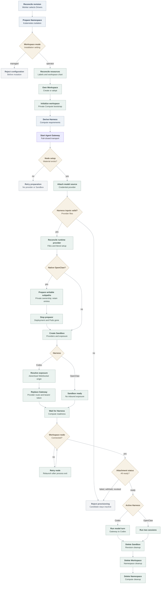

# OpenShell Sandbox provisioning flow

## Overview

Kubernetes Compute delegates dedicated Codex and native OpenClaw to OpenShell. Operator mode owns each Namespace's Workspace; managed mode fails before mutation. A [credential source](credential-source-lifecycle.md) grants model access without Agent Secret permission. Codex authenticates the advertised bearer-passthrough exposure; its direct Harness Service stays inactive.

The development provider exposes an expiring node-setup token inside the Sandbox,
so it is not a production credential guarantee. The Harness signs that literal
token; policy limits node egress to the executable and Agent Gateway endpoint.

Both local control-plane profiles install the pinned Gateway and workspace chart, using provider delivery for both Harnesses.

## Entry Points

- Trigger: a worker reconciles an Agent revision that selects the OpenShell
  Sandbox Driver and Kubernetes Compute Driver.
- Source: `apps/controller/src/drivers/sandbox/openshell.ts:ensureNamespace`
- Source: `apps/controller/src/drivers/sandbox/openshell.ts:provisionHarness`
- Source: `apps/controller/src/drivers/compute/kubernetes/index.ts:prepareRevision`
- Assumptions: the Installation selects Kubernetes Compute, OpenShell Sandbox
  and Credential Gateway through one `openshell` Backend; Namespace isolation
  exists; the Gateway is ready in operator mode.

## Flow

## Execution Trace

### 0. Create the development control plane

`scripts/dev-up`, `internal/occdev/openshell_k3d.go:upK3d`,
`internal/occdev/openshell.go:prepareOpenShell`,
`internal/occdev/kubernetes.go:writeInstallation`

The Installation selects the `openshell` Backend, Gateway, Sandbox and Credential Gateway. Model profiles allow Node and both x64/ARM64 Codex binaries independently of the launcher host. The pinned runtime enables Dedicated OpenClaw development; launch requires hard Landlock enforcement.

`scripts/dev-up` invokes `occ dev up` after Kubernetes/OpenShell validation. Compose is default; `OCC_DEVELOPMENT_CONTROL_PLANE=kubernetes` selects Kubernetes-only. That profile rejects API-port collisions and records engine, cluster, namespace, port and key destination before state creation. Both verify the pinned archive, package charts and import immutable OpenShell images. Kubernetes-only also selects or builds controller/runtime images, imports PostgreSQL and resolves cluster digests.

Before rollout failure returns for rollback, `internal/occdev/agent_sandbox_rollout_diagnostics.go:captureAgentSandboxRollout` records the fixed Deployment, controller-UID-linked ReplicaSets/Pods and Warning reasons. Messages, environment, full labels and logs are excluded; unavailable, malformed or oversized results are marked. Limits are a fresh 15-second context, three seconds per command, 256 KiB per command and 32 KiB per record. It awaits direct commands; 200 ms pipe draining does not terminate arbitrary descendants. Ignored output failures, writer latency and durability remain outside the subprocess budget. Capture neither retries nor diagnoses.

After Helm, `network.providerHarness` records Gateway ClusterIP, Pod selector and TCP/8080. Agent Gateways alias only the advertised hostname to that address; HTTP Host retains the routing key. NetworkPolicy permits only that peer and port. Compose runs PostgreSQL and OCC with a k3d-targeting worker; Kubernetes-only uses `oce-system` and in-cluster authentication. Both install private Envoy routing and operator Workspaces, restricting Gateway access to control-plane callers, supervisor callbacks and dedicated Agent Gateways. See [local deployment guides](../guides/deploy/local-kubernetes-development.md).

Cleanup validates recorded engine/state before deleting the named cluster and Compose project/volumes; partial cleanup retains recovery state.

### 1. Prepare the Namespace and OpenShell Workspace

`apps/controller/src/drivers/compute/kubernetes/index.ts:ensureNamespace`

Compute establishes quota, limits and baseline NetworkPolicies before
`SandboxDriver.ensureNamespace`. Managed mode rejects before Kubernetes or
Gateway use. Operator mode applies namespace labels, workspace-chart resources
and provider NetworkPolicies, then checks health; optional namespace-local
readiness comes first. Development uses the central Gateway endpoint.

`apps/controller/src/backends/openshell.ts:clientForNamespace` passes raw
endpoints, including bracketed IPv6, unchanged to the gRPC client. HTTP
origins keep port 80 explicit; HTTPS and nondefault ports retain their behavior.

The Workspace uses Compute's physical namespace name: `oce-` plus a 15-character digest fits OpenShell's 19-character limit. The Driver reads or creates the Workspace, rereading after `ALREADY_EXISTS`. Adoption requires exact name, ownership labels and active phase.

### 2. Derive the provider-owned Harness request

`apps/controller/src/drivers/compute/kubernetes/index.ts:prepareRevision`

Compute derives requirements from its ordinary Deployment. [Private workspace setup](workspace-files.md#2-deployment-initializes-storage-before-execution) initializes the approved PVC; marker readiness, byte cleanup, fenced deletion and writer termination precede Sandbox handoff. Only the completion guard remains.

First-deploy Gateway transport fails closed; native enrollment is outbound and the direct Agent Service stays inactive. Until Gateway readiness and its Agent-owned setup Secret exist, preparation creates no attachment, provider or Sandbox. Compute then adds the Secret reference and invokes the Driver.
The local OpenShell profile disables projected workload identity. If it is
enabled, OpenShell rejects the revision before Gateway mutation because the
pinned API cannot preserve the exact Agent ServiceAccount and token.
For a `credential_source` revision it renders API-key login mode without a model
Secret and calls `CredentialGatewayDriver.attachForRevision`. The
attachments, one provider name per source, go into
`requirements.credentialAttachments`. Compute passes those requirements and the
immutable revision to OpenShell instead of creating the Deployment itself.
For Codex, it reads the exact Agent transport Secret in the control plane and
adds only its SHA-256 verifier as `APP_TOKEN_SHA`. It turns the admitted
plugin-runtime snapshot into `runtime.json` and `config.toml` workload-file
requirements and removes their ConfigMap paths from the remaining environment.

The credential gateway derives the profile from immutable `config.base_url`,
defaulting to OpenAI `/v1`. Its shared validator rejects invalid endpoints before
[registration](credential-source-lifecycle.md#1-admit-the-registration-request).
The profile binds credentials to the full base path, including prefixes such as
`/api/v1`, followed by `/**`. `attachForRevision` rejects custom endpoints for
native OpenClaw. For Codex,
`apps/controller/src/drivers/compute/plugin-runtime.ts:codexConfigurationToml`
selects a named provider with the normalized endpoint and HTTPS Responses transport.

### 3. Validate and serialize the Sandbox

`apps/controller/src/drivers/sandbox/openshell.ts:provisionHarness`

Only dedicated Codex or OpenClaw revisions pinned to this Driver are accepted.
Kubernetes, filesystem, process and binary-scoped network policy use the
`v0.1.3-pre.2` wire contract. Landlock is required; unsupported enums, inherited
keys, old `passthrough` TLS spelling and missing executable paths fail before
launch. Readiness `timeoutMs` must be a positive safe integer. The Installation
loader names it; startup instead logs `startup-error` / `STARTUP_FAILED` before
Kubernetes calls. Duplicate names and reserved `workspace-node-enrollment` fail
before Driver construction. Rename them, retaining binaries and endpoints.

`provisionHarness` creates or adopts the provider with final setup. Expired setup renewal version-fences `UpdateProvider` to `node_setup_json`. For Codex, a bounded post-create delay precedes the exposed route; Compute rolls the Gateway before observing enrollment. Native OpenClaw has no inbound route.

Dedicated Codex requires one lowercase `APP_TOKEN_SHA`, no `APP_SERVER_TOKEN`,
and two bounded plugin-free runtime inputs. Selected plugins, repository broker
configuration, malformed files, and other Secret-backed environment fail before
Gateway mutation.

Revision providers use `oce-codex-runtime` or `oce-openclaw-runtime`. Both supply read-only setup and Gateway CA files; Codex requires `runtime.json` and `config.toml`, which native OpenClaw refuses. The validated setup Secret's complete expiring envelope, including `bootstrapToken`, becomes `node-setup.json`. WebSocket rewriting is unsupported: OpenClaw signs the literal token in its device proof.
Before renewal, the Driver requires the same endpoint and TLS fingerprint, an
expired stored envelope, a later live expiry, and unchanged runtime and CA
configuration. The Sandbox network policy limits the connection to the exact
Gateway endpoint and `/usr/local/bin/node`. Foreign ownership or other drift
fails before Sandbox creation.

The Driver mounts a revision-scoped Agent PVC subpath at
`/sandbox/.openclaw-runtime`; persistent subpaths mount below
`/sandbox/.openclaw-mounts`. It rewrites admitted `/home/node` paths beneath the
runtime home, declared as `harnessHome` for native hook credentials. Codex hooks trust the provider-file Gateway CA and can reach the Gateway route only when the node can: an in-cluster routing hostname or two clusters. Exact mount paths such as `OPENCLAW_NODE_STATE_DIR` use a process-created `state` child, avoiding atomic replacement through a symlink or root-owned mount. Workspace, node identity, sessions and generated images stay separate. The supervisor probes `/tmp`; the native command redirects `TMPDIR` to a private `tmp` child of its runtime home.

`prepareNativeWorkspace` uses a restricted revision-owned Deployment to privatize every writable PVC subpath before native Sandbox creation, including retained redeployment state. `harnessWorkspacePreparationScript` preserves existing entries; verification checks mode and process ownership before UID-fenced foreground deletion and writer Pod termination. Preparation requires explicit `userNamespaces: false` and the pinned Gateway's default identity selection. It adds no model credential, ServiceAccount token, Linux capability or direct Pod creation.

Credential attachments use the OCC `oce-cs-` name shape and cannot repeat static providers. Model profiles bind access to the configured Codex or Node executable; stale paths fail the startup model probe. These development paths remain unqualified for production.

### 4. Call the versioned gateway contract

`apps/controller/src/drivers/sandbox/openshell-gateway-client.ts:createSandbox`

The client sends the Sandbox identity, spec, Namespace Workspace scope, and a
`request_id`: the revision UUID first. OpenShell keeps a `request_id` whose create
errored server-side unresolved forever, so when the Gateway refuses one
(`REQUEST_OUTCOME_UNCERTAIN`, `REQUEST_ID_PAYLOAD_MISMATCH`, or
`REQUEST_REPLAY_UNAVAILABLE`) and `getSandbox` finds no Sandbox, the Driver tries
the next of 16 IDs: the revision UUID, then 15 derived from it. Each failing pass
spends one ID; the Workspace-unique name prevents duplicates. Unresolved
IDs never expire. Once the controller
identity holds 1000 unresolved or unexpired admission records, OpenShell rejects
every new `request_id` with `RESOURCE_EXHAUSTED`, so repeated server-side create
failures count against that quota. Completed records expire after 24 hours.
`unary` maps that exact refusal to `OpenShellAdmissionLimitError`, a
`TransientDependencyError` (`SANDBOX_ADMISSION_LIMIT_REACHED`): revision
provisioning waits for it until the convergence deadline without spending
attempts; Namespace work retries it as usual. Codex requests one unnamed
bearer-passthrough exposure for `APP_SERVER_PORT` and requires its `service_urls`
entry. Native
OpenClaw connects outbound, so it requests no exposure and rejects any returned
URL. The Driver
calls `getSandbox` first and creates only an absent Sandbox; it adopts an
existing or `ALREADY_EXISTS` Sandbox only when its Workspace, labels,
annotations, and full spec match the request and it is not deleting or stopped.
For Codex, `GetService` must also return the unnamed bearer-passthrough endpoint
on the admitted port. Workspace `sandbox:write` is the trust boundary because a
holder can replace the Sandbox.

The Backend shares endpoint clients and retries failed setup. Unary calls check cancellation after setup/credential preparation, before dispatch. Setup cancellation awaits the pending step without bounding stalled initialization or reads. Dispatched calls cancel local gRPC; remote mutations may continue and require recovery.

`GetService` returns a normalized URL for local clients and the advertised
hostname/port for workload transport. The Driver requires the unnamed
bearer-passthrough exposure on the admitted app-server port; `harnessEndpoint`
returns its WebSocket origin and provider-local `/sandbox/enterprise` workspace
root. Missing, malformed or changed exposure fails closed.

Providers survive uncertain creation; cleanup deletes the Sandbox first.

Provider files use their reported absolute paths; Gateway failures prevent readiness.

OpenShell's supervisor opens the node connection. Kubernetes-only uses the
in-cluster WSS route; Compose uses the Agent Gateway Service URL. In both cases,
policy binds the node executable and supervisor to the exact destination. The
supervisor relaunches an exited node and falls back to direct signaling when
process-group signaling returns `EPERM`.

### 5. Observe readiness or clean up

`apps/controller/src/drivers/compute/kubernetes/index.ts:prepareRevision`

Compute verifies the returned revision reference. Codex `harnessEndpoint` replaces the first Gateway's fail-closed template with the exact `APP_SERVER_URL`, provider `OPENCLAW_REMOTE_WORKSPACE_ROOT` and, in k3d, a host alias. Egress reaches only the configured provider peer/port; the Agent Service stays inactive and Compute omits its Harness route. Preparation preserves a serving predecessor; activation resolves the candidate again. Without `harnessEndpoint`, Codex retains Kubernetes transport. Native OpenClaw uses outbound enrollment and its admitted workspace.

Compute waits for the provider Harness Pod and exact workspace node; missing enrollment keeps it inactive. The Codex supervisor
rereads the provider setup before every node retry and retains the latest valid
value while the projection is unavailable. It relaunches the workspace-node
process one second after every exit without capping attempts, so Gateway rollout
does not strand the Sandbox. Shutdown stops the retry loop.

For bound sources
Compute calls `attachmentStatus`, which reads
`GetSandboxProviderStatus`. `pending` or a missing status retries; `failed`,
`withheld`, `revoked`, or `absent` fails the revision; only `ready` for every
attachment completes preparation. On revision
shutdown, `shutdownRevisionRuntime` calls `cleanup` with the revision. The
Gateway client sends `DeleteSandbox` with the same `workspace_scope`; a missing
Sandbox is an idempotent success. Both Harnesses then delete their owned
revision provider. `cleanupNativeWorkspace` also retires an owned preparer left
by an interrupted attempt without a Sandbox; foreign or replaced resources fail
closed. Namespace cleanup removes unused runtime profiles.

After revision cleanup, Namespace deletion calls `cleanup` without a revision. OpenShell verifies Workspace ownership, deletes remaining owned runtime
providers and the shared profile, sends idempotent `DeleteWorkspace`, then removes
workspace-chart resources and NetworkPolicies in reverse order. A terminating
Workspace remains retryable after a lost response. Compute deletes the Kubernetes
namespace only after this cleanup succeeds.

## Debugging and verification

The [testing guide](../testing/openshell.md) owns prerequisites and commands. Compose checks provider ClusterIP, advertised `ws://*.openshell.localhost:8080/` routing and inactive direct Service. Protected k3d must prove provider delivery, verifier authorization, enrollment, model turns, cleanup, containment and networking on a Landlock-capable host. Console admission and initialized files do not prove native model execution.

## Related docs

- [OpenShell Sandbox Driver](../reference/drivers/openshell-sandbox.md) and [OpenShell Credential Gateway](../reference/drivers/openshell-credential-gateway.md)
- [Credential source lifecycle](credential-source-lifecycle.md)
- [OpenShell tests](../testing/openshell.md)
- [Kubernetes Compute Driver](../reference/drivers/kubernetes-compute.md)
- [Harness execution topology](harness-execution-topology.md)

## Manual Notes

[keep this for the user to add notes. do not change between edits]

## Changelog

- 2026-10-14: Merge current contracts with native provisioning and retained-workspace preparation. (Codex/01a13654-be66-7741-b54f-f8ae80f2d496)

- 2026-10-13 14:11: Reconcile setup-Secret ordering and preserve service-IPv6 history alongside credential endpoint safeguards. (agent:roboclaw:dashboard:9d0532e1-befb-4fc3-935e-7cd2a0c72110 - 90268463bbd255c3c13a0e0bdeb437728189eb1a)

- 2026-10-10 13:04: Reconcile native hook HOME/CA flow with endpoint safeguards; trim repeated narration. (agent:roboclaw:dashboard:9d0532e1-befb-4fc3-935e-7cd2a0c72110 - 90268463bbd255c3c13a0e0bdeb437728189eb1a)

- 2026-10-10 12:40: Declare the Sandbox HOME for native hook credentials; hooks trust the file-delivered Gateway CA. (fix-1017)

- 2026-10-09 23:18: Accept bracketed IPv6 endpoints. (authoring-run/6eefb93e-33fb-450a-9657-51ebe15a686e - 21f34928437fb7d6f4391ba4af5d3e15bf9ce480)

- 2026-10-09 20:27: Integrate main lifecycle, native workspace and readiness contracts without dropping endpoint safeguards. (agent:roboclaw:dashboard:9d0532e1-befb-4fc3-935e-7cd2a0c72110 - 90268463bbd255c3c13a0e0bdeb437728189eb1a)

- 2026-10-09 19:45: Cover both runtime architectures in the development credential policy. (authoring-run/1e7118f7-bdb0-4564-894c-02f990f75e67 - bd540bcdef63cdc719e73192e4dbe99c365953c3)

- 2026-10-09 15:30: Record bounded Agent Sandbox failure metadata before the original error returns and rollback proceeds; tighten setup prose. (authoring-run/54f8d1c2-fb6e-4074-999f-5185af50a86f - 8bfec22f49b207c16afce21bd9a941ee0e9cd95d)

- 2026-10-13 16:45: Reconcile native private temporary state and retained writable-subpath preparation. (Codex/01a13654-be66-7741-b54f-f8ae80f2d496 - ff12fc86cd1662c98a9d8db78be9c2fa4facdcdd)

- 2026-10-08: Document normal native OpenClaw provider delivery and private Compute workspace initialization; retain experimental qualification limits. (Codex/01a0e8ec-d02f-7b93-a59b-5b7fccf2ebaa)

- 2026-10-06 22:10: Preserve HTTP port 80 when creating the OpenShell gRPC target. (authoring-run/88f2e095-3f3a-4d9b-a878-663034cdde6e - 2fc8320cf8bfbf9d7ea20757ef3fe32d7157e6aa)

- 2026-10-06 11:17: Reconciled endpoint flow with current namespace and provider provisioning; condensed repeated prose. (agent:roboclaw:dashboard:9d0532e1-befb-4fc3-935e-7cd2a0c72110 - b6dc6b87a461ad33374e133d15cc739d8e074fea)

- 2026-10-05 16:17: Documented version-fenced workspace-node setup renewal through the revision provider and supervisor refresh. (authoring-run/4f3e6ccd-a967-48c8-9d5d-f29a6d338d7d - fd9a082e2587432bde6282748a82e3025a64fd1a)

- 2026-10-05 11:36: Trace pre-registration endpoint validation and condense repeated setup and runtime details. (agent:roboclaw:dashboard:9d0532e1-befb-4fc3-935e-7cd2a0c72110 - 9958ef0412565864efba7b13995536d7c2a51d22)

- 2026-10-05 00:06: Bind immutable credential-source endpoints to provider profiles and Codex runtime configuration while retaining existing default endpoint limits for other consumers. (authoring-run/4e4824a1-f107-44c2-90bf-00fe13ff650c - d269c6d03)

- 2026-10-05 12:50: Removed repeated setup and wire-contract detail while preserving the current OpenShell provisioning sequence and moved older entries to the history page. (authoring-run/fd7f6cdb-1d1d-40d5-8d4a-d6d80cd946e7 - 4b5afe0cb653f7dd99fccdb2e3432cbf60e6a03e)

- 2026-10-02 16:26: Passed OpenShell's provider-local workspace root to the dedicated Gateway while preserving the canonical Kubernetes Harness root. (authoring-run/3bf937d5-c422-419e-af2d-754abe024ca4 - 987c8c2b4ace1e152262ef6920b6d0f9ff26a086)

[OpenShell Sandbox provisioning documentation history](openshell-sandbox-provisioning/history.md) preserves the older dated entries.
