# OpenShell Sandbox provisioning flow

## Overview

Kubernetes Compute provisions dedicated Codex/OpenClaw through OpenShell.
[Credential sources](credential-source-lifecycle.md) supply model access.

## Entry Points

- Trigger: worker Namespace preparation/deletion or Agent revision reconciliation
  with OpenShell Sandbox and Kubernetes Compute.
- Source: `apps/controller/src/drivers/sandbox/openshell.ts:ensureNamespace`
- Source: `apps/controller/src/drivers/sandbox/openshell.ts:provisionHarness`
- Source: `apps/controller/src/drivers/compute/kubernetes/index.ts:prepareRevision`
- Assumptions: Kubernetes Compute, OpenShell Sandbox and Credential Gateway share
  one `openshell` Backend; Namespace isolation exists; the operator-mode Gateway
  is ready.

## Flow

```mermaid
graph TD
  A["<b>Reconcile Agent revision</b><br/>Worker selects Drivers"] --> B["<b>Prepare Namespace</b><br/>Kubernetes isolation"]
  B --> C{"<b>Workspace mode</b><br/>Installation setting"}
  C -- "managed" --> X["<b>Reject configuration</b><br/>Before mutation"]
  C -- "operator" --> D["<b>Reconcile resources</b><br/>Creation nonce and UID"]
  D --> E["<b>Bind Workspace</b><br/>Save immutable ID"]
  E --> F["<b>Derive Harness</b><br/>Compute requirements"]
  F --> K0["<b>Start Agent Gateway</b><br/>Fail-closed transport"]
  K0 --> Y0{"<b>Node setup</b><br/>Material exists?"}
  Y0 -- "no" --> R0["<b>Retry preparation</b><br/>No provider or Sandbox"]
  Y0 -- "yes" --> Q["<b>Attach model source</b><br/>Credential provider"]
  Q --> G{"<b>Harness inputs valid?</b><br/>Provider files"}
  G -- "no" --> R["<b>Reject provisioning</b><br/>Candidate stays inactive"]
  G -- "yes" --> W["<b>Reconcile runtime provider</b><br/>Files and literal setup"]
  W --> W0{"<b>Native OpenClaw?</b>"}
  W0 -- "yes" --> W1["<b>Prepare writable subpaths</b><br/>Private ownership; retain entries"]
  W1 --> W2["<b>Stop preparer</b><br/>Deployment and Pods gone"]
  W2 --> H["<b>Create Sandbox</b><br/>Providers and exposure"]
  W0 -- "no" --> H
  H --> I["<b>Initialize workspace</b><br/>Private ExecSandbox stdin"]
  I --> V{"<b>Harness</b>"}
  V -- "Codex" --> J["<b>Resolve exposure</b><br/>Advertised WebSocket origin"]
  J --> K["<b>Replace Gateway</b><br/>Provider route and bearer token"]
  K --> M["<b>Wait for Harness</b><br/>Compute readiness"]
  V -- "OpenClaw" --> T["<b>Sandbox ready</b><br/>No inbound exposure"]
  T --> M
  M --> Y{"<b>Workspace node</b><br/>Connected?"}
  Y -- "no" --> R1["<b>Retry node</b><br/>Relaunch after process exit"]
  R1 --> Y
  Y -- "yes" --> S{"<b>Attachment status</b><br/>All ready?"}
  S -- "failed, withheld, revoked" --> R
  S -- "ready" --> Z{"<b>Active Harness</b>"}
  Z -- "Codex" --> L["<b>Run model turn</b><br/>Gateway to Codex"]
  Z -- "OpenClaw" --> U["<b>Run native turn</b>"]
  L -- "Git withdrawn" --> D1["<b>Fence delivery</b><br/>OCC commits intent"]
  D1 --> D2{"<b>Verify reduction</b><br/>Exact execution"}
  D2 -- "pending" --> D2
  D2 -- "withdrawn" --> L
  D2 -- "cannot prove" --> D3["<b>Request retirement</b><br/>Caller decides"]
  L --> N["<b>Delete Sandbox</b><br/>Version cleanup"]
  U --> N
  N --> O["<b>Confirm Workspace removal</b><br/>Namespace cleanup"]
  O -- "completed" --> P0["<b>Commit cleanup receipt</b><br/>Worker claim and audit"]
  O -- "unknown" --> O1["<b>Keep cleanup incomplete</b><br/>Retain provider access"]
  P0 --> P1["<b>Delete owned resources</b><br/>UID and resourceVersion"]
  P1 --> P2["<b>Save cleanup result</b><br/>Compute fences sweep"]
  P2 --> P["<b>Retain or delete Namespace</b><br/>Compute lifecycle"]

  classDef state fill:#EDF2F7,stroke:#879AB0,color:#25364A,stroke-width:1px
  classDef operation fill:#EBF3F0,stroke:#7F9D93,color:#2B4038,stroke-width:1px
  classDef gate fill:#F7F1E5,stroke:#B3A078,color:#514532,stroke-width:1px
  classDef blocked fill:#F3F4F6,stroke:#98A2AE,color:#44505F,stroke-width:1px
  class A,B,F,D1,P0,P2 state
  class D,E,I,Q,W,W1,W2,H,J,K,L,M,N,O,P,P1,R1,T,U operation
  class C,G,S,V,Y,Y0,Z,W0,D2 gate
  class X,R,R0,D3,O1 blocked
  linkStyle default stroke:#8B949E,stroke-width:1px
```

## Execution Trace

### 0. Create the development control plane

`scripts/dev-up`, `internal/occdev/openshell_k3d.go:upK3d`,
`internal/occdev/openshell.go:prepareOpenShell`,
`internal/occdev/kubernetes.go:writeInstallation`

`openshell` launchers require Landlock, support Node and x64/ARM64 Codex on any launcher, verify 0.1.6 charts and pin Gateway/supervisor/sandbox images. OCE image import precedes k3s garbage collection. `writeInstallation` selects curated Codex plugins; the selected Credential Gateway supplies credentials.

`dev-up` validates Kubernetes/OpenShell before `occ dev up`.
`OCC_DEVELOPMENT_CONTROL_PLANE=kubernetes` selects Kubernetes-only: in-cluster
authentication, `oce-system`, imported PostgreSQL and [per-Agent HTTPS](../guides/deploy/local-setup.md).
Its launcher checks port collisions and records engine, cluster, Namespace,
ports and key path. Compose runs PostgreSQL/OCC with a k3d-targeting worker.
The retired local static-inference profile no longer provisions an authority
or verifies middleware chart configuration.

After rollout failure, `prepareOpenShell` calls
`internal/occdev/agent_sandbox_rollout_diagnostics.go:captureAgentSandboxRollout`
once, preserving rollback's original error. Diagnostics include Deployment,
UID-linked ReplicaSets/Pods and Warning reasons, excluding messages, environment,
full labels and logs. Unavailable, malformed or oversized results are marked.
Limits: 15-second context; three seconds/256 KiB per command; 32 KiB per record.
No retries; 200 ms pipe draining cannot terminate descendants.

`network.providerHarness` records Gateway ClusterIP, Pod selector and TCP/8080.
Agent Gateways alias its advertised hostname without changing HTTP Host;
policy permits only those Pods/port. Both launchers install private Envoy routing
and operator Workspaces. Gateway ingress admits API, worker, supervisor callbacks
and dedicated Agent Gateways; the public quickstart's
`docs/snippets/openshell-quickstart/kubernetes/service-policies.py` reads live selectors and admits these callers on TCP/8080, retaining each Namespace's
supervisor policy when another is applied. Tenant callers must still match the namespace ownership label. The quickstart platform helper records each policy set before applying it; uninstall deletes every recorded set. See [local deployment](../guides/deploy/local-kubernetes-development.md)
and the [local protected-profile retirement notice](../guides/deploy/local-openshell-images.md#select-the-protected-profile).

`internal/occdev/sandbox_network_policy.go:loadSandboxNetworkPolicies` validates
policies (maximum 1 MiB) before provisioning; persisted rules augment generated
rules. See [startup network policy](../guides/deploy/local-sandbox-network-policy.md).
`internal/occdev/compose_routing.go:prepareComposeRoutingFiles` sets routing-file
container ownership; Installation files remain `0644` in private state.
Cleanup validates ownership, deletes cluster/project/volumes and retains partial-failure state.

### 0.1. Check Harness mode support

`apps/controller/src/drivers/sandbox/openshell.ts:constructor` sets
`supportsHarnessExecutionMode`.
`packages/occ/src/index.ts:admitsOpenClawExecutionMode` checks this value,
native-worker support, and provisioning requirements.
Agent writes check support before transforming Configuration; deployment stores
the result in the Agent revision. Provisioning status reads return stored work.

### 1. Prepare the Namespace and OpenShell Workspace

`apps/controller/src/drivers/compute/kubernetes/index.ts:ensureNamespace`

Compute delegates Namespace journal data and the original Namespace UID.
OpenShell checks placement and saves creation intent before effects. Unknown
Kubernetes creates are not repeated; saved-nonce readback binds their UID.
Definitive refusals cannot settle earlier uncertainty.
`OpenShellSandboxDriver.ensureNamespaceWorkspace` converts wire NetworkPolicy
`from` fields to the SDK alias for create and update. Updates retain the saved
UID, current `resourceVersion`, and creation nonce; readback restores wire fields
for operator configuration checks.
Preinstalled operator-owned resources require full configuration checks and are
retained. Readiness and health precede Workspace creation.

`apps/controller/src/backends/openshell.ts:lifecycleTarget` binds the effective
endpoint and public server trust. A bare Service resolves in the tenant Namespace;
the development profile uses a central Gateway. `clientForNamespace` passes raw endpoints, including bracketed IPv6, unchanged to gRPC; HTTP retains explicit port 80; HTTPS and other ports are unchanged.

The Workspace name is Compute's physical namespace: `oce-` plus a 15-character
digest fits OpenShell's 19-character limit. Before `CreateWorkspace`, the Driver saves intent; before ready, it saves the returned immutable ID. Retries require that ID and ownership metadata; unbound Workspaces and unknown creates cannot be adopted by name. Callbacks commit under the worker's live claim/audit transaction; no credentials are stored.

### 2. Derive the provider-owned Harness request

`apps/controller/src/drivers/compute/kubernetes/index.ts:prepareRevision`

Compute derives `provisionHarness` from its ordinary Deployment. First deployment keeps the Service inactive and transport fail-closed. Attachments and provider/Sandbox creation await Gateway readiness and its Agent-owned setup Secret. Local projected identity is disabled; enabling it fails before mutation because the pinned API cannot preserve the Agent ServiceAccount/token.

For `credential_source`, Compute renders the catalog login mode without a model
Secret and passes version and `attachForRevision` provider names through
`requirements.credentialAttachments`. For `chatgptAuthTokens`, OpenShell omits
static `CODEX_ACCESS_TOKEN`, retaining account metadata. Codex receives only `APP_TOKEN_SHA` from its exact Agent transport
Secret. Compute converts the admitted plugin snapshot into `runtime.json` and
`config.toml` workload files, removing their ConfigMap environment paths.

`OpenShellSandboxDriver.configureAgent` sets full access/user review for all
login modes and removes `appServer.networkProxy`.
`deploy/runtime/openclaw-codex-full-access-profile.patch` sends the endpoint's
`:danger-full-access` profile for threads/turns; constrained threads fail
before a turn. First Agent warns: prior PAT `workspace-write` versions break
shell tools; `--replace-key` deploys current policy.
OpenShell blocks nested bubblewrap; model readiness does not prove shell execution.

PAT bootstrap (`prepareHarnessAuth`;
`apps/controller/src/drivers/compute/kubernetes/runtime-entrypoints.ts:AGENT_RUNTIME_ENTRYPOINT`)
writes an opaque placeholder to private `auth.json`, clears the child override,
and validates native login status. Scoped [PAT routes](../reference/drivers/openshell-credential-gateway.md#source-type-catalog)
admit bootstrap/model traffic; failure keeps versions inactive.
API-key profiles bind immutable `config.base_url` plus `/**` (default OpenAI `/v1`),
preserving prefixes including `/api/v1`. [Registration validation](credential-source-lifecycle.md#1-admit-the-registration-request)
rejects invalid endpoints.
`attachForRevision` requires native OpenClaw's selected model endpoints to match
the source. For Codex,
`apps/controller/src/drivers/compute/plugin-runtime.ts:codexConfigurationToml`
selects a named provider and HTTPS Responses transport.

### 3. Validate and serialize the Sandbox

`apps/controller/src/drivers/sandbox/openshell.ts:provisionHarness`

Dedicated Codex/OpenClaw requires Landlock. Kubernetes, filesystem, process and
[binary-scoped network policy](agent-sandbox-policy.md) use pinned `v0.1.6`.
Relocation preserves opaque `OCE_CODEX_CHATGPT_ACCOUNT` JSON.
Unsupported enums, inherited keys, `passthrough` TLS, missing executables or
non-positive/unsafe-integer readiness `timeoutMs` prevent Kubernetes calls.
Duplicate names and `workspace-node-enrollment` prevent construction.
Template Pod labels outside `allowed_pod_labels` fail deployment immediately
with `SANDBOX_POD_LABELS_NOT_PERMITTED`.

`provisionHarness` creates or adopts the provider. Renewal checks its version and updates only `node_setup_json` through `UpdateProvider`. Optional `startupDelayMs` is at most 120 seconds; development omits it. `harnessStatus` reports starting until an authenticated WebSocket handshake succeeds. Harness failures block readiness. Compute rolls the Gateway before enrollment.

Dedicated Codex requires one lowercase `APP_TOKEN_SHA` and two runtime files,
each at most 65,536 bytes. `APP_SERVER_TOKEN` is forbidden. A second model proxy,
malformed files and other Secret-backed environment fail before Gateway mutation.

After login and egress enrollment, `agentRuntimeEntrypoint` calls
`apps/controller/src/drivers/compute/kubernetes/codex-plugin-stdio.ts:withCodexPluginStdio`
to install selections. Clean stdio exit precedes verifier-only WebSocket startup
in the same home. Failure terminates the process group through TERM/KILL cleanup.
The provider Gateway skips HMAC plugin status; readiness observes transport.

Providers `oce-codex-runtime` and `oce-openclaw-runtime` supply read-only setup/Gateway CA files. Codex requires `runtime.json`/`config.toml`; native OpenClaw refuses them. The validated envelope, including `bootstrapToken`, becomes `node-setup.json`. WebSocket rewriting is unsupported: device proof signs the literal token.
Renewal requires an expired stored envelope, later live expiry, and unchanged
endpoint, TLS fingerprint, runtime and CA configuration. Sandbox policy limits
connections to that Gateway and `/usr/local/bin/node`. Foreign ownership or drift
prevents creation.

Version state uses `/sandbox/.openclaw-runtime`; persistent subpaths use `/sandbox/.openclaw-mounts`. Admitted `/home/node` paths move under `harnessHome` for native hook credentials. Codex hooks require the provider-file Gateway CA and node-reachable routing. `OPENCLAW_NODE_STATE_DIR` uses a process-created `state` child, avoiding root-owned mounts/symlinks.
`apps/controller/src/drivers/compute/kubernetes/runtime-entrypoints.ts:agentWithNodeEntrypoint`
and `NATIVE_WORKER_ENTRYPOINT` apply `0700` before OpenClaw setup or migration,
clearing setgid. Retries prepare children without changing retained state/workspace permissions. Permission failures stop startup. Workspace, node identity, sessions and images remain separate. The supervisor probes `/tmp`; native `TMPDIR` uses private runtime-home `tmp`.

`prepareNativeWorkspace` uses a restricted Deployment for the Agent revision to privatize
writable PVC subpaths, preserving retained entries. Mode and process ownership checks precede
UID-fenced foreground deletion and writer Pod termination.
Preparation requires `userNamespaces: false`, at most one operator-mode ServiceAccount
and the pinned Gateway's default identity, without model credentials, ServiceAccount
tokens, capabilities, or direct Pod creation. Mode support and admission report
these setting requirements before deployment.

After Sandbox readiness, `initializeWorkspace` verifies the private setup Secret's Namespace, Agent and setup identity, then sends the shared initializer/JSON stdin through authenticated `ExecSandbox`. Workspace `flock` serializes attempts; the Harness awaits completion. Document delivery is separate from native subpath preparation. See [workspace initialization](workspace-files.md#2-deployment-initializes-storage-before-execution).

Credential attachments require OCC `oce-cs-` names without static-provider duplicates.
Model profiles bind access to the selected Codex/Node executable. Production
qualification is incomplete.

### 4. Call the versioned gateway contract

`apps/controller/src/drivers/sandbox/openshell-gateway-client.ts:createSandbox`

The client sends Sandbox identity/spec, Workspace, and one of 16 `request_id` values: revision UUID, then 15 derived IDs. After `REQUEST_OUTCOME_UNCERTAIN`,
`REQUEST_ID_PAYLOAD_MISMATCH` or `REQUEST_REPLAY_UNAVAILABLE` it advances once
`getSandbox` finds nothing. Unresolved IDs never expire; completed records do
after 24 hours. Names are Workspace-unique. At 1,000 live/unresolved
records, `RESOURCE_EXHAUSTED` becomes transient `SANDBOX_ADMISSION_LIMIT_REACHED`:
Preparation waits without spending attempts until its convergence
deadline; Namespace work retries. Each Harness takes one unnamed
bearer-passthrough `APP_SERVER_PORT` exposure (Codex transport, native held
failure); only Codex returns a URL. The Driver reads first. It adopts an existing or `ALREADY_EXISTS` Sandbox only
when Workspace, labels, annotations, and spec match exactly and it is neither stopped nor deleting. Workspace `sandbox:write` permits replacement and
bounds trust. Native exposure ends once a post-enrollment pass confirms its
delete, by `withdrawHarnessExposure`, adoption or recreation with
`workspaceNodeEnrolled`.

After HTTP `400` or `404`, `observeHeldRepositoryGitPreview` and `enrollHarness`
require the recorded release acknowledgment and authenticated WebSocket. Other
non-`200` responses stay pending or refuse enrollment without an upgrade.

The Backend reuses clients and retries setup. Cancellation is checked after
setup/credential preparation; stalled initialization/file reads have no cancellation deadline. After dispatch, cancellation stops local gRPC; remote mutations
may continue, requiring recovery.

`GetService` separates control URL and advertised workload host/port.
`harnessEndpoint` returns WebSocket origin and configured
`sandboxDataMount.mountPath` (default `/sandbox/enterprise`). Native hooks
use `harnessHome`, mode `0700`. Invalid or changed exposure fails closed.

`apps/controller/src/drivers/sandbox/openshell.ts:harnessStatus` probes the
authenticated WebSocket handshake before reading a held-failure document;
unanswered reads are transient `SANDBOX_GATEWAY_UNAVAILABLE`.
`apps/controller/src/drivers/sandbox/openshell-service-transport.ts:serviceWebSocketHandshake`
destroys HTTP refusals at once, releasing their connections.

Provider files require reported absolute paths. Gateway failure blocks readiness; uncertain creates retain providers. Cleanup deletes their Sandbox first.

Both planes use the Gateway's scoped WSS node route. Envoy rewrites worker-transfer paths and attributes clients. Policy binds executable, host and port. On process-group `EPERM`, the supervisor signals the process.

### 5. Observe readiness or clean up

`apps/controller/src/drivers/compute/kubernetes/index.ts:prepareRevision`

Compute verifies Namespace, Agent, ServicePrincipal and Agent revision IDs.
Codex `harnessEndpoint` sets `APP_SERVER_URL`, `OPENCLAW_REMOTE_WORKSPACE_ROOT`
and `OPENCLAW_CODEX_PROVIDER_PERMISSION_PROFILE`; owned k3d pins the provider host.
`gatewayConfigurationDocument` keeps `/home/node/workspace`, mapped to the Sandbox
root without Harness storage mounts. `gatewayNativeHookRelayConfiguration` uses
`harnessHome`; Compute owns relay URL/auth. Egress permits only the provider
peer/port. Compute keeps the direct Agent Service inactive and omits its Harness
route. Preparation preserves a serving predecessor; activation rechecks the
candidate. Without `harnessEndpoint`, Codex uses Kubernetes transport and
`/home/node/workspace`. Native OpenClaw enrolls outbound into its admitted workspace.

Activation requires the Harness Pod and enrolled Secret node. Retries reread provider setup, retaining valid values during projection outages. Until shutdown, Codex restarts workspace-node one second after each exit.

`apps/controller/src/drivers/egress-proxy/openshell-request-hook-preview.ts:previewPolicyAndRecipient`
checks policy, recipient and launcher proof. Strict grants require `PRE_CREDENTIALS`;
legacy preview accepts absent binding fields.

`apps/controller/src/drivers/egress-proxy/openshell-git-runtime.ts:observeHeldPreview` arms one-use denial: `git-write` probes `/<owner>/<repo>.git/oce-observe-request/<nonce>.git/info/refs`; installation-shaped providers, including `github-repository`, probe `/oce-observe-request/<nonce>.git/info/refs`. Both use `service=git-upload-pack`. The credential-free HTTPS launcher reaches denial before binding lookup for either prefix; only the exact challenge qualifies. Observation cannot release the Harness.

Compute checks sources through `attachmentStatus`/`GetSandboxProviderStatus`:
`pending` or missing status retries; `failed`, `withheld`, `revoked` or `absent`
fails preparation. Shutdown reads the Sandbox and checks its name, Workspace,
Namespace, Agent, and revision annotations before `DeleteSandbox`. Absence needs
`GetWorkspace` and a second `GetSandbox`. Cleanup then deletes runtime and Git
providers and profiles. `cleanupNativeWorkspace` retires interrupted preparers,
refusing foreign or replaced resources.

`apps/controller/src/drivers/sandbox/openshell.ts:cleanupNamespace` checks saved
Namespace/resource UIDs and ownership before provider mutations. It removes owned
runtime/Git providers and profiles only from the original Workspace ID. A fresh
`DeleteWorkspace` completion plus removal readback precedes the awaited cleanup
checkpoint. `ACCEPTED`, `ALREADY_ABSENT`, unknown responses and bare absence do not
supply that receipt.

After receipt commit, reverse-order cleanup uses saved UIDs/current `resourceVersion` and confirms removal. Finalizers defer completion. Compute saves all configured absent or retained references before sweeping other objects. Absent references refuse reappearance; retained references refuse replacement UIDs. Retries skip provider RPCs despite gateway/Namespace loss.
Compute handles managed Namespace removal or external claim release;
see [Namespace placement](kubernetes-existing-namespace-placement.md).

`apps/controller/src/drivers/compute/kubernetes/index.ts:cleanupRevisionSandbox`
runs after Namespace loss: stop removes serving paths first; retirement cleans
the provider first. Derived placement requires provider confirmation.

### 6. Withdraw Git without retiring the execution

`apps/controller/src/drivers/egress-proxy/openshell-registration.ts:createOpenShellCapabilities`
keeps the transport inside the installed Driver. The Token Service supplies material;
`packages/occ/src/state/credential-deliveries.ts:CredentialDeliveries` stores target, binding,
fence, desired and observed policy, installed and pending material versions. Unknown
writes survive restart. A forward migration preserves receipts and fences former writers.

After OCC withdraws authority,
`apps/controller/src/drivers/egress-proxy/openshell-git-route-store.ts:expire`
fences the delivery and commits its reduction intent through
`packages/occ/src/state/credential-delivery-reductions.ts:CredentialDeliveryReductions`.
`apps/controller/src/drivers/egress-proxy/openshell-expired-git.ts:subtractExpiredOpenShellGit`
conditionally detaches Git. It independently verifies the reduced generation, original
process and network, retained providers and model attachment. Applied detaches are observed,
never resent; an unapplied intent repeats its request. A replacement cannot settle it.

One Git binding and separately authorized model access are supported; removing its last route denies Git without interrupting conversation. Multiple Git bindings remain unsupported. For generic exchange routes, `withdrawBinding`
returns `retire-runtime`. Compute reports `CREDENTIAL_WITHDRAWAL_REQUIRES_RUNTIME_RETIREMENT`
without deleting the Sandbox or claiming detachment. The worker keeps that source
pending and attempts other authorized withdrawals. Runtime retirement remains separate.

## Debugging and verification

See [test prerequisites and proof](../testing/openshell.md). Compose needs the
provider ClusterIP, advertised `ws://*.openshell.localhost:8080/` route, and inactive
direct Service. Native model proof requires Landlock; Console admission and
initialized files are insufficient.

`tests/integration/runtime-image-node-state-permissions.test.ts` checks packaged
setup, retry and restart under setgid parents. It does not prove Kubernetes or
model execution.

`tests/integration/sandbox-driver-startup.test.mjs` checks journal order, unknown
responses and replacement refusal with controlled transports. The independent
Workspace wire test checks request IDs and deletion outcomes. Live provider removal and Kubernetes concurrency remain unproved.

## Related docs

- [Agent Sandbox policy admission and live application](agent-sandbox-policy.md)

- [OpenShell Sandbox Driver](../reference/drivers/openshell-sandbox.md) and [OpenShell Credential Gateway](../reference/drivers/openshell-credential-gateway.md)
- [Credential source lifecycle](credential-source-lifecycle.md)
- [OpenShell tests](../testing/openshell.md)
- [Kubernetes Compute Driver](../reference/drivers/kubernetes-compute.md)
- [Harness execution topology](harness-execution-topology.md)

## Manual Notes

[keep this for the user to add notes. do not change between edits]

## Changelog

- 2026-11-04 19:20: Preserve cleanup ownership and observed Harness readiness. (authoring-run/73695cc1-a0da-41a6-9cb1-c3fbde5f5a71 - 3f3150ce8a8b024e902ecf493a5e41ff5b72c934)

[OpenShell Sandbox provisioning documentation history](openshell-sandbox-provisioning/history.md) preserves the older dated entries.
