# OpenShell Sandbox provisioning flow

## Overview

Kubernetes Compute provisions Codex and OpenClaw Harnesses through OpenShell.
[Credential sources](credential-source-lifecycle.md) supply model access.

## Entry Points

- Trigger: worker reconciliation of an Agent revision selecting OpenShell Sandbox
  and Kubernetes Compute.
- Source: `apps/controller/src/drivers/sandbox/openshell.ts:ensureNamespace`
- Source: `apps/controller/src/drivers/sandbox/openshell.ts:provisionHarness`
- Source: `apps/controller/src/drivers/compute/kubernetes/index.ts:prepareRevision`
- Assumptions: shared `openshell` Backend, Namespace isolation and ready
  operator-mode Gateway.

## Flow

```mermaid
graph TD
  A["<b>Reconcile Agent revision</b><br/>Worker selects Drivers"] --> B["<b>Prepare Namespace</b><br/>Kubernetes isolation"]
  B --> C{"<b>Workspace mode</b><br/>Installation setting"}
  C -- "managed" --> X["<b>Reject configuration</b><br/>Before mutation"]
  C -- "operator" --> D["<b>Reconcile resources</b><br/>Labels and workspace chart"]
  D --> E["<b>Own Workspace</b><br/>Create or adopt"]
  E --> F["<b>Derive Harness</b><br/>Compute requirements"]
  F --> K0["<b>Start Agent Gateway</b><br/>Fail-closed transport"]
  K0 --> Y0{"<b>Node setup</b><br/>Material exists?"}
  Y0 -- "no" --> R0["<b>Retry preparation</b><br/>No provider or Sandbox"]
  Y0 -- "yes" --> Q["<b>Attach model source</b><br/>Credential provider"]
  Q --> G{"<b>Harness inputs valid?</b><br/>Provider files"}
  G -- "no" --> R["<b>Reject provisioning</b><br/>Candidate stays inactive"]
  G -- "yes" --> W["<b>Reconcile runtime provider</b><br/>Files and literal setup"]
  W --> W0{"<b>Native OpenClaw?</b>"}
  W0 -- "yes" --> W1["<b>Prepare writable subpaths</b><br/>Private ownership; retain entries"]
  W1 --> W2["<b>Stop preparer</b><br/>Deployment and Pods gone"]
  W2 --> H["<b>Create Sandbox</b><br/>Providers and exposure"]
  W0 -- "no" --> H
  H --> I["<b>Initialize workspace</b><br/>Private ExecSandbox stdin"]
  I --> V{"<b>Harness</b>"}
  V -- "Codex" --> J["<b>Resolve exposure</b><br/>Advertised WebSocket origin"]
  J --> K["<b>Replace Gateway</b><br/>Provider route and bearer token"]
  K --> M["<b>Wait for Harness</b><br/>Compute readiness"]
  V -- "OpenClaw" --> T["<b>Sandbox ready</b><br/>No inbound exposure"]
  T --> M
  M --> Y{"<b>Workspace node</b><br/>Connected?"}
  Y -- "no" --> R1["<b>Retry node</b><br/>Relaunch after process exit"]
  R1 --> Y
  Y -- "yes" --> S{"<b>Attachment status</b><br/>All ready?"}
  S -- "failed, withheld, revoked" --> R
  S -- "ready" --> Z{"<b>Active Harness</b>"}
  Z -- "Codex" --> L["<b>Run model turn</b><br/>Gateway to Codex"]
  Z -- "OpenClaw" --> U["<b>Run native turn</b>"]
  L -- "Git withdrawn" --> D1["<b>Fence delivery</b><br/>OCC commits intent"]
  D1 --> D2{"<b>Verify reduction</b><br/>Exact execution"}
  D2 -- "pending" --> D2
  D2 -- "withdrawn" --> L
  D2 -- "cannot prove" --> D3["<b>Request retirement</b><br/>Caller decides"]
  L --> N["<b>Delete Sandbox</b><br/>Version cleanup"]
  U --> N
  N --> O["<b>Delete Workspace</b><br/>Namespace cleanup"]
  O --> P["<b>Delete Namespace</b><br/>Compute cleanup"]

  classDef state fill:#EDF2F7,stroke:#879AB0,color:#25364A,stroke-width:1px
  classDef operation fill:#EBF3F0,stroke:#7F9D93,color:#2B4038,stroke-width:1px
  classDef gate fill:#F7F1E5,stroke:#B3A078,color:#514532,stroke-width:1px
  classDef blocked fill:#F3F4F6,stroke:#98A2AE,color:#44505F,stroke-width:1px
  class A,B,F,D1 state
  class D,E,I,Q,W,W1,W2,H,J,K,L,M,N,O,P,R1,T,U operation
  class C,G,S,V,Y,Y0,Z,W0,D2 gate
  class X,R,R0,D3 blocked
  linkStyle default stroke:#8B949E,stroke-width:1px
```

## Execution Trace

### 0. Create the development control plane

`scripts/dev-up`, `internal/occdev/openshell_k3d.go:upK3d`,
`internal/occdev/openshell.go:prepareOpenShell`,
`internal/occdev/kubernetes.go:writeInstallation`

Both `openshell` launchers require Landlock, support Node and x64/ARM64 Codex
independently of launcher architecture, verify 0.1.6 charts and pin
Gateway/supervisor/sandbox images. Importing OCE images first prevents k3s garbage
collection. `writeInstallation` selects curated Codex plugins; the selected
Credential Gateway supplies credentials.

Agent Sandbox manifest downloads use
`internal/occdev/routing_manifest.go`; CI bootstrap uses
`scripts/ci/routing.mjs:downloadPinnedArtifact`. Transient network failures
and HTTP 408/429/5xx allow eight attempts, each limited to 60 seconds;
retries start within 120 seconds. Other HTTP errors and checksum mismatches
fail immediately. Only verified bytes become the private manifest passed to
`kubectl`; source-archive downloads are unchanged.

`dev-up` validates Kubernetes/OpenShell before `occ dev up`.
`OCC_DEVELOPMENT_CONTROL_PLANE=kubernetes` selects Kubernetes-only: in-cluster
authentication, `oce-system`, imported PostgreSQL and [per-Agent HTTPS](../guides/deploy/local-setup.md).
The launcher checks port collisions, recording engine, cluster, Namespace, ports
and key path. Compose runs PostgreSQL/OCC with a k3d worker.

On rollout failure, `prepareOpenShell` calls
`internal/occdev/agent_sandbox_rollout_diagnostics.go:captureAgentSandboxRollout`
once, preserving rollback errors. Diagnostics include Deployment,
UID-linked ReplicaSets/Pods and Warning reasons, excluding messages, environment,
full labels and logs. Unavailable, malformed or oversized results are identified.
Limits: 15-second context; three seconds/256 KiB per command; 32 KiB per record.
No retries; 200 ms pipe draining cannot terminate descendants.

`network.providerHarness` records Gateway ClusterIP, Pod selector and TCP/8080.
Agent Gateways alias its hostname, preserving HTTP Host; policy permits only those
Pods/port. Both launchers install private Envoy routing and operator Workspaces.
`docs/snippets/openshell-quickstart/kubernetes/service-policies.py` uses live
selectors to admit API, worker, supervisors and Agent Gateways on TCP/8080.
Supervisor grants accumulate per Namespace; callers must match ownership labels.
Protected Git preserves Gateway DNS/API egress using Service addresses, DNS
selectors/ports and ready API endpoints. Empty discovery warns and removes stale
backend grants; failed reads abort. Policies are recorded before application and
deleted on uninstall. See [local deployment](../guides/deploy/local-kubernetes-development.md)
and the [retired local protected profile](../guides/deploy/local-openshell-images.md#select-the-protected-profile).

`internal/occdev/sandbox_network_policy.go:loadSandboxNetworkPolicies` validates
policies (maximum 1 MiB) before provisioning; persisted rules augment generated
rules. See [startup network policy](../guides/deploy/local-sandbox-network-policy.md).
`internal/occdev/compose_routing.go:prepareComposeRoutingFiles` sets routing-file
container ownership; Installation files remain `0644` in private state.
Cleanup validates ownership, deletes cluster/project/volumes and retains partial-failure state.

### 0.1. Check Harness mode support

`apps/controller/src/drivers/sandbox/openshell.ts:constructor` sets
`supportsHarnessExecutionMode`; `packages/occ/src/index.ts:admitsOpenClawExecutionMode`
checks it, native-worker support and provisioning requirements before Agent writes
transform Configuration. Deployment stores the result in the Agent revision;
status reads return stored work.

### 1. Prepare the Namespace and OpenShell Workspace

`apps/controller/src/drivers/compute/kubernetes/index.ts:ensureNamespace`

Compute establishes quota, limits and baseline NetworkPolicies before
`SandboxDriver.ensureNamespace`. Managed mode rejects before Kubernetes/Gateway
use. Operator mode checks optional local readiness, applies namespace labels,
workspace resources and provider NetworkPolicies, then checks health.
Development uses the central Gateway.

`apps/controller/src/backends/openshell.ts:clientForNamespace` passes raw endpoints,
including bracketed IPv6, unchanged to gRPC. HTTP retains explicit port 80;
HTTPS and nondefault ports retain their behavior.

The Workspace uses Compute's physical name: `oce-` plus a 15-character digest,
within OpenShell's 19-character limit. The Driver creates absent Workspaces and
rereads after `ALREADY_EXISTS`. Adoption requires matching name, OCC Namespace ID,
managed-by labels and active phase; conflicts fail preparation.

### 2. Derive the provider-owned Harness request

`apps/controller/src/drivers/compute/kubernetes/index.ts:prepareRevision`

`provisionHarness` derives from Compute's Deployment. Initially, it
keeps the Agent Service inactive and Gateway transport fail-closed. Attachments
and provider/Sandbox creation await Gateway readiness and its Agent-owned setup
Secret reference. At deployment, `validateHarnessAuth` rejects dedicated OpenShell
projected identity, naming `servicePrincipalCredentials.mode`: OpenShell cannot
preserve the Agent ServiceAccount/token.

For `credential_source`, Compute renders the catalog login mode without a model
Secret and passes version and `attachForRevision` provider names through `requirements.credentialAttachments`.
For `chatgptAuthTokens`, OpenShell omits static `CODEX_ACCESS_TOKEN` but retains
account metadata. Codex receives only `APP_TOKEN_SHA` from its exact Agent transport
Secret. Compute converts the admitted plugin snapshot to `runtime.json`/`config.toml` workload
files, removing ConfigMap environment paths.

`OpenShellSandboxDriver.configureAgent` sets full access/user review for every login
mode and removes `appServer.networkProxy`.
`deploy/runtime/openclaw-codex-full-access-profile.patch` sends `:danger-full-access`
for threads/turns; constrained threads fail before a turn. First Agent warns that
prior PAT `workspace-write` versions break shell tools; `--replace-key` deploys
current policy. OpenShell blocks nested bubblewrap; model readiness does not prove shell execution.

PAT bootstrap (`prepareHarnessAuth`;
`apps/controller/src/drivers/compute/kubernetes/runtime-entrypoints.ts:AGENT_RUNTIME_ENTRYPOINT`)
writes an opaque placeholder to private `auth.json`, clears the child override and validates
native login. Scoped [PAT routes](../reference/drivers/openshell-credential-gateway.md#source-type-catalog)
admit bootstrap/model traffic; failure keeps versions inactive.
`requireModelSourceDestination` checks immutable `config.authorized_base_url`
before API-key profiles bind the [shared provider](../reference/drivers/kubernetes-compute/model-provider.md)
URL plus `/**`, preserving `/api/v1` prefixes. `attachForRevision` translates native
OpenClaw configuration and matches selected endpoints to this URL. For Codex,
`apps/controller/src/drivers/compute/plugin-runtime.ts:codexConfigurationToml`
selects a named provider and HTTPS Responses transport.

### 3. Validate and serialize the Sandbox

`apps/controller/src/drivers/sandbox/openshell.ts:provisionHarness`

`sandboxDataMount` validates mounts; `OpenShellGitRuntime.prepare` supplies process-scoped,
mount-specific `safe.directory` and `push.negotiate=true`.

Dedicated Codex/OpenClaw requires Landlock. Kubernetes, filesystem, process and
[binary-scoped network policy](agent-sandbox-policy.md) use pinned `v0.1.6`.
Relocation preserves opaque `OCE_CODEX_CHATGPT_ACCOUNT` JSON.
Unsupported enums, inherited keys, `passthrough` TLS, missing executables or
non-positive/unsafe-integer readiness `timeoutMs` prevent Kubernetes calls.
Duplicate names and `workspace-node-enrollment` prevent construction.
Template Pod labels outside `allowed_pod_labels` fail deployment immediately
with `SANDBOX_POD_LABELS_NOT_PERMITTED`.

`provisionHarness` creates or adopts the provider. Renewal checks its version
and updates only `node_setup_json` through `UpdateProvider`.
`internal/occdev/kubernetes.go:openShellInstallationConfiguration` omits the
optional startup delay in development. `harnessStatus` treats a service that
does not listen yet as starting and requires an authenticated WebSocket
handshake before it reports serving. Compute rolls the Gateway before checking
enrollment; a reported Harness failure still blocks readiness.

Dedicated Codex requires one lowercase `APP_TOKEN_SHA` and two runtime files,
each at most 65,536 bytes. `APP_SERVER_TOKEN` is forbidden. A second model proxy,
malformed files and other Secret-backed environment fail before Gateway mutation.

After login, `agentRuntimeEntrypoint` calls
`apps/controller/src/drivers/compute/kubernetes/codex-plugin-stdio.ts:withCodexPluginStdio`.
Clean exit permits verifier WebSocket startup; failure triggers group TERM/KILL.
Provider Gateway readiness checks transport, not HMAC plugin status.

`oce-codex-runtime`/`oce-openclaw-runtime` provide read-only setup and Gateway CA.
Only Codex accepts `runtime.json`/`config.toml`. Validated setup, including
`bootstrapToken`, becomes `node-setup.json`. TLS-pinned setup requires `wss://`
at admission and supervisor replacement. WebSocket rewriting is unsupported:
device proofs sign the literal token.
Renewal requires expired stored setup, later live expiry and unchanged endpoint,
TLS fingerprint, runtime and CA. Policy permits that Gateway and `/usr/local/bin/node` only;
foreign ownership/drift prevents creation.

Version state mounts at `/sandbox/.openclaw-runtime`; persistent subpaths mount
below `/sandbox/.openclaw-mounts`. Admitted `/home/node` paths move under
`harnessHome` for native hook credentials. Codex hooks use the provider-file
Gateway CA and node-reachable routing. `OPENCLAW_NODE_STATE_DIR` uses a created
`state` child to avoid root-owned mounts and symlinks.
`apps/controller/src/drivers/compute/kubernetes/runtime-entrypoints.ts:agentWithNodeEntrypoint`
and `NATIVE_WORKER_ENTRYPOINT` apply `0700` before OpenClaw setup or migration,
clearing inherited setgid. OpenClaw prepares its children on retry; retained state
and workspace permissions stay unchanged. Permission failures stop startup.
Workspace, node identity, sessions and images stay separate. The supervisor probes
`/tmp`; native `TMPDIR` is a private `tmp` child under the runtime home.

`prepareNativeWorkspace` privatizes retained PVC subpaths through a restricted
revision Deployment. Mode/ownership checks precede UID-fenced foreground deletion;
completed preparation exits successfully on SIGTERM with normal termination grace.
Sandbox creation waits for every writer Pod.
Preparation requires `userNamespaces: false`, at most one operator-mode ServiceAccount
and the pinned Gateway's default identity, without model credentials, ServiceAccount
tokens, capabilities, or direct Pod creation. Admission reports these requirements before deployment.

After Sandbox readiness, `initializeWorkspace` validates the setup Secret's
Namespace, Agent and setup identity, then sends initializer/JSON stdin through
authenticated `ExecSandbox`. Workspace `flock` serializes attempts; the Harness
awaits completion. See [document initialization](workspace-files.md#2-deployment-initializes-storage-before-execution),
separate from native subpath preparation.

Credential attachments require OCC `oce-cs-` names without static-provider duplicates.
Model profiles bind access to the selected Codex/Node executable. Production
qualification is incomplete.

### 4. Call the versioned gateway contract

`apps/controller/src/drivers/sandbox/openshell-gateway-client.ts:createSandbox`

The client sends identity/spec, Workspace scope and one of 16 `request_id` values:
the revision UUID, then 15 derived IDs. `REQUEST_OUTCOME_UNCERTAIN`,
`REQUEST_ID_PAYLOAD_MISMATCH` or `REQUEST_REPLAY_UNAVAILABLE` advances only after
`getSandbox` finds nothing. Unresolved IDs never expire; completed records expire
after 24 hours. Names are Workspace-unique. At 1,000 live/unresolved records,
`RESOURCE_EXHAUSTED` becomes `SANDBOX_ADMISSION_LIMIT_REACHED`: preparation waits
without spending attempts until its deadline; Namespace work retries.

Adoption, including `ALREADY_EXISTS`, requires matching Workspace, labels,
annotations/spec and a Sandbox that is neither stopped nor deleting. Workspace `sandbox:write`
permits replacement. Each Harness has one unnamed bearer-passthrough
`APP_SERVER_PORT` exposure; only Codex returns a URL. Native held-failure exposure
ends after confirmed deletion through `withdrawHarnessExposure`, adoption or
recreation with `workspaceNodeEnrolled`.

After HTTP `400` or `404`, `observeHeldRepositoryGitPreview` and `enrollHarness`
require the recorded release acknowledgment and authenticated WebSocket. Other
non-`200` responses stay pending or refuse enrollment without an upgrade.

The Backend reuses clients and retries setup. Cancellation follows
setup/credential preparation; stalled initialization/file reads have no cancellation deadline.
After dispatch it stops local gRPC, but remote mutations may require recovery.

`GetService` separates control/workload addresses. `harnessEndpoint` returns the
WebSocket origin and `sandboxDataMount.mountPath` (default `/sandbox/enterprise`).
Native hooks use `harnessHome` (`0700`). Invalid/changed exposure fails closed.

`apps/controller/src/drivers/sandbox/openshell.ts:harnessStatus` probes the
authenticated WebSocket handshake before reading a held-failure document;
unanswered reads are transient `SANDBOX_GATEWAY_UNAVAILABLE`.
`apps/controller/src/drivers/sandbox/openshell-service-transport.ts:serviceWebSocketHandshake`
destroys HTTP refusals at once, releasing their connections.

Provider files use reported absolute paths. Gateway failure blocks readiness.
Providers survive uncertain creates; cleanup deletes their Sandbox first.

Both control planes use the Gateway's scoped WSS node route. Envoy rewrites
worker-transfer paths and attributes clients. Policy binds executable/host/port.
On process-group `EPERM`, the supervisor signals the process directly.

### 5. Observe readiness or clean up

`apps/controller/src/drivers/compute/kubernetes/index.ts:prepareRevision`

Compute verifies Namespace, Agent, ServicePrincipal and revision IDs.
Codex `harnessEndpoint` sets `APP_SERVER_URL`, `OPENCLAW_REMOTE_WORKSPACE_ROOT`
and `OPENCLAW_CODEX_PROVIDER_PERMISSION_PROFILE`; owned k3d pins the provider host.
`gatewayConfigurationDocument` maps `/home/node/workspace` to the Sandbox root
without Harness storage mounts. `gatewayNativeHookRelayConfiguration` uses
`harnessHome` and Compute-owned relay URL/auth. Egress permits only the provider
peer/port; the direct Agent Service stays inactive without a Harness route.
Preparation preserves the serving predecessor; activation rechecks candidates.
Without `harnessEndpoint`, Codex uses Kubernetes transport and `/home/node/workspace`.
Native OpenClaw enrolls outbound into its admitted workspace.

Activation requires the Harness Pod and enrolled Secret node. Each retry rereads
provider setup, retaining valid values during projection outages. The Codex
supervisor restarts workspace-node one second after every exit until shutdown.

`apps/controller/src/drivers/egress-proxy/openshell-request-hook-preview.ts:previewPolicyAndRecipient`
checks policy, recipient and launcher proof. Strict grants require `PRE_CREDENTIALS`;
legacy preview accepts absent binding fields.

`apps/controller/src/drivers/egress-proxy/openshell-git-runtime.ts:observeHeldPreview`
arms one-use denial: `git-write` probes
`/<owner>/<repo>.git/oce-observe-request/<nonce>.git/info/refs`;
installation-shaped providers, including `github-repository`, probe
`/oce-observe-request/<nonce>.git/info/refs`. Both use `service=git-upload-pack`.
The HTTPS launcher sends no credentials. The authority sends every request under either
probe prefix to the denial handler before binding lookup. Only the exact challenge qualifies.
Observation alone cannot release the Harness.

`attachmentStatus`/`GetSandboxProviderStatus` retries pending/missing status;
`failed`, `withheld`, `revoked` or `absent` fails preparation. Version `cleanup`
calls `GetSandbox`, `DeleteSandbox`, then deletes runtime and Git providers/profile.
Absence requires `GetWorkspace` and another `GetSandbox`. `cleanupNativeWorkspace`
retires interrupted preparers without a Sandbox, refusing foreign/replaced resources.

Namespace `cleanup` verifies Workspace ownership, removes owned runtime/Git
providers and profiles, sends idempotent `DeleteWorkspace`, then removes chart
resources/NetworkPolicies in reverse order. Lost responses retry terminating
Workspaces. Compute deletes the Kubernetes namespace only after cleanup succeeds.

### 6. Withdraw Git without retiring the execution

`apps/controller/src/drivers/egress-proxy/openshell-registration.ts:createOpenShellCapabilities`
keeps the transport inside the installed Driver. The Token Service supplies material;
`packages/occ/src/state/credential-deliveries.ts:CredentialDeliveries` stores target, binding,
fence, desired and observed policy, installed and pending material versions. Unknown
writes survive restart. A forward migration preserves receipts and fences former writers.

After OCC withdraws authority,
`apps/controller/src/drivers/egress-proxy/openshell-git-route-store.ts:expire`
fences the delivery and commits its reduction intent through
`packages/occ/src/state/credential-delivery-reductions.ts:CredentialDeliveryReductions`.
`apps/controller/src/drivers/egress-proxy/openshell-expired-git.ts:subtractExpiredOpenShellGit`
conditionally detaches Git. It independently verifies the reduced generation, original
process and network, retained providers and model attachment. Applied detaches are observed,
never resent; an unapplied intent repeats its request. A replacement cannot settle it.

This supports one Git binding and separately authorized model access; removing its
last route denies Git without interrupting the conversation. Multiple independent
Git bindings remain unsupported. For generic exchange routes, `withdrawBinding`
returns `retire-runtime`. Compute reports `CREDENTIAL_WITHDRAWAL_REQUIRES_RUNTIME_RETIREMENT`
without deleting the Sandbox or claiming detachment. The worker keeps that source
pending and attempts other authorized withdrawals. Runtime retirement remains separate.

## Debugging and verification

See [test prerequisites and proof](../testing/openshell.md). Compose needs the
provider ClusterIP, advertised `ws://*.openshell.localhost:8080/` route, and inactive
direct Service. Native model proof requires Landlock; Console admission and
initialized files are insufficient.

`tests/integration/runtime-image-node-state-permissions.test.ts` checks packaged
setup, retry and restart under setgid parents. It does not prove Kubernetes or
model execution.

## Related docs

- [Agent Sandbox policy admission and live application](agent-sandbox-policy.md)

- [OpenShell Sandbox Driver](../reference/drivers/openshell-sandbox.md) and [OpenShell Credential Gateway](../reference/drivers/openshell-credential-gateway.md)
- [Credential source lifecycle](credential-source-lifecycle.md)
- [OpenShell tests](../testing/openshell.md)
- [Kubernetes Compute Driver](../reference/drivers/kubernetes-compute.md)
- [Harness execution topology](harness-execution-topology.md)

## Manual Notes

[keep this for the user to add notes. do not change between edits]

## Changelog

- 2026-11-05 14:34: Reuse bounded retries for the pinned Agent Sandbox manifest. (authoring-run/33ffb317-d84b-4de5-b946-70b58f35af74 - a383313636fc348a2325c0b1f6e05ae80327fd30)

- 2026-11-05 14:17: Revoke empty API grants. (authoring-run/a85a4857-880b-4f7b-8fe2-d648c86e601e - 2b92aa9b35de6e7633b960dfd7edcf1fd3fd46ea)

- 2026-11-05 12:54: Reject projected identity at admission. (authoring-run/root-deployment_docs - 894a5b6698049c41fba27f5c2c0764e86b4c0632)

- 2026-11-05 11:46: Preserve Gateway DNS and Kubernetes API egress when enabling protected Git. (authoring-run/42be4d0d-c90e-4ade-bfa2-a8b8df80fc1d - a69245cb064932a4c7bf27df3fd8646a0107c4e4)

- 2026-11-05 02:27: Enable `push.negotiate`. (authoring-run/bbe8db1d-f7e2-4322-80db-fbdf882659e2 - b4c30b3593105309904715c7dfff29c987dbb885)

- 2026-11-05 00:43: Trace exact workspace Git trust in the Sandbox environment. (authoring-run/5112cc08-58d9-46f9-9e8d-eb23191832e6 - 392d3f1d70fbf2d401afe0c1bdb2ddcf8f6341d9)

- 2026-11-04 23:20: Reject plaintext setup with TLS pins. (authoring-run/63c54d1f-8f48-4ab3-a707-9b0d72978728 - 24c8c7f7c2b012bd1b802be333a3420645808533)

- 2026-11-04 12:10: Use observed Harness readiness without the development startup delay. (authoring-run/858f56ce-7f7b-44cb-9d2f-845adc6299f4 - 0268defcf69d3d368d983f7dd2b4b973671fdaf1)

- 2026-11-04 11:18: Exit native workspace preparation cleanly on SIGTERM after its synchronous writes. (authoring-run/858f56ce-7f7b-44cb-9d2f-845adc6299f4 - bb0314249dfee342458615a0d624d3342e8233f6)

- 2026-11-04 09:00: Remove the retired local middleware chart-verification claim. (authoring-run/5728cb52-6c01-4613-a558-c793a649f415 - 384b030ae118b130013f9863873bbeee0a9f4961)

- 2026-11-04 03:20: Record all applied quickstart service policies for removal. (authoring-run/f5965c91-dd7b-445f-8656-57a942f4f9e0 - d64367ecb30d4b56e944b4bfd385496e7e1f3b0f)

- 2026-11-04 03:10: Bind persistent tenant ingress to namespace ownership. (authoring-run/f5965c91-dd7b-445f-8656-57a942f4f9e0 - 7446e87d35b0fdaa7a80d01dead82fec488b66d5)

- 2026-11-04 03:07: Refuse malformed repository probes before binding lookup. (authoring-run/f5965c91-dd7b-445f-8656-57a942f4f9e0 - 05d56a9176b8e2785a4968fdd7d381a7d5c5e263)

- 2026-11-04 01:57: Preserve quickstart management callers across tenant policy updates. (authoring-run/142bbf24-9a49-48de-816c-9898b58c311b - fdca6e74421067adc66dce4f141d153af0355f68)

- 2026-11-04 01:57: Keep the held Git denial probe within its provider endpoint in the accompanying Driver fix. (authoring-run/8e4a06a2-463e-437c-9f6b-11ea7548f898 - fdca6e74421067adc66dce4f141d153af0355f68)

- 2026-11-03 18:15: Correct provider ownership. (authoring-run/01a1a454-f48a-7ef3-81a3-bf8ac904b03f - 39c0ad271114a3340f9eba00d47a195607180c85)

- 2026-10-30 16:09: Preserve capability-based repository admission while integrating patched runtime provenance. (authoring-run/9aae796b-aac3-4058-99fd-5d9f4d403d4f - 87d52638bda95e06820328e244ba2ad9960df1c4)

- 2026-10-30 10:12: Adopt 0.1.6. (authoring-run/9d2efbc4-c4d4-4678-a191-7b23d350a008 - 319e24a88facddd38a883bdfd5b226652d2a6e26)

- 2026-10-29 23:56: Merge both capabilities. (authoring-run/0f5c25dc-b648-4d4a-9ef2-24db4179b122 - fbb3b8065fc907305e4f607208fb419df2ffe17a)

- 2026-10-29 23:25: Qualify Git independently of release labels. (authoring-run/58990420-42d2-463b-911f-914ca3d54611 - 77d84ecbf76ce5c60193ad21c8be33184a304ee6)

- 2026-10-29 04:23: Route OpenShell workspace nodes through Envoy for worker HTTP transfers and client attribution. (authoring-run/01a17fae-f253-7d71-af12-d3f259c4faf0 - 15440bacfc5a6553190c9580eb0eccf6f301f0ed)

- 2026-10-28 21:24: Unify preparation cleanup. (01a184cd-7ec2-7fa2-8547-9629c51ad0ba - 208172f773)

- 2026-10-28 16:50: Trace stdio plugin installation before verifier-only native startup. (01a184cd-7ec2-7fa2-8547-9629c51ad0ba - 000e1381e7)

- 2026-10-28 15:09: Clarify mode support and Configuration transformation wording. (01a183dc-eb11-7f33-9992-dec02cd989e3 - a06c28fe0e)

[OpenShell Sandbox provisioning documentation history](openshell-sandbox-provisioning/history.md) preserves the older dated entries.
