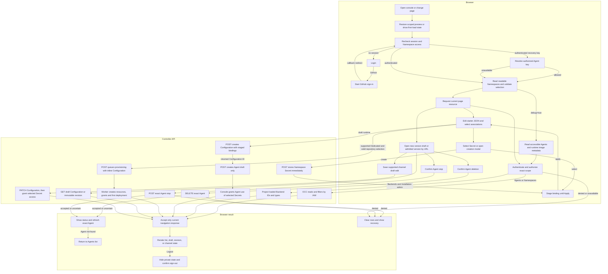

# Platform console request flow

## Overview

`/console/` renders session-authorized resources.
The [console reference](../reference/console.md) owns user-visible behavior;
API and IAM authorize access.

## Entry Points

- Browser entry: `apps/controller/src/console/console.mjs` composes the session,
  request client, view lifetime, navigation, and shell.
- `api-client.mjs` owns cancellation and session expiry; `view-lifetime.mjs`
  owns generation and abort state; `navigation.mjs` owns return paths and history;
  `shell.mjs` owns navigation and collections.
- `agents/{list,create,detail}.mjs` own Agent views;
  `channels/{slack,shared-ui}.mjs` own Slack editing. `agents.mjs` and
  `channels.mjs` compose them.
- HTTP: `apps/controller/src/index.ts:createFastifyApp`.
- Startup: `apps/controller/src/composition/production.ts:composeProduction`
  and `development-postgres.ts:composePostgresDevelopment`.
- Requires a bootstrapped Installation, provisioned account, selected IAM Driver,
  same-origin controller, and the [API permissions](../reference/api.md)
  for each read or mutation.

## Flow

## Execution Trace

### 1. Compose discovery metadata and serve public assets

`apps/controller/src/composition/production.ts:composeProduction`

`apps/controller/src/composition/development-postgres.ts:composePostgresDevelopment`

Startup passes safe Backend `{id,type}` summaries to `createFastifyApp`.
[Backend-managed delivery](service-account-driver-credential-delivery.md) owns
Driver activation. Requests do not reread configuration or credentials.

`apps/controller/src/console-assets.ts:readConsoleAsset` serves allowlisted assets
and the shared HTML shell with MIME types and same-origin CSP. Unknown console
paths return the shell with `404`; API routes retain JSON errors.
`encodedAsset` compresses static scripts and styles once (brotli or gzip, per
`Accept-Encoding`, with `Vary`). The shell, which also answers sign-in, stays identity.

`scripts/build-console-metadata.mjs` bakes the publisher's checked
`OCC_BUILD_REVISION` into HTML. With `debug=true`, `shell.mjs:renderShell` displays
the full commit; invalid or absent metadata remains unknown.

`runtime-images.mjs:renderRuntimeImages` issues at most three concurrent reads for
readable Agents in the selected Namespace.
`packages/occ/src/index.ts:OpenClawController.getAgentRuntimeImages` authorizes
exact Agent read, resolves its active revision, then calls its Compute Driver.
The [Compute contract](../reference/drivers/compute.md) owns workload inspection
and Enterprise/OpenClaw provenance. Navigation preserves `debug=true`; removing it
stops reads. Missing provenance stays explicit.

### 2. Resolve the session before private reads

`apps/controller/src/console/console.mjs:loadPage`

`loadPage` starts a request generation with `GET /api/auth/session`. Opening an Agent
from the list immediately shows **Loading agent details…** and **Back to Agents**.
Access checks finish before the Agent’s name, actions, and overview appear together.
Other ways into an Agent keep the shown page until then; a fresh load shows loading after 400 ms.
Going back cancels the read and returns to the list; a second press does
nothing. A refocus during that read keeps this page. Other first visits and
Refresh show loading after 250 ms. A held page keeps its own navigation and header.
A page held for another page keeps its Namespace selector disabled.
A return to a retained view or a refocus keeps the shown page inert and says
**Still checking…** after one second. The Console retains up to 16 views by route,
Namespace, and session owner, excluding passwords and discovery
state. An interrupted return keeps its view; an interrupted Refresh discards it.

`apps/controller/src/console/api-client.mjs:createApiClient` keeps its composed
abort signal through JSON and text body consumption. After headers arrive,
cancellation retains the signal's reason and socket failures reach the caller's
interrupted-read recovery. Only JSON syntax failures become invalid-response
errors; a failed body never causes an automatic replay.

Completed views retain DOM, handlers, and draft callbacks. On return, `loadPage`
checks GET dependencies and user identity. A match remounts the view with expanded
debug details. Changed data or the first readable Namespace for a view without a
selection rebuilds it; Refresh always rebuilds.
Pending or failed reads, password input, and mutations prevent reuse; read-only
catalog and diagnostic POSTs do not.

A changed user or session key clears retained views and drafts before further
private reads. Missing sessions open login; failed reads offer Retry.
The [console sign-in flow](platform-console/sign-in-return.md) covers provider
discovery, one-use session binding, and requested destination recovery.

`apps/controller/src/auth/index.ts:requireTrustedBrowserOrigin` checks Origin
before sign-in/out, even for SDK calls bypassing Better Auth middleware; headerless
CLI requests remain supported. The browser stores no credentials.

After authentication, `loadPage` reads `GET /namespaces`, preserving URL
selection or choosing the first ready/readable Namespace. Unreadable IDs stay
unavailable; selection never becomes an API query selector.

`shell.mjs:namespaceSelector` disables and hides choices through session and
Namespace checks, naming a known selection; retained-view reads do not extend this.
`shell.mjs:createShell` listens for the 760px mobile breakpoint; widening closes
the drawer without focusing its hidden toggle and releases `main.inert`.
Empty lists show access guidance. `navigation.mjs:navigate` returns Agent detail/creation
to Agents; global pages remain open; recovered warnings disappear.

### 3. Authorize the selected page resource

`apps/controller/src/index.ts:perform`, `requireInstallationAdmin`

`packages/occ/src/index.ts:OpenClawController.listNamespaces`, `listAgents`

Agents use the selected Namespace's route. OCC authorizes Namespace reads and
filters Agents by exact read permission; Namespace listing filters its
Installation-wide collection. No readable selection means no Agent request.
`GET /backends` ignores selection and requires Installation `administer` before
returning safe startup summaries. Empty configuration returns an empty list;
missing wiring or failed dependencies return errors.

Agents and Create Agent read Namespace permissions before rendering. If `agents.create`
is false, both explain the restriction. If the read fails, creation stays available;
the API authorizes every create. Changing Provider or Harness resets incompatible
credentials and model choices, preserving unrelated JSON. See
[Agent creation](../reference/console/create-and-deploy.md) for inputs and recovery.

`agents/plugin-fields.mjs:createPluginFields` edits Agent `plugins` separately
from Configuration. Invalid JSON and untouched fields survive; clearing overrides
restores inheritance. Submission, uncertain outcomes, or invalid JSON lock editing.
`capabilities.pluginPolicies` gates policy edits; unsupported reviewers remain clearable.
The picker keeps a compact credential/access reminder beside an expandable
**Access and credential setup** disclosure. Its bounded instructions, list, and
details scroll within the dialog while search and pagination remain reachable.
While mounted, Available and Configured retain separate selected plugins, queries,
tool filters, and expanded rows without fetching pages or changing drafts.
Removed selections clear their details; discovery resets clear both tabs.

`create.mjs:loadPluginCatalog` and `loadPluginTools` implement
[PAT discovery](agent-plugins.md#credential-scoped-discovery): the selected or
Preset Secret takes precedence over an entered token. OCC reads the
Secret server-side. Pagination is upstream; filtering is local. Selecting a plugin loads tools.
Credential, provider, and Harness changes clear results and invalidate pending reads.

`create.mjs:MODEL_CHOICES` supplies unauthenticated static lists and manual entry.
`renderAgentForm` toggles `manualModel`, invoking `updateModelConfiguration` and
`updateControls`. Manual mode preserves `model.value` and clears the dropdown.
`resetModelChoices` restores the current provider's list, including Configuration
JSON changes, retaining only listed models; otherwise both inputs clear.
Provider/authentication changes retain no model. Submission matches the primary
Configuration model to `model.value`. `updateControls` sets the button label,
visibility, and required input; the toggle moves focus. Returning preserves credentials and unrelated
Configuration; saved-Configuration and pending-request locks govern both directions.

`configurationTemplate` enables Control UI with loopback origins on port 18789.
Compute supplies gateway authentication; Presets replace the starter unchanged.
[Native admin access](agent-native-admin.md) owns HTTPS isolation.

`createRepositoryFields` loads `GET /namespaces/:namespaceId/agents/repository-options`,
then requests optional descriptions for visible refs. [Repository admission](agent-repository-credentials.md) resolves the
submitted `repositoryAccess`. Retained drafts keep selections through failed
discovery; retries recheck current policy. Only `503 REPOSITORY_OPTIONS_UNAVAILABLE`
permits creation without bindings, and only without retained selections; other
failures block submission.

Supported Dedicated runtimes submit inline Configuration, optional repository
access, and Secret references to [provisioning](agent-provisioning.md), even after
that outage. The worker reauthorizes, creates resources and exact Secret grants,
and deploys; Console polls, then opens the revision.

Ordinary drafts post `{kind: "agent", values, secretBindings}` to
`POST /namespaces/:namespaceId/configurations`, then submit its ID, plugins,
`initialWorkspaceFiles`, and `workspaceDefaultsId` to
`POST /namespaces/:namespaceId/agents`. Success opens `revision=draft`.
OCC stages all four workspace textareas, including unchanged/empty values, outside
Agent/Configuration for [workspace setup](workspace-files.md).

`create.mjs:grantConfigurationSecretAccess` grants exact Secret `operate` for final
same-Namespace `env` bindings. Failure retains the Agent; **Retry credential access**
rereads grants without duplication. Failed Agent writes retain Configuration ID
and lock JSON/Harness for explicit reuse. Writes never retry automatically; drafts
admit no revision and start no runtime.

`agents/harness-auth.mjs` edits bindings and shows
[Secret identities](platform-console/agent-editing.md#4-render-draft-revision-or-channels),
never values. Authentication source uses the shared form-field presentation;
issued-account lookup feedback stays inside its conditionally visible account field.
Switching methods hides that feedback without changing the lookup or saved choice.

### 4–6. Edit the Agent and access runtime files

[Agent editing](platform-console/agent-editing.md) traces revision rendering,
channels, credentials, workspace files, stopping, and deletion;
[Agent sharing](platform-console/agent-sharing.md) traces policy writes.
Responses follow the ordering checks below.

`channels/slack.mjs:supportSlack` rejects shapes the editor cannot preserve;
`updatedSlack` preserves untouched policies and reply overrides. The
[editing flow](platform-console/agent-editing.md#4-render-draft-revision-or-channels)
owns DM policies and channel-only reply defaults. Admission snapshots native values;
Kubernetes `prepareRevision` carries them into `openclaw.json` without adding defaults.

`apps/controller/src/console/agents/detail.mjs:renderAgentDetail` registers tab
navigation with `console.mjs:loadPage`. For the same Agent, Namespace, and
revision, tab clicks/history replace only tab content; shell, native-admin panel,
and revision controls stay mounted. Configuration and revision reads are shared;
direct Workspace URLs start neither. Refresh, revision changes, and successful
channel/authentication edits reload fully. A `403` on the configuration or revision
read is an audited denial, so `console.mjs:deniedReadsFor` remembers that path in tab
`sessionStorage` for the session owner; later views show **Configuration unavailable**
without asking again, and **Retry** forgets the path and rereads. Logout clears it.

`agents/detail.mjs:renderTab` brings a clipped selected tab into the horizontal
strip without moving page focus or vertical scroll. A strip ResizeObserver repeats
this on viewport changes, disconnects for inactive or detached views, and re-arms
through the retained view's resume hook.
Completed tabs retain their DOM and draft capture callbacks within the detail view.
Returning restores loaded controls and expanded disclosures. Pending or failed
reads, password values, and mutations invalidate tab reuse. Each tab checks it
is mounted before applying a response; late reads cannot overwrite another tab.
Password values clear while [draft captures](platform-console/agent-editing.md#4-render-draft-revision-or-channels) retain edits. Channel
Secret saves update the shared draft snapshot used by other tabs and deployment
preflight.

**Open vN Logs** opens the failed revision from any version or draft. Logs reserves space;
Stop and Delete stay put. Direct navigation focuses and scrolls to the output; selecting
the tab leaves visible output in place.

[Runtime logs](agent-runtime-logs.md) explains access. A status `403` hides Pod details,
not separately authorized logs. Denials last until logout; newly granted `operate` permits
another status read. A refused log read or download clears the rows. A late success cannot
restore them or start a download. Back rebuilds a refused view; otherwise it shows the page it checked.

### 7. Commit only the current response, or clear the view

`apps/controller/src/console/console.mjs:loadPage`, `logout`

After full-page navigation settles, `loadPage` focuses the destination heading if
focus fell to the body, using `preventScroll` to preserve return position. An Agent
opened from the list focuses its heading when the title renders. Tabs and
focused controls keep focus. Navigation, Namespace changes, and logout invalidate
reads; generations reject late responses. Refocus coalesces events. Agent detail
rechecks access in place, preserving controls, input, and saves; failures clear it.
Other pages revalidate before reuse, a shown 403 or 404 included; forms defer refocus. Draft save baselines and
Namespace scopes stay separate.

Authorization and dependency failures clear affected content and expose recovery;
a current protected `401` clears all private state. `pagehide` clears
private DOM, previews, and drafts even for BFCache; persisted `pageshow` performs
a fresh load. Failure views show local reasons and bounded request IDs, never
backend error text. Backend authorization denial clears every retained preview,
including other Namespace selections, because the permission is Installation-wide.

The [detail action flow](platform-console/agent-editing.md#stop-agent) traces
confirmed Stop and Delete requests and permissions. Acceptance
is not completed shutdown or deletion. Uncertain outcomes block replay until
readback; only confirmed absence returns to Agents. Deployment resumes
a stopped Agent through a new revision. The [Agent reference](../reference/agents.md#deletion)
owns asynchronous cleanup.

Logout first hides private state, then calls the sign-out endpoint.
Confirmed success or session inspection proving absence replaces history with
login. An unconfirmed logout stays blocked with Retry. The
[authentication flow](local-password-authentication.md) owns server revocation;
this client never infers it from a network error.

## Deploy the new revision

The **Create new version** draft exposes **Deploy new version**.
**Operator-managed credentials** persist `{ "method": "runtime" }` and bypass
managed credential setup in Console; OCC does not validate host credentials.
Deployment checks the Agent, Configuration association, and generation, then sends
bodyless
`POST /namespaces/:namespaceId/agents/:agentId/deploy`. The server authorizes
and admits the revision. Its read-only details open while **Deployment
activity** follows the latest visible deployment. Workspace reads check gateway
startup and file availability. An uncertain response disables replay until
refresh and inspection.

## Debugging and Verification

- Match the displayed request ID to controller logs.
  A Namespace-only user cannot discover Backends; check Installation authority
  before treating that denial as a configuration problem.
- Browser suites use real Fastify, Better Auth, Native IAM, and in-memory storage.
  They verify navigation, isolation, creation, draft/history/channel editing, and
  authentication, not PostgreSQL persistence, Backend health, runtime dispatch,
  worker leases, or Compute effects.
- API tests cover safe discovery, permission boundaries, empty versus missing
  wiring, static MIME/allowlisting, and unchanged API JSON errors. See
  [Testing](../testing/README.md) for commands and the image smoke boundary.

## Related docs

- [Console reference](../reference/console.md)
- [Authentication](../reference/authentication.md)
- [Backend-managed credential delivery](service-account-driver-credential-delivery.md)
- [Configuration and Agent revision](configuration-driver.md)
- [Docker development](docker-compose-development.md)
- [Production startup](production-startup.md)

## Manual Notes

[keep this for the user to add notes. do not change between edits]

## Changelog

- 2026-10-16 18:30: Forget denials at logout, clear refused logs or Pod status, and show the page Back checked. (lows-1016o / log-refusal-followup - 1fb2170)
- 2026-10-16 16:40: Open a Logs URL at its output; reuse a member's Agent view on Back; keep the startup status to 400 ms. (ui-jank-code-11)
- 2026-10-16 14:45: Keep the startup status on a fresh Agent load until the overview reveals; leave tab moves to a full load until then. (lows-1016k)

[Platform console request documentation history](platform-console/history.md) preserves the older dated entries.
