# Platform console request flow

## Overview

[Console reference](../reference/console.md).

## Entry Points

- Browser entry: `apps/controller/src/console/console.mjs` composes the session,
  request client, view lifetime, navigation, and shell.
- HTTP: `apps/controller/src/index.ts:createFastifyApp`.
- Startup: `apps/controller/src/composition/production.ts:composeProduction`
  and `development-postgres.ts:composePostgresDevelopment`.
- Requires a bootstrapped Installation, provisioned account, selected IAM Driver,
  same-origin controller, and the [API permissions](../reference/api.md)
  for each read or mutation.

## Flow

```mermaid
graph TD
  THEME["API startup loads optional theme bundle"] -->|valid snapshot| ASSET["Serve branded HTML, CSS and images"]
  THEME -->|invalid| FAIL["Refuse API startup"]
  ASSET --> A
  subgraph Browser["Browser"]
    A["Open console or change page"] --> B["Restore scoped preview or show first-load state"]
    B --> B1["Recheck session and Namespace access"]
    B1 -->|no session| C["Login"]
    C -->|OIDC/Google| C1["External sign-in"]
    B1 -->|authenticated recovery key| NR["Resolve authorized Agent key"]
    NR -->|allowed| D
    NR -->|unavailable| D
    C1 -->|callback redirect| B1
    B1 -->|authenticated| D["Read readable Namespaces and validate selection"]
    D -->|Debug mode enabled| DBG["Read accessible Agents and runtime image metadata"]
    DBG --> F
    D --> E["Request current page resource"]
    E --> NC["Create Namespace"]
    E --> ND["Confirm deletion"]
    E --> SEC["Manage Namespace Secret metadata and values"]
    E --> E1["Edit starter JSON and select associations"]
    E1 --> S1["Select Secret or open creation modal"]
    S1 -->|select| S3["Stage binding until Apply"]
    S3 -->|apply| E1
    E --> E2["Open new version draft or admitted version by URL"]
    E2 --> E3["Save supported channel draft edit"]
    E2 --> E4["Confirm Agent deletion"]
    E2 --> E5["Confirm Agent stop"]
  end
  subgraph Controller["Controller API"]
    ND --> NDELETE["Authorize DELETE; check contents"]
    E --> F["Authenticate and authorize exact scope"]
    F -->|Agents or Namespaces| G["OCC reads and filters by IAM"]
    F -->|Backends and Installation admin| H["Project loaded Backend IDs and types"]
    NC --> NPOST["POST authorizes, persists and queues provisioning"]
    S1 -->|create| S2["POST stores Namespace Secret immediately"]
    S2 --> S3
    SEC --> SAPI["Authorize Secret list, read, create, replace or delete"]
    SAPI -->|metadata or confirmed mutation| I
    SAPI -->|unconfirmed write| SU["Erase input and block resubmission"]
    SU -->|manual inspection| SEC
    E1 -->|draft runtime| M1["POST creates Configuration with staged bindings"]
    E1 -->|supported Dedicated and valid repository selection| M3["POST queues provisioning with inline Configuration"]
    M3 --> M4["Worker creates resources, grants and first deployment"]
    M1 -->|returned Configuration ID| M["POST creates Agent draft only"]
    M --> M2["Console grants Agent use of selected Secrets"]
    E2 --> N["GET draft Configuration or Agent revision"]
    E3 --> O["PATCH Configuration, then grant selected Secret access"]
    E4 --> P["DELETE exact Agent"]
    E5 --> P2["POST exact Agent stop"]
  end
  subgraph Result["Browser result"]
    NDELETE -->|nonempty| NB["Show blockers and cleanup links"]
    NDELETE -->|accepted| NP["Poll Namespace until removed"]
    NDELETE -->|uncertain| NRD["Require status refresh before retry"]
    G --> I["Accept only current navigation response"]
    H --> I
    NPOST -->|201| NSUCCESS["Creation accepted"]
    NPOST -->|unconfirmed| NUNKNOWN["Inspect before retry"]
    NPOST -->|refused| K
    NUNKNOWN --> D
    NSUCCESS --> D
    M2 --> I
    M4 --> I
    N --> I
    O --> I
    P -->|accepted or uncertain| Q["Show status and refresh exact Agent"]
    P2 -->|accepted or uncertain| Q
    P2 -->|denied| K
    P -->|denied| K
    Q -->|Agent not found| R["Return to Agents list"]
    I --> J["Render list, draft, Agent revision, or channel state"]
    F -->|denied or unavailable| K["Clear rows and show recovery"]
    J -->|Logout| L["Hide private state and confirm sign-out"]
  end
```

## Execution Trace

### 1. Compose discovery metadata and serve public assets

`apps/controller/src/api-startup.ts:startApi` loads the [theme bundle](../reference/console/theming.md) once. Invalid bundles stop startup;
ConfigMap links stay inside the bundle. `renderConsoleThemeShell` escapes branding;
`console/shell.mts:brandContents` renders names as text. `/console/theme/` serves
images and generated CSS with `no-store`; missing assets return 404.

Startup passes Backend `{id,type}` to `createFastifyApp`.
[Backend-managed delivery](service-account-driver-credential-delivery.md) owns activation.

`apps/controller/src/console-assets.ts:readConsoleAsset` serves allowlisted HTML and assets with MIME types and same-origin CSP. Unknown paths return HTML 404s; API errors stay JSON. `encodedAsset` caches brotli/gzip output
according to `Accept-Encoding` and `Vary`; higher-weight `identity` wins.
HTML, including sign-in, stays uncompressed.

`scripts/build-console-metadata.mjs` stamps `OCC_BUILD_REVISION` into HTML.
`internal/occdev/openshell_k3d.go:importDevelopmentController` resolves Git `HEAD`
and runs the engine directly for cancellation and timing. Missing metadata
stops builds; the SHA excludes uncommitted edits.
`shell.mts:renderShell` displays it in Debug mode.

`console.mts:readDebugPreference` enables diagnostics only for local-storage
`oce.console.debug=true`. Storage failures default to off. `settingsView` saves,
clears retained views, and rebuilds the shell; failures show an error.
`navigation.mts` removes the old query flag.

`runtime-images.mts:renderRuntimeImages` allows three concurrent reads in the
selected Namespace. `packages/occ/src/agent-runtime-observations.ts:AgentRuntimeObservations.getAgentRuntimeImages`
checks Agent read and calls the active revision's Compute Driver.
Disabling Debug mode stops new reads. See the
[Compute contract](../reference/drivers/compute.md).

### 2. Resolve the session before private reads

`agents/collection.mts:renderAgentList` focuses the Agent link on plain row clicks.
Interactive targets, modified clicks and selected text retain behavior. Search
arrows visit visible names. Enter opens the sole match for a nonempty query.

On return to focused **Search Agents**, a 5xx without `Retry-After` hides rows
and focuses **Retry**. Enter retries. Success restores focus and selection if
account, route and query match and focus stayed put. Background success waits
for a successful foreground check.

`loadPage` reads `GET /api/auth/session`. Opening an Agent shows **Loading agent
details…** and **Back to Agents**. Back cancels once. Refocus waits. Other Agent routes delay loading
400 ms, other visits and Refresh 250 ms. Loading stays visible at least 300 ms.

Within a Namespace, return and refocus keep views inert. **Still checking…**
appears after one second. Up to 16 views retain drafts and disclosures by
route, Namespace and session. Changed reads, newly readable Namespaces and
Refresh rebuild. Cancelled returns preserve views. Cancelled Refresh
discards them. Discovery, passwords, mutations and pending or failed
reads prevent reuse. Read-only POSTs permit it.

In unchanged drafts, Back and Forward can refocus **Configuration**,
**Edit Configuration** or **Configuration JSON** unless you moved focus.
Refocusing the editor also restores its scroll position.
**Open Configuration draft** focuses the tab.

`console.mts:revalidateMountedAgent` checks session, Namespace, Agent, and detail
reads. Focus and visibility share checks. Navigation cancels it. Detail errors
hide protected content. A 5xx permits one retry unless refusal, 429 or delay
precedes it. Narrowed access rebuilds. Reused and replacement views require
confirmed Agent permissions for grant-dependent controls.

Persistent errors warn with the confirmed Agent name. **Retry** starts foreground
admission after the latest deadline. Expiry opens sign-in. Refusals remove private
content.

`api-client.mts:createApiClient` preserves abort and socket failures through
response bodies without replay.

**Back to Agents** awaits admission and rows for newest readable versions.
`agents/collection.mts:currentRevision` reads versions off-page. `deniedReadsFor`
retains 403s. Reused deployment cells show **Reading deployment…** after 250 ms
for at least 150 ms and regain focus. Pending or failed reads resume. Search
cancels hidden reads (`collection.mts:retireHidden`). Redisplayed rows read once.

Changed users or session keys clear private state. Missing sessions
[open sign-in](platform-console/sign-in-return.md).

`GET /namespaces` selects the URL Namespace or first ready, readable Namespace.
Unreadable IDs stay unavailable. Unscoped Agent URLs require matching requested
Agent and selected or probed Namespace IDs plus a nonempty Configuration ID.
Malformed replies cannot establish absence. Back restarts interrupted lookups.
`shell.mts:namespaceSelector` hides choices during admission. Widening past 760 px
closes the drawer without focusing its toggle. An open drawer blocks scrolling.
`createShell` preserves navigation presses across renders. Switching Namespaces
from Agent details or creation opens **Agents**. Agent details disappear
immediately. Visible rows retain their Namespace label.

### 3. Authorize the selected page resource

`apps/controller/src/index.ts:perform`, `requireInstallationAdmin`

`packages/occ/src/namespace-operations.ts:listNamespaces`, `packages/occ/src/agent-queries.ts:listAgents`

Agent, Secret and Source requests use the selected readable Namespace; OCC filters exact reads.
`GET /backends` requires Installation `administer`; missing wiring or dependencies return errors.
The [Credential Source flow](platform-console/credential-sources.md) traces discovery and registration.

[`secrets.mts:renderSecrets`](../guides/console/secrets.md) lists metadata.
Actions read `consumers` and advisory `callerPermissions`. Only readable Agents
show names. References disable Delete. The server rechecks.
`console.mts:takeLinkedSecret` retains linked IDs until shown. Creation and
replacement require Namespace readiness. Tracked writes use the Secret API.

After revalidation or Back, `console.mts:loadPage` restores scoped, session-owned
Namespace and Secret searches, filtering readable names and IDs locally.
`focusInShownView` restores selection or row focus by ID unless focus moved.
Missing Secrets refocus search. Back reveals the opened Namespace. Back from an
Agent consumer revalidates, restores scroll, and focuses the visible Secret row
by key (Credentials heading if absent), unless focus moved. **Refresh** clears search.

`secrets.mts:editValue` masks input, preserves whitespace (CRLF to LF), and
clears input after request, dismissal, or retention (`console.mts:clearPasswordInputs`).
Pending requests block navigation and dismissal. Denial disables submission.
The dialog cannot replay unconfirmed writes. `secrets.mts:confirmDelete` offers
an exact status read after uncertain deletion. Denial never confirms removal.
Replacement requires explicit Agent deployment or CredentialSource
update under the [Secret delivery contract](../reference/drivers/kubernetes-secret.md#update-and-redeploy).

[`namespaces.mts:renderNamespaces`](../guides/console/create-namespace.md) validates names.
`OpenClawController.createNamespace` authorizes `POST /namespaces` and queues
provisioning. `perform` audits. After 201, `namespaces.mts:confirmCreation`
keeps **Done** available. Exact list membership adds **Open Agents**.
Omission or denial leaves only **Done**. Inconclusive reads allow another GET.
Closing refocuses the opener. Create 403 disables creation account-wide until Refresh.

`namespace-deletion.mts` blocks navigation and dismissal during writes. OCC
rechecks IAM and contents (20 blocker IDs per kind). After 202, polling runs
every three seconds. A 404 removes the row and repairs selection. If the focused
search toolbar disappears, the result receives focus. A 403 signals lost access.
`readStatus` requires the exact ID and scalar [NamespaceSchema status](../../packages/contracts/src/api/resources.ts).
Failed or invalid reads close confirmation. For **Status unknown**,
[**Refresh status**](../guides/console/delete-namespace.md) restores confirmed actions.

Agents, Secrets and Create Agent read Namespace permissions. False `agents.create` or an Agent-refusing
[Namespace status](../reference/namespaces.md#lifecycle) explains why, rechecking on return; failed reads keep creation open.
Refused `GET /installation` saves only drafts. `agents/collection.mts` polls provisioning Namespaces;
omission disables Create (`NAMESPACE_MISSING`), clears rows and feedback, closes
confirmations, and ends polling. Its note replaces empty states. Late outcomes are
generic, without replay; 401 expires the session. Focus: Search. Failed reads retry.

See [Agent setup and provisioning](platform-console/agent-creation.md).

### 4–6. Edit the Agent and access runtime files

[Agent editing](platform-console/agent-editing.md) traces version rendering,
channels and credentials; [workspace files](platform-console/agent-workspace-files.md) and
[stop and deletion](platform-console/agent-stop-and-deletion.md) trace those operations;
[Agent sharing](platform-console/agent-sharing.md) traces policy writes.

`channels/slack.mjs:supportSlack` rejects shapes the editor cannot preserve. The
[editing flow](platform-console/agent-editing.md#4-render-draft-revision-or-channels)
owns DM policies and channel-only reply defaults. Admission snapshots native values;
Kubernetes `prepareRevision` carries them into `openclaw.json` without adding defaults.

`apps/controller/src/console/agents/detail.mts:renderAgentDetail` registers tabs
with `console.mjs:loadPage`. Within one Agent, Namespace and version, tabs replace
content; shell, native-admin and version controls remain mounted. Configuration
and revision reads are shared; direct Workspace URLs start neither. Refresh,
version changes and successful channel/authentication edits reload fully.
`console.mjs:deniedReadsFor` remembers audited Configuration/revision `403` paths
in owner-scoped tab `sessionStorage`. Later views show **Configuration unavailable**
without rereading; **Retry** forgets and rereads. Logout clears denials.

`agents/detail.mts:renderTab` reveals clipped tabs horizontally without changing
focus or vertical scroll. Its ResizeObserver repeats on resize, disconnects for
inactive/detached views, and re-arms on resume.
Tabs retain DOM/drafts except during pending/failed reads, passwords or mutations;
unmounted responses are ignored.
[Draft captures](platform-console/agent-editing.md#4-render-draft-revision-or-channels)
exclude passwords. Secret saves update the shared snapshot.
`agents/detail.mts:boundSecretsDenied` reuses Deploy's authorized names.
Configuration excludes Harness-only Secrets; Plugins/Credentials include them.
Epochs fence publication; rechecks clear names and refresh authorized reads.
Deploy keeps its last Secret operate answer until the refreshed one lands.
Late names preserve state/focus; metadata failures keep IDs; unknown grants stay generic.

[Save handling](platform-console/agent-editing.md#5-save-authentication-and-deploy-the-first-version)
owns receipts and draft retirement.

Recovery normally offers **Open vN Logs** for the failed version. If the
Console skips log text, operators see **View vN runtime status in Logs**
on every visit while status remains available. Status denial hides only
that version’s status link. An unreadable version or a server refusal of
log text hides both links. Neither link needs an extra read.
Recovery focuses and scrolls to Logs, smoothly unless rebuilding or motion is reduced.
Direct navigation focuses and scrolls to output. Tab selection preserves it. Stop and Delete stay put.

[Runtime logs](agent-runtime-logs.md) explains access and row handling.
`readLogs: false` skips the audited text read. Refresh and sign-out clear remembered denials.
Status `403` hides Pods but preserves authorized logs. Newly granted `operate` permits one retry.
Revoking readable text triggers a fresh status check. Back rebuilds refused
views. Rate notices update without rereading.

### 7. Commit only the current response, or clear the view

`apps/controller/src/console/console.mts:loadPage`, `logout`

`loadPage` moves body focus to headings without scrolling, including list → Agent.
Arrow keys navigate tabs within one Tab stop. If repository edits block Back or
Forward, `loadPage` restores the URL and focuses the explanation unless interrupted.
Navigation, Namespace changes and logout invalidate reads by generation. Refocus events coalesce.
`revalidateMountedAgent` rereads session, Namespace, Agent, version and
[permissions](platform-console/agent-stop-and-deletion.md#stop-agent).

After admission, `apps/controller/src/console/agents/detail.mts:syncHarnessRead`
rechecks the same dedicated Sandbox if the Agent remains active with desired
state `running`. It also rechecks once per newer failed dedicated replacement,
including on entry. Only the latest answer updates status.
Older foreground 401/403/404 responses still retire protected details.
Lifecycle changes cancel reads and clear status before version lookup.
Rechecks retain same-version loss warnings and guidance. Mismatched or
unavailable answers show unknown. No request tests live serving.

Unchanged access preserves controls, input and saves. Repeated draft 403s preserve
partial Agents with never-readable drafts. Checks skip known unreadable versions.
Access loss clears protected views. Other pages revalidate before reuse, including
403s and 404s. Forms defer checks. Unchanged views can restore control focus.
If **Still checking…** succeeds in the background, the Configuration editor keeps its selection.
The next successful foreground check can refocus it unless focus or selection changed. Draft save baselines stay Namespace-scoped.

Other admission failures clear affected content. A current protected `401` clears
all private state. `pagehide` clears private DOM, previews and drafts, including
BFCache. Persisted `pageshow` reloads. Failure views show local reasons and
`req_<UUID>` IDs. Backend text is limited to API-explained refusals,
including field/rule errors (400) and typed conflicts (409).
Installation-wide backend authorization denial clears previews across Namespaces.

The [detail action flow](platform-console/agent-stop-and-deletion.md#stop-agent) traces
acceptance, uncertainty, and replay guards. `agents/deletion.mts:refreshStatus` owns polling: 404 returns to Agents;
Postacceptance 403 stops polling without claiming completion.
See [asynchronous cleanup](../reference/agents.md#deletion).

Logout first hides private state, then calls the sign-out endpoint.
Confirmed success or session inspection proving absence replaces history with
login. An unconfirmed logout stays blocked with Retry. The
[authentication flow](local-password-authentication.md) owns server revocation;
this client never infers it from a network error.

## Deploy the new version

**Deploy new version** on the **Create new version** draft sends bodyless
`POST /namespaces/:namespaceId/agents/:agentId/deploy` after the checks and
uncertain-response handling that [Agent editing](platform-console/agent-editing.md#4-render-draft-revision-or-channels) traces.
**Operator-managed credentials** (`{ "method": "runtime" }`) skip managed setup; OCC
does not validate host credentials. The server saves the version; its read-only
details open while **Deployment activity** follows it. Workspace reads check
gateway startup and file availability.

## Debugging and Verification

- Match request IDs to Controller logs. For Backend discovery denial, check
  Installation authority.
- Browser suites verify navigation, isolation, creation, editing, and sign-in
  with Fastify, Better Auth, Native IAM, and in-memory storage. PostgreSQL
  persistence, Backend health, runtime dispatch, worker leases, and Compute
  effects need runtime tests.
- `node --test tests/browser/console-secrets.test.ts` covers Secret writes, Agent
  references, denials, and lost replies with passive test storage. The
  [`console-secrets` QA scenario](../testing/ci/qa-advisory.md) exercises shipped
  storage with runtime and credential setup.
- API tests cover discovery, permissions, wiring, static MIME and allowlisting,
  and JSON errors. See [Testing](../testing/README.md) for commands and image smoke coverage.

## Related docs

- [Namespaces](../reference/namespaces.md)
- [Authentication](../reference/authentication.md)

## Manual Notes

[keep this for the user to add notes. do not change between edits]

## Changelog

- 2026-11-25 21:19: Blocked repository navigation. (authoring-run/dadb5e9f-d65b-4fae-8fe3-20232e7d6f5c - 2fece6e5c56d39aa228648a166e4d4e6cbc664e9)
- 2026-11-25 11:30: Trace Namespace Source discovery and write-only registration in Console. (authoring-run/b55a110d-b732-438a-9cbf-aa5480016db9 - 105ffee9962176cf42fc7cfe013b8b94831435db)

- 2026-11-25 08:48: Trace runtime status on return to Logs. (authoring-run/dfe9b6d4-0759-4dc0-8ad6-0df4fe70c747 - 1238aef6d77aa4544bfabfd80215ef1ea7414f2d)

- 2026-11-25 02:20: Trace failed replacement refresh. (authoring-run/edcfef1d-bfa1-402e-bb5b-bf1e12d2fe12 - cdd3ab41242cce4734163c6edc4abe115fd90f83)

- 2026-11-24 10:55: Trace Secret consumer return. (authoring-run/98a91bb0-a61e-44aa-99a8-48df79e1e388 - acd247bba5b03788840efc5f0d1dda7b7fe0c63d)

- 2026-11-22 11:39: Trace Namespace cleanup and keyboard focus. (authoring-run/7befa996-8a20-4b54-9c7c-5d7d18dd0095 - 5768ebdac724be812904dba59ae1c31f749f6bec)

- 2026-11-22 11:28: Clarify Namespace list results. (authoring-run/d86bdf09-8b77-410f-8646-4feb7a9071cf - 5aa97a22d8d7d1ed8ca31a18d9892ad0313e24c6)

- 2026-11-22 11:22: Trace Namespace search and return focus. (authoring-run/25d72135-b5b4-456b-a1c3-25c6dfee5cb1 - d687874b7213584ff916a22cdfccdce48bfe1fc8)

- 2026-11-22 11:17: Trace Secrets search restoration. (authoring-run/6a1f921d-e68d-4ad9-a9b0-733f9344099e - b4bf1f79813c391977b4f58eb92e5241a8eaa8b8)

- 2026-11-22 11:16: Trace the read after Namespace creation. (authoring-run/4f0bae81-577e-4c6c-b34e-daa95bc82a3c - ad54d29adb562767e830020c504302479159c578)

- 2026-11-22 08:59: Trace keyboard search. (authoring-run/d7fa729b-2fe9-40b9-be53-eb2e0051e95c - f3996c521e94d8bf18ff9018069c699dda6913c6)

- 2026-11-22 02:59: Refresh the active Sandbox observation on Agent refocus. (authoring-run/2adc51f8-4b63-4436-af89-e2e8c4bb112b - 72a9006ec8c4b7a6e40947d75938f1518c7da364)
- 2026-11-21 19:15: Bind lookup. (authoring-run/71c8077a-06c3-42e4-9baf-a6bed016ab3d - e263cecbf94cb066d7c1b7879c57f47906ad495b)

[Platform console request documentation history](platform-console/history.md) preserves the older dated entries.
