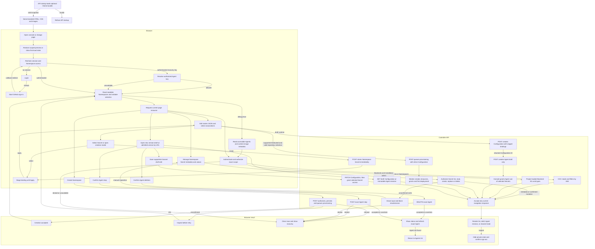

# Platform console request flow

## Overview

`/console/` renders session-authorized resources.
The [console reference](../reference/console.md) owns user-visible behavior.

## Entry Points

- Browser entry: `apps/controller/src/console/console.mjs` composes the session,
  request client, view lifetime, navigation, and shell.
- HTTP: `apps/controller/src/index.ts:createFastifyApp`.
- Startup: `apps/controller/src/composition/production.ts:composeProduction`
  and `development-postgres.ts:composePostgresDevelopment`.
- Requires a bootstrapped Installation, provisioned account, selected IAM Driver,
  same-origin controller, and the [API permissions](../reference/api.md)
  for each read or mutation.

## Flow

## Execution Trace

### 1. Compose discovery metadata and serve public assets

`apps/controller/src/api-startup.mjs:startApi` loads an optional
[theme bundle](../reference/console/theming.md) once. Invalid bundles stop startup;
ConfigMap links must resolve inside the bundle. `renderConsoleThemeShell` escapes
branding and links the generated stylesheet. `console/shell.mts:brandContents`
renders the name as text. `/console/theme/` serves only referenced images and
generated CSS, returns a plain 404 for missing assets, and uses `no-store` so an
API restart can replace the theme.

`apps/controller/src/composition/production.ts:composeProduction`

`apps/controller/src/composition/development-postgres.ts:composePostgresDevelopment`

Startup passes safe Backend `{id,type}` summaries to `createFastifyApp`.
[Backend-managed delivery](service-account-driver-credential-delivery.md) owns
Driver activation. Requests do not reread configuration or credentials.

`apps/controller/src/console-assets.ts:readConsoleAsset` serves allowlisted assets
and the shared HTML shell with MIME types and same-origin CSP. Unknown console
paths return the shell with `404`; API routes retain JSON errors.
`encodedAsset` compresses static scripts and styles once (brotli or gzip, per
`Accept-Encoding`, with `Vary`), unless an explicit `identity` weight beats both
encodings. The shell, which also answers sign-in, stays identity.

`scripts/build-console-metadata.mjs` bakes the publisher's checked
`OCC_BUILD_REVISION` into HTML. With `debug=true`, `shell.mts:renderShell` displays
the full commit; invalid or absent metadata remains unknown.

`runtime-images.mts:renderRuntimeImages` issues at most three concurrent reads for
readable Agents in the selected Namespace.
`packages/occ/src/index.ts:OpenClawController.getAgentRuntimeImages` authorizes
exact Agent read, resolves its selected version, then calls its Compute Driver.
The [Compute contract](../reference/drivers/compute.md) owns workload inspection
and Enterprise/OpenClaw provenance. Navigation preserves `debug=true`; removing it
stops reads. Missing provenance stays explicit.

### 2. Resolve the session before private reads

`apps/controller/src/console/console.mjs:loadPage`

`agents/collection.mts:renderAgentList` forwards plain clicks on row content to
its Agent-name link. It ignores links, buttons (including disabled buttons),
modified clicks, and selected text. Focusing the name before activation preserves
the same return-focus target. Keyboard users activate the existing name link.

`loadPage` starts with `GET /api/auth/session`. Opening an Agent from the list
immediately shows **Loading agent details…** and **Back to Agents**. Its name,
actions, and overview appear together after access checks. Back cancels the read;
a second Back does nothing, and refocusing does not interrupt it. Other routes to
an Agent keep the current page, or show loading after 400 ms on a fresh load.
Once visible, loading stays at least 300 ms (`loadingMinimumMs`).

Other first visits and Refresh show loading after 250 ms. A return or refocus
keeps the current page inert, with its own header and disabled Namespace selector;
after one second it says **Still checking…**. The Console retains up to 16 views
by route, Namespace, and session owner, excluding passwords and discovery state.
An interrupted return preserves the view; an interrupted Refresh discards it.

`apps/controller/src/console/api-client.mts:createApiClient` keeps the abort signal
through the response body. Cancellation preserves its reason; a socket failure is an interrupted read,
not invalid JSON. Neither replays the request.

On return, `loadPage` checks the user and retained GET dependencies. A match
restores the DOM, handlers, drafts, and expanded debug details. Changed data,
a newly readable Namespace, or Refresh rebuilds the view. Pending or failed
reads, password input, and mutations prevent reuse; read-only catalog and diagnostic POSTs do not.

**Back to Agents:** session, Namespace, permission, and collection checks gate the
list, not row reads. Each row's newest readable revisions page feeds its deployment
and `agents/collection.mts:currentRevision`, which reads an off-page current version alone;
`deniedReadsFor` keeps a `403`. On reuse, `renderAgentList` sets visible deployment
cells to **Reading deployment…**, hidden 250 ms, then kept at least 150 ms, before paint, then shows
each fresh result or refusal. Back or refocus from a deployment focuses that cell,
not the old version's link. Unfinished or failed row reads never prevent reuse; resuming rereads them.

A changed user or session key clears retained views and drafts before further
private reads. Missing sessions open login; failed reads offer Retry.
The [console sign-in flow](platform-console/sign-in-return.md) covers provider
discovery, one-use session binding, and requested destination recovery.

`apps/controller/src/auth/index.ts:requireTrustedBrowserOrigin` checks Origin
before sign-in/out, even for SDK calls bypassing Better Auth middleware; headerless
CLI requests remain supported. The browser stores no credentials.

After authentication, `loadPage` reads `GET /namespaces`, preserving URL
selection or choosing the first ready/readable Namespace. Unreadable IDs stay
unavailable; selection never becomes an API query selector.

`shell.mts:namespaceSelector` disables and hides choices through session and
Namespace checks, naming a known selection; retained-view reads do not extend this.
`shell.mts:createShell` listens for the 760px mobile breakpoint; widening closes
the drawer without focusing its hidden toggle and releases `main.inert`.
Empty lists show access guidance. `navigation.mts:navigate` returns Agent detail/creation
to Agents; global pages remain open; recovered warnings disappear.

### 3. Authorize the selected page resource

`apps/controller/src/index.ts:perform`, `requireInstallationAdmin`

`packages/occ/src/index.ts:OpenClawController.listNamespaces`, `listAgents`

Agents and Secrets use the selected Namespace's route. OCC authorizes Namespace reads and
filters Agents by exact read permission; Namespace listing filters its
Installation-wide collection. No readable selection means no Agent request.
`GET /backends` ignores selection and requires Installation `administer` before
returning safe startup summaries. Empty configuration returns an empty list;
missing wiring or failed dependencies return errors.

`apps/controller/src/console/secrets.mts:renderSecrets` lists metadata and reads
the exact Secret's `consumers` before showing actions. Agent IDs link to their
pages; hidden counts and truncation remain visible. Known references disable
Delete; the server rechecks references on submission. Create and replacement
wait for Namespace readiness. Each mutation uses the tracked request client and
the existing Secret API; no browser code calls a Driver directly.

`secrets.mjs:editValue` masks new input, preserves whitespace, and clears it after
the request or dismissal. `console.mjs:clearPasswordInputs` also clears marked
Secret inputs before retaining a view. Pending requests block navigation and
dismissal. A denied write disables submission; an unconfirmed write cannot be
replayed from that dialog. `secrets.mjs:confirmDelete` offers an explicit exact
status read after an uncertain delete; a denial never confirms removal.
Replacement hands delivery to explicit Agent deployment or CredentialSource
update under the [Secret delivery contract](../reference/drivers/kubernetes-secret.md#update-and-redeploy).

`apps/controller/src/console/namespaces.mts:renderNamespaces` sends Name-rule-valid names
through tracked `POST /namespaces`; `OpenClawController.createNamespace` authorizes
each attempt, queues provisioning; `perform` audits. Open Agents needs the Namespace
relisted. Closing refocuses the opener; a 403 disables it per account, across
navigation, until Refresh (`fromRefresh`). Pending writes block dismissal; 400s
mark names; conflicts keep input; unconfirmed responses need inspection.

Agents and Create Agent read permissions. False `agents.create` or an Agent-refusing
[Namespace status](../reference/namespaces.md#lifecycle) explains why, rechecking on return; failed reads keep creation open.
Refused `GET /installation` saves only drafts. `agents/collection.mts` polls provisioning Namespaces;
omission disables Create (`NAMESPACE_MISSING`) and stops; failures retry.
OCC authorizes writes ([Agent creation](../reference/console/create-and-deploy.md)).

The [creation flow](platform-console/agent-creation.md) traces the form: plugin
fields and discovery, model choices, the starter template, repository options,
provisioning, ordinary drafts, Secret grants, and harness authentication.

### 4–6. Edit the Agent and access runtime files

[Agent editing](platform-console/agent-editing.md) traces version rendering,
channels, credentials, and workspace files;
[stop and deletion](platform-console/agent-stop-and-deletion.md) have their own trace;
[Agent sharing](platform-console/agent-sharing.md) traces policy writes.
Responses follow the ordering checks below.

`channels/slack.mjs:supportSlack` rejects shapes the editor cannot preserve;
`updatedSlack` preserves untouched policies and reply overrides. The
[editing flow](platform-console/agent-editing.md#4-render-draft-revision-or-channels)
owns DM policies and channel-only reply defaults. Admission snapshots native values;
Kubernetes `prepareRevision` carries them into `openclaw.json` without adding defaults.

`apps/controller/src/console/agents/detail.mts:renderAgentDetail` registers tab
navigation with `console.mjs:loadPage`. For the same Agent, Namespace, and
version, tab clicks/history replace only tab content; shell, native-admin panel,
and version controls stay mounted. Configuration and Agent revision reads are shared;
direct Workspace URLs start neither. Refresh, version changes, and successful
channel/authentication edits reload fully. A `403` on the configuration or Agent revision
read is an audited denial, so `console.mjs:deniedReadsFor` remembers that path in tab
`sessionStorage` for the session owner; later views show **Configuration unavailable**
without asking again, and **Retry** forgets the path and rereads. Logout clears it.

`agents/detail.mts:renderTab` brings a clipped selected tab into the horizontal
strip without moving page focus or vertical scroll. A strip ResizeObserver repeats
this on viewport changes, disconnects for inactive or detached views, and re-arms
through the retained view's resume hook.
Completed tabs retain their DOM and draft capture callbacks within the detail view.
Returning restores loaded controls and expanded disclosures. Pending or failed
reads, password values, and mutations invalidate tab reuse. Each tab checks it
is mounted before applying a response; late reads cannot overwrite another tab.
Password values clear while [draft captures](platform-console/agent-editing.md#4-render-draft-revision-or-channels) retain edits. Channel
Secret saves update the shared draft snapshot used by other tabs and deployment
preflight.

**Open vN Logs** opens the failed version from any version or draft. Logs reserves space;
Stop and Delete stay put. Direct navigation focuses and scrolls to the output; selecting
the tab leaves visible output in place. Recovery links scroll their version tab into view
and focus its tab control, smoothly unless the page rebuilds or motion is reduced.

[Runtime logs](agent-runtime-logs.md) explains access. Status `403` hides Pod details, not
separately authorized logs. Denials last until logout; newly granted `operate` permits another
status read. Refused reads or downloads clear the rows; late successes cannot restore them or
download. Refusing allowed log text rereads status at once, superseding stale reads. Back
rebuilds refused views, else shows the checked page. Refresh keeps rows and cursor until
replaced; rate-limit notices update at the retry time without rereading. New streams or
rejected cursors clear rows.

### 7. Commit only the current response, or clear the view

`apps/controller/src/console/console.mjs:loadPage`, `logout`

After full-page navigation settles, `loadPage` focuses the destination heading if
focus fell to the body, using `preventScroll` to preserve return position. An Agent
opened from the list focuses its heading when the title renders. Tabs (one Tab
stop; arrows move) and focused controls keep focus. Navigation, Namespace changes, and logout invalidate
reads; generations reject late responses. Refocus coalesces events. Agent detail
rechecks access in place, preserving controls, input, and saves; failures clear it.
Other pages revalidate before reuse, including a shown 403 or 404; forms defer the check.
Returning to the tab restores focus after the unchanged view is admitted, if the control
remains and the reader hasn’t moved on. Draft save baselines and Namespace scopes stay separate.

Authorization and dependency failures clear affected content and expose recovery;
a current protected `401` clears all private state. `pagehide` clears
private DOM, previews, and drafts even for BFCache; persisted `pageshow` performs
a fresh load. Failure views show local reasons and `req_<UUID>` request IDs, never
backend error text. Backend authorization denial clears every retained preview,
including other Namespace selections, because the permission is Installation-wide.

The [detail action flow](platform-console/agent-stop-and-deletion.md#stop-agent) traces
confirmed Stop and Delete requests and permissions. Acceptance
is not completed shutdown or deletion. Uncertain outcomes block replay until
readback; only confirmed absence returns to Agents. Deployment resumes
a stopped Agent through a new Agent revision. The [Agent reference](../reference/agents.md#deletion)
owns asynchronous cleanup.

Logout first hides private state, then calls the sign-out endpoint.
Confirmed success or session inspection proving absence replaces history with
login. An unconfirmed logout stays blocked with Retry. The
[authentication flow](local-password-authentication.md) owns server revocation;
this client never infers it from a network error.

## Deploy the new version

The **Create new version** draft exposes **Deploy new version**.
**Operator-managed credentials** persist `{ "method": "runtime" }` and bypass
managed credential setup in Console; OCC does not validate host credentials.
Deployment checks the Agent, Configuration association, and generation, then sends
bodyless
`POST /namespaces/:namespaceId/agents/:agentId/deploy`. The server authorizes
and saves the version. Its read-only details open while **Deployment
activity** follows the latest visible deployment. Workspace reads check gateway
startup and file availability. An uncertain response disables replay until
refresh and inspection.

## Debugging and Verification

- Match the displayed request ID to controller logs.
  A Namespace-only user cannot discover Backends; check Installation authority
  before treating that denial as a configuration problem.
- Browser suites use real Fastify, Better Auth, Native IAM, and in-memory storage.
  They verify navigation, isolation, creation, draft/history/channel editing, and
  authentication, not PostgreSQL persistence, Backend health, runtime dispatch,
  worker leases, or Compute effects.
- `node --test tests/browser/console-secrets.test.ts` exercises Secret mutation,
  Agent references, denials, and lost replies with passive test Secret storage.
  The `console-secrets` [QA scenario](../testing/ci.md#qa-matrix) selects real
  shipped storage; it requires the documented runtime and credential setup.
- API tests cover safe discovery, permission boundaries, empty versus missing
  wiring, static MIME/allowlisting, and unchanged API JSON errors. See
  [Testing](../testing/README.md) for commands and the image smoke boundary.

## Related docs

- [Console reference](../reference/console.md)
- [Console Agent creation](platform-console/agent-creation.md)
- [Console Agent stop and deletion](platform-console/agent-stop-and-deletion.md)
- [Authentication](../reference/authentication.md)
- [Backend-managed credential delivery](service-account-driver-credential-delivery.md)
- [Configuration and Agent revision](configuration-driver.md)
- [Docker development](docker-compose-development.md)
- [Production startup](production-startup.md)

## Manual Notes

[keep this for the user to add notes. do not change between edits]

## Changelog

- 2026-10-21 22:22: Connect console themes to API startup and the shared shell. (authoring-run/634a754f-a79e-4aac-94fe-0646caf6a287 - 2c9e7f6c4)
- 2026-10-20 15:53: Add Namespace Secret management and uncertain-write recovery in the accompanying console change. (authoring-run/9b10a6df-a6ce-4d38-859d-480a59d95cf0 - e8185dac8)
- 2026-10-20 14:55: Add startup-loaded console themes and public asset confinement with accompanying source changes. (authoring-run/485ab8a9-4293-44df-a85f-f8f051b74bf8 - e8185dac805b737363c7178d3068b310a53a7c24)

- 2026-10-20 05:00: Move the Create Agent form trace to [Agent creation](platform-console/agent-creation.md). (docs-split-1020)
- 2026-10-19 15:16: Namespace creation and recovery. (authoring-run/e988d724-dd95-4e63-a711-5fd44393f211 - 141515257737cccdb75137fabbeec707915856af)

[Platform console request documentation history](platform-console/history.md) preserves the older dated entries.
