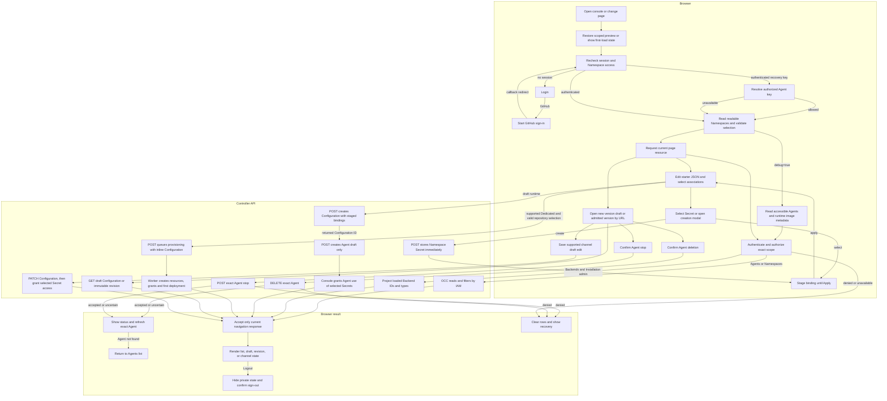

# Platform console request flow

## Overview

`/console/` renders session-authorized resources.
The [console reference](../reference/console.md) owns user-visible behavior;
API and IAM authorize access.

## Entry Points

- Browser entry: `apps/controller/src/console/console.mjs` composes the session,
  request client, view lifetime, navigation, and shell.
- `api-client.mjs` owns cancellation and session expiry; `view-lifetime.mjs`
  owns generation and abort state; `navigation.mjs` owns return paths and history;
  `shell.mjs` owns navigation and collections.
- `agents/{list,create,detail}.mjs` own Agent views;
  `channels/{slack,shared-ui}.mjs` own Slack editing. `agents.mjs` and
  `channels.mjs` compose them.
- HTTP: `apps/controller/src/index.ts:createFastifyApp`.
- Startup: `apps/controller/src/composition/production.ts:composeProduction`
  and `development-postgres.ts:composePostgresDevelopment`.
- Requires a bootstrapped Installation, provisioned account, selected IAM Driver,
  same-origin controller, and the [API permissions](../reference/api.md)
  for each read or mutation.

## Flow

## Execution Trace

### 1. Compose discovery metadata and serve public assets

`apps/controller/src/composition/production.ts:composeProduction`

`apps/controller/src/composition/development-postgres.ts:composePostgresDevelopment`

Startup passes safe Backend `{id,type}` summaries to `createFastifyApp`.
[Driver activation](service-account-driver-credential-delivery.md) occurs once;
requests reread neither configuration nor credentials.

`apps/controller/src/console-assets.ts:readConsoleAsset` serves allowlisted assets
and the shared HTML shell with MIME types and same-origin CSP. Unknown console
paths return the shell with `404`; API routes retain JSON errors.
`encodedAsset` compresses static scripts and styles once (brotli or gzip, per
`Accept-Encoding`, with `Vary`), unless an explicit `identity` weight beats both
encodings. The shell, which also answers sign-in, stays identity.

`scripts/build-console-metadata.mjs` bakes the publisher's checked
`OCC_BUILD_REVISION` into HTML. With `debug=true`, `shell.mjs:renderShell` displays
the full commit; invalid or absent metadata remains unknown.

`runtime-images.mjs:renderRuntimeImages` limits reads to three concurrent requests
for readable Agents in the selected Namespace.
`packages/occ/src/index.ts:OpenClawController.getAgentRuntimeImages` authorizes
exact Agent read and asks its active revision's Compute Driver for
[workload and provenance metadata](../reference/drivers/compute.md).
Navigation preserves `debug=true`; removing it stops reads. Missing provenance
stays explicit.

### 2. Resolve the session before private reads

`apps/controller/src/console/console.mjs:loadPage`

`loadPage` reads `GET /api/auth/session` first. Opening an Agent from the list
shows **Loading agent details…** and **Back to Agents**, then reveals its name,
actions and overview after access checks. Back cancels; refocusing does not.
Other Agent routes hold the current page or show loading after 400 ms, for at
least 300 ms (`loadingMinimumMs`).

Other first visits and Refresh show loading after 250 ms. Returns hold the page
inert with its header and disabled Namespace selector, showing **Still checking…**
after one second. Up to 16 views retain route, Namespace and session ownership,
excluding passwords and discovery state. Interrupted returns preserve views;
Refresh discards them.

`apps/controller/src/console/api-client.mjs:createApiClient` keeps its abort signal through JSON/text body reads. Cancellation preserves its reason; socket failures reach interrupted-read recovery. Only JSON syntax failures become invalid-response errors. Failed bodies are never replayed.

Returns revalidate GET data/pagination without request IDs and compare settled
`403`/`404` refusals as outcomes. Matching answers restore DOM, handlers, drafts
and disclosures; changed answers, a newly readable Namespace or Refresh rebuild.
Other failed or pending reads, passwords and mutations prevent reuse. Live sections
own their return checks rather than replaying polls. Tab-local `403` caching avoids
repeated audits until Retry. Read-only catalog/diagnostic POSTs preserve views.

**Back to Agents:** session, Namespace, permission, and collection checks gate the
list, not each row’s deployment read. On reuse, `agents/list.mjs:renderAgentList`
sets visible deployment cells to **Reading deployment…**, hidden for 250 ms and, once shown, kept at least 150 ms, before paint, then shows
each fresh result or refusal. Back or refocus from a deployment focuses that cell,
not a link to the old revision. Unfinished or failed row reads never prevent reuse; resuming rereads them.

Changed users or session keys clear retained views and drafts before private
reads. Missing sessions open login; failed reads offer Retry.
The [console sign-in flow](platform-console/sign-in-return.md) covers provider
discovery, one-use session binding, and requested destination recovery.

`apps/controller/src/auth/index.ts:requireTrustedBrowserOrigin` checks Origin
before sign-in/out, even for SDK calls bypassing Better Auth middleware; headerless
CLI requests remain supported. The browser stores no credentials.

Authenticated `loadPage` reads `GET /namespaces`, retaining URL selection or the
first ready/readable Namespace. Unreadable IDs stay unavailable; selection never
selects API query scope.

`shell.mjs:namespaceSelector` disables and hides choices through session and
Namespace checks, naming a known selection; retained-view reads do not extend this.
`shell.mjs:createShell` listens for the 760px mobile breakpoint; widening closes
the drawer without focusing its hidden toggle and releases `main.inert`.
Empty lists show access guidance. `navigation.mjs:navigate` returns Agent detail/creation
to Agents; global pages remain open; recovered warnings disappear.

### 3. Authorize the selected page resource

`apps/controller/src/index.ts:perform`, `requireInstallationAdmin`

`packages/occ/src/index.ts:OpenClawController.listNamespaces`, `listAgents`

Agents use the selected Namespace's route. OCC authorizes Namespace reads and
filters Agents by exact read permission; Namespace listing filters its
Installation-wide collection. Unreadable selections prevent Agent requests.
`GET /backends` ignores selection and requires Installation `administer` before
returning safe startup summaries. Empty configuration returns an empty list;
missing wiring or failed dependencies return errors.

Agents and Create Agent read Namespace permissions before rendering. If `agents.create`
is false, or the [Namespace status](../reference/namespaces.md#lifecycle) refuses Agents, both explain why and recheck on return. A failed read keeps creation available;
OCC still authorizes every write. Changing Provider or Harness resets incompatible
credentials and model choices, preserving unrelated JSON. See
[Agent creation](../reference/console/create-and-deploy.md) for inputs and recovery.

`agents/plugin-fields.mjs:createPluginFields` edits Agent `plugins` separately
from Configuration. Invalid JSON and untouched fields survive; clearing overrides
restores inheritance. Submission, uncertain outcomes and invalid JSON lock editing.
`capabilities.pluginPolicies` gates policy edits; unsupported reviewers remain clearable.
The picker keeps credential guidance in **Access and credential setup**.
Instructions and details scroll while search and pagination stay reachable.
Available and Configured retain selections, queries, filters and expanded
rows without fetching or changing drafts. Removing selections clears details;
discovery resets both tabs.

`create.mjs:loadPluginCatalog` and `loadPluginTools` implement
[PAT discovery](agent-plugins.md#credential-scoped-discovery): the selected or
Preset Secret takes precedence over an entered token. OCC reads the
Secret server-side. Pagination is upstream; filtering is local. Selecting a plugin loads tools.
Credential, provider, and Harness changes clear results and invalidate pending reads.

`create.mjs:MODEL_CHOICES` supplies static lists and manual entry.
`renderAgentForm` toggles `manualModel`, updates Configuration and controls, preserves
`model.value` and clears the dropdown. `resetModelChoices` restores the provider's
list after JSON changes, retaining only listed models. Provider/authentication
changes clear the model. Submission matches Configuration's primary model to
`model.value`. The toggle moves focus and preserves credentials and unrelated
Configuration; saved-Configuration and pending-request locks apply.

`configurationTemplate` enables Control UI with loopback origins on port 18789.
Compute supplies gateway authentication; Presets replace the starter unchanged.
[Native admin access](agent-native-admin.md) owns HTTPS isolation.

`createRepositoryFields` loads `GET /namespaces/:namespaceId/agents/repository-options`,
then requests optional descriptions for visible refs. [Repository admission](agent-repository-credentials.md) resolves the
submitted `repositoryAccess`. Retained drafts keep selections through failed
discovery; retries recheck current policy. Only `503 REPOSITORY_OPTIONS_UNAVAILABLE`
permits creation without bindings, and only without retained selections; other
failures block submission.

Supported Dedicated runtimes submit inline Configuration, optional repository
access, and Secret references to [provisioning](agent-provisioning.md), even after
that outage. The worker reauthorizes, creates resources and exact Secret grants,
and deploys; Console polls, then opens the revision.

Ordinary drafts first check values and plugins with
`POST /namespaces/:namespaceId/agents/validate`, then post
`{kind: "agent", values, secretBindings}` to `.../configurations` and submit its ID,
plugins, `initialWorkspaceFiles`, and `workspaceDefaultsId` to `.../agents`.
Success opens `revision=draft`.
OCC stages all four workspace textareas, including unchanged/empty values, outside
Agent/Configuration for [workspace setup](workspace-files.md).

`create.mjs:grantConfigurationSecretAccess` grants exact Secret `operate` for final
same-Namespace `env` bindings. Failure retains the Agent; **Retry credential access**
rereads grants without duplication. Failed Agent writes retain Configuration ID
and lock JSON/Harness for explicit reuse. Writes never retry automatically; drafts
admit no revision and start no runtime.

`agents/harness-auth.mjs` edits bindings and shows
[Secret identities](platform-console/agent-editing.md#4-render-draft-revision-or-channels),
never values. Authentication source uses the shared form-field presentation;
issued-account lookup feedback stays inside its conditionally visible account field.
Switching methods hides that feedback without changing the lookup or saved choice.

### 4–6. Edit the Agent and access runtime files

[Agent editing](platform-console/agent-editing.md) traces versions, channels,
credentials, workspace, stopping and deletion. [Sharing](platform-console/agent-sharing.md)
owns policy writes; the response ordering below applies to both.

`channels/slack.mjs:supportSlack` rejects unpreservable shapes; `updatedSlack`
preserves untouched policies and reply overrides. The [editing flow](platform-console/agent-editing.md#4-render-draft-revision-or-channels)
owns DM policies and channel-only defaults. Admission snapshots native values;
Kubernetes `prepareRevision` copies them into `openclaw.json` without defaults.

`agents/detail.mjs:renderAgentDetail` registers tab navigation with `console.mjs:loadPage`.
Within one Agent, Namespace and revision, tabs/history replace content only;
shell, native access and revision controls persist. Configuration/revision reads
are shared; direct Workspace reads neither. Refresh, revision changes and successful
channel/authentication edits reload fully. `deniedReadsFor` caches audited
Configuration/revision `403`s in tab `sessionStorage` per owner until Retry or logout.

`renderTab` reveals clipped tabs without moving focus or vertical scroll.
Its ResizeObserver repeats on resize, disconnects on inactivity/detachment and
resumes with the view. Completed tabs retain DOM, drafts and disclosures;
pending/failed reads, passwords and mutations prevent reuse. Mounted checks reject
late responses. Passwords clear while [draft captures](platform-console/agent-editing.md#4-render-draft-revision-or-channels)
retain edits. Channel Secret saves update the shared snapshot and deployment preflight.

**Open vN Logs** targets the failed revision from any version/draft. Reserved
log space keeps Stop/Delete fixed. Direct links focus and scroll output; tab
selection leaves visible output still. Recovery links scroll and focus the version
tab, smoothly unless rebuilt or motion is reduced.

[Runtime logs](agent-runtime-logs.md) explains access. Status `403` hides Pod details, not
separately authorized logs. Denials last until logout; newly granted `operate` permits another
status read. Refused reads or downloads clear the rows; late successes cannot restore them or
download. Refusing allowed log text rereads status at once, superseding stale reads. Back
rebuilds refused views, else shows the checked page. Refresh keeps rows and cursor until
replaced; rate-limit notices update at the retry time without rereading. New streams or
rejected cursors clear rows.

### 7. Commit only the current response, or clear the view

`apps/controller/src/console/console.mjs:loadPage`, `logout`

After full-page navigation settles, `loadPage` focuses the destination heading if
focus fell to the body, using `preventScroll` to preserve return position. An Agent
opened from the list focuses its heading when the title renders. Tabs (one Tab
stop; arrows move) and focused controls keep focus. Navigation, Namespace changes, and logout invalidate
reads; generations reject late responses. Refocus coalesces events. Agent detail
rechecks access in place, preserving controls, input, and saves; failures clear it.
Other pages revalidate before reuse, including a shown 403 or 404; forms defer the check.
Returning to the tab restores focus after the unchanged view is admitted, if the control
remains and the reader hasn’t moved on. Draft save baselines and Namespace scopes stay separate.

Authorization and dependency failures clear affected content and expose recovery;
a current protected `401` clears all private state. `pagehide` clears
private DOM, previews, and drafts even for BFCache; persisted `pageshow` performs
a fresh load. Failure views show local reasons and bounded request IDs, never
backend error text. Backend authorization denial clears every retained preview,
including other Namespace selections, because the permission is Installation-wide.

The [detail action flow](platform-console/agent-editing.md#stop-agent) traces
confirmed Stop and Delete requests and permissions. Acceptance
is not completed shutdown or deletion. Uncertain outcomes block replay until
readback; only confirmed absence returns to Agents. Deployment resumes
a stopped Agent through a new revision. The [Agent reference](../reference/agents.md#deletion)
owns asynchronous cleanup.

Logout first hides private state, then calls the sign-out endpoint.
Confirmed success or session inspection proving absence replaces history with
login. An unconfirmed logout stays blocked with Retry. The
[authentication flow](local-password-authentication.md) owns server revocation;
this client never infers it from a network error.

## Deploy the new revision

The **Create new version** draft exposes **Deploy new version**.
**Operator-managed credentials** persist `{ "method": "runtime" }` and bypass
managed credential setup in Console; OCC does not validate host credentials.
Deployment checks the Agent, Configuration association, and generation, then sends
bodyless
`POST /namespaces/:namespaceId/agents/:agentId/deploy`. The server authorizes
and admits the revision. Its read-only details open while **Deployment
activity** follows the latest visible deployment. Workspace reads check gateway
startup and file availability. An uncertain response disables replay until
refresh and inspection.

## Debugging and Verification

- Match the displayed request ID to controller logs.
  A Namespace-only user cannot discover Backends; check Installation authority
  before treating that denial as a configuration problem.
- Browser suites use real Fastify, Better Auth, Native IAM, and in-memory storage.
  They verify navigation, isolation, creation, draft/history/channel editing, and
  authentication, not PostgreSQL persistence, Backend health, runtime dispatch,
  worker leases, or Compute effects.
- API tests cover safe discovery, permission boundaries, empty versus missing
  wiring, static MIME/allowlisting, and unchanged API JSON errors. See
  [Testing](../testing/README.md) for commands and the image smoke boundary.

## Related docs

- [Console reference](../reference/console.md)
- [Authentication](../reference/authentication.md)
- [Backend-managed credential delivery](service-account-driver-credential-delivery.md)
- [Configuration and Agent revision](configuration-driver.md)
- [Docker development](docker-compose-development.md)
- [Production startup](production-startup.md)

## Manual Notes

[keep this for the user to add notes. do not change between edits]

## Changelog

- 2026-10-19 14:08: Preserve role-catalog recovery alongside updated Console behavior and move older entries into the flow history. (authoring-run/0a964265-43ea-4512-b547-2175d1d28e72 - 22c5ee8f85e33efab6d80045df8ea0dfbd3b1458)

- 2026-10-18 15:02: Honor an explicit higher identity weight when serving static scripts and styles. (authoring-run/fe116f0f-fbc0-4682-affa-70eda6bbbd1d - bcf4fbcf0f082367910d262b1f06732b0bdd80c8)

[Platform console request documentation history](platform-console/history.md) preserves the older dated entries.
