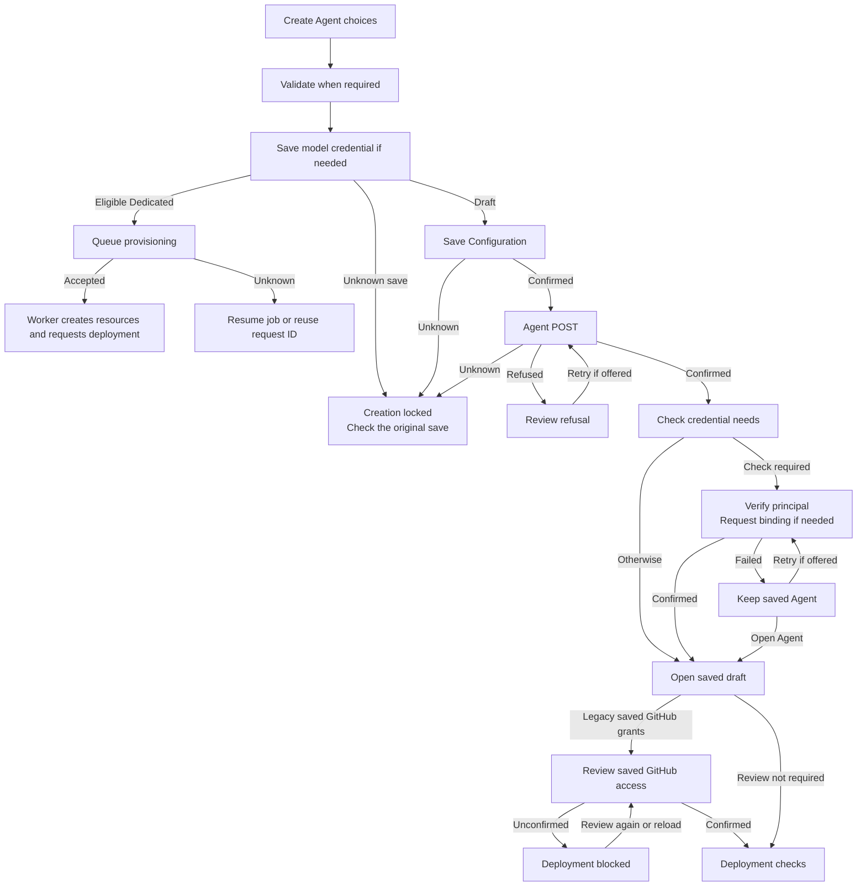

# Console Agent creation

## Overview

Trace the Create Agent form from plugin, model, and repository choices to a
provisioning request or an ordinary draft, then Secret grants and authentication.
The [parent flow](../platform-console.md) authorizes the page first; the
[creation reference](../../reference/console/create-and-deploy.md) owns
user-visible behavior.

## Entry Points

- `apps/controller/src/console/agents/create.mts:renderCreateAgent` renders the
  form (`renderAgentForm`) and submits it.
- `apps/controller/src/console/agents/plugin-fields.mts:createPluginFields` and
  `agents/repositories.mts:createRepositoryFields` supply the plugin and repository fields.
- A signed-in caller with Namespace Agent `create`; each write is authorized again.

## Flow

## Execution Trace

### 1. Edit plugin selections and discover plugins

`agents/plugin-fields.mjs:createPluginFields` edits Agent `plugins` separately
from Configuration. Invalid JSON and untouched fields survive; clearing overrides
restores inheritance. Submission, uncertain outcomes, or invalid JSON lock editing.
The selected Harness's entry in `capabilities.pluginCatalogs` defines the policy controls.
A credential/access reminder sits beside the expandable
**Access and credential setup** disclosure. Instructions, list, and details
scroll within the dialog; search and pagination remain reachable.
While mounted, Available and Configured retain separate selected plugins, queries,
tool filters, and expanded rows without fetching pages or changing drafts.
Removed selections clear their details; discovery resets clear both tabs.

`agents/plugin-discovery.mjs:createPluginDiscovery` (`loadCatalog`, `loadTools`) implements
[PAT discovery](../agent-plugins.md#credential-scoped-discovery): the selected or
Preset Secret takes precedence over an entered token. OCC reads the
Secret server-side. Pagination is upstream; filtering is local. Selecting a plugin loads tools.
Credential, provider, and Harness changes clear results and invalidate pending reads.

The model credential, people search and Slack token fields use the shared
[Secret picker](agent-editing.md#4-render-draft-revision-or-channels). When a field first opens,
`renderCreateAgent` reads `GET /namespaces/:namespaceId/permissions/secrets`: the readable
Secrets the caller may not `operate`, reported only to a caller with Namespace read and Agent
`create`. Agent create, Configuration create and the people search refuse such a Secret, so each
field lists it disabled with its reason and never stages it; the Preset's **Use existing Secret**
list does the same, and **Use Preset** refuses it. A permission reread, a refused create or an
inline Secret create reads the answer again. A failed read keeps the last answer, or marks
none before any answer.

`secret-picker.mts:bindSecret` waits for the permission answer. During a model Secret
choice, `renderAgentForm` blocks submission. A provider or authentication method change
calls `clearModelCredential`, which clears the choice and its hint. A late answer cannot
restore that choice or replace a newer one. Accepting a choice marks the draft as edited.

### 2. Choose a model and starter Configuration

`create.mts:updateModelConfiguration` preserves authored `plugins.allow` and
`plugins.deny` while changing Codex runtime wiring. Missing and empty allowlists
remain unrestricted. An explicit `plugins.entries.codex.enabled: false` survives
a round trip. Dedicated Codex enables the plugin at startup if the draft passes
admission. Returning to OpenClaw through the Harness selector or model JSON restores
the original disabled entry when the projected entry is unchanged. Operator edits
and deletions to the Dedicated projection of an originally disabled native Codex
entry survive the switch. The form uses the existing server preflight and
provisioning admission. A refusal leaves the editable
Configuration unchanged. See [runtime admission](../../reference/harness-execution.md#native-runtime-selection).

`create.mts:MODEL_CHOICES` supplies unauthenticated static lists and manual entry.
`renderAgentForm` toggles `manualModel`, invoking `updateModelConfiguration` and
`updateControls`. Manual mode preserves `model.value` and clears the dropdown.
`resetModelChoices` restores the current provider's list, including Configuration
JSON changes, retaining only listed models; otherwise both inputs clear.
Provider and authentication changes normally reset the model. `updateControls`
sets the button label, visibility, and required input; the toggle moves focus.
Returning preserves credentials and unrelated Configuration. Saved Configuration
and pending requests lock the toggle.

If Codex model, provider or Harness controls encounter malformed `plugins.allow`,
the form keeps the JSON as typed and focuses **Configuration JSON**. Use an
array of strings or remove the field. A refused model selection, provider change,
or Harness change keeps the last applied model, provider, Harness, and execution
mode. The authentication method can still change: the form clears the prior
credential and shows the new method's fields without changing the model or JSON.

Before merging a model selection, `canMergeModelCatalog` checks the provider list
that the selection would update. If the list is malformed, the form keeps the
draft JSON as typed, opens **Advanced settings**, and focuses **Configuration JSON**.
The warning names the affected `models.providers.<provider>.models` field. The
edit sends no write request. [Correct the list and retry](../../reference/console/create-and-deploy.md#create-an-agent)
to apply the model.

Before a model change rewrites the JSON, `readModelConfiguration` rejects values
that parse as infinity, including nested numbers such as `1e400`. Serialization
would otherwise replace them with `null`. The form skips the rewrite, keeps the
raw draft, and focuses **Configuration JSON** with an inline error. The same
number check stops submission before any writes. Replace the value with a
number closer to zero and retry the action.

Submission still matches the primary Configuration model to `model.value` and
uses the normal server validation.

`configurationTemplate` enables Control UI with loopback origins on port 18789.
Compute supplies gateway authentication; Presets replace the starter unchanged.
[Native admin access](../agent-native-admin.md) owns HTTPS isolation.

### 3. Load repository options

`agents/repositories.mts:createRepositoryFields` loads `GET /namespaces/:namespaceId/agents/repository-options`,
which authorizes Agent create. The form waits for permission to allow Agent create,
or a successful Installation read without an answer. A known refusal prevents the read
and offers no retry. Discovery requests optional descriptions for visible refs.
[Repository admission](../agent-repository-credentials.md) resolves submitted
`repositoryAccess`. Failed discovery retains draft selections; retries recheck current
policy. Only `503 REPOSITORY_OPTIONS_UNAVAILABLE` or `meta.notConfigured` (no
`repository` settings), with no retained selections, permits creation without bindings.
Other failures block submission.

Managed model Sources follow the
[Source lifecycle](../credential-source-lifecycle.md). Legacy protected Git follows
[Git egress](../credential-source-egress.md).

### 4. Submit provisioning or an ordinary draft

`apps/controller/src/console/agents/create.mts:renderAgentForm`

[Per-repository access](../../guides/topics/agent-sandbox-policy.md#set-github-access-before-the-first-deployment)
defaults to delegated limits. Selections require **Save Agent draft** and go in
`repositoryAccess`, including the GitHub App client ID and access levels.
Provisioning warns when scoped choices are available but none are selected.
After deployment without a policy, per-repository access can require a new Agent.

Guided [provisioning](../agent-provisioning.md) requires a ready Namespace,
advertised Dedicated mode, no scoped repository selections, no managed static
Source enrollment and no `credential_source` authentication, including Preset
bindings. It takes inline Configuration and Secret references. The worker
reauthorizes, creates resources and exact Secret grants, then requests deployment.
Console opens the saved version. Uncertainty retains the request ID or accepted
job. Without Embedded OpenClaw, placement refusals name the missing setting.

Installation capabilities omit Compute support for operator-managed Preset
`runtime` bindings. `checkRuntimeBinding` preflights them. A `harnessAuth.method`
refusal disables submission and names the administrator's remedy. Neither binding
nor mode is editable.

`namespaces.mts:namespaceNameProblem` checks the name before writes.
`agents/workspace.mts:workspaceFileProblem` flags invalid files in Advanced settings.
Denied `operate` on a readable Secret blocks new model Secrets and the Preset's
**Create new Secret**. New Secrets lack that grant.

Unsaved drafts call `POST /namespaces/:namespaceId/agents/validate` before
submit-time writes. Provisioning preflights before saving a new model Secret.
The request checks name, Configuration values, channel `secretBindings`, plugins
and planned `harnessAuth`. Before credential enrollment it sends only `api_key`
or `codex_pat`. ChatGPT sign-in omits authentication. OCC authorizes Agent create,
rejects cross-Namespace bindings, checks Configuration size, content and Driver
admission, then plugins, topology and name conflicts (`409`). Unbound channel
tokens return `400`. Slack requires both tokens. `list.mts:channelBindingRefusal`
shows channel validation and provisioning refusals under Configuration JSON.
Writes check Secret existence and `operate`.
Validation timeout preserves entries without saving.

Before binding a new Secret, Console checks its name, Namespace, ID and reference.
An uncertain save clears the input and locks creation. For unbound Dedicated
OpenAI with Source storage selected or required, Console posts a static Credential
Source containing the API key or Codex service account token through TokenService,
clears the input and checks its type, ready state, name, Namespace, ID, reference and
`openai` or `codex-pat` provider preset. It binds the ID in `harnessAuth` and
`credentialSources` and saves a draft. **Save service account token** can enroll
earlier for plugin discovery. Unknown enrollment clears the input and locks
creation. Check Credential Sources before further action. Confirmed Sources are
reused after later failures.

Console posts `{kind: "agent", values, secretBindings}` to
`.../configurations`. It confirms the `201` response's ID, Namespace, kind,
generation, values and bindings before posting that ID, repository intent,
plugins, `initialWorkspaceFiles` and `workspaceDefaultsId` to `.../agents`.
It confirms the Agent ID, name, Namespace, Configuration and principal.
Unrecognized success or uncertain Configuration or Agent writes lock creation.
Without a confirmed Configuration ID, no Agent POST occurs. Ask a
[platform operator](../../guides/topics/audit-log.md#access-and-limitations)
to trace `openclaw.configurations.create` using Namespace, time and any request ID,
then [read the Configuration](../../reference/configuration.md#create-read-update-and-delete).
For uncertain Agent writes, follow
[creation recovery](../../reference/console/create-and-deploy.md#create-an-agent).

After confirmed refusal, reload repository selections. Without them,
`create.mts:agentSaveAccessReason` matches Agent POST `403` denials to Namespace
Agent create, Configuration read or browser setup update, Harness Secret operate,
ServiceAccount read or CredentialSource operate. Unnamed Secrets yield only the
permission. Other denials stay generic. An administrator can check grants and
Restrictions with any available request ID. An offered retry reuses the
Configuration. **Cancel** leaves it saved. A fresh draft may duplicate it.
OCC stages all four workspace textareas, including empty values, outside
Agent/Configuration for [workspace setup](../workspace-files.md).

### 5. Grant Secret access and edit authentication

Known non-administrators and drafts without credential needs skip IAM. Otherwise
Console verifies the active saved Agent and principal. On the creating submission,
that principal must match the
Agent POST response. Retries use the fresh principal. For a model Secret or
Credential Source, Console creates or reuses an exact `operate` AccessBinding.
A binding does not prove effective access. Deployment checks authorization, and a
matching deny Restriction can block use.

`create.mts:grantConfigurationSecretAccess` grants only staged channel Secrets
matching final same-Namespace `env` bindings.
[Transactional native IAM can grant at deployment](../namespace-iam-policy.md#6-default-users-owners-and-deploy-time-grants)
if the caller has `operate`. Failure retains the Agent. **Retry credential access**
repeats verification when offered. With unreadable capabilities, a `403` hides
retry and directs deployment from the Agent page.

Console then opens `revision=draft`. For first legacy GitHub drafts with saved
grants, `detail.mts` requires **Review saved GitHub access**. It reads the saved
networking policy with SandboxPolicy read. Failed or unconfirmed review blocks
deployment. Review again or reload the saved draft without recreating it.
Automatic GitHub App access skips this legacy review. Deployment rejects stale
policy versions with `409`.

After a refused Installation read, **Your access** reports Agent `create`. When
allowed, `create.mts:loadNamespaceCapabilities` reads
`GET /namespaces/:namespaceId/agent-capabilities`.
`packages/occ/src/installation-capabilities.ts:getNamespaceAgentCapabilities`
checks [Agent `create` on the collection](../../reference/authorization.md#authorization-decisions)
before resolving the Namespace. It returns `403` on denial or `404` for a missing
Namespace, without requiring Namespace `read`. The response retains advertised
`modelCredentialSourcePresets` and device authorization, omits `agentProvisioning`
and therefore saves drafts. Advertised `nativeAdmin` offers **Enable browser chat**.
See
[Agent browser access](../../reference/agent-native-admin.md).
**Retry permission check** rereads only the failed permission answer. A refusal
removes the form. Writes never retry automatically. Drafts save no version and
start no runtime.

`agents/harness-auth.mjs` edits bindings and shows
[Secret identities](agent-editing.md#4-render-draft-revision-or-channels), never values.
Switching methods hides account lookup feedback without changing the saved choice.

## Debugging and Verification

- `tests/browser/console-agents.test.ts`, `console-agent-presets.test.ts`,
  `console-agent-repositories.test.ts`, and `console-create-agent-member.test.ts`
  exercise the form against the real controller.
- Review the refusal and any request ID. Inspect saved
  Configuration and Agent IDs before retrying.

## Related docs

- [Return to the parent flow](../platform-console.md)
- [Agent provisioning](../agent-provisioning.md)
- [Agent editing](agent-editing.md)

## Manual Notes

[keep this for the user to add notes. do not change between edits]

## Changelog

- 2026-11-25 03:54: Trace TokenService enrollment and preserve the checks after an uncertain save. (authoring-run/5285b629-c2be-4720-b57b-1dd375287ce5 - 105ffee9962176cf42fc7cfe013b8b94831435db)
- 2026-11-24 05:48: Preserve repository checks. (authoring-run/db58f110-6136-4b7e-8004-11d32e9e2509 - e2ba60f263b4bf30ee07051791a9367c20daf243)
- 2026-11-24 05:45: Reconcile Source enrollment with first-deployment repository warning. (authoring-run/816f6bc5-1b99-4a82-8903-be3d98e6dd07 - d6403c2401e338964f5486f8db2fcb40a3758448)
- 2026-11-24 04:58: Trace the first-deployment repository warning and draft action. (authoring-run/02daa2dc-277c-444c-bb4d-5589ee0579e9 - 840798ada6c310271e26b3004c25bd7b253d042c)
- 2026-11-24 03:41: Clarify deployment admission. (authoring-run/a0be62f9-adfa-426c-865d-043a3e34121f - b6555dada1415cff47cdfec9b5af33222ce4f387)
- 2026-11-24 02:29: Show the repository grant check on the saved draft. (authoring-run/ba9ea959-8a2b-4cab-830f-387425ba3574 - e2d257fbd92637a19042477ef2ad8c6ecf3f9fdf)
- 2026-11-23 14:21: Clarify creation locks and bindings. (authoring-run/c19f29e8-5721-43ff-bada-5264ccb9b4ea - 54922275aed4dd2c5d6c23901fb0a2ff42a54136)
- 2026-11-23 13:25: Clarify grants and recovery. (authoring-run/b8e9fa39-d34f-4d9c-b2e4-d1cbe1f79036 - 0844df38c9838ec25596b96b70ba76440c5be22d)
- 2026-11-23 07:52: Trace direct static Source creation and draft save in Console. (authoring-run/cc0bf76f-7449-4eac-b151-d064ddc9580e - e4a24549373e8e111a15ec6da6b753eca4449646)
- 2026-11-22 12:45:07 UTC: Trace matched Agent-save permission refusals, conditional same-draft retry, unknown outcomes, and the saved Configuration warning on Cancel. (authoring-run/0af8b944-e54e-4170-939f-bc90ca8b2967 - e46d3a6401a2b9040ac6001555baad26356c70a3)
- 2026-11-22 10:40: Trace pending and canceled model Secret choices. (authoring-run/cb3a3926-c616-4777-9f78-5da17d6d53bc - 0706f806d51c60465533b087ae9d0db5c87bc896)
- 2026-11-20 19:04: Refresh sources. (authoring-run/8a8bde8b-71de-4de5-80bf-e32f0e335c34 - 220f62d86ceb3dfc6f66dbee7c6f86cda50e5d05)
- 2026-11-18 10:15: Preserve authored `plugins.allow`, `plugins.deny` and an explicitly disabled native Codex entry across Harness switches, including unfinished JSON recovery. (authoring-run/658e4f7a-f9c1-4bea-8723-f9dfe9053b2f - 27aa612d2bafd819c734942d59125084a6c658eb)

- 2026-11-13 05:52: Trace Configuration Driver admission and cross-Namespace Secret binding checks before Agent creation saves resources. (authoring-run/09e9dfc6-0460-4492-905d-33d9fe7b60d4 - 4ecf71da20e0606cb4f78fc90551462af11b4981)

- 2026-11-12 19:08: Limit the Proxy bypass to Agents with ordinary Gateway sources. (authoring-run/9928fd4c-05a8-4ce6-b0d6-5322a30b0fe8 - 988124f27)

- 2026-11-12 18:36: Preserve credential registration refusals across empty status checks. (authoring-run/e0dff858-3588-44ee-9ffa-b67c8dd4dfe5 - 4478a18a7)

- 2026-11-12 16:13: Trace Agent create authorization, Namespace lookup, and browser-access capability discovery. (authoring-run/2aa6ee22-af84-4f68-8186-9da30e578f98 - a7d3cf24896836c7e1d05c5850749f4bfd042fe3)

- 2026-11-11 19:04: Keep ordinary Gateway model delivery independent of Git Proxy selection. (authoring-run/1e8e6ab1-7c1b-4d49-a362-2dc060e32bbb - aea0cb511)

- 2026-11-10 13:36: Show a confirmed repository-only Credential Proxy requirement before provisioning. (authoring-run/f0decdaf-c71f-47f9-b2e5-c5bd6b1dfee1 - 07c2a00c82e8a10635533eb1a27b110b52b90f14)
- 2026-11-05: A member reads the Namespace's Agent capabilities after a refused Installation read, registers a model Secret with a Credential Gateway, and opens the draft without an IAM request. (claude/session_01HzmRt1DGB79VEnEWHt7PRy)
- 2026-11-05 18:37: Explain the Configuration number range refusal on Create. (authoring-run/d006a89e-c176-48cc-8710-16d38835bbb9 - 5fd3fde4911e1640c354d69bb09f6f3d72445a05)
- 2026-11-04 22:06: Explain which Create Agent settings stay in place when an invalid plugin list blocks a Codex change. (authoring-run/386aa943-15cf-49cd-b53e-05831b4a7da0 - e109eba64ea0e81c02513f81f9c892a832dc1b69)
- 2026-10-25: The per-Secret `operate` remedy names an exact-Secret grant; the Agents list gives Create Agent's next step when Agent create is denied. (findings 2507, 2508)
- 2026-10-25: Send the Agent name to the preflight; mark and focus the name field when the preflight, provisioning or Agent create refuses it as taken. (fix-dogfood-r36, finding 2420)
- 2026-10-25: Secret fields and the Preset's existing Secret refuse readable Secrets the caller may not `operate`. (fix-2469, findings 2469, 2479)
- 2026-10-25: Refuse a typed model key, and disable the Preset's **Create new Secret**, where `operate` is denied on a readable Secret. (fix-2492, finding 2492)
- 2026-10-25: An inline Secret create rereads the `operate` answer before staging. (finding 2486)
- 2026-10-25 08:00: Refuse an operator-managed Preset when it opens where the Compute Driver refuses its binding (finding 2427). (fix-mutant-1025c)
- 2026-10-25 04:30: Run the preflight before a Credential Gateway registration too (finding 2406). (fix-postland-1025c - 44eebaad38)
- 2026-10-25 03:30: Run the preflight before provisioning saves the model Secret; trim placement advice the form cannot follow. (fix-postland-1025b - 2b1f510594)
- 2026-10-25 00:55: Name "no Sandbox Driver selected" as the reason Dedicated OpenClaw is disabled when the Installation lists Embedded. (finding 2384)
- 2026-10-25 00:30: Treat repository options with `meta.notConfigured` like the fixed-composition 503. (finding 2387)
- 2026-10-24 19:00: Check the Agent name and initial workspace files with the API's rules before any write. (fix-2339-2341)
- 2026-10-22 10:56: Confirm creation responses before granting access or continuing provisioning. (console-create-delivery-20261022 - eef3442ff)
- 2026-10-20 05:00: Split from the platform console flow's step 3. (docs-split-1020)
