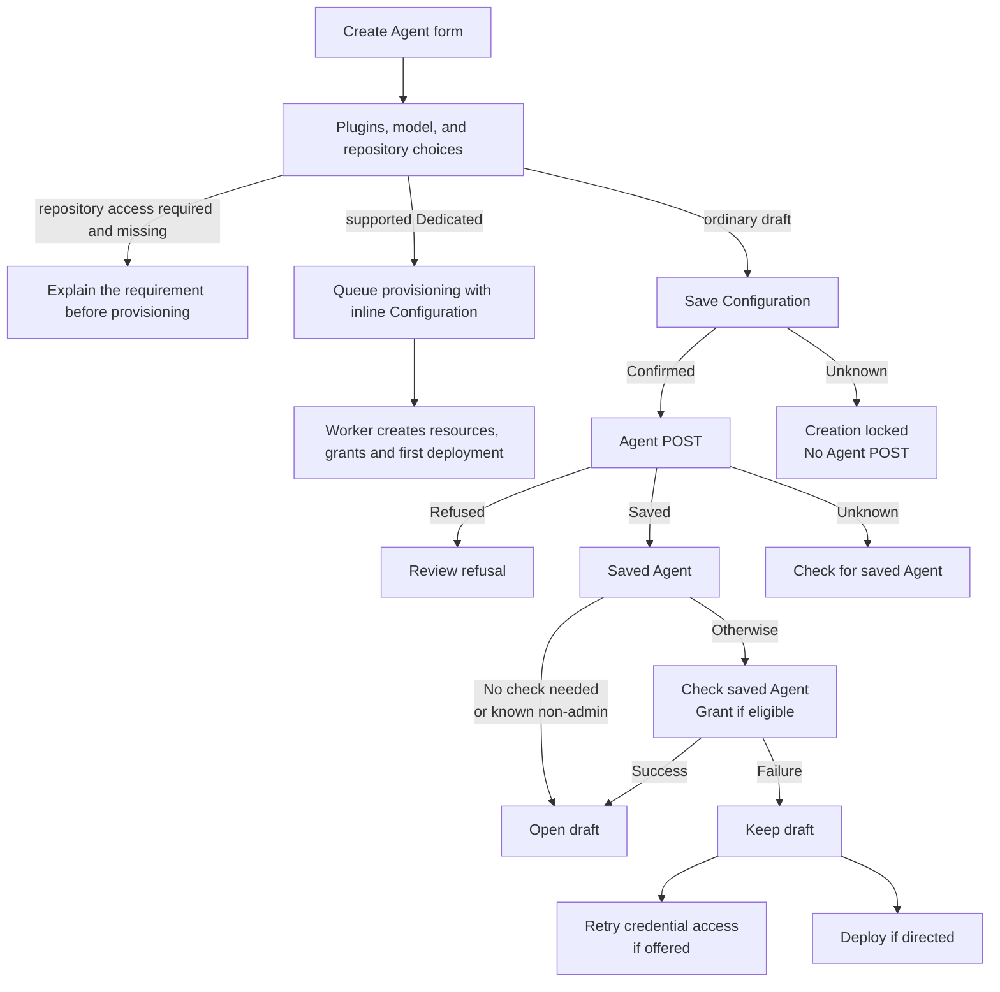

# Console Agent creation

## Overview

Trace the Create Agent form from plugin, model, and repository choices to a
provisioning request or an ordinary draft, then Secret grants and authentication.
The [parent flow](../platform-console.md) authorizes the page first; the
[creation reference](../../reference/console/create-and-deploy.md) owns
user-visible behavior.

## Entry Points

- `apps/controller/src/console/agents/create.mts:renderCreateAgent` renders the
  form (`renderAgentForm`) and submits it.
- `apps/controller/src/console/agents/plugin-fields.mts:createPluginFields` and
  `agents/repositories.mts:createRepositoryFields` supply the plugin and repository fields.
- A signed-in caller with Namespace Agent `create`; each write is authorized again.

## Flow

## Execution Trace

### 1. Edit plugin selections and discover plugins

`agents/plugin-fields.mjs:createPluginFields` edits Agent `plugins` separately
from Configuration. Invalid JSON and untouched fields survive; clearing overrides
restores inheritance. Submission, uncertain outcomes, or invalid JSON lock editing.
The selected Harness's entry in `capabilities.pluginCatalogs` defines the policy controls.
A credential/access reminder sits beside the expandable
**Access and credential setup** disclosure. Instructions, list, and details
scroll within the dialog; search and pagination remain reachable.
While mounted, Available and Configured retain separate selected plugins, queries,
tool filters, and expanded rows without fetching pages or changing drafts.
Removed selections clear their details; discovery resets clear both tabs.

`agents/plugin-discovery.mjs:createPluginDiscovery` (`loadCatalog`, `loadTools`) implements
[PAT discovery](../agent-plugins.md#credential-scoped-discovery): the selected or
Preset Secret takes precedence over an entered token. OCC reads the
Secret server-side. Pagination is upstream; filtering is local. Selecting a plugin loads tools.
Credential, provider, and Harness changes clear results and invalidate pending reads.

The model credential, people search and Slack token fields use the shared
[Secret picker](agent-editing.md#4-render-draft-revision-or-channels). When a field first opens,
`renderCreateAgent` reads `GET /namespaces/:namespaceId/permissions/secrets`: the readable
Secrets the caller may not `operate`, reported only to a caller with Namespace read and Agent
`create`. Agent create, Configuration create and the people search refuse such a Secret, so each
field lists it disabled with its reason and never stages it; the Preset's **Use existing Secret**
list does the same, and **Use Preset** refuses it. A permission reread, a refused create or an
inline Secret create reads the answer again. A failed read keeps the last answer, or marks
none before any answer.

`secret-picker.mts:bindSecret` waits for the permission answer. During a model Secret
choice, `renderAgentForm` blocks submission. A provider or authentication method change
calls `clearModelCredential`, which clears the choice and its hint. A late answer cannot
restore that choice or replace a newer one. Accepting a choice marks the draft as edited.

### 2. Choose a model and starter Configuration

`create.mts:updateModelConfiguration` preserves authored `plugins.allow` and
`plugins.deny` while changing Codex runtime wiring. Missing and empty allowlists
remain unrestricted. An explicit `plugins.entries.codex.enabled: false` survives
a round trip. Dedicated Codex enables the plugin at startup if the draft passes
admission. Returning to OpenClaw through the Harness selector or model JSON restores
the original disabled entry when the projected entry is unchanged. Operator edits
and deletions to the Dedicated projection of an originally disabled native Codex
entry survive the switch. The form uses the existing server preflight and
provisioning admission. A refusal leaves the editable
Configuration unchanged. See [runtime admission](../../reference/harness-execution.md#native-runtime-selection).

`create.mts:MODEL_CHOICES` supplies unauthenticated static lists and manual entry.
`renderAgentForm` toggles `manualModel`, invoking `updateModelConfiguration` and
`updateControls`. Manual mode preserves `model.value` and clears the dropdown.
`resetModelChoices` restores the current provider's list, including Configuration
JSON changes, retaining only listed models; otherwise both inputs clear.
Provider and authentication changes normally reset the model. `updateControls`
sets the button label, visibility, and required input; the toggle moves focus.
Returning preserves credentials and unrelated Configuration. Saved Configuration
and pending requests lock the toggle.

If Codex model, provider or Harness controls encounter malformed `plugins.allow`,
the form keeps the JSON as typed and focuses **Configuration JSON**. Use an
array of strings or remove the field. A refused model selection, provider change,
or Harness change keeps the last applied model, provider, Harness, and execution
mode. The authentication method can still change: the form clears the prior
credential and shows the new method's fields without changing the model or JSON.

Before merging a model selection, `canMergeModelCatalog` checks the provider list
that the selection would update. If the list is malformed, the form keeps the
draft JSON as typed, opens **Advanced settings**, and focuses **Configuration JSON**.
The warning names the affected `models.providers.<provider>.models` field. The
edit sends no write request. [Correct the list and retry](../../reference/console/create-and-deploy.md#create-an-agent)
to apply the model.

Before a model change rewrites the JSON, `readModelConfiguration` rejects values
that parse as infinity, including nested numbers such as `1e400`. Serialization
would otherwise replace them with `null`. The form skips the rewrite, keeps the
raw draft, and focuses **Configuration JSON** with an inline error. The same
number check stops **Create Agent** before any writes. Replace the value with a
number closer to zero and retry the action.

Submission still matches the primary Configuration model to `model.value` and
uses the normal server validation.

`configurationTemplate` enables Control UI with loopback origins on port 18789.
Compute supplies gateway authentication; Presets replace the starter unchanged.
[Native admin access](../agent-native-admin.md) owns HTTPS isolation.

### 3. Load repository options

`agents/repositories.mts:createRepositoryFields` loads `GET /namespaces/:namespaceId/agents/repository-options`,
which authorizes Agent create. Create Agent holds this read until the permission answer allows
Agent create, or the Installation read succeeds without an answer; after a known refusal it
reads none and says so, without a retry. After the read it requests optional descriptions for visible refs. [Repository admission](../agent-repository-credentials.md) resolves the
submitted `repositoryAccess`. Retained drafts keep selections through failed
discovery; retries recheck current policy. Only `503 REPOSITORY_OPTIONS_UNAVAILABLE`
or `meta.notConfigured` (no `repository` settings) permits creation without bindings, and only without retained selections; other
failures block submission.

The credential catalog includes ordinary Gateway sources even when a Git Proxy
is selected. Repository access remains optional in the form. An ordinary Gateway
source without protected sources or repository bindings needs no Proxy admission.
Source-free deployment follows the [protected admission flow](../credential-source-egress.md#1-admit-source-and-install-the-revision-plan).

### 4. Submit provisioning or an ordinary draft

`apps/controller/src/console/agents/create.mts:renderAgentForm`

Supported Dedicated runtimes submit inline Configuration, optional repository
access, and Secret references to [provisioning](../agent-provisioning.md), even after
a `503 REPOSITORY_OPTIONS_UNAVAILABLE` outage. Before it saves a model Secret or registers a
Credential Source for the request, the form runs the preflight below with the planned method.
The worker reauthorizes, creates resources and exact Secret grants, and deploys; Console polls and opens the saved version. Where the form cannot follow a placement
refusal's advice to select Embedded OpenClaw, it shows only the missing setting.

The Installation capabilities do not show whether the Compute Driver supplies a Preset's
operator-managed (`runtime`) binding. When the capabilities are read, `checkRuntimeBinding` sends
that binding to the preflight below; a `harnessAuth.method` refusal disables **Create Agent** and
names what an administrator changes, because the form can change neither the binding nor the mode.

Before writing, `create.mts:renderAgentForm` checks the Agent name with the API rule
`namespaces.mts:namespaceNameProblem` and initial files with the Workspace tab rule
`agents/workspace.mts:workspaceFileProblem`. File errors identify the file and
open Advanced settings. If the check above denies `operate` on any readable Secret,
Console disables the Preset's **Create new Secret** and refuses a typed model key. A new Secret lacks that grant.

`POST /namespaces/:namespaceId/agents/validate` checks the name, draft values,
staged channel `secretBindings`, plugins and planned `harnessAuth` (method only
for a Secret saved next or registered with a Credential Gateway, none for
ChatGPT sign-in). After Agent create authorization, OCC rejects cross-Namespace
Configuration Secret bindings, applies Configuration size, content and required
Configuration Driver admission checks, then checks plugins, topology and name conflicts (`409`).
A channel token reference without a binding returns `400`. Preflight writes nothing.
Actual writes check Secret existence and `operate`.
`list.mts:channelBindingRefusal` shows validation and provisioning refusals for channels
only under Configuration JSON. Enabling Slack requires both token Secrets.

Console posts `{kind: "agent", values, secretBindings}` to `.../configurations`,
then its ID, plugins, `initialWorkspaceFiles` and `workspaceDefaultsId` to `.../agents`.
It verifies Secret name and Namespace, Configuration values and bindings,
and Agent name, Namespace and Configuration.

An uncertain Configuration or Agent save, including an unrecognized success, locks creation. If the Configuration response is uncertain,
Console has no confirmed ID and sends no Agent POST. Ask your
[platform operator](../../guides/topics/audit-log.md#access-and-limitations)
to trace `openclaw.configurations.create` by Namespace, time and any request ID.
A successful event identifies the [Configuration to read](../../reference/configuration.md#create-read-update-and-delete).
Confirm the outcome before starting again. For an uncertain Agent POST,
follow [creation recovery](../../reference/console/create-and-deploy.md#create-an-agent).

With repository bindings, reload repository choices after a confirmed refusal.
Without them, for Agent POST `403`, `create.mts:agentSaveAccessReason` matches the complete
denial to the request. It names Namespace Agent create, saved Configuration read,
browser setup Configuration update, Harness Secret operate or ServiceAccount read,
or submitted CredentialSource operate. An unnamed Secret yields only the permission.
Other denials stay generic. The alert retains the request ID. Ask an Installation
administrator to check grants and IAM Restrictions. After access changes, retry
**Create Agent** in this draft to reuse the Configuration. **Cancel** warns it
remains saved. A fresh draft can save another.

For an uncertain Credential Source registration, **Check credential registration** reads
the source for this request and confirms its type and Secret references before continuing.
After a known registration refusal, empty checks retain the refusal and the saved Secret.
They do not retry writes. A confirmed validation refusal unlocks source correction;
other known refusals keep the same registration for an explicit **Create Agent** retry.
If the Console times out waiting for validation, it stops before the save step,
keeps the form entries, and lets the caller select **Create Agent** to try again.
Success opens `revision=draft`.
OCC stages all four workspace textareas, including unchanged/empty values, outside
Agent/Configuration for [workspace setup](../workspace-files.md).

### 5. Grant Secret access and edit authentication

Known Installation non-administrators skip grants. Otherwise, before the first grant,
Console rereads the Agent and stops if its ServicePrincipal differs from the
create response. For a model Secret or Credential Source, Console creates or
reuses an `operate` AccessBinding for that principal on that exact resource.
Deployment rechecks authorization. A matching deny Restriction can block use.

Configuration Secret bindings also trigger verification.
`create.mts:grantConfigurationSecretAccess` covers only staged channel Secrets
matching final same-Namespace `env` bindings.
[Transactional native IAM can grant at deployment](../namespace-iam-policy.md#6-default-users-owners-and-deploy-time-grants)
if the caller has `operate`.
Failure retains the draft. If offered, **Retry credential access** verifies
the saved Agent again and uses the ServicePrincipal from that read. With unreadable capabilities,
`403` on verification or grant hides retry and directs deployment from the Agent page.

After a refused Installation read, **Your access** shows whether Agent `create`
is allowed, refused, or unchecked. When allowed,
`create.mts:loadNamespaceCapabilities` reads `GET /namespaces/:namespaceId/agent-capabilities`.
`packages/occ/src/installation-capabilities.ts:getNamespaceAgentCapabilities` checks
[Agent `create` on the requested collection](../../reference/authorization.md#authorization-decisions)
before resolving that Namespace by ID. The API returns `403` on denial and `404`
if an authorized request names a missing Namespace. The lookup needs no
Namespace `read` grant.

The form applies these capabilities as it applies the Installation's. The
Namespace response gives the form the credential source types to register a
model Secret with a Credential Gateway as in step 4. It omits
`agentProvisioning`, so the form saves a draft. When browser access is enabled,
the response includes `nativeAdmin` and the form offers **Enable browser chat**.
[Agent browser access](../../reference/agent-native-admin.md) owns the later
access checks. A failed permission read adds **Retry permission check**, which
rereads only that answer. A retry that refuses create shows the refusal a fresh load shows,
without the form. Failed Agent writes retain Configuration ID
and lock JSON/Harness for explicit reuse. Writes never retry automatically; drafts
save no version and start no runtime.

`agents/harness-auth.mjs` edits bindings and shows
[Secret identities](agent-editing.md#4-render-draft-revision-or-channels),
never values. Authentication source uses the shared form-field presentation;
issued-account lookup feedback stays inside its conditionally visible account field.
Switching methods hides that feedback without changing the lookup or saved choice.

## Debugging and Verification

- `tests/browser/console-agents.test.ts`, `console-agent-presets.test.ts`,
  `console-agent-repositories.test.ts`, and `console-create-agent-member.test.ts`
  exercise the form against the real controller.
- A refused write shows the API's reason and a request ID; inspect saved
  Configuration and Agent IDs before retrying.

## Related docs

- [Return to the parent flow](../platform-console.md)
- [Agent provisioning](../agent-provisioning.md)
- [Agent editing](agent-editing.md)

## Manual Notes

[keep this for the user to add notes. do not change between edits]

## Changelog

- 2026-11-23 14:21: Clarify creation locks and bindings. (authoring-run/c19f29e8-5721-43ff-bada-5264ccb9b4ea - 54922275aed4dd2c5d6c23901fb0a2ff42a54136)
- 2026-11-23 13:25: Clarify grants and recovery. (authoring-run/b8e9fa39-d34f-4d9c-b2e4-d1cbe1f79036 - 0844df38c9838ec25596b96b70ba76440c5be22d)
- 2026-11-22 12:45:07 UTC: Trace matched Agent-save permission refusals, conditional same-draft retry, unknown outcomes, and the saved Configuration warning on Cancel. (authoring-run/0af8b944-e54e-4170-939f-bc90ca8b2967 - e46d3a6401a2b9040ac6001555baad26356c70a3)
- 2026-11-22 10:40: Trace pending and canceled model Secret choices. (authoring-run/cb3a3926-c616-4777-9f78-5da17d6d53bc - 0706f806d51c60465533b087ae9d0db5c87bc896)
- 2026-11-20 19:04: Refresh sources. (authoring-run/8a8bde8b-71de-4de5-80bf-e32f0e335c34 - 220f62d86ceb3dfc6f66dbee7c6f86cda50e5d05)
- 2026-11-18 10:15: Preserve authored `plugins.allow`, `plugins.deny` and an explicitly disabled native Codex entry across Harness switches, including unfinished JSON recovery. (authoring-run/658e4f7a-f9c1-4bea-8723-f9dfe9053b2f - 27aa612d2bafd819c734942d59125084a6c658eb)

- 2026-11-13 05:52: Trace Configuration Driver admission and cross-Namespace Secret binding checks before Agent creation saves resources. (authoring-run/09e9dfc6-0460-4492-905d-33d9fe7b60d4 - 4ecf71da20e0606cb4f78fc90551462af11b4981)

- 2026-11-12 19:08: Limit the Proxy bypass to Agents with ordinary Gateway sources. (authoring-run/9928fd4c-05a8-4ce6-b0d6-5322a30b0fe8 - 988124f27)

- 2026-11-12 18:36: Preserve credential registration refusals across empty status checks. (authoring-run/e0dff858-3588-44ee-9ffa-b67c8dd4dfe5 - 4478a18a7)

- 2026-11-12 16:13: Trace Agent create authorization, Namespace lookup, and browser-access capability discovery. (authoring-run/2aa6ee22-af84-4f68-8186-9da30e578f98 - a7d3cf24896836c7e1d05c5850749f4bfd042fe3)

- 2026-11-11 19:04: Keep ordinary Gateway model delivery independent of Git Proxy selection. (authoring-run/1e8e6ab1-7c1b-4d49-a362-2dc060e32bbb - aea0cb511)

- 2026-11-10 13:36: Show a confirmed repository-only Credential Proxy requirement before provisioning. (authoring-run/f0decdaf-c71f-47f9-b2e5-c5bd6b1dfee1 - 07c2a00c82e8a10635533eb1a27b110b52b90f14)
- 2026-11-05: A member reads the Namespace's Agent capabilities after a refused Installation read, registers a model Secret with a Credential Gateway, and opens the draft without an IAM request. (claude/session_01HzmRt1DGB79VEnEWHt7PRy)
- 2026-11-05 18:37: Explain the Configuration number range refusal on Create. (authoring-run/d006a89e-c176-48cc-8710-16d38835bbb9 - 5fd3fde4911e1640c354d69bb09f6f3d72445a05)
- 2026-11-04 22:06: Explain which Create Agent settings stay in place when an invalid plugin list blocks a Codex change. (authoring-run/386aa943-15cf-49cd-b53e-05831b4a7da0 - e109eba64ea0e81c02513f81f9c892a832dc1b69)
- 2026-10-25: The per-Secret `operate` remedy names an exact-Secret grant; the Agents list gives Create Agent's next step when Agent create is denied. (findings 2507, 2508)
- 2026-10-25: Refuse a typed model key, and disable the Preset's **Create new Secret**, where `operate` is denied on a readable Secret. (fix-2492, finding 2492)
- 2026-10-25: An inline Secret create rereads the `operate` answer before staging. (finding 2486)
- 2026-10-25: Secret fields and the Preset's existing Secret refuse readable Secrets the caller may not `operate`. (fix-2469, findings 2469, 2479)
- 2026-10-25: Send the Agent name to the preflight; mark and focus the name field when the preflight, provisioning or Agent create refuses it as taken. (fix-dogfood-r36, finding 2420)
- 2026-10-25 08:00: Refuse an operator-managed Preset when it opens where the Compute Driver refuses its binding (finding 2427). (fix-mutant-1025c)
- 2026-10-25 04:30: Run the preflight before a Credential Gateway registration too (finding 2406). (fix-postland-1025c - 44eebaad38)
- 2026-10-25 03:30: Run the preflight before provisioning saves the model Secret; trim placement advice the form cannot follow. (fix-postland-1025b - 2b1f510594)
- 2026-10-25 00:55: Name "no Sandbox Driver selected" as the reason Dedicated OpenClaw is disabled when the Installation lists Embedded. (finding 2384)
- 2026-10-25 00:30: Treat repository options with `meta.notConfigured` like the fixed-composition 503. (finding 2387)
- 2026-10-24 19:00: Check the Agent name and initial workspace files with the API's rules before any write. (fix-2339-2341)
- 2026-10-22 10:56: Confirm creation responses before granting access or continuing provisioning. (console-create-delivery-20261022 - eef3442ff)
- 2026-10-20 05:00: Split from the platform console flow's step 3. (docs-split-1020)
