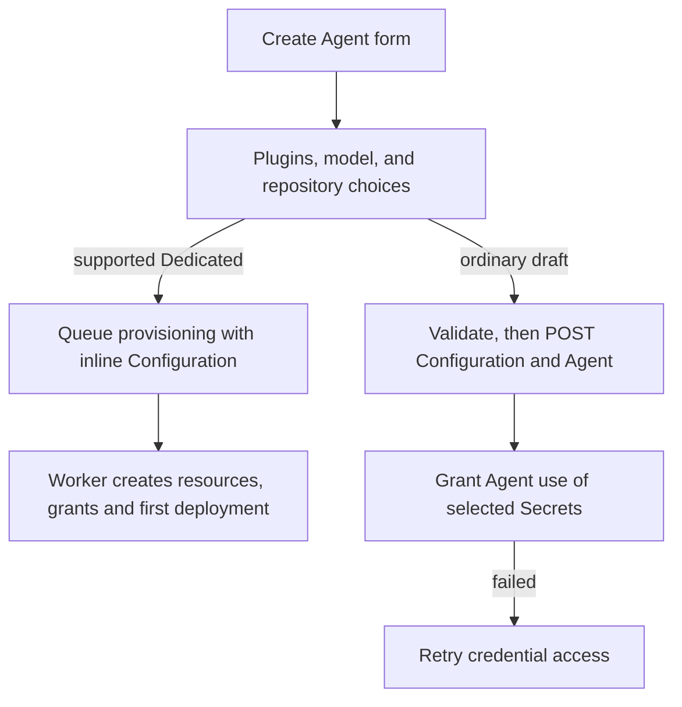

# Console Agent creation

## Overview

Trace the Create Agent form from plugin, model, and repository choices to a
provisioning request or an ordinary draft, then Secret grants and authentication.
The [parent flow](../platform-console.md) authorizes the page first; the
[creation reference](../../reference/console/create-and-deploy.md) owns
user-visible behavior.

## Entry Points

- `apps/controller/src/console/agents/create.mjs:renderCreateAgent` renders the
  form (`renderAgentForm`) and submits it.
- `apps/controller/src/console/agents/plugin-fields.mjs:createPluginFields` and
  `agents/repositories.mjs:createRepositoryFields` supply the plugin and repository fields.
- A signed-in caller with Namespace Agent `create`; each write is authorized again.

## Flow

## Execution Trace

### 1. Edit plugin selections and discover plugins

`agents/plugin-fields.mjs:createPluginFields` edits Agent `plugins` separately
from Configuration. Invalid JSON and untouched fields survive; clearing overrides
restores inheritance. Submission, uncertain outcomes, or invalid JSON lock editing.
`capabilities.pluginPolicies` gates policy edits; unsupported reviewers remain clearable.
A credential/access reminder sits beside the expandable
**Access and credential setup** disclosure. Instructions, list, and details
scroll within the dialog; search and pagination remain reachable.
While mounted, Available and Configured retain separate selected plugins, queries,
tool filters, and expanded rows without fetching pages or changing drafts.
Removed selections clear their details; discovery resets clear both tabs.

`agents/plugin-discovery.mjs:createPluginDiscovery` (`loadCatalog`, `loadTools`) implements
[PAT discovery](../agent-plugins.md#credential-scoped-discovery): the selected or
Preset Secret takes precedence over an entered token. OCC reads the
Secret server-side. Pagination is upstream; filtering is local. Selecting a plugin loads tools.
Credential, provider, and Harness changes clear results and invalidate pending reads.

### 2. Choose a model and starter Configuration

`create.mjs:MODEL_CHOICES` supplies unauthenticated static lists and manual entry.
`renderAgentForm` toggles `manualModel`, invoking `updateModelConfiguration` and
`updateControls`. Manual mode preserves `model.value` and clears the dropdown.
`resetModelChoices` restores the current provider's list, including Configuration
JSON changes, retaining only listed models; otherwise both inputs clear.
Provider/authentication changes retain no model. Submission matches the primary
Configuration model to `model.value`. `updateControls` sets the button label,
visibility, and required input; the toggle moves focus. Returning preserves credentials and unrelated
Configuration; saved-Configuration and pending-request locks govern both directions.

`configurationTemplate` enables Control UI with loopback origins on port 18789.
Compute supplies gateway authentication; Presets replace the starter unchanged.
[Native admin access](../agent-native-admin.md) owns HTTPS isolation.

### 3. Load repository options

`createRepositoryFields` loads `GET /namespaces/:namespaceId/agents/repository-options`,
then requests optional descriptions for visible refs. [Repository admission](../agent-repository-credentials.md) resolves the
submitted `repositoryAccess`. Retained drafts keep selections through failed
discovery; retries recheck current policy. Only `503 REPOSITORY_OPTIONS_UNAVAILABLE`
permits creation without bindings, and only without retained selections; other
failures block submission.

### 4. Submit provisioning or an ordinary draft

Supported Dedicated runtimes submit inline Configuration, optional repository
access, and Secret references to [provisioning](../agent-provisioning.md), even after
a `503 REPOSITORY_OPTIONS_UNAVAILABLE` outage. The worker reauthorizes, creates resources and exact Secret grants,
and deploys; Console polls and opens the saved version.

Ordinary drafts first check values and plugins with
`POST /namespaces/:namespaceId/agents/validate`, then post
`{kind: "agent", values, secretBindings}` to `.../configurations` and submit its ID,
plugins, `initialWorkspaceFiles`, and `workspaceDefaultsId` to `.../agents`.
Success opens `revision=draft`.
OCC stages all four workspace textareas, including unchanged/empty values, outside
Agent/Configuration for [workspace setup](../workspace-files.md).

### 5. Grant Secret access and edit authentication

`create.mjs:grantConfigurationSecretAccess` grants exact Secret `operate` for final
same-Namespace `env` bindings. Failure retains the Agent; **Retry credential access**
rereads grants without duplication. Grants are Installation administration: a session
whose `/observability` probe was refused sends no IAM request and names the administrator
step, and a member's refused grant offers no retry. After a refused Installation read, a
failed permission read offers **Retry permission check**, which rereads only that answer. Failed Agent writes retain Configuration ID
and lock JSON/Harness for explicit reuse. Writes never retry automatically; drafts
save no version and start no runtime.

`agents/harness-auth.mjs` edits bindings and shows
[Secret identities](agent-editing.md#4-render-draft-revision-or-channels),
never values. Authentication source uses the shared form-field presentation;
issued-account lookup feedback stays inside its conditionally visible account field.
Switching methods hides that feedback without changing the lookup or saved choice.

## Debugging and Verification

- `tests/browser/console-agents.test.ts`, `console-agent-presets.test.mjs`, and
  `console-agent-repositories.test.mjs` exercise the form against the real controller.
- A refused write shows the API's reason and a request ID; inspect saved
  Configuration and Agent IDs before retrying.

## Related docs

- [Return to the parent flow](../platform-console.md)
- [Agent provisioning](../agent-provisioning.md)
- [Agent editing](agent-editing.md)

## Manual Notes

[keep this for the user to add notes. do not change between edits]

## Changelog

- 2026-10-20 05:00: Split from the platform console flow's step 3. (docs-split-1020)
