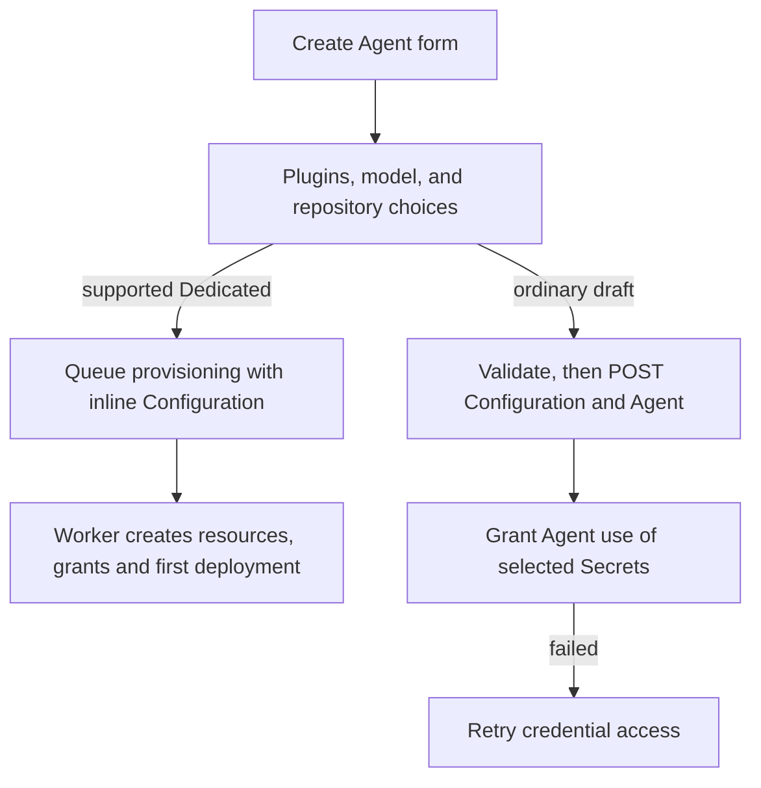

# Console Agent creation

## Overview

Trace the Create Agent form from plugin, model, and repository choices to a
provisioning request or an ordinary draft, then Secret grants and authentication.
The [parent flow](../platform-console.md) authorizes the page first; the
[creation reference](../../reference/console/create-and-deploy.md) owns
user-visible behavior.

## Entry Points

- `apps/controller/src/console/agents/create.mts:renderCreateAgent` renders the
  form (`renderAgentForm`) and submits it.
- `apps/controller/src/console/agents/plugin-fields.mjs:createPluginFields` and
  `agents/repositories.mts:createRepositoryFields` supply the plugin and repository fields.
- A signed-in caller with Namespace Agent `create`; each write is authorized again.

## Flow

## Execution Trace

### 1. Edit plugin selections and discover plugins

`agents/plugin-fields.mjs:createPluginFields` edits Agent `plugins` separately
from Configuration. Invalid JSON and untouched fields survive; clearing overrides
restores inheritance. Submission, uncertain outcomes, or invalid JSON lock editing.
`capabilities.pluginPolicies` gates policy edits; unsupported reviewers remain clearable.
A credential/access reminder sits beside the expandable
**Access and credential setup** disclosure. Instructions, list, and details
scroll within the dialog; search and pagination remain reachable.
While mounted, Available and Configured retain separate selected plugins, queries,
tool filters, and expanded rows without fetching pages or changing drafts.
Removed selections clear their details; discovery resets clear both tabs.

`agents/plugin-discovery.mjs:createPluginDiscovery` (`loadCatalog`, `loadTools`) implements
[PAT discovery](../agent-plugins.md#credential-scoped-discovery): the selected or
Preset Secret takes precedence over an entered token. OCC reads the
Secret server-side. Pagination is upstream; filtering is local. Selecting a plugin loads tools.
Credential, provider, and Harness changes clear results and invalidate pending reads.

The model credential, people search and Slack token fields use the shared
[Secret picker](agent-editing.md#4-render-draft-revision-or-channels). When a field first opens,
`renderCreateAgent` reads `GET /namespaces/:namespaceId/permissions/secrets`: the readable
Secrets the caller may not `operate`, reported only to a caller with Namespace read and Agent
`create`. Agent create, Configuration create and the people search refuse such a Secret, so each
field lists it disabled with its reason and never stages it; the Preset's **Use existing Secret**
list does the same, and **Use Preset** refuses it. A permission reread, a refused create or an
inline Secret create reads the answer again. A failed read keeps the last answer, or marks
none before any answer.

### 2. Choose a model and starter Configuration

`create.mts:MODEL_CHOICES` supplies unauthenticated static lists and manual entry.
`renderAgentForm` toggles `manualModel`, invoking `updateModelConfiguration` and
`updateControls`. Manual mode preserves `model.value` and clears the dropdown.
`resetModelChoices` restores the current provider's list, including Configuration
JSON changes, retaining only listed models; otherwise both inputs clear.
Provider/authentication changes retain no model. Submission matches the primary
Configuration model to `model.value`. `updateControls` sets the button label,
visibility, and required input; the toggle moves focus. Returning preserves credentials and unrelated
Configuration; saved-Configuration and pending-request locks govern both directions.

`configurationTemplate` enables Control UI with loopback origins on port 18789.
Compute supplies gateway authentication; Presets replace the starter unchanged.
[Native admin access](../agent-native-admin.md) owns HTTPS isolation.

### 3. Load repository options

`agents/repositories.mts:createRepositoryFields` loads `GET /namespaces/:namespaceId/agents/repository-options`,
then requests optional descriptions for visible refs. [Repository admission](../agent-repository-credentials.md) resolves the
submitted `repositoryAccess`. Retained drafts keep selections through failed
discovery; retries recheck current policy. Only `503 REPOSITORY_OPTIONS_UNAVAILABLE`
or `meta.notConfigured` (no `repository` settings) permits creation without bindings, and only without retained selections; other
failures block submission.

### 4. Submit provisioning or an ordinary draft

Supported Dedicated runtimes submit inline Configuration, optional repository
access, and Secret references to [provisioning](../agent-provisioning.md), even after
a `503 REPOSITORY_OPTIONS_UNAVAILABLE` outage. Before it saves a model Secret or registers a
Credential Source for the request, the form runs the preflight below with the planned method.
The worker reauthorizes, creates resources and exact Secret grants, and deploys; Console polls and opens the saved version. Where the form cannot follow a placement
refusal's advice to select Embedded OpenClaw, it shows only the missing setting.

The Installation capabilities do not show whether the Compute Driver supplies a Preset's
operator-managed (`runtime`) binding. When the capabilities are read, `checkRuntimeBinding` sends
that binding to the preflight below; a `harnessAuth.method` refusal disables **Create Agent** and
names what an administrator changes, because the form can change neither the binding nor the mode.

Before any write, `create.mts:renderAgentForm` checks the Agent name with the API's Name rule
(`namespaces.mts:namespaceNameProblem`) and each initial workspace file with the Workspace tab's
`agents/workspace.mts:workspaceFileProblem`, which names the file; the check opens Advanced
settings to it. A new Secret gets no `operate` grant, so where the `operate` answer above denies
any readable Secret, the Preset's **Create new Secret** choice is disabled and a typed model key
is refused before any write. It then checks the Agent name, draft values with their staged channel
`secretBindings`, plugins and the planned `harnessAuth`
(only the method for a Secret it saves next or registers with a Credential Gateway; none for
ChatGPT sign-in) with
`POST /namespaces/:namespaceId/agents/validate`, which refuses a name another Agent has with
Agent create's `409` and a channel token reference without a binding with Configuration
create's `400`. `list.mts:channelBindingRefusal` shows that refusal, and the same one from
provisioning, only under the Configuration JSON;
the Slack drawer requires both token Secrets while Slack is enabled. It then posts
`{kind: "agent", values, secretBindings}` to `.../configurations` and submits its ID,
plugins, `initialWorkspaceFiles`, and `workspaceDefaultsId` to `.../agents`.
Console checks the returned Secret name and Namespace, the Configuration values and bindings
it sent, and the Agent name, Namespace and Configuration. Before granting credential access it
reads that Agent and confirms its service principal matches the create response. A mismatch
stops the grant; **Retry credential access** reads the saved Agent again without recreating it.
An unrecognized success leaves the outcome unknown and blocks another create.
For an uncertain Credential Source registration, **Check credential registration** reads
the source for this request and confirms its type and Secret references before continuing.
If the Console times out waiting for validation, it stops before the save step,
keeps the form entries, and lets the caller select **Create Agent** to try again.
Success opens `revision=draft`.
OCC stages all four workspace textareas, including unchanged/empty values, outside
Agent/Configuration for [workspace setup](../workspace-files.md).

### 5. Grant Secret access and edit authentication

`create.mts:grantConfigurationSecretAccess` grants exact Secret `operate` for final
same-Namespace `env` bindings. Failure retains the Agent; **Retry credential access**
rereads grants without duplication. Grants are Installation administration: a session
known not to administer the Installation sends no IAM request and names the administrator
step, and a member's refused grant offers no retry. After a refused Installation read, a
failed permission read offers **Retry permission check**, which rereads only that answer. Failed Agent writes retain Configuration ID
and lock JSON/Harness for explicit reuse. Writes never retry automatically; drafts
save no version and start no runtime.

`agents/harness-auth.mjs` edits bindings and shows
[Secret identities](agent-editing.md#4-render-draft-revision-or-channels),
never values. Authentication source uses the shared form-field presentation;
issued-account lookup feedback stays inside its conditionally visible account field.
Switching methods hides that feedback without changing the lookup or saved choice.

## Debugging and Verification

- `tests/browser/console-agents.test.ts`, `console-agent-presets.test.ts`, and
  `console-agent-repositories.test.ts` exercise the form against the real controller.
- A refused write shows the API's reason and a request ID; inspect saved
  Configuration and Agent IDs before retrying.

## Related docs

- [Return to the parent flow](../platform-console.md)
- [Agent provisioning](../agent-provisioning.md)
- [Agent editing](agent-editing.md)

## Manual Notes

[keep this for the user to add notes. do not change between edits]

## Changelog

- 2026-10-25: The per-Secret `operate` remedy names an exact-Secret grant; the Agents list gives Create Agent's next step when Agent create is denied. (findings 2507, 2508)
- 2026-10-25: Refuse a typed model key, and disable the Preset's **Create new Secret**, where `operate` is denied on a readable Secret. (fix-2492, finding 2492)
- 2026-10-25: An inline Secret create rereads the `operate` answer before staging. (finding 2486)
- 2026-10-25: Secret fields and the Preset's existing Secret refuse readable Secrets the caller may not `operate`. (fix-2469, findings 2469, 2479)
- 2026-10-25: Send the Agent name to the preflight; mark and focus the name field when the preflight, provisioning or Agent create refuses it as taken. (fix-dogfood-r36, finding 2420)
- 2026-10-25 08:00: Refuse an operator-managed Preset when it opens where the Compute Driver refuses its binding (finding 2427). (fix-mutant-1025c)
- 2026-10-25 04:30: Run the preflight before a Credential Gateway registration too (finding 2406). (fix-postland-1025c - 44eebaad38)
- 2026-10-25 03:30: Run the preflight before provisioning saves the model Secret; trim placement advice the form cannot follow. (fix-postland-1025b - 2b1f510594)
- 2026-10-25 00:55: Name "no Sandbox Driver selected" as the reason Dedicated OpenClaw is disabled when the Installation lists Embedded. (finding 2384)
- 2026-10-25 00:30: Treat repository options with `meta.notConfigured` like the fixed-composition 503. (finding 2387)
- 2026-10-24 19:00: Check the Agent name and initial workspace files with the API's rules before any write. (fix-2339-2341)
- 2026-10-22 10:56: Confirm creation responses before granting access or continuing provisioning. (console-create-delivery-20261022 - eef3442ff)
- 2026-10-20 05:00: Split from the platform console flow's step 3. (docs-split-1020)
