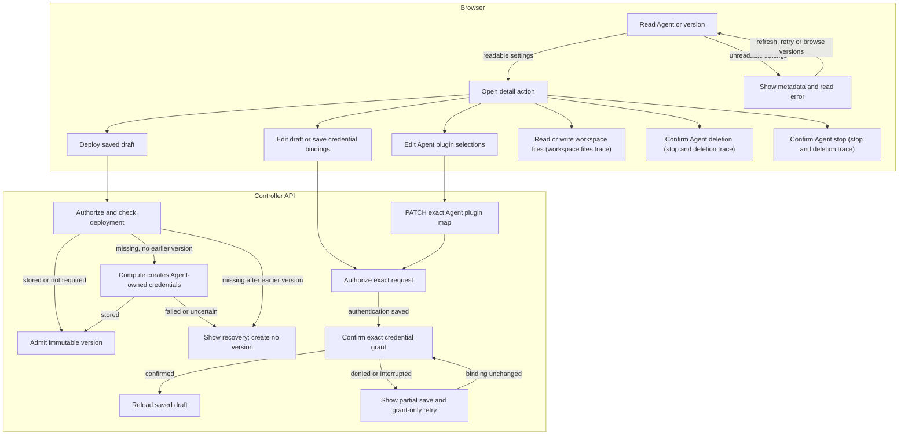

# Console Agent editing and runtime requests

## Overview

Related flows: [parent](../platform-console.md),
[workspace files](agent-workspace-files.md), [stop and deletion](agent-stop-and-deletion.md).

## Entry Points

- `apps/controller/src/console/agents/detail.mts:renderAgentDetail` loads the exact Agent and composes the detail actions.
- `apps/controller/src/console/agents/credentials.mjs:createChannelSecretsPanel` saves channel Secret bindings.
- `packages/occ/src/index.ts:OpenClawController.deployAgent` admits a version after first-deployment credential setup.
- Each action requires permission for its exact resource.

## Flow

## Execution Trace

### 4. Render draft, version, or channels

`apps/controller/src/console/agents/detail.mts:renderAgentDetail`

The page reads Agent, readable versions, and current Configuration
(`revision=draft`) or Agent revision (`revision=<id>`).
`packages/occ/src/index.ts` uses `listAgents`, `listRevisions`,
`getAgentForBrowsing`, and `getRevisionForBrowsing` for browsing.
`packages/occ/src/state/postgres-state.ts:browseSavedConfiguration` turns
payload-decode failures into metadata plus `configurationReadError`; queries
and operational reads remain strict. Unreadable drafts refuse editing and deployment without defaults.
**Selected for service** uses `activeRevisionId`; **Viewing version** selects a draft
or read-only version without activation. **Load older versions** appends pages,
retains selection, and focuses the picker after the last page. The picker marks
failures from `deploymentStatus` and `deploymentErrorCode` across reloads, excluding
superseded/stopped outcomes.

**Deployment** mounts activity, the selected record, and diagnostics
(`agents/deployment-evidence.mts`); polling continues across tabs.
Activity and its label are no scroll anchor (`console.css`), so the record keeps its place as
activity settles (3016).
`detail.mts:renderTab` offers **Retry** for transient snapshot errors.
Completion and reads after `FIRST_ACTIVITY_WAIT_MS` fold unless cleanup, warnings,
or overview errors need attention. Overview errors preserve outcomes.

`createDeploymentStatusPanel` polls until completion/refusal. Transient errors retain
progress; `invalidate`/`fail` clear caches and reads. `onFreshRecord` shares matching
GETs; `show` never republishes. Refusals override successes; any `401` expires the session.
`terminalOverview` tracks reconciliation without denied records. Unreconciled terminal
data reads Agent/revisions once; matching reads share work. Failures require explicit retry.
`readingOverview` protects explicit reads; `recordGeneration` rejects stale payloads.
Fresh evidence renders while Refresh stays busy.
**Refresh deployment** queues one full reread; **Refresh record** preserves focus
and ignores repeats. Refusals open details; matching errors share an alert.

`agents/deployment-recovery.mts` places failure recovery above the summary;
`deployment-failure-steps.ts` classifies `deploy-again`, `logs` or `change`.
Denied log/version reads hide Logs for this sign-in. **Open Configuration** requires
Configuration `update`, bound Secret `operate`, and no known read denial.
Read-only **Open draft** and **Deploy again** (`deploy-again`) require `deploy` and readable
Configuration; the latter focuses **Deploy new version**. Credential recovery
requires Agent saves. Hidden/unlisted current versions suppress recovery; viewed
versions retain their results.
**Current observations** in `agents/deployment-diagnostics.mts` requests timestamped
`succeeded`, `failed`, or `unknown` diagnostics without changing deployment status.
Its bodyless POST requires Agent `read`/`operate` and exact Agent revision `read`.
**Open draft** opens the saved draft; **Deploy new version** admits its
Configuration/plugins. **Edit current Configuration** never copies historical
values. Deploy stays disabled while the Secret permission answer names a bound
Secret the caller may not `operate`, or counts one the caller may neither `read`
nor `operate`; that reason names no Secret (finding D756). After deployment, versions omitted from the newest page appear unreadable without
an audited read (finding D758).

**Edit Configuration** rereads the Agent and Configuration, then PATCHes only
`{ values, expectedGeneration }`, preserving `secretBindings`. A changed ID or stale
generation (also a racing save's `409`) requires **Reload draft**.
A response not confirming the same Configuration and Namespace, a newer generation, and the
sent values and bindings is an unknown outcome; reload before saving again.
A focused, disabled **Save Configuration** moves focus to **Checking Configuration…**.
Success focuses **Edit Configuration** unless the reader moved focus.

**Enable gateway password access** and **Collaboration and safety**
(`agents/gateway-safety.mts`) stage edits here; **Cancel** discards them. Password access sets `gateway.auth.password` to reference `OPENCLAW_GATEWAY_PASSWORD`, changing nothing else. Kubernetes
`gatewayConfiguration` recognizes the reference; `deployment` supplies the password.

Saves preserve scroll, focus and admitted snapshots. Rejected edits stay. Unsaved edits block deployment; pending saves block tab and version changes.
A refused write lists required grants without guessing which; a refused preflight read names read
access, a Workspace file save Agent `operate`. Without Agent `update`, Configuration `read` or
bound-source grants (`operate`, and `read` on a Harness ServiceAccount; the note names both),
plugins and repository access are summaries (dropping a kept plugin edit) and authentication is
disabled. Reads the answer refuses are skipped.
Lacking Configuration `update` makes Configuration and channels read-only; lacking `operate` on a
bound Secret does too, unless, for channels, each such Secret has a Slack token name; with nothing
editable, the draft says so and, without deploy, has no checklist.

`agents/plugin-fields.mts:createPluginFields` renders **Plugins**.
`agents/plugins.mts:savePlugins` rereads the Agent before PATCH. If the Agent,
Namespace, Configuration, selections, or approvers differ from the editor's
baseline, it sends no write. This read does not lock the Agent. The editor clears
the draft only when the response confirms that identity and the submitted settings.
The page then rebuilds from that response, which also carries a Stop or
deployment made since the page loaded.
**Reload plugin selections** discards the local draft and reads the Agent without
repeating the PATCH. A successful read rebuilds the editor from saved settings.
If the read fails, the Console opens the draft page again. The Plugin Driver
validates the selections before deployment [snapshots the saved settings](../agent-plugins.md).

**Repositories** uses `createRepositoryFields` with exact-Agent discovery and
PATCHes `repositoryAccess`. Unsaved edits also block tabs; failed discovery leaves
access unverified.

Deployment rereads Agent and Configuration, requires authentication and
Slack bindings, and blocks Teams. Changed association, generation, authentication,
plugins, execution mode, Backend, or repository access require reload; controls
stay locked while pending. Snapshot views deploy current settings. Failed reads
send no bodyless deploy POST; success opens the version. Uncertain POSTs require
history readback before retry; browser reads are not atomic with admission.

`apps/controller/src/console/drafts.mts:createDraftStore` holds document-local drafts.
`console.mjs:resetReads` and `detail.mjs:renderTab` capture fields before teardown,
excluding passwords. Namespace and Agent keys isolate drafts; session expiry,
user change, logout, exit, and reload clear them. Nothing enters browser storage
or URLs. Configuration, authentication, and channel baselines prevent stale saves;
channel snapshots include controls and staged Secret metadata. Reload draft reapplies
only the reader's edits, naming overlaps and skipped choices. Save and Cancel
clear captures; pending saves retain recovery guards.

`dom.mts:dismissOnBackdrop` requires press and click outside the topmost editor.
Like Escape, cancellation discards channel drafts, clears Secret inputs, and
retains plugin selections. Pending channel saves and Secret creation prevent dismissal.

`apps/controller/src/console/channels.mjs:renderChannels` renders Slack settings;
only **Open draft** permits editing. The
[console reference](../../reference/console/versions-and-channel-drafts.md)
owns Slack requirements and rejected native shapes; Teams remains native JSON.

`agents/detail.mts:renderConfigurationTab` reads draft Harness authentication
from the Agent, or admitted authentication and channel `secretBindings` from the
version. `agents/secret-picker.mjs:renderSecretReference` checks the source
Namespace and reads exact Secret metadata. On Agent detail, unless the session
is an Installation administrator, it first reads the readable Namespace's Secret
list once per view: the list audits nothing it leaves out, while each refused
exact read is an audited denial. A Secret it leaves out shows as unavailable
without the exact read (finding 2619). Successful reads link names to
`/console/secrets?secret=<id>`, which opens that Secret's metadata and consumers;
Secret fields link only a Secret their list includes and give an unlisted one
the same unavailable sentence (finding D757). Successful reads show names and IDs;
absent, loading, and unavailable states remain distinct. Failures retain IDs;
stale responses are ignored and current 401s expire the session. Summaries need
neither collection permission nor Secret values.

`apps/controller/src/console/channels/slack.mjs:appendFields` separates channel
senders from DMs. Wildcard, empty, or omitted channel `users` selects **Allow
everyone**; explicit IDs fill the mutually exclusive input. Mention
requirements remain independent. `updatedSlack` replaces selected channels'
`users`, preserving DM and group policies, unrelated settings, and bindings.

The DM selector preserves omitted policies on existing configurations; new setup
starts with Allowlist. `validate` rejects empty/wildcard DM allowlists and
unsupported organization-wide policies. Selecting Open writes `allowFrom: ["*"]`;
leaving it for Allowlist or Pairing clears the wildcard input. Untouched lists
and native `dm.enabled` remain unchanged. Configuration save persists the
selection; redeployment applies it. See
[Slack policies](../../reference/configuration/secrets.md#native-channel-configuration).

`apps/controller/src/console/agents/detail.mts:renderAgentDetail` supplies Namespace,
bindings and Credentials URL to `channels/slack.mjs:credentialReferenceField`.
`GET /namespaces/:namespaceId/secrets` requires Namespace read;
`packages/occ/src/index.ts:listSecrets` filters exact Secret read without the Secret Driver.
`agents/secret-picker.mjs:createSecretReferenceField` filters names/IDs. Arrows navigate,
Enter selects, Escape restores, Cancel discards; typing stages nothing, selection stages references.
**Refresh Secret list** preserves query, focus, staged fields and highlighted IDs across reordering;
vanished highlights require new intent. It retries metadata, never saves; pending reads disable refresh.
When a selection waits for permission, a refused list clears readable metadata and prevents that
selection from staging. The completed refresh clears its loading hint without replacing newer feedback.
False Namespace `secrets.create` disables creation with reasons and existing-only drawer/Preset hints.
**Save configuration** requires changed fields/bindings.
`GET .../agents/:agentId/permissions/secrets` lists readable but inoperable Secrets, disabled with
reasons, never staged. Refused binding saves reread it; inline creation rereads before staging.
Any listed denial means per-Secret operate: new Secrets have none, disabling picker/Preset
creation with reasons and existing-only hints. Failed rereads keep prior answers.

`apps/controller/src/console/agents/secret-picker.mjs:openCreateSecretDialog` shows
an editable Agent-prefixed Name, the Secrets page's `secretValueControl` (CRLF becomes LF),
and optional fixed Slack key. Both meet the API's rules before POST, which stores the Secret
and stages returned metadata; cancellation never deletes it. Conflicts retain inputs.
Readiness errors differ from name/backend conflicts. Success, cancellation, and uncertain outcomes clear values;
uncertain outcomes block retries until refresh. The
[Secret storage flow](../secret-storage-and-delivery.md) owns persistence and
recovery. Metadata and Credentials links open new tabs, preserving edits.
Values are never retrieved.

Channel saves reread the Agent and Configuration. A changed Configuration, service principal,
or generation requires **Reload draft** before a write or Secret grant. A provisioning
reservation explains the refusal. PATCH sends
`{ values, expectedGeneration }`, plus every binding after a Secret change; a save keeping a Secret
the caller cannot `operate` is refused before the PATCH, so **Disable** is offered disabled.
A save that rebinds such a Secret rereads the permission answer; Plugins, Repositories and the
authentication source follow it without a reload.

After PATCH, `apps/controller/src/console/agents/credential-access.mjs:ensureCredentialOperateBinding`
grants the Agent service principal access to selected Secrets through Namespace IAM. A failed
grant leaves Configuration saved; a 403 names the Installation administrator, who selects
**Retry Secret access**; a timeout or 5xx stays unknown. A member's session sends no grant and
says access was not verified until **Reload draft**. An administrator's console checks every
bound Secret's grant, as deployment does, with Slack on or off; Deploy waits for those reads and
rechecks before its POST, and a save or Retry during one reads again before naming Deploy. With
Slack off, the section shows only while a bound Secret's grant waits, with only Retry (3018),
whose success names the granted access. A Retry carries no Secret choices into **Reload draft** (3021).
A Retry's warning names only the grant, and a later save's names the Configuration save (3023,
3029); after **Reload draft** the section waits for its grant read instead of restating that outcome.
If it finds nothing outstanding, the section says access is confirmed and focuses that line (3030).
`agents/credentials.mjs:missingChannelCredentialGroups` reads token keys as the Slack Channel
Driver does; pickers appear only for standard keys. A 400 that
`agents/list.mjs:channelBindingRefusal` matches shows the API's message. An uncertain PATCH
blocks another channel write until Refresh. Disabling a draft channel changes Configuration
but does not stop a running Agent.

### 5. Save authentication and deploy the first version

`apps/controller/src/console/agents/detail.mts:renderAgentDetail` rereads the
Agent and rejects changed bindings before saving authentication. PATCH replaces
the prior Harness `credentialSources` entry, preserving unrelated entries without
deleting the old source or revoking grants. After PATCH,
`apps/controller/src/console/agents/credential-access.mjs:ensureCredentialOperateBinding`
grants the Agent service principal exact Secret (`api_key` or imported `codex_pat`)
or CredentialSource `operate` through the actor's IAM authority. Managed
ServiceAccount PATs and runtime authentication skip this grant.

Grant failure preserves saved authentication and freezes controls. `credentials.mjs:grantWarning`
names the outcome; members send no grant and get no retry. **Retry credential access**
rechecks identity and bindings before granting. Uncertain PATCH requires **Reload authentication
source**. Pending access survives navigation and holds deployment until confirmed or reloaded;
members' unverified grants do not. Administrator Namespace IAM denials also hold deployment.
Admission remains authoritative; confirmed access does not prove provider readiness.

Authentication and JSON Save preflight 403 call `detail.mts:retireSaveRead`. The shell's
`onProtectedReadDenied` clears that Agent's scoped drafts and retires its view before
completion handlers run. The causal receipt and request ID remain; history cannot restore data. Binding preflight uses the same boundary. Retry receipts preserve
prior saved-binding success and identify the failed read, without names or identifiers.
No write or grant starts on denied preflight. Transient reads and PATCH refusals keep their
contextual recovery. Lifecycle polling remains separately owned.

Deployment also authorizes the caller's Secret `operate` on each bound Secret. When the
Agent's `permissions/secrets` answer lists one, Deploy is disabled with a note naming it; a
generic deploy `403` rereads the answer and names them in its alert. A caller with Agent
`deploy` but neither update gets an answer only on the Secrets the draft binds.

**Operator-managed credentials** saves `{ "method": "runtime" }` without a source,
requiring readable version history and an unchanged draft. API authorization and
Driver compatibility remain authoritative.

**Open draft** shows bound Slack Secrets without proving live health.

`OpenClawController.deployAgent` checks transport credentials before admission.
Before the first version, Agent `read`/`operate` plus `deploy` authorize Compute
to check ownership/workloads and create missing whole Secrets, preserving matching
groups. Bytes enter neither Configuration nor audit.
Failure admits no version; retry rechecks status. Missing credentials after an
earlier version require operator investigation. Model/channel Secrets stay separate.

### 6. Read and replace live workspace files

`apps/controller/src/console/agents/workspace.mts:renderWorkspaceFiles`.
Moved to [Agent workspace files](agent-workspace-files.md#6-read-and-replace-live-workspace-files).

### 7. Request a stop and read back the Agent

`apps/controller/src/console/agents/stop.mts:createAgentStop`.
Moved to [Agent stop and deletion](agent-stop-and-deletion.md#7-request-a-stop-and-read-back-the-agent).

### 8. Confirm deletion and read back the Agent

`apps/controller/src/console/agents/deletion.mjs:createAgentDeletion`.
Moved to [Agent stop and deletion](agent-stop-and-deletion.md#8-confirm-deletion-and-read-back-the-agent).

## Debugging and Verification

- Run `node --test tests/browser/console-deployment-activity.test.ts`: Controller-backed
  disclosure, overlap, and refusal checks, not runtime proof.

- A denied Secret list requires collection `read`; a missing menu entry may lack
  exact Secret `read`.
- After a partial save, inspect Configuration, Secret metadata, and Agent IAM
  bindings before retrying; storage and binding do not prove runtime delivery.
- After a plugin edit, compare saved `Agent.plugins` with the version's plugin
  snapshot; an Agent update installs or activates no plugin until a deployment.
- [Console failures](../../reference/console.md#failures-and-logout) covers session,
  permission, and network recovery.

## Related docs

- [Agent lifecycle reference](../../reference/agents.md#deletion)
- [Agent plugin flow](../agent-plugins.md)
- [Agent sharing flow](agent-sharing.md)

## Manual Notes

[keep this for the user to add notes. do not change between edits]

## Changelog

- 2026-10-31 09:00: Confirm access when the read after Reload draft finds no grant outstanding. (fix-3030)

- 2026-10-31 08:00: Name the save after a refused Retry. (fix-offers-1031)

[Console Agent editing documentation history](agent-editing/history.md) preserves the older dated entries.
