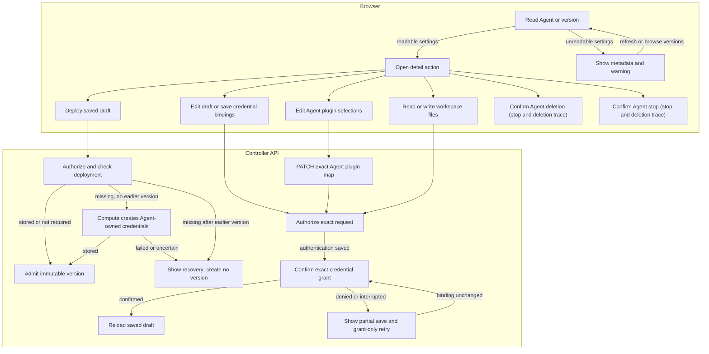

# Console Agent editing and runtime requests

## Overview

Trace Agent edits, credentials, and workspace files. See the
[parent flow](../platform-console.md); [stop and deletion](agent-stop-and-deletion.md)
have their own trace.

## Entry Points

- `apps/controller/src/console/agents/detail.mjs:renderAgentDetail` loads the exact Agent and composes the detail actions.
- `apps/controller/src/console/agents/credentials.mjs:createChannelSecretsPanel` saves channel Secret bindings.
- `packages/occ/src/index.ts:OpenClawController.deployAgent` admits a version after first-deployment credential setup.
- A signed-in caller must hold each action's permission on the exact resource.

## Flow

## Execution Trace

### 4. Render draft, version, or channels

`apps/controller/src/console/agents/detail.mjs:renderAgentDetail`

The page reads Agent, readable versions, and current Configuration
(`revision=draft`) or immutable Agent revision (`revision=<id>`).
`packages/occ/src/index.ts` uses `listAgents`, `listRevisions`,
`getAgentForBrowsing`, and `getRevisionForBrowsing` for browsing.
`packages/occ/src/state/postgres-state.ts:browseSavedConfiguration` turns
payload-decode failures into metadata plus `configurationReadError`; queries
and operational reads remain strict. Drafts and versions decode independently.
The UI preserves navigation and exact-resource permissions, refusing unreadable-draft
editing/deployment without defaults.
**Selected version** uses `activeRevisionId`; **View version vN** opens read-only
details without activating it. **Deployment activity** shows the newest readable
version's persisted status, not live health. Routine completion folds; pending work,
read errors, warnings, and cleanup stay visible. A first read that lands after the
`FIRST_ACTIVITY_WAIT_MS` reveal fills the folded one-row stand-in without opening it (the
summary shows its outcome); cleanup, warnings, and overview errors still open it, so nothing
above the version tabs moves. Failed deployments show the API's message
(logs advice if it names no step) and offer Logs unless log text or version access was
denied this sign-in. **Open Configuration** needs Agent `update` and no known Configuration
read error or denial. **Open version draft** (`deploy` only) and **Deploy again** (per the
message) need `deploy` and a successful Configuration read; Deploy again focuses **Deploy new
version**. Credentials recovery needs `update`. Hidden or unlisted
current versions suppress recovery; viewed versions show results. Activity polls every
`DEPLOYMENT_POLL_MS`, through transient read errors, until a result, denial, or missing record; a new result also rereads selection. **Refresh deployment** rereads
activity and selection, after any poll in flight. Polls patch in place (`patchChildren`), so
an unchanged poll writes nothing. A pending deploy lists its result rows before the first attempt;
the details keep their tallest height until Refresh after it settles. **Current observations** requests timestamped
`succeeded`, `failed`, or `unknown` diagnostics without changing deployment status.
Its bodyless POST requires Agent `read`/`operate` and exact Agent revision `read`.
**Create new version** opens the saved draft; **Deploy new version** admits its
Configuration/plugins. **Edit current Configuration** never copies historical
values. Stop/deletion target the Agent.

**Edit Configuration** rereads the Agent and Configuration, then PATCHes only
`{ values, expectedGeneration }`, preserving `secretBindings`. A changed ID or stale
generation (including a `409` from a racing save) requires **Reload draft**.
When a focused **Save Configuration** becomes disabled, focus moves to **Checking Configuration…**.
Success focuses **Edit Configuration**, unless the reader moved focus elsewhere during the save.

**Enable gateway password access** sets `gateway.auth.password` to reference
`OPENCLAW_GATEWAY_PASSWORD`, changing nothing else; **Cancel** discards it. Kubernetes
`gatewayConfiguration` recognizes the reference; `deployment` supplies the password.

Saves preserve scroll, focus and admitted snapshots. Rejected edits stay in the editor;
an uncertain save requires readback. Unsaved edits block deployment; pending saves block tab and version changes.
A refused write lists required grants without guessing which; a refused preflight read names read
access, a Workspace file save Agent `operate`. Lacking Agent `update` disables plugin, repository
and authentication editors; Configuration saves get no such hint.

`agents/plugin-fields.mts:createPluginFields` renders **Plugins**.
`agents/plugins.mts:savePlugins` rereads the Agent before PATCH. If the Agent,
Namespace, Configuration, selections, or approvers differ from the editor's
baseline, it sends no write. This read does not lock the Agent. The editor clears
the draft only when the response confirms that identity and the submitted settings.
**Reload plugin selections** discards the local draft and reads the Agent without
repeating the PATCH. A successful read rebuilds the editor from saved settings.
If the read fails, the Console opens the draft page again. The Plugin Driver
validates the selections before deployment [snapshots the saved settings](../agent-plugins.md).

**Repositories** uses `createRepositoryFields` with exact-Agent discovery and
PATCHes `repositoryAccess`. Unsaved edits also block tabs; failed discovery leaves
access unverified.

Deployment rereads Agent and Configuration, requires authentication and
Slack bindings, and blocks Teams. Changed association, generation, authentication,
plugins, execution mode, Backend, or repository access require reload; controls
stay locked while pending. Snapshot views deploy current settings. Failed reads
send no bodyless deploy POST; success opens the version. Uncertain POSTs require
history readback before retry; browser reads are not atomic with admission.

`apps/controller/src/console/drafts.mts:createDraftStore` holds document-local drafts.
`console.mjs:resetReads` and `detail.mjs:renderTab` capture fields before teardown,
excluding passwords. Namespace and Agent keys isolate drafts; session expiry,
user change, logout, exit, and reload clear them. Nothing enters browser storage
or URLs. Configuration, authentication, and channel baselines prevent stale saves;
channel snapshots include controls and staged Secret metadata. Reload draft reapplies
only the reader's edits, naming overlaps and skipped choices. Save and Cancel
clear captures; pending saves retain recovery guards.

`dom.mts:dismissOnBackdrop` requires press and click outside the topmost editor.
Like Escape, cancellation discards channel drafts, clears Secret inputs, and
retains plugin selections. Pending channel saves and Secret creation prevent dismissal.

`apps/controller/src/console/channels.mjs:renderChannels` renders Slack settings;
only **Create new version** permits editing. The
[console reference](../../reference/console/versions-and-channel-drafts.md)
owns Slack requirements and rejected native shapes; Teams remains native JSON.

`agents/detail.mjs:renderConfigurationTab` reads draft Harness authentication
from the Agent, or admitted authentication and channel `secretBindings` from the
version. `agents/secret-picker.mjs:renderSecretReference` checks the source
Namespace and reads exact Secret metadata. Successful reads link names and IDs;
absent, loading, and unavailable states remain distinct. Failures retain IDs;
stale responses are ignored and current 401s expire the session. Summaries need
neither collection permission nor Secret values.

`apps/controller/src/console/channels/slack.mjs:appendFields` separates channel
senders from DMs. Wildcard, empty, or omitted channel `users` selects **Allow
everyone**; explicit IDs fill the mutually exclusive input. Mention
requirements remain independent. `updatedSlack` replaces selected channels'
`users`, preserving DM and group policies, unrelated settings, and bindings.

The DM selector preserves omitted policies on existing configurations; new setup
starts with Allowlist. `validate` rejects empty/wildcard DM allowlists and
unsupported organization-wide policies. Selecting Open writes `allowFrom: ["*"]`;
leaving it for Allowlist or Pairing clears the wildcard input. Untouched lists
and native `dm.enabled` remain unchanged. Configuration save persists the
selection; redeployment applies it. See
[Slack policies](../../reference/configuration/secrets.md#native-channel-configuration).

`apps/controller/src/console/agents/detail.mjs:renderAgentDetail` supplies Namespace,
bindings, and Credentials URL to `channels/slack.mjs:credentialReferenceField`.
It loads `GET /namespaces/:namespaceId/secrets`; Namespace read is required.
`packages/occ/src/index.ts:listSecrets` filters records by exact Secret read
without calling the Secret Driver. Shared `agents/secret-picker.mjs:createSecretReferenceField`
filters names/IDs in a combobox. Arrows navigate, Enter selects, and Escape
restores the binding. Typing stages nothing; selection stages a reference,
Cancel discards it. Creation remains available.

`apps/controller/src/console/agents/secret-picker.mjs:openCreateSecretDialog` shows
an editable Agent-prefixed Name, password input, and optional fixed Slack key.
POST stores the Secret immediately and stages returned metadata; cancellation
never deletes it. Conflicts retain inputs without overwriting Secrets.
Readiness errors differ from name/backend conflicts. Success, cancellation, and uncertain outcomes clear passwords;
uncertain outcomes block retries until refresh. The
[Secret storage flow](../secret-storage-and-delivery.md) owns persistence and
recovery. Metadata and Credentials links open new tabs, preserving edits.
Values are never retrieved.

Channel saves reread the Agent and Configuration. A changed association or stale generation
offers **Reload draft**; a provisioning reservation explains the refusal. PATCH sends
`{ values, expectedGeneration }` and changed `secretBindings`. Rejection grants no Secret access.

After PATCH, `apps/controller/src/console/agents/credential-access.mjs:ensureCredentialOperateBinding`
grants the Agent service principal access to selected Secrets through Namespace
IAM. A failed grant leaves Configuration saved. The detail view rereads bindings
and asks a Namespace administrator to grant access without repeating the
channel save. An uncertain PATCH blocks another
channel write until Refresh. Disabling a draft channel changes Configuration
but does not stop a running Agent. The
[console reference](../../reference/console/versions-and-channel-drafts.md)
describes the supported edits and their deployment boundaries.

### 5. Save authentication and deploy the first version

`apps/controller/src/console/agents/detail.mjs:renderAgentDetail` rereads the
Agent and rejects changed bindings before saving authentication. PATCH replaces
the prior Harness `credentialSources` entry, preserving unrelated entries without
deleting the old source or revoking grants. After PATCH,
`apps/controller/src/console/agents/credential-access.mjs:ensureCredentialOperateBinding`
grants the Agent service principal exact Secret (`api_key` or imported `codex_pat`)
or CredentialSource `operate` through the actor's IAM authority. Managed
ServiceAccount PATs and runtime authentication skip this grant.

Grant failure preserves saved authentication and freezes controls.
**Retry credential access** rejects changed bindings and retries only the grant;
rereading bindings recovers lost responses. An uncertain PATCH requires
**Reload authentication source** before saving or granting. Pending access
survives navigation and blocks deployment until confirmed or reloaded. Admission
remains authoritative; preflight/authorization errors stay separate from credential
metadata. Confirmed access does not prove provider readiness.

`apps/controller/src/console/agents/credentials.mjs:createChannelSecretsPanel`

**Operator-managed credentials** saves `{ "method": "runtime" }` without a source,
requiring readable version history and an unchanged draft. API authorization and
Driver compatibility remain authoritative.

**Create new version** shows bound Slack Secrets without proving live health.

`OpenClawController.deployAgent` checks transport credentials before admission.
Before the first version, Agent `read`/`operate` plus `deploy` authorize Compute
to check ownership/workloads and create missing whole Secrets, preserving matching
groups. Bytes enter neither Configuration nor audit.
Failure admits no version; retry rechecks status. Missing credentials after an
earlier version require operator investigation. Model/channel Secrets stay separate.

On explicit submission, the browser rereads Agent and Configuration; a changed
ID or generation requires reload. It then PATCHes selected Secret references with
`expectedGeneration`, preserving other bindings, then calls `ensureCredentialOperateBinding` for changed
and pending Secrets. A post-PATCH grant failure leaves bindings saved and blocks
deployment in the current view. Subsequent saves retry still-referenced pending
grants. Picker edits and rejected PATCHes preserve that warning; only a confirmed
grant or confirmed removal of its reference clears the pending Secret. Explicit
refresh resets local outcome tracking; the API always enforces Secret access.
Pickers switch references; rotating shared Secret values is separate.

### 6. Read and replace live workspace files

`apps/controller/src/console/agents/workspace.mjs:renderWorkspaceFiles` opens from
`tab=workspace` after an exact Agent read. Contents belong to the live Agent, not Configuration or version history.
With no selected version, files stay unavailable and no file request is sent. Another current version
keeps the editors, focus and caret, rereading unedited files in place; gaining or losing one rebuilds them.

The editor GETs each supported filename and normalizes textareas to LF. An
untouched CRLF file stays clean and is not rewritten. Only an edit enables Save.
The response reauthorizes access before restoring retained text, including empty
edits. Drafts keep their baseline; Reload replaces them. A 404 without an unknown
write permits an explicit create, including an empty file; other failures disable
Save. Save PUTs `{ content }` on the exact-Agent route. It neither patches
Configuration nor admits a version. The [workspace flow](../workspace-files.md)
owns authorization and native transport. Results are per file. An unknown write
waits for explicit Reload. Current contents, or the formal missing-file 404,
settle it and open an empty editor for a deliberate create. Another 404, a
denial, or an unavailable read stays guarded. The editor never retries or creates
a file.

The [creation trace](../platform-console.md#3-authorize-the-selected-page-resource)
covers initial channel settings and Secret bindings.
`apps/controller/src/console/agents/create.mjs` submits `initialWorkspaceFiles`
and `workspaceDefaultsId`. OCC stages these privately for Compute's initialization
before execution; no gateway is needed. The [workspace setup flow](../workspace-files.md)
owns initialization, retries, and cleanup. Live editing requires deployment.

### 7. Request a stop and read back the Agent

Moved to [Agent stop and deletion](agent-stop-and-deletion.md#7-request-a-stop-and-read-back-the-agent).

### 8. Confirm deletion and read back the Agent

Moved to [Agent stop and deletion](agent-stop-and-deletion.md#8-confirm-deletion-and-read-back-the-agent).

## Debugging and Verification

- A denied Secret list requires collection `read`; a missing menu entry may lack
  exact Secret `read`. Saving bindings also requires caller `operate` on those
  Secrets, Configuration update, and Namespace IAM authority to grant Agent use.
- After a partial save, inspect Configuration, Secret metadata, and Agent IAM
  bindings before retrying. Storage and binding do not prove runtime delivery;
  deploy and verify the consuming Agent.
- Compare saved `Agent.plugins` with the viewed version's plugin snapshot after
  a plugin edit. A successful Agent update does not install or activate plugins;
  deploy and inspect startup status separately.
- See [console failures](../../reference/console.md#failures-and-logout) for
  session, permission, and network recovery.

## Related docs

- [Return to the parent flow](../platform-console.md).
- [Console reference](../../reference/console.md)
- [Agent lifecycle reference](../../reference/agents.md#deletion)
- [Agent plugin flow](../agent-plugins.md)
- [Agent sharing flow](agent-sharing.md)
- [Agent stop and deletion flow](agent-stop-and-deletion.md)

## Manual Notes

[keep this for the user to add notes. do not change between edits]

## Changelog

- 2026-10-22 10:14: Trace plugin save confirmation and recovery when the response is incomplete or identifies different settings. (01a162ec-b748-7c42-9034-1f0a92b05703 - 345d9f63d)
- 2026-10-20 05:00: Move steps 7 and 8 (stop, deletion) to [their own trace](agent-stop-and-deletion.md). (docs-split-1020)
- 2026-10-18 20:30: Show each failure's next step; add Deploy again. (ux-a1)

[Console Agent editing documentation history](agent-editing/history.md) preserves the older dated entries.
