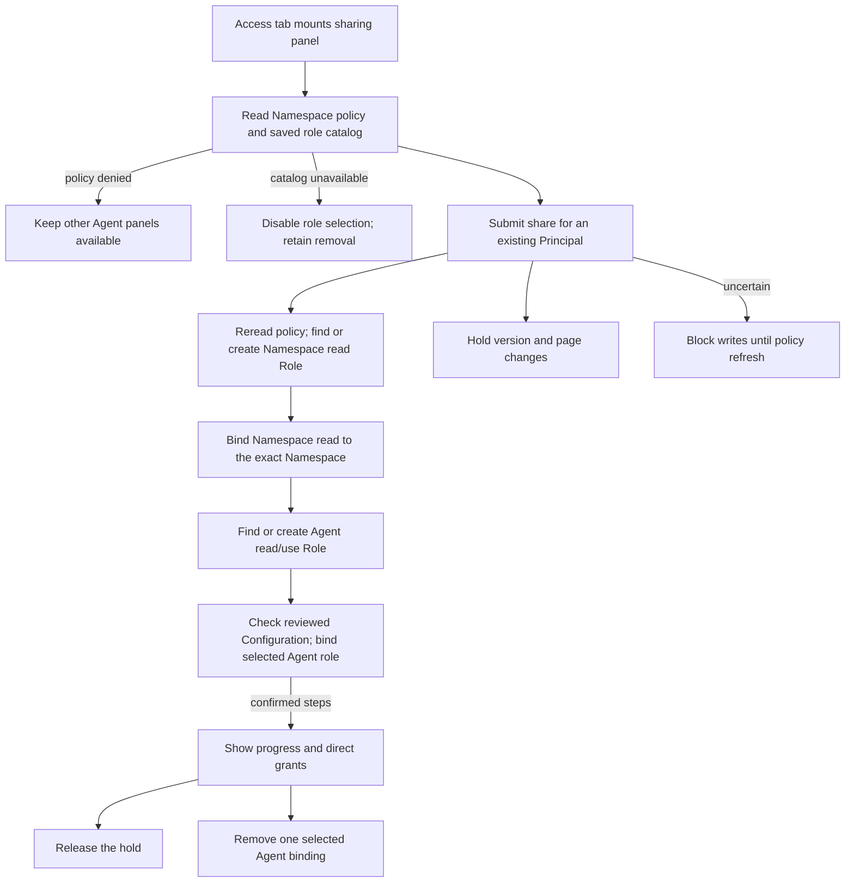

# Console Agent sharing and removal

## Overview

Trace how Agent detail shares one Agent with an existing Principal and removes
one explicit Agent binding. The trace starts when Agent detail's Access tab
mounts the sharing panel and stops at policy configuration; native gateway admission and
runtime readiness belong to the [native admin flow](../agent-native-admin.md).
See the [parent flow](../platform-console.md) and the
[sharing reference](../../reference/console/agent-sharing.md).

## Entry Points

- `apps/controller/src/console/agents/access.mts:renderAgentAccess` renders the
  sharing panel on Agent detail's Access tab.
- `apps/controller/src/console/agents/detail.mts:renderAgentDetail` mounts it when
  that tab first opens.
- Assumptions: a signed-in Installation administrator, an existing Principal ID,
  and the Namespace IAM policy endpoints.

## Flow

## Execution Trace

### 1. Mount the panel and read policy

`apps/controller/src/console/agents/access.mts:renderAgentAccess`

The Access tab mounts sharing independently of version/configuration reads and
native admission. Agent detail leaves the tab out when the console's observability
probe already showed the person lacks Installation administration: the policy
endpoints require it and the API audits each denial. The panel reads `/agents/:agentId/runtime-roles` and the selected Namespace’s
`/iam/roles` and `/iam/access-bindings` endpoints. A policy `403` hides the
panel and the tab, opens Configuration, and leaves the other panels usable; a current `401` retains global
session expiry.

The catalog carries saved Configuration ID/generation, assignable roles, desired
runtime state and optional active-revision role summaries. Configured and deployed
permissions are shown separately, including before deployment and while stopped.
A failed catalog read clears role choices and retains removal.
Sharing owns catalog return checks through `context.onRevalidate`, using
`rereadOnResume` outside the generic GET cache. An unfinished read rebuilds the
panel; a completed panel refreshes its choices in place and clears consent when
the catalog changes. Catalog failure leaves unrelated drafts and live logs intact.

### 2. Serialize Role and binding writes

`apps/controller/src/console/agents/access.mts:matchesRole`

Submission rereads policy, finds or creates an immutable Role by exact Namespace
and permissions, then binds Namespace read to the exact Namespace. Only after
that response does it find or create the exact Agent read/use Role and
bind it to the selected Agent with the chosen runtime role and the reviewed Configuration precondition. Policy readback does not silently refresh that precondition. Explicit refresh or a return check replaces the catalog; changed policy clears the person's consent. The panel rejects a subject that is not a `prn_`
Principal ID, such as an email, before any request, and reports a `404` during a
share as an unknown Principal ID. The server validates the supplied subject and
resource on each write. When the person already has a runtime assignment, the panel preserves it and grants exact Agent read separately if missing. Confirmed progress survives later failure; unknown
results disable mutations until an explicit current-policy refresh. Readback is
configuration evidence, not a historical receipt, and never triggers a write.

### 3. Change the selected runtime role

`apps/controller/src/console/agents/access.mts:writeRuntimeRole`
`packages/occ/src/index.ts:updateIAMRuntimeRole`

The selector PATCHes `runtimeRole` and `runtimeRoleConfiguration` (the reviewed Configuration ID and generation). OCC holds policy-management authority, then checks the saved Configuration under the same Namespace lock used by Configuration and Agent updates. A changed ID or generation rejects the write with `409` before mutating the assignment; a missing role returns `400`. The assignment and audit commit in the existing transaction. Only `runtimeRole` is persisted on the binding. The binding identity, OCE Role and exact resource remain unchanged. An uncertain response blocks further writes until explicit readback. Runtime and proxy admission resolve the new role on subsequent requests.

### 4. Hold the page while writes run

`apps/controller/src/console/agents/detail.mts:renderAgentDetail`

Each request belongs to the page and stops when the page goes. So while sharing, role changes or
removal run, the panel's `onWriting` callback has Agent detail hold version and
page changes, as it does for a draft's writes. The held changes are the Versions
rail, Create new version, version links, ← Agents, the sidebar, the Namespace
selector, Back and Forward, the header's Refresh, and the page's own reloads. The
page shows "This page stays open until sharing finishes." Tabs still switch. After
Delete replaces the page with its deletion row, a write still in flight holds the
page and its note shows above that row. The page's `setWriteInFlight` check, which
also covers a draft's writes, makes `beforeunload` in `console.mjs` ask before a
reload or tab close. The hold ends when the last request settles. Each request has a 15-second timeout. Session expiry and sign-out still leave.

### 5. Remove one explicit binding

`apps/controller/src/console/agents/access.mts:renderAgentAccess`

Removal rereads current IAM policy without loading the role catalog and addresses only the selected Agent binding. The request client's existing
success envelope handling also accepts the API's empty `204` deletion response.
The panel retains discovery grants and explains other possible access sources.

## Debugging and Verification

- A `403` on the policy reads hides only the Access tab; check Installation
  administration before treating a missing panel as a console fault.
- After an uncertain write, select **Refresh sharing** and inspect the direct
  grants before submitting again. A present binding does not prove an earlier
  request's outcome.
- The real-runtime sharing case is described in
  [gateway routing tests](../../testing/kubernetes.md#native-gateway-sharing).

## Related docs

- [Return to the parent flow](../platform-console.md)
- [Agent editing flow](agent-editing.md)
- [Namespace IAM policy flow](../namespace-iam-policy.md)
- [Sharing procedure](../../guides/console/agent-sharing.md)

## Manual Notes

[keep this for the user to add notes. do not change between edits]

## Changelog

- 2026-10-17 19:30: Refresh Sharing's catalog through its own return check and clear changed-policy consent. (authoring-run/dc9ec1fb-19a3-4d2b-8e27-d5596378b7d2 - da391ff75)

- 2026-10-05 13:58: Trace saved Configuration role selection, stale-selection rejection and deployed permission previews. (authoring-run/80db88a0-8bf4-401d-b060-01f34cc3af10 - 76f9307b61ccb1c544257081d95b15a0ee893b92)

- 2026-10-03 09:11: Preserve cached Agent pages when the deployed role catalog is unavailable. (authoring-run/59d7541c-66d2-414c-8139-174fca84fe33 - b6f9185159f14399905bf495b3cdef3ce2d14e30)

- 2026-10-02 11:55: Trace configured role selection, atomic assignment changes, read grants on reused assignments and removal when the role catalog is unavailable. (authoring-run/fd458bb6-fbf9-4c93-ad3f-1e6fc793300f - a946032a14cb2f33a5077c3c0340e8f5f54cf4b7)

- 2026-09-28 01:39: Move the sharing trace out of the parent and editing flows to keep them within the length limit. (authoring-run/462d5207-c3a1-4203-af4a-8db2551ccb9a - 4f32ebbca5d699296a142dfbd34c8ec46844fce7)

- 2026-09-23 22:29: Receive main; consolidate the sharing trace. (01a0b0e4-839a-71b3-9ec1-3b1000b5d06a - 3bf606bfda107ada7e32a941c161aa0fdcbafd92)

- 2026-09-23 10:11: Trace sharing, removal and uncertain outcomes. (authoring-run/2dbd0778-19ef-4616-a799-abcfcba888e4 - ba03f19e950577141837c02dda37112fd3377dc5)
