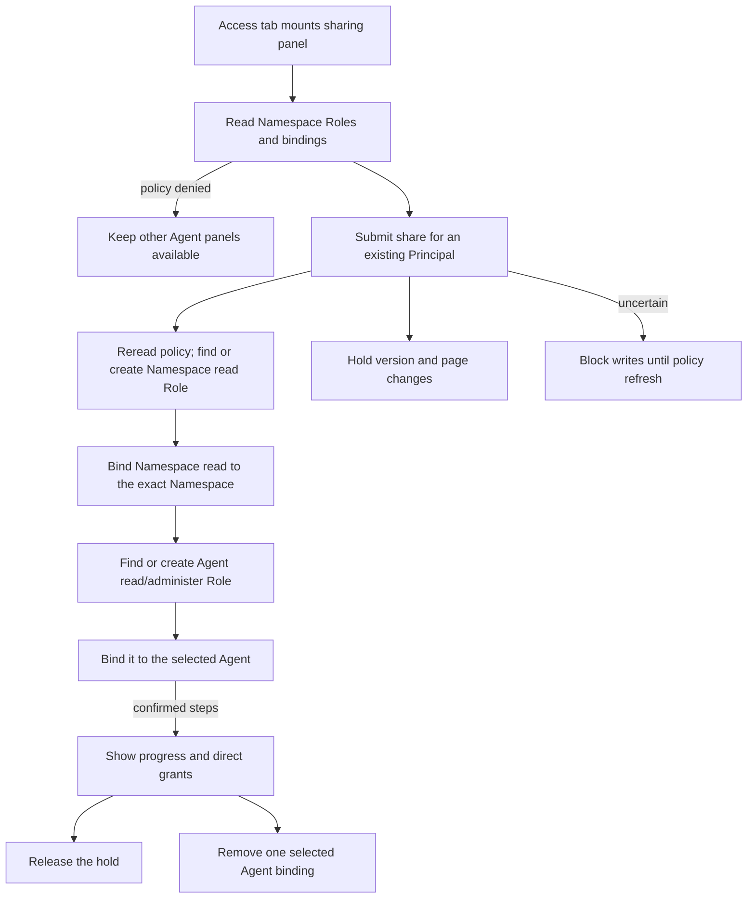

# Console Agent sharing and removal

## Overview

Trace how Agent detail shares one Agent with an existing Principal and removes
one explicit Agent binding. The trace starts when Agent detail's Access tab
mounts the sharing panel and stops at policy configuration; native gateway admission and
runtime readiness belong to the [native admin flow](../agent-native-admin.md).
See the [parent flow](../platform-console.md) and the
[sharing reference](../../reference/console/agent-sharing.md).

## Entry Points

- `apps/controller/src/console/agents/access.mts:renderAgentAccess` renders the
  sharing panel on Agent detail's Access tab.
- `apps/controller/src/console/agents/detail.mts:renderAgentDetail` mounts it when
  that tab first opens.
- Assumptions: a signed-in Installation administrator, an existing Principal ID,
  and the Namespace IAM policy endpoints.

## Flow

## Execution Trace

### 1. Mount the panel and read policy

`apps/controller/src/console/agents/access.mts:renderAgentAccess`

The Access tab mounts sharing independently of version/configuration reads and
native admission. Agent detail leaves the tab out when the console's Installation-access
answer already showed the person lacks Installation administration: the policy
endpoints require it and the API audits each denial. The panel reads the selected Namespace's existing
`/iam/roles` and `/iam/access-bindings` endpoints, one list at a time, so a
person whose administration ended after the page loaded gets one audited `403`.
On panel load, a policy `403` hides **Access**. Agent detail opens
**Configuration** only if the page is current, **Access** is still selected
and deletion is not underway. A current `401` expires the session.

The panel is built once per page. Returning to a healthy panel reloads
policy with the controls disabled. **Refresh sharing** checks Agent
permissions and rechecks a remembered denial of Installation administration
through Namespace permissions. These permission checks are unaudited. If
administration is restored, the panel can read policy without a page reload.
If the denial stands, it hides **Access** under the same navigation rules
without another audited policy read.

### 2. Serialize Role and binding writes

`apps/controller/src/console/agents/access.mts:ensureGrant`

Submission rereads policy, finds or creates an immutable Role by exact Namespace
and permissions, then binds Namespace read to the exact Namespace. Only after
that response does it find or create the exact Agent read/administer Role and
bind it to the selected Agent. The panel rejects an invalid Principal ID,
including an email address, before submission. OCC validates the subject and
target when creating an AccessBinding. During a share write, a `404` or a
`400` naming `/subjectId` or `/resourceId` reports that the Principal cannot receive
access here or the Agent is unavailable. The message cannot distinguish them.

If a policy reread or write fails during sharing or removal, even with
`403`, the panel shows an error and retains confirmed progress. Returning
to the tab does not clear the error. **Refresh sharing** must succeed before
another change. Refresh shows current grants without proving an earlier
request's outcome or replaying a write.

### 3. Hold the page while writes run

`apps/controller/src/console/agents/detail.mts:renderAgentDetail`

Each request belongs to the page and stops when the page goes. So while a share or
removal runs, the panel's `onWriting` callback has Agent detail hold version and
page changes, as it does for a draft's writes. The held changes are the Versions
rail, Create new version, version links, ← Agents, the sidebar, the Namespace
selector, Back and Forward, the header's Refresh, and the page's own reloads. The
page shows "This page stays open until sharing finishes." Tabs still switch. After
Delete replaces the page with its deletion row, a write still in flight holds the
page and its note shows above that row. The page's `setWriteInFlight` check, which
also covers a draft's writes, makes `beforeunload` in `console.mts` ask before a
reload or tab close. The hold ends when the operation settles. A share can
make two policy reads and up to four writes. Each request has a 15-second
timeout. Session expiry and sign-out still leave.

### 4. Remove one explicit binding

`apps/controller/src/console/agents/access.mts:renderAgentAccess`

Removal addresses only the selected Agent binding. The request client's existing
success envelope handling also accepts the API's empty `204` deletion response.
The panel retains discovery grants and explains other possible access sources.

## Debugging and Verification

- If **Access** disappears when loading or refreshing policy, check
  Installation administration. For a denial during sharing or removal,
  select **Refresh sharing**.
- After an uncertain write, select **Refresh sharing** and inspect the direct
  grants before submitting again. A present binding does not prove an earlier
  request's outcome.
- The real-runtime sharing case is described in
  [gateway routing tests](../../testing/kubernetes.md#native-gateway-sharing).

## Related docs

- [Return to the parent flow](../platform-console.md)
- [Agent editing flow](agent-editing.md)
- [Namespace IAM policy flow](../namespace-iam-policy.md)
- [Sharing procedure](../../guides/console/agent-sharing.md)

## Manual Notes

[keep this for the user to add notes. do not change between edits]

## Changelog

- 2026-11-24 07:47: Correct sharing errors, recovery and request timing. (authoring-run/35799ac1-4172-470c-8e06-b9f9023a37ab - 2105bdcb059a49741f883566dc4e847b0161f489)

- 2026-09-28 01:39: Move the sharing trace out of the parent and editing flows to keep them within the length limit. (authoring-run/462d5207-c3a1-4203-af4a-8db2551ccb9a - 4f32ebbca5d699296a142dfbd34c8ec46844fce7)

- 2026-09-23 22:29: Receive main; consolidate the sharing trace. (01a0b0e4-839a-71b3-9ec1-3b1000b5d06a - 3bf606bfda107ada7e32a941c161aa0fdcbafd92)

- 2026-09-23 10:11: Trace sharing, removal and uncertain outcomes. (authoring-run/2dbd0778-19ef-4616-a799-abcfcba888e4 - ba03f19e950577141837c02dda37112fd3377dc5)
