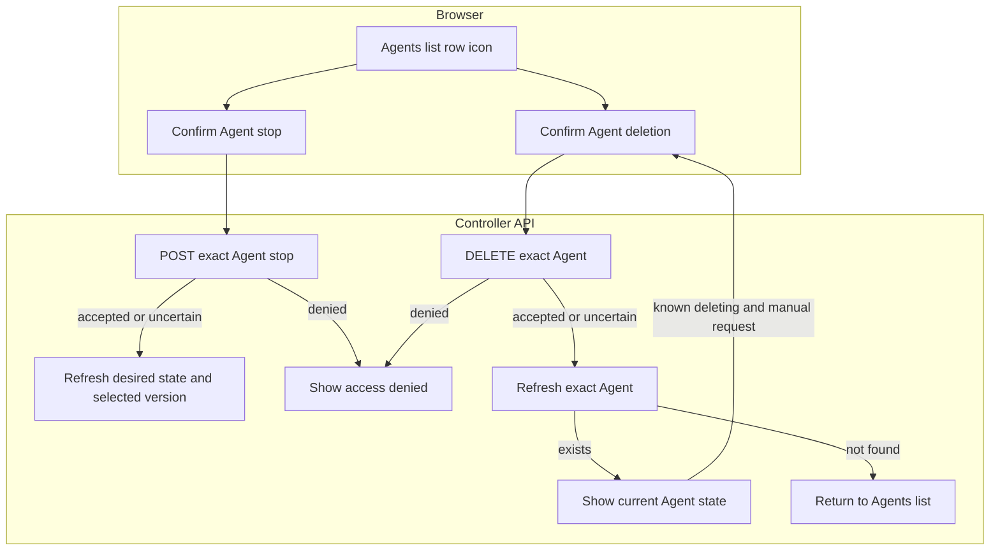

# Console Agent stop and deletion

## Overview

Trace **Stop Agent** and **Delete Agent** on Agent detail and Agents list rows,
from confirmation to readback. See the [parent flow](../platform-console.md) and
[Agent editing](agent-editing.md); steps 7 and 8 continue that trace's numbering.

## Entry Points

- `apps/controller/src/console/agents/stop.mjs:createAgentStop` sends the stop request.
- `apps/controller/src/console/agents/deletion.mjs:createAgentDeletion` sends the deletion request.
- `apps/controller/src/console/agents/detail.mjs:renderAgentDetail` mounts both as rows of one **Danger zone** card;
  [Agents list rows](#stop-or-delete-from-an-agents-list-row) also offer them.
- A signed-in caller needs Agent `operate` to stop and Agent `delete` to delete.

## Flow

## Execution Trace

### 7. Request a stop and read back the Agent

A negative [permission answer](../../reference/api.md#get-namespacesnamespaceidagentsagentidpermissions)
hides the Stop or Delete row, and the card when neither remains. If the dialog is open, it disables
confirmation, focuses Cancel and keeps the row. A missing answer keeps the rows; late advice cannot recall a request.

`apps/controller/src/console/agents/stop.mjs:createAgentStop` sends a bodyless `POST` to the
Agent’s `/stop` route. OCC’s `packages/occ/src/index.ts:stopAgent` checks Agent `operate`,
persists the requested stopped state, and queues reconciliation. Success means admission,
not that Compute has shut down. Cancel restores focus to the invoking button; submission focuses
**Refresh stop status**.

For a stopped Agent, **Request Stop again** confirms a new stop intent, even with no selected
version; the Console cannot inspect history or candidate cleanup. With no selected version
and no readable versions yet (`setNoReadableVersions`), the Stop row is hidden unless the viewer
just used it. The overview's **Runtime** row reports a requested stop.

Refresh reads desired state and selected version, not live health. Denial stays inline; changed
state updates panels in place. If the read finds deletion in progress, Agent detail switches to
the deletion recovery controls without sending a write. Focus moves to **Refresh deletion status**
only when the reader stayed on the disappearing Stop control. An uncertain write blocks another
Stop until readback succeeds.
[Deploy to resume](../../reference/agents/deployment.md#stop-and-resume); the lifecycle
reference covers worker shutdown and preservation of versions, credentials, and state.

### 8. Confirm deletion and read back the Agent

`apps/controller/src/console/agents/deletion.mjs:createAgentDeletion`

**Delete Agent** requests confirmation before sending a bodyless `DELETE` to the
exact Agent URL. The controller requires Agent `delete`; a `403` stays visible on
the detail page. Acceptance starts asynchronous cleanup and marks the Agent deleting. The page
rereads the exact Agent every few seconds; **Refresh deletion status** reads it
on demand. A read error stops polling. Only a not-found read after
an accepted or uncertain request, or when an already-deleting Agent is opened,
returns to the Agents list in the selected Namespace. An already deleting Agent
keeps **Request deletion again** beside Refresh. It opens a cancel-first confirmation
and sends the same bodyless DELETE only when the reader confirms. Queued or claimed
work stays unchanged; terminal work can restart under the controller's existing
current-permission and retry-ownership checks. The view does not infer a worker
outcome from the Agent's deleting state or add a separate status contract.

An uncertain initial or repeated deletion blocks writes until a successful exact
Agent read. A deleting read clears that guard even when the view was already deleting;
a failed read does not. Cancel returns focus to the repeat-request button, and
successful writes retain status refresh. The browser never retries DELETE automatically.

`packages/occ/src/index.ts:deleteAgent` owns deletion admission. The
[Agent deletion reference](../../reference/agents.md#deletion) covers
worker cleanup and the Namespace-owned resources it preserves.

### Stop or delete from an Agents list row

`apps/controller/src/console/agents/collection.mts:renderAgentList` rows use the
same Stop and Delete confirmations. Each row reads
[permission advice](../../reference/api.md#get-namespacesnamespaceidagentsagentidpermissions)
like its deployment, and reads it again when a retained list resumes.
Refusal disables the action and explains why; in an open confirmation, it also
disables confirmation and focuses Cancel. A stopped Agent without a selected
version has no Stop action. A response that confirms the action for the requested Agent
updates its row without polling. If the response names a different Agent, the list reports an
unknown outcome and keeps the last observed state of both Agents. After `404`, `409`, or an
uncertain outcome, the requested row’s actions stay disabled until **Refresh** rereads it.

## Debugging and Verification

- On repeat `403`, follow the API’s retry-ownership explanation. For ordinary
  denials, check `delete` on the exact Agent; Agent `read` and
  `operate` do not authorize deletion. Any failed repeat pauses polling until a manual action. Use the displayed request ID when present.
- An accepted deletion remains in progress until the exact Agent read reports
  not found. A failed refresh does not establish whether cleanup finished.

## Related docs

- [Agent editing flow](agent-editing.md)
- [Stop and resume](../../reference/agents/deployment.md#stop-and-resume)
- [Agent lifecycle reference](../../reference/agents.md#deletion)

## Manual Notes

[keep this for the user to add notes. do not change between edits]

## Changelog

- 2026-10-20 08:02: Trace Stop and Delete from Agents list rows, moved from the Agent editing flow, in the accompanying merge. (8b95a6fb-7095-4556-9028-0723f32cc534 - a8fb50b1babb68f3eb759841f92b042da039248e)
- 2026-10-20 07:57: Describe deletion discovered by a stop-status read in the accompanying change. (authoring-run/28365356-ae7e-47dc-9790-888c3592251f - 6aedac546aad8308b4e9954648268f14545e39b2)
- 2026-10-20 05:00: Split from the Agent editing flow's steps 7 and 8. (docs-split-1020)
