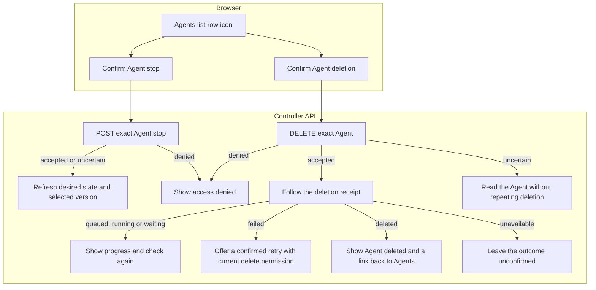

# Console Agent stop and deletion

## Overview

Trace **Stop Agent** and **Delete Agent** on Agent detail and Agents list rows,
from confirmation to readback. See the [parent flow](../platform-console.md) and
[Agent editing](agent-editing.md); steps 7 and 8 continue that trace's numbering.

## Entry Points

- `apps/controller/src/console/agents/stop.mts:createAgentStop` sends the stop request.
- `apps/controller/src/console/agents/deletion.mts:createAgentDeletion` sends the deletion request.
- `apps/controller/src/console/agents/detail.mts:renderAgentDetail` shows the **Danger zone** on **Configuration**. When deletion starts, the deletion row replaces the tabbed view.
  [Agents list rows](#stop-or-delete-from-an-agents-list-row) also offer Stop and Delete.
- A signed-in caller needs Agent `operate` to stop and Agent `delete` to delete.

## Flow

## Execution Trace

### 7. Request a stop and read back the Agent

A negative [permission answer](../../reference/api.md#get-namespacesnamespaceidagentsagentidpermissions)
hides the Stop or Delete row, and the card when neither remains. If the dialog is open, it disables
confirmation, focuses Cancel and keeps the row. A missing answer keeps the rows; late advice cannot recall a request.

`apps/controller/src/console/agents/stop.mts:createAgentStop` sends a bodyless `POST` to the
Agent’s `/stop` route. OCC’s `packages/occ/src/index.ts:stopAgent` checks Agent `operate`,
persists the requested stopped state, and queues reconciliation. Success means admission,
not that Compute has shut down. Cancel restores focus to the invoking button; submission focuses
**Refresh stop status**. A `403` about grants shows the Console's refusal with the Agent's name
and the Request ID; any other `403` shows the API's text. Either way Stop stays unavailable,
described by it, until a permission answer read after the refusal allows operate, such as the one
a window refocus rereads. An answer read before the refusal, even one that arrives after it,
does not lift it.

For a stopped Agent, **Request Stop again** confirms a new stop intent, even with no selected
version; the Console cannot inspect history or candidate cleanup. Its confirmation says the
Agent is already requested to stop and that this sends the request again. With no selected version
and no readable versions yet (`setNoReadableVersions`), the Stop row is hidden unless the viewer
just used it. A running Agent keeps Stop regardless of the latest readable deployment outcome
(`setLatestDeployment`), as on the Agents list: a failed readable deployment can hide newer queued
work. Agent `operate` still controls access. The latest readable outcome supplies confirmation
text, not visibility. A queued or in-progress one says Stop cancels that deployment. An unreadable
deployment or a failed read keeps the confirmation that names both outcomes; a succeeded one read
before the Agent reread keeps the running-gateway text. The overview's **Runtime** row reports
a requested stop. After an accepted Stop during a first deployment, the Stop row reports
**Deployment cancellation requested**, not deployment or runtime completion. `applyAgent` clears
that local result when either Stop readback or a detail-page update observes a running request
or a selected version. An unchanged stopped read with no selected version keeps it.

Refresh reads desired state and selected version, not live health. Denial stays inline; changed
state updates panels in place. If the read finds deletion in progress, Agent detail switches to
the deletion status page without sending a write. An uncertain write blocks another
Stop until readback succeeds.
[Deploy to resume](../../reference/agents/deployment.md#stop-and-resume); the lifecycle
reference covers worker shutdown and preservation of versions, credentials, and state.

### 8. Confirm deletion and follow its outcome

**Delete Agent** opens a cancel-first confirmation. **Permanently delete Agent**
sends a bodyless `DELETE` to the exact Agent URL. The controller requires Agent
`delete`. A refusal stays visible on the page. The Delete control remains focusable with its
reason and becomes available only after a newer permission read allows deletion.
The identified refusal alert includes its request ID. A conflict preserves the API's
reason and requires a status read before another deletion attempt.
If the response is lost or names
a different Agent, the Console offers a read to find out what happened without
sending another deletion.

A `202` includes a deletion receipt. The Console opens
`/console/agents/:agentId/deletion` with the Namespace and receipt ID in the URL.
`agents/deletion-status.mts:renderDeletionStatus` reads only the status endpoint,
so reload and browser history work after the Agent and its grants are removed.
The receipt identifies the request; the controller still checks the signed-in
identity and current Namespace read access. Opening this link while signed out
preserves only that read destination through sign-in. A different person cannot
use the receipt, and signing out clears the page and its remembered receipts.
When Stop discovers deletion, its explicit focus handoff travels through navigation
to **Refresh deletion status**; ordinary links keep the normal page focus behavior.

The page follows queued, running and waiting work automatically. **Refresh deletion
status** checks now. Only `deleted` confirms completion; a missing result, access
denial or read failure stops polling and leaves the outcome unknown. **Back to
Agents** is available throughout. A reader who opens an already deleting Agent
without its receipt can follow cleanup only while the Agent remains readable.

Only failed cleanup with current delete permission offers **Retry cleanup**.
Confirmation rechecks both the failure and permission before sending a new request.
Cancel or Escape during those reads sends nothing. The controller decides who can
retry; an unclear write outcome requires a status check, never an automatic replay.

`packages/occ/src/index.ts:deleteAgent` owns deletion admission. The
[Agent deletion reference](../../reference/agents.md#deletion) covers
worker cleanup and the Namespace-owned resources it preserves.

### Stop or delete from an Agents list row

`apps/controller/src/console/agents/collection.mts:renderAgentList` rows use the
same Stop and Delete confirmations. Each row reads
[permission advice](../../reference/api.md#get-namespacesnamespaceidagentsagentidpermissions)
like its deployment, and reads it again when a retained list resumes.
Refusal disables the action and explains why; in an open confirmation, it also
disables confirmation and focuses Cancel. A stopped Agent without a selected
version has no Stop action. An accepted Stop updates its row without polling; an
accepted Delete opens its receipt. If the Console already observed Namespace access
loss, a late accepted Delete leaves the cleared list and Search focus in place with
a generic acknowledgement; it neither remembers nor opens the receipt.
**View deletion progress** opens status from a deleting row, using the receipt only
if this session requested the deletion. If the response names a different Agent, the list reports an
unknown outcome and keeps the last observed state of both Agents. After `404`, `409`, or an
uncertain outcome, the requested row’s actions stay disabled until **Refresh** rereads it.
After a `403` about grants, the refused icon stays unavailable and the row's note names the grant
under it, until a permission answer read later allows that action. Any other `403`, such as
retry ownership on a stale row, shows the API's text, the row's note points to it, and the row's
actions stay unavailable, described by it, until **Refresh**. A window refocus that rebuilds the
list shows that refusal again while the Agent is listed, and keeps focus on the same row control,
scrolling only as far as needed to keep its cell and note in view.
If that control is gone or disabled, focus goes to the row's name, or to the page heading when
the row is gone.

## Debugging and Verification

- On repeat `403`, follow the API’s retry-ownership explanation. For ordinary
  denials, check `delete` on the exact Agent; Agent `read` and
  `operate` do not authorize deletion. Any failed repeat pauses polling until a manual action. Use the displayed request ID when present.
- Match the Namespace, Agent and receipt in the status response. A missing Agent
  or a failed status check does not establish whether cleanup finished.

## Related docs

- [Agent editing flow](agent-editing.md)
- [Stop and resume](../../reference/agents/deployment.md#stop-and-resume)
- [Agent lifecycle reference](../../reference/agents.md#deletion)

## Manual Notes

[keep this for the user to add notes. do not change between edits]

## Changelog

- 2026-11-03 20:31: Merge main into the detail Stop fix: keep Stop after a failed readable deployment beside main's refusal handling and Configuration-only Danger zone. (authoring-run/0b5d9b57-4ffe-4be0-a3b2-23bcb0922ad2 - 2323a30cd6ec2514d2348a25ffe4f24da9445664)
- 2026-11-01 18:19: Limit the Danger zone to Configuration and preserve standalone deletion recovery in the accompanying change. (authoring-run/66929759-4566-4a73-bb19-97213ee54faf - 7bb67ab81e65bfcea35aeddf2a9f02c4f258b138)
- 2026-10-28 21:55: Scope first-deployment Stop feedback to the observed lifecycle and distinguish requested cancellation from completion in the accompanying fix. (authoring-run/4b2306f4-4b43-4bec-b246-0e4b1f9819fb - 3b5e7834b9111ea31e22766811e228a43d4aa537)

- 2026-10-24 01:28: Follow the deletion receipt to confirmed completion, including status access and retry boundaries. (authoring-run/2912f79a-c23d-4312-a263-1ffb0e516efc - 3ace2f1205d77b815883e75b8b95c9a3f2858eee)
- 2026-10-20 08:02: Trace Stop and Delete from Agents list rows, moved from the Agent editing flow, in the accompanying merge. (8b95a6fb-7095-4556-9028-0723f32cc534 - a8fb50b1babb68f3eb759841f92b042da039248e)
- 2026-10-20 07:57: Describe deletion discovered by a stop-status read in the accompanying change. (authoring-run/28365356-ae7e-47dc-9790-888c3592251f - 6aedac546aad8308b4e9954648268f14545e39b2)
- 2026-10-20 05:00: Split from the Agent editing flow's steps 7 and 8. (docs-split-1020)
