# Console Agent stop and deletion

## Overview

Trace **Stop Agent** and **Delete Agent** on Agent detail, from confirmation to
readback. See the [parent flow](../platform-console.md) and
[Agent editing](agent-editing.md); the trace keeps its step numbers.

## Entry Points

- `apps/controller/src/console/agents/stop.mjs:createAgentStop` sends the stop request.
- `apps/controller/src/console/agents/deletion.mjs:createAgentDeletion` sends the deletion request.
- `apps/controller/src/console/agents/detail.mjs:renderAgentDetail` mounts both.
- A signed-in caller needs Agent `operate` to stop and Agent `delete` to delete.

## Flow

```mermaid
graph TD
  subgraph Browser["Browser"]
    E["Confirm Agent deletion"]
    S["Confirm Agent stop"]
  end
  subgraph API["Controller API"]
    E --> G["DELETE exact Agent"]
    S --> T["POST exact Agent stop"]
    T -->|accepted or uncertain| U["Refresh desired state and selected version"]
    T -->|denied| I
    G -->|accepted or uncertain| H["Refresh exact Agent"]
    G -->|denied| I["Show access denied"]
    H -->|exists| J["Show current Agent state"]
    J -->|known deleting and manual request| E
    H -->|not found| K["Return to Agents list"]
  end
```

## Execution Trace

### 7. Request a stop and read back the Agent

[Permission advice](../../reference/api.md#get-namespacesnamespaceidagentsagentidpermissions) can disable
Stop before confirmation. If the dialog is open, a negative answer disables confirmation and
focuses Cancel. Missing advice leaves the normal path available; late advice cannot recall a request.

`apps/controller/src/console/agents/stop.mjs:createAgentStop` sends a bodyless `POST` to the
Agent’s `/stop` route. OCC’s `packages/occ/src/index.ts:stopAgent` checks Agent `operate`,
persists the requested stopped state, and queues reconciliation. Success means admission,
not that Compute has shut down. Cancel restores focus to the invoking button; submission focuses
**Refresh stop status**.

For a stopped Agent, **Request Stop again** confirms a new stop intent, even with no selected
version; the Console cannot inspect history or candidate cleanup. With no selected version
and no readable versions yet (`setNoReadableVersions`), the Stop card is hidden unless the viewer
just used it. The overview's **Runtime** row reports a requested stop.

Refresh reads desired state and selected version, not live health. Denial stays inline; changed
state updates panels in place. An uncertain write blocks another Stop until readback succeeds.
[Deploy to resume](../../reference/agents/deployment.md#stop-and-resume); the lifecycle
reference covers worker shutdown and preservation of versions, credentials, and state.

### 8. Confirm deletion and read back the Agent

`apps/controller/src/console/agents/deletion.mjs:createAgentDeletion`

**Delete Agent** requests confirmation before sending a bodyless `DELETE` to the
exact Agent URL. The controller requires Agent `delete`; a `403` stays visible on
the detail page. Acceptance starts asynchronous cleanup and marks the Agent deleting. The page
rereads the exact Agent every few seconds; **Refresh deletion status** reads it
on demand. A read error stops polling. Only a not-found read after
an accepted or uncertain request, or when an already-deleting Agent is opened,
returns to the Agents list in the selected Namespace. An already deleting Agent
keeps **Request deletion again** beside Refresh. It opens a cancel-first confirmation
and sends the same bodyless DELETE only when the reader confirms. Queued or claimed
work stays unchanged; terminal work can restart under the controller's existing
current-permission and retry-ownership checks. The view does not infer a worker
outcome from the Agent's deleting state or add a separate status contract.

An uncertain initial or repeated deletion blocks writes until a successful exact
Agent read. A deleting read clears that guard even when the view was already deleting;
a failed read does not. Cancel returns focus to the repeat-request button, and
successful writes retain status refresh. The browser never retries DELETE automatically.

`packages/occ/src/index.ts:deleteAgent` owns deletion admission. The
[Agent deletion reference](../../reference/agents.md#deletion) covers
worker cleanup and the Namespace-owned resources it preserves.

## Debugging and Verification

- On repeat `403`, follow the API’s retry-ownership explanation. For ordinary
  denials, check `delete` on the exact Agent; Agent `read` and
  `operate` do not authorize deletion. Any failed repeat pauses polling until a manual action. Use the displayed request ID when present.
- An accepted deletion remains in progress until the exact Agent read reports
  not found. A failed refresh does not establish whether cleanup finished.

## Related docs

- [Agent editing flow](agent-editing.md)
- [Stop and resume](../../reference/agents/deployment.md#stop-and-resume)
- [Agent lifecycle reference](../../reference/agents.md#deletion)

## Manual Notes

[keep this for the user to add notes. do not change between edits]

## Changelog

- 2026-10-20 05:00: Split from the Agent editing flow's steps 7 and 8. (docs-split-1020)
