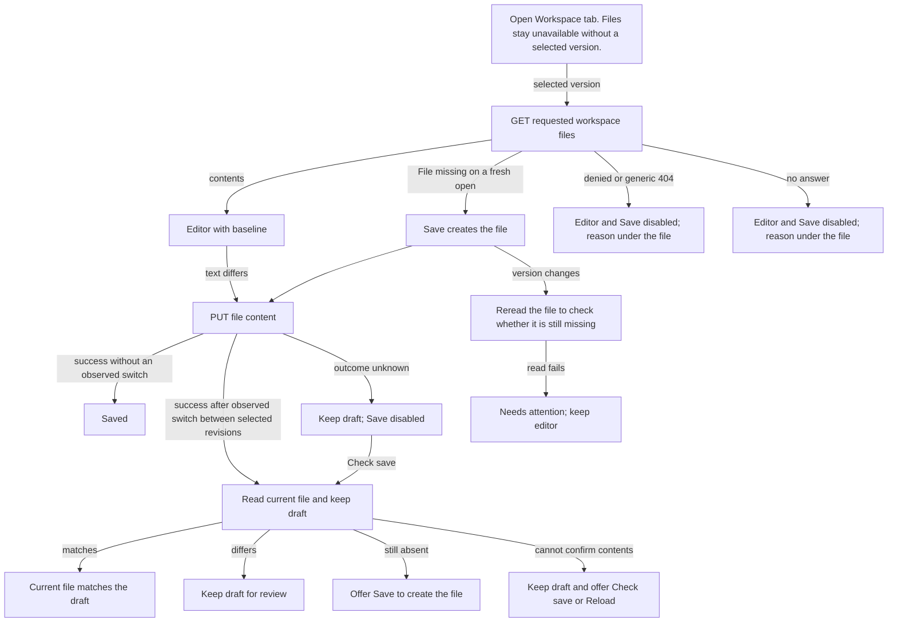

# Console Agent workspace files

## Overview

Trace the Agent page's **Workspace** tab, which reads and replaces files in the live
Agent's workspace. See the [parent flow](../platform-console.md) and
[Agent editing](agent-editing.md); step 6 continues that trace's numbering.

## Entry Points

- `apps/controller/src/console/agents/workspace.mts:renderWorkspaceFiles` opens from `tab=workspace`.
- It reads and writes `GET`/`PUT .../agents/:agentId/workspace/files/:name`.
- A signed-in caller needs the exact Agent read; writes follow the Agent `operate` answer.

## Flow

This diagram follows one file opened without a retained draft. It assumes the
user can read and edit the file. The execution trace covers leaving the editor
and returning to a draft.

## Execution Trace

### 6. Read and replace live workspace files

`apps/controller/src/console/agents/workspace.mts:renderWorkspaceFiles` opens from
`tab=workspace` after an exact Agent read. Contents belong to the live Agent, not Configuration or version history.
With no selected version, files stay unavailable and no file request is sent. Another current version
keeps the editors, focus and caret, rereading unedited files in place; gaining or losing one rebuilds them.

The desktop tab list or phone **Workspace file** picker selects one editor and shows
the file's role. Selection uses the Agent-scoped draft store, so returning to the tab
restores it. Switching files sends no write and keeps each file's unsaved text.
Per-file indicators show unsaved, loading, missing, denied, and uncertain-save states.
Save, Check save and Reload apply only to the selected file.
`workspace.mts:renderWorkspaceFiles` updates both indicators when a reread confirms
that a file is still missing after a transient failure. **Needs attention** returns
to **Missing**, while the editor stays empty and ready to create the file.

The editor reads each supported file by name; the response must name that file and
include its contents. For an existing file, **Save** becomes available when the
text differs from the latest read. The comparison uses LF line endings, so it
does not rewrite an untouched CRLF file. A fresh read checks access before
restoring a draft, including an empty edit. The draft retains its original
editing baseline for an overwrite warning that repeats across restores while the
latest file differs from that baseline. Matching the latest read clears the
warning and disables Save. **Reload** replaces those edits.

Returning to these parked editors applies the newest Agent operate answer the page has
read (Logs can read a newer one meanwhile): a grant makes the files editable; a revocation
makes them read-only with the explanation and keeps unsaved text. A failed permission
read keeps the previous answer. The controller still authorizes every write. Stop and
each version's **Run diagnostics** follow the same answer.

The editor recognizes a missing file only from a `404` with code `NOT_FOUND`
and message `The requested workspace file was not found.` On a fresh open,
an authorized user can create the file, even with empty contents. On return, a file-specific
`404` has these effects for a user who can read and edit the file.

| Retained draft                             | What the editor shows                                   | Next action                                             |
| ------------------------------------------ | ------------------------------------------------------- | ------------------------------------------------------- |
| Unsaved edits with no check pending        | The draft                                               | **Save** can create the file.                           |
| Needs a check, file last known absent      | The draft, with **Save** disabled                       | Choose **Check save**.                                  |
| Needs a check, file last read successfully | An empty, disabled editor. The draft is still retained. | Choose **Check save** again when the file is available. |

A generic resource `404` or a denial keeps the editor and **Save** disabled and
shows the reason under that file. **Reload** checks again without writing.

If the first read or an explicit **Reload** cannot reach the API or the gateway,
the editor and **Save** stay disabled. The file shows the reason and any request
ID under its editor.
`workspace.mts:renderWorkspaceFiles` shows one notice above the files. The notice
names the files that **Retry** reads again, and those files are not marked
**Needs attention**. The notice changes when the reads in progress end, so files
that fail together are announced once. If focus was on **Retry**, it returns
there when a read fails again, or moves to the file tabs or the phone picker when
the notice goes.

**Retry** skips files with unsaved edits or an unknown save outcome.
The notice lists only the files it will read.

**Save** sends the selected file's contents in a `PUT` and checks the returned
filename. The write leaves Configuration and Agent versions unchanged.
If the same open editor observes a switch from one selected revision to another
while the write is pending, the reply may describe the previous version.
After a successful reply, the editor reads the current file. It reports
success if the text matches and keeps the draft if it differs. If this read
fails or the write outcome is unknown, the editor keeps the draft and disables
**Save** until the user checks the file or reloads it.

**Check save** reads the file once. If the text matches the draft, there is
nothing to save. If it differs, the editor shows both versions. An authorized
user can combine the edits and save. A read shows the file at that moment
and cannot identify which write produced it.

For a file-specific `404` during a save check, use the most recent file state.

- If the editor had a copy of the file, even an empty one, keep **Save**
  disabled and offer **Check save** again.
- If the last known file state was absent, the user can choose
  **Save** to create it.

A failed check never resends a write. A draft already visible stays available
to copy when the workspace is unavailable. An explicit **Reload** discards
the draft when it reads the file or confirms absence.

The [creation trace](../platform-console.md#3-authorize-the-selected-page-resource)
covers initial channel settings and Secret bindings.
`apps/controller/src/console/agents/create.mts` submits `initialWorkspaceFiles`
and `workspaceDefaultsId`. OCC stages these privately for Compute's initialization
before execution; no gateway is needed. The [workspace flow](../workspace-files.md) owns
authorization, native transport, initialization, retries, and cleanup. Live editing requires
deployment.

## Debugging and Verification

- Compare a fresh open with a return to a draft that needs **Check save**
  for a file the editor last read successfully. The same missing-file `404`
  enables creation on the fresh open and leaves **Save** disabled on return.
- After an unknown write outcome, choose **Check save**. The `GET` keeps the edits
  and compares them with the current file. If a previously existing file is reported
  missing, check again. To recreate it deliberately, copy the edits, use **Reload**,
  and review the missing-file result before choosing **Save**. **Reload** discards the edits.

## Related docs

- [Workspace files flow](../workspace-files.md)
- [Agent workspace files reference](../../reference/agents/workspace-files.md)

## Manual Notes

[keep this for the user to add notes. do not change between edits]

## Changelog

- 2026-11-28 12:53: Explain Check save when a previously existing file is reported missing. Accompanying uncommitted changes. (authoring-run/e4a7d654-bfe1-4090-96c4-2d9beca49b8b - de04ef93d97e0cf3b7253cc3f70209c6a647bb93)

- 2026-11-27 08:30: Explain how the editor checks a pending save across a version change. Accompanying uncommitted changes. (authoring-run/efaedf81-9bec-4ebe-b1a3-7f1985d3232e - d3de1af54d06c6f49527560486571ff3e2c4c5ab)

- 2026-11-27 06:49: Document keyboard access to a visible draft when Check save cannot reach the file. Accompanying uncommitted changes. (authoring-run/40704daa-5838-4499-b883-f56f94610a64 - 0d2c1dfef541ffe41ea25e693ddaae594471b65b)

- 2026-11-25 06:47: Document Check save, retained edits, current-content comparison, manual retry and the Reload alternative. Accompanying uncommitted changes. (authoring-run/2670875e-4890-4aa5-8759-7d812beb4d6e - 738d973508be39f8c8f426d7e4688d209d094404)

- 2026-11-23 08:40: Document the reason under each file, the notice that names the files Retry reads again, and the files Retry does not read. Accompanying uncommitted changes. (authoring-run/d5788be8-adbb-4923-8e01-9076e9336b0b - c7b58d62b900589c88f55ec8604a24ef4232738f)

- 2026-11-20 14:17: Document the single notice and Retry for file reads that get no answer. Accompanying uncommitted changes. (authoring-run/0ec2fda6-e3a3-4419-a147-8de6adf701bf - 5bf2ae7fd703197701f311098d734a10ed4ab593)

- 2026-10-27 13:55: Document missing-file indicator recovery after a failed reread. Accompanying uncommitted changes. (authoring-run/99997d03-9533-4cff-b942-8fe773c472db - b1e6d83d1cde4741d6f0b857e30e473ec1f97a18)

- 2026-10-27 09:30: Document file selection, role descriptions, and per-file state. Accompanying uncommitted changes. (authoring-run/f3434faa-8624-4f34-83a2-521047f80329 - 24a35dff22e1efb2a9b7058f5c90d6d9e2f9caf7)

- 2026-10-25: Move step 6 from [Agent editing](agent-editing.md) unchanged. (finding 2488)
