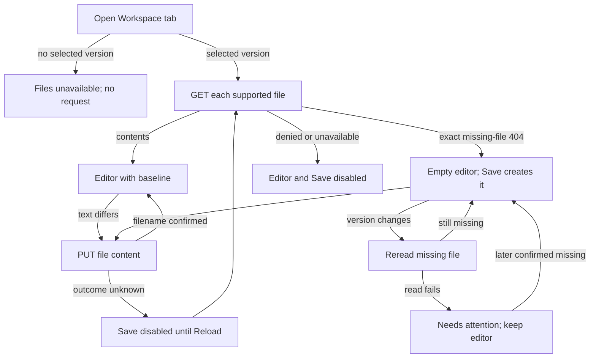

# Console Agent workspace files

## Overview

Trace the Agent page's **Workspace** tab, which reads and replaces files in the live
Agent's workspace. See the [parent flow](../platform-console.md) and
[Agent editing](agent-editing.md); step 6 continues that trace's numbering.

## Entry Points

- `apps/controller/src/console/agents/workspace.mts:renderWorkspaceFiles` opens from `tab=workspace`.
- It reads and writes `GET`/`PUT .../agents/:agentId/workspace/files/:name`.
- A signed-in caller needs the exact Agent read; writes follow the Agent `operate` answer.

## Flow

## Execution Trace

### 6. Read and replace live workspace files

`apps/controller/src/console/agents/workspace.mts:renderWorkspaceFiles` opens from
`tab=workspace` after an exact Agent read. Contents belong to the live Agent, not Configuration or version history.
With no selected version, files stay unavailable and no file request is sent. Another current version
keeps the editors, focus and caret, rereading unedited files in place; gaining or losing one rebuilds them.

The desktop tab list or phone **Workspace file** picker selects one editor and shows
the file's role. Selection uses the Agent-scoped draft store, so returning to the tab
restores it. Switching files sends no write and keeps each file's unsaved text.
Per-file indicators show unsaved, loading, missing, denied, and uncertain-save states;
Save and Reload apply only to the selected file.
`workspace.mts:renderWorkspaceFiles` updates both indicators when a reread confirms
that a file is still missing after a transient failure. **Needs attention** returns
to **Missing**, while the editor stays empty and ready to create the file.

The editor reads each supported file by name; the response must name that file and
include its contents. For an existing file, **Save** becomes available
when the text differs from that baseline. The comparison uses LF line endings, so
it does not rewrite an untouched CRLF file. A fresh read checks access before
restoring a draft, including an empty edit. **Reload** replaces those edits.

Returning to these parked editors applies the newest Agent operate answer the page has
read (Logs can read a newer one meanwhile): a grant makes the files editable; a revocation
makes them read-only with the explanation and keeps unsaved text. A failed permission
read keeps the previous answer. The controller still authorizes every write. Stop and
each version's **Run diagnostics** follow the same answer.

On the first read or an explicit **Reload**, only a `404` with code `NOT_FOUND`
and message `The requested workspace file was not found.` confirms the file is
missing. The operator can then choose **Save** to create it, even as an empty file.
A generic resource `404`, a denial, or an unavailable read keeps the editor and
**Save** disabled. **Reload** checks again without writing.

**Save** sends `PUT` with `{ content }` for that file and checks the returned filename. Saving neither patches Configuration nor admits
a version. If the outcome is unknown, **Save** stays disabled until the operator chooses
**Reload** and the controller returns the file contents or that same missing-file
response. The editor never repeats the write automatically.

The [creation trace](../platform-console.md#3-authorize-the-selected-page-resource)
covers initial channel settings and Secret bindings.
`apps/controller/src/console/agents/create.mts` submits `initialWorkspaceFiles`
and `workspaceDefaultsId`. OCC stages these privately for Compute's initialization
before execution; no gateway is needed. The [workspace flow](../workspace-files.md) owns
authorization, native transport, initialization, retries, and cleanup. Live editing requires
deployment.

## Debugging and Verification

- A missing file is confirmed only by the exact `404` described above; any other
  failure keeps **Save** disabled.
- After an unknown write outcome, choose **Reload** and compare the returned contents
  before saving again.

## Related docs

- [Workspace files flow](../workspace-files.md)
- [Agent workspace files reference](../../reference/agents/workspace-files.md)

## Manual Notes

[keep this for the user to add notes. do not change between edits]

## Changelog

- 2026-10-27 13:55: Document missing-file indicator recovery after a failed reread. Accompanying uncommitted changes. (authoring-run/99997d03-9533-4cff-b942-8fe773c472db - b1e6d83d1cde4741d6f0b857e30e473ec1f97a18)

- 2026-10-27 09:30: Document file selection, role descriptions, and per-file state. Accompanying uncommitted changes. (authoring-run/f3434faa-8624-4f34-83a2-521047f80329 - 24a35dff22e1efb2a9b7058f5c90d6d9e2f9caf7)

- 2026-10-25: Move step 6 from [Agent editing](agent-editing.md) unchanged. (finding 2488)
