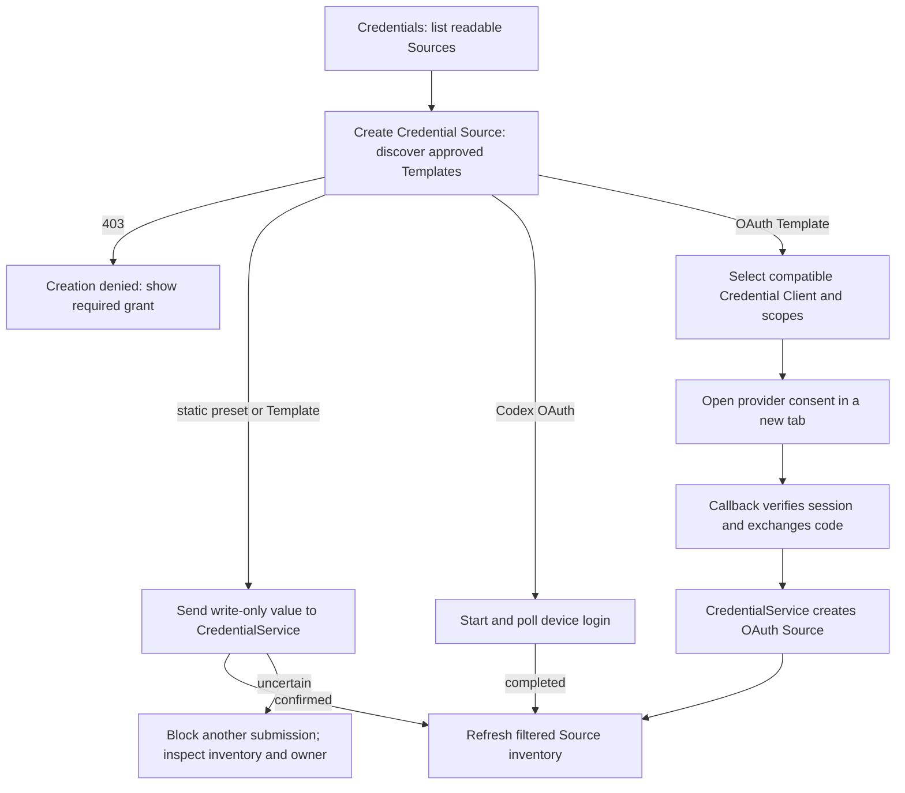

# Console Credential Source discovery and creation

## Overview

Credentials lists readable Credential Sources in the selected Namespace. A user selects a built-in preset or approved Connection Template to create a Source. Static values go to CredentialService; OAuth Sources appear only after sign-in completes. This flow ends at a confirmed Source, refusal, or uncertain result; Agent binding and deployment remain separate.

## Entry Points

- A signed-in user opens **Credentials** and selects a readable Namespace.
- `apps/controller/src/console/console.mts:loadPage` reads the selected Source collection.
- `apps/controller/src/console/credential-sources.mts:renderCredentialSources` renders the inventory and creation dialog.
- `apps/controller/src/console/credential-consent.mts:authorizeInNewTab` opens browser consent for an OAuth Template.

## Flow

## Execution Trace

### 1. List public Source metadata

`apps/controller/src/console/console.mts:loadPage`; `apps/controller/src/console/credential-sources.mts:readInventorySource`

Console requests `GET /namespaces/:namespaceId/credential-sources`. OpenClaw Control Plane (OCC) requires Namespace `read`, excludes Credential Gateway records, and filters Sources by exact `read`. Console checks each returned Source's Namespace and reference before showing public metadata, including OAuth and protected Proxy Sources. Existing Namespace Secret controls remain available; they do not change Source discovery.

### 2. Discover creation choices

`apps/controller/src/console/credential-sources.mts:openCreate`, `usableTemplates`, `selectionChanged`

The dialog lists built-in OpenAI API key, Codex PAT, Codex OAuth, and plain static choices. It requests the Namespace's usable Connection Templates, which requires Source `create`. A 403 disables creation and names the grant. Another discovery failure leaves built-in choices available, with the API authoritative on submission. The selected choice controls which fields appear.

### 3. Register a static Source

`apps/controller/src/console/credential-sources.mts:renderForm`, `refreshCreated`

For a static choice, Console sends the name and write-only value to the Source POST route, then clears the value field. OpenAI and Codex PAT include their approved model preset; a static Template includes its Template ID; plain static includes neither. The API checks Source `create`, Template availability when selected, and CredentialService support. Console verifies the returned public identity, state, preset, and Template association, then refreshes the filtered inventory. A confirmed Source may still be unreadable. A denied or uncertain result blocks resubmission; a `409` can occur after custody begins. Refresh checks the inventory, and an absent Source requires operator inspection before retry.

### 4. Complete Template OAuth consent

`apps/controller/src/console/credential-sources.mts:selectionChanged`; `apps/controller/src/console/credential-consent.mts:authorizeInNewTab`, `scopeChoices`; `apps/controller/src/http/connections.ts:createConnectionCallback`

For an OAuth Template, Console requests eligible Credential Clients for that Template. OCC filters by issuer, Namespace or Installation availability, selected CredentialService ownership, and verified endpoint authentication method. The user chooses a Client and allowed scopes. Console starts the connection and opens the provider in a new tab. No Source exists from the start response. The callback checks the initiating browser session, Source `create`, Template and Client availability, issuer, and granted scopes before CredentialService creates the Source. OCC assigns its name. Only the verified callback confirms the Source ID to the original Console tab, which refreshes the inventory.

### 5. Complete built-in Codex OAuth

`apps/controller/src/console/credential-sources.mts:selectionChanged`; `apps/controller/src/console/agents/device-login.mts:createDeviceLogin`

The built-in Codex choice uses the existing Agent device-authorization route. Starting requires Agent `create` and Source `create` in the Namespace, plus a selected CredentialService that supports device authorization. The user completes sign-in and Console polls; a completed response identifies the saved built-in Codex OAuth Source. Polling an already linked Source checks exact Source `operate`.

The next owner is [Agent creation](agent-creation.md), which lists compatible saved model Sources and checks exact Source `operate` when saving an Agent. Template-backed and plain static Sources are not model presets. GitHub App Sources remain resolved through Agent deployment.

## Debugging and Verification

- Run the focused Source scenarios in `tests/browser/console-create-agent-provisioning-400.test.ts` and the relevant Console inventory/consent browser scenarios. They exercise the real Console and API with controlled external transport.
- PostgreSQL integration covers separate custody and binding contracts. Storybook previews simulate responses; they do not prove persistence, consent with a real provider, delivery, deployment, or a model turn.

## Related docs

- [Console request flow](../platform-console.md)
- [Managed static credential sources](../../reference/credential-sources/managed-static.md#console)
- [Connect an account](../../reference/connection-templates.md#connect-an-account)
- [Credential Source lifecycle](../credential-source-lifecycle.md)

## Manual Notes

[keep this for the user to add notes. do not change between edits]

## Changelog

- 2026-11-26 14:02: Trace unified static choices and OAuth consent in the accompanying Console changes. (authoring-run/ad4d58ec-acf7-489c-9bd4-41ba84682a13 - aaba0649e4cdb56f2653826410547cde6c2a9e8f)

- 2026-11-25 17:14: Trace fixed-destination handling for saved Codex OAuth Sources in the accompanying Console changes. (authoring-run/8b9726b9-2263-4930-b132-f170f536f67e - 3f9d71609ae39e4841355c5a4bf60409f39a609d)
- 2026-11-25 11:47: Trace Console Source discovery and registration. (authoring-run/b55a110d-b732-438a-9cbf-aa5480016db9 - 105ffee9962176cf42fc7cfe013b8b94831435db)
- 2026-11-25 08:41: Trace the unified Credentials tab and readable OAuth and Proxy Source inventory in the accompanying changes. (authoring-run/94d8a178-9510-4094-9563-77b4d2369ac1 - 6e4615ac5539e0ca0ae1773c0b469c9d84689ecf)
