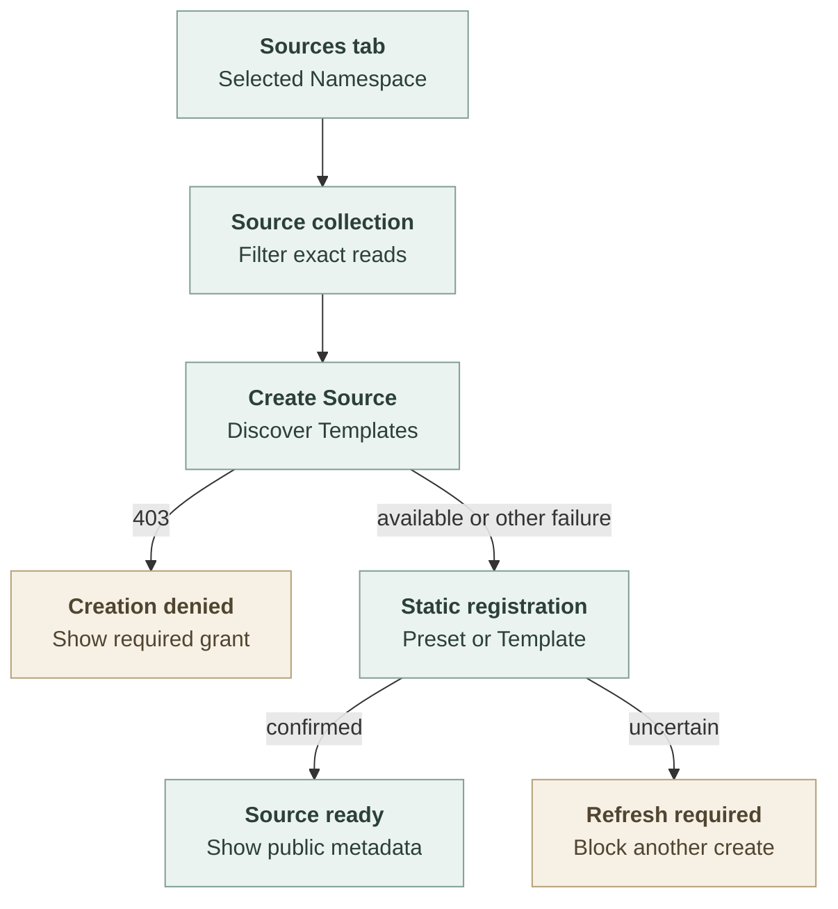

# Console Credential Source discovery and creation

## Overview

The Sources tab lists readable Namespace Source metadata and lets a user register a static credential with TokenService. This flow ends at a confirmed Source or an explicit refusal or uncertain result. Agent binding and deployment are separate operations.

## Entry Points

- A signed-in user opens **Credentials → Sources** in a readable Namespace.
- `apps/controller/src/console/console.mts:collectionPath`, `loadPage` request the selected Namespace collection.
- `apps/controller/src/console/credential-sources.mts:renderCredentialSources` renders the inventory and creation dialog.

## Flow

## Execution Trace

### 1. List public Source metadata

`apps/controller/src/console/console.mts:collectionPath`, `loadPage`; `apps/controller/src/console/credential-source-metadata.mts:readCredentialSourceMetadata`

Console requests `GET /namespaces/:namespaceId/credential-sources`. OCC requires Namespace `read` and filters each Source by exact `read`. The Console validates the Namespace and Source reference and constructs an allowlisted summary; it never resolves credential material. Unsupported protected Proxy entries do not enter the managed Source inventory.

### 2. Discover creation choices

`apps/controller/src/console/credential-sources.mts:openCreate`, `staticTemplates`

The dialog requests the Namespace's usable Connection Templates. This operation checks Source `create`, not TokenService enrollment support. A 403 disables creation and shows the denial. Another failure shows a warning and permits only a model-preset attempt. Available static Bearer Templates add Template-associated choices.

### 3. Register and confirm the Source

`apps/controller/src/console/credential-sources.mts:renderForm`

Submission sends the write-only credential string with either the approved model preset or Template ID to the Source POST route, then clears the input. The Source API authorizes the collection operation; TokenService accepts or rejects registration. Console confirms the returned public Source identity, resource scope, type, state and purpose before showing success. It reloads the filtered inventory before showing the Source in the library; creation does not grant exact Source `read`. A denied or uncertain result blocks resubmission. A `409` is uncertain because owner custody can begin before the conflict. Refresh rechecks the inventory. If the Source name is absent, Console keeps the operator-inspection warning because the inventory cannot rule out owner custody. The page also shows this recovery instruction after a browser reload, without persisting the submitted name or value. A Template-associated Source cannot authenticate a model or be admitted directly to an Agent.

The next owner is [Agent creation](agent-creation.md), which uses Compute's endpoint normalization to refuse an incompatible configured OpenClaw model destination before saving Configuration or Agent state. Console cannot confirm Codex's effective Installation destination before save; deployment admission checks it. Agent save checks exact Source `operate` and binds the eligible Source. For a Dedicated Codex draft, `agents/detail.mts:loadDetails` checks the bound Source's public metadata without blocking the draft tabs. Deploy waits for this check. A readable Codex PAT preset removes the retained model provider override and disables new overrides. If the Source cannot be read, Console warns and leaves admission authoritative. Refresh retries the read after access changes.

## Debugging and Verification

- Run the Source cases in `tests/browser/console-create-agent-provisioning-400.test.ts`. They use the real Console and API with controlled network failures.
- The PostgreSQL staged Agent binding integration verifies API custody, authorization and persisted binding. Storybook previews simulate API responses and do not prove persistence or runtime delivery.

## Related docs

- [Console request flow](../platform-console.md)
- [Managed static credential sources](../../reference/credential-sources/managed-static.md#console)
- [Credential Source lifecycle](../credential-source-lifecycle.md)

## Manual Notes

[keep this for the user to add notes. do not change between edits]

## Changelog

- 2026-11-25 11:47: Trace Console Source discovery and registration. (authoring-run/b55a110d-b732-438a-9cbf-aa5480016db9 - 105ffee9962176cf42fc7cfe013b8b94831435db)
