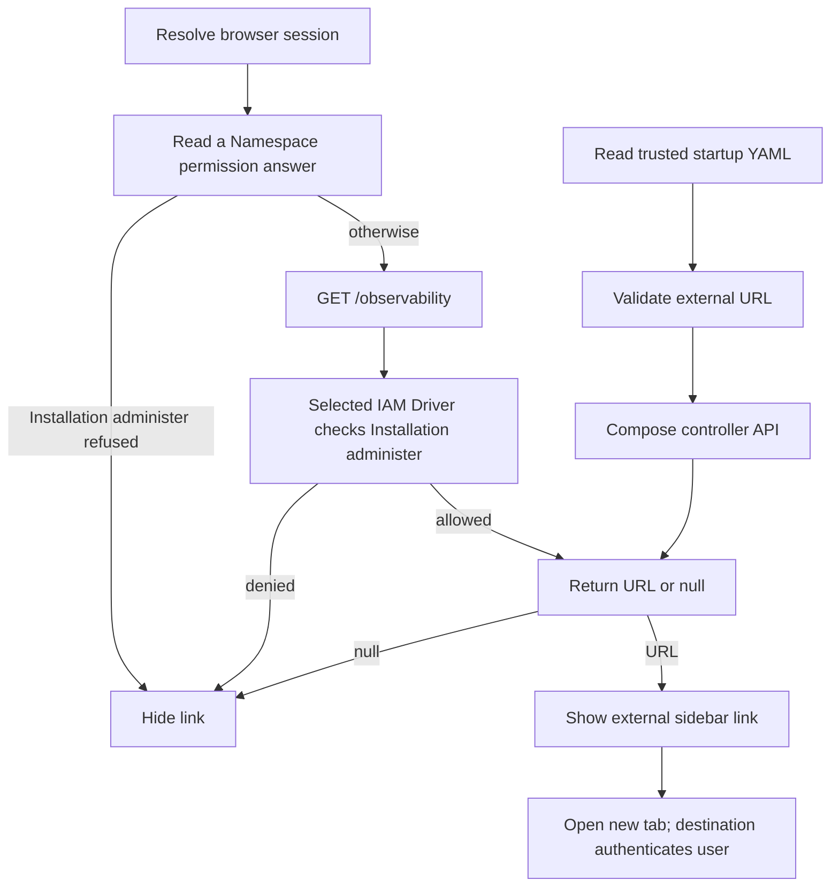

# Console external observability link

## Overview

A signed-in Installation administrator can open an operator-configured observability UI from the console sidebar. The controller reads the URL from trusted startup YAML, checks Installation authority, and returns it to the browser. The flow ends when the browser opens the external service; that service controls its own access.

## Entry Points

- `apps/controller/src/composition/installation-config.ts:loadInstallationConfiguration` validates the optional `observability.url`.
- `apps/controller/src/console/console.mjs:loadPage` requests the destination after session resolution.
- `apps/controller/src/index.ts:requireInstallationAdmin` checks the selected IAM Driver for exact Installation `administer` permission.

The caller needs a valid console session and Installation `administer` permission. The URL is optional and requires HTTP or HTTPS without embedded credentials or a fragment.

## Flow

## Execution Trace

### 1. Validate the operator destination at startup

`apps/controller/src/composition/installation-config.ts:loadInstallationConfiguration`
accepts an optional closed `observability` block in trusted Installation YAML.
It rejects malformed URLs, unsupported schemes, credentials, fragments, an IPv4
host that is not four decimal octets from 0 to 255 with no leading zeros, a
tab or newline, a backslash before the query, and unknown fields. Shorthand
and integer hosts, and any `@` before the host, stop
API and worker startup with log code `OBSERVABILITY_URL_INVALID`; correct the
URL and restart. The
[breaking-change notice](../../guides/deploy/breaking-changes.md) has the
wording. Production and configured PostgreSQL development pass the
validated URL to `createFastifyApp`. Compose development also accepts an
observability-only YAML with its default Drivers. Changing it requires API restart; it is
not persisted as an Installation resource or used as an OTLP export target.

### 2. Resolve the browser link

After the session check and the Namespace collection, `loadPage` asks `apps/controller/src/console/console.mjs:installationAccess`. It first reads `GET /namespaces/{namespaceId}/permissions` for the selected Namespace, or the first readable one. Its `installation.administer` field is the selected IAM Driver's Installation `administer` decision, the same check the probe makes, and the answer audits nothing. The field does not depend on the Namespace, so a Restriction that denies Agent create there does not change it. When it is `false`, the console hides the link and sends no probe, because the API audits each denied probe. When it is `true`, or with no readable Namespace or no permission answer, the console reads `GET /observability` (through `probeInstallationAccess`). The read outlives the view: a navigation while it is in flight joins it instead of aborting it and asking again, and a probe that settles while the navigation reads its permission answer is reused. `apps/controller/src/index.ts:perform` calls `requireInstallationAdmin`, which authorizes the exact Installation through the selected IAM Driver and records denial evidence. An allowed response contains the startup URL or `null`. Denial or an unavailable optional read leaves the link hidden. A session `401` clears private console state.

The console settles the probe once per session owner: an allowed response or a `403` is reused across navigation and, through tab `sessionStorage` keyed by the noncredential session binding, across reloads in the same tab. A `false` permission answer is reused across navigation but not kept across reloads, so a reload asks again without an audited denial. A user with a readable Namespace who is not an administrator produces no audited denial; a user with none produces one per session and tab. Transient failures retry on the next page load. Logout and an owner change clear the result. Revoking administration takes effect in the console at the next sign-in, in a new tab, or at the first `403` from `GET /backends` or from another read only administration may make. Sharing policy, Driver configuration schemas and a bound Secret read by ID are such reads. They pass through `apps/controller/src/console/console.mjs:administrationRead`, which sends them one at a time in each page load until one that needs administration succeeds (a Secret read by ID does not count), unless the probe answered in that load. Leaving the page or signing out drops the reads still waiting, unsent. Its `403` asks the permission answer whether the caller still administers the Installation, because a Restriction can refuse one such read to an administrator. Unless the answer says yes, that one audited refusal settles the answer as `false` for the tab and hides the link. A failed permission answer settles nothing. The reads still waiting are refused without being sent, so the page takes the member path. A page kept for **Back** replays these reads through the same gate when it checks that it is unchanged. A later **Refresh** or reload asks the permission answer, not `GET /backends`. Granting it takes effect at the next reload after a `false` permission answer, or at **Refresh** on the Backends refusal, which forgets the settled answer and asks again. The API check still applies to every request. The settled answer also tells Agent detail whether to mount the Installation-admin sharing panel. **Backends** needs the same `administer` permission, so a caller this answer marks as no administrator gets the Backends refusal without `GET /backends`, which the API would audit as a denial.

`apps/controller/src/console/shell.mts:renderShell` adds **Observability** with an external-link icon only for a returned URL. It opens a separate tab with `noopener noreferrer`; the browser does not send the OCC session to the destination. The external service authenticates the user independently.

## Debugging and Verification

- `node --test tests/integration/console-api.test.mjs` verifies the real API route, Installation IAM denial, and absent URL.
- The focused `tests/browser/console.test.mjs` case verifies administrator visibility, Namespace-only hiding with no probe, one probe per session across navigation and reload, and safe new-tab attributes in Chrome.
- `tests/browser/console-agent-state.test.mjs` verifies that a reader's page loads audit no observability, IAM, Backends or bound Secret denial, and that an administrator still reads each. It also verifies that a Restriction on Agent create leaves an administrator the Installation pages, and that Refresh and reload on the Backends refusal find a new grant. For a revoked administrator, it verifies one audited refusal whether the first page is the Access tab, Agent detail or Settings, and that a Restriction on Secret read settles nothing, also when the permission answer fails. It verifies that **Back** to a kept Agent page after a revoke adds no audited refusal after the first.
- These tests do not verify access at the external observability service.

## Related docs

- [Parent console flow](../platform-console.md)
- [Console reference](../../reference/console.md)
- [Installation startup configuration](../../reference/configuration.md#installation-startup-configuration)
- [Observability setup](../../guides/observability.md)

## Manual Notes

[keep this for the user to add notes. do not change between edits]

## Changelog

- 2026-10-26 18:00: Only a read that needs administration ends the one-at-a-time sends; leaving the page or signing out drops the reads still waiting. (2643, 2644)

- 2026-10-26 16:00: A kept page's replay keeps the administration gate, and a failed permission answer settles nothing. (findings 2636, 2637)

- 2026-10-26 15:30: Any read only administration may make settles a revoked administrator as `false` at its first `403`; the page load sends them one at a time until one succeeds. (D760)

- 2026-10-26 13:00: A `403` from `GET /backends` settles Installation administration as `false`, so a revoked administrator is refused once, not at each Refresh or reload. (2627)

- 2026-10-26 12:10: A probe that settles while the next page reads its permission answer is reused, not sent again. (2625)

- 2026-10-26 11:15: Ask the permission answer's `installation.administer` instead of inferring it from Agent create; reload and Backends Refresh ask again. (2620-2622)

- 2026-10-14 12:20: Startup refuses a tab, newline, or a backslash before the query, and logs `OBSERVABILITY_URL_INVALID`. A backslash in the query stays. (2383)

- 2026-10-13 22:10: Startup refuses an observability IPv4 host that is not four decimal octets. (2329)

- 2026-10-05 01:30: A navigation joins the in-flight probe instead of repeating it. (flake-hunt-8)

- 2026-09-29 12:00: Read the destination once per session owner. (obs-495 - 6858f3c0)

- 2026-09-27 15:08: Trace the authorized external observability link. (authoring-run/f396defd-23ca-46d0-ab3a-e749b6ea1d18 - 0663fa97)
