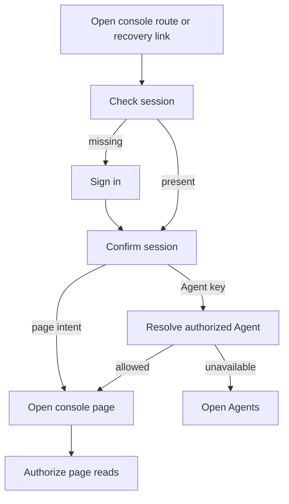

# Console sign-in and destination recovery

## Overview

The console authenticates a browser session and restores a requested supported
page when the user can still access it. Agent recovery resolves an opaque key
only after session admission and ends at ordinary Agent detail.

## Entry Points

- `apps/controller/src/console/console.mjs:loadPage` checks the browser session.
- `apps/controller/src/console/console.mjs:showLogin` offers available sign-in methods.
- `apps/controller/src/console/navigation.mts:createNavigation` validates page intents.

## Flow

## Execution Trace

### 1. Discover sign-in and bind the session

`apps/controller/src/console/console.mjs:showLogin`, `loadPage`

On a cold visit, the shell's static “Loading OpenClaw Enterprise…” status paints
before any script runs; CSS shows it only after 400 ms, so a fast load never
flashes it. `loadPage` takes that status over in place while checking the session
and announces “Checking session…” only if still pending after 400 ms.
The result can render immediately: sign-in for a missing session, the console
for a confirmed session, or a retry if the check failed.

`showLogin` reads `GET /api/auth/providers`; true `github`/`google` flags add their **Continue
with** buttons, and discovery failure keeps password login. A true `oidc` flag adds a button
labelled from `oidcSignIn.label` only when `oidcSignIn.authorizationUrl` is `https:`; its start
URL must use that endpoint's origin and path, as GitHub's and Google's must use their fixed ones. `password: false`
(recovery-only) hides the form behind **Recovery sign-in** and changes the
provider-error advice from "use your password" to asking an administrator. Pending login disables
all; generations reject late redirects. With `sessionBinding`, `loadPage`
exchanges the button's stored `attemptId` once for its key. Tabs then send
their pinned `x-occ-session-key`, so a replaced cookie yields login.
A refused callback returns with `authError` and makes no exchange, so a failed
exchange (`providerExchangeFailure`) reports a rate limit, an outage, the
browser-origin check, a provider that the API no longer configures (`403`), or
an attempt that expired or was replaced (`401`), never a refused identity.
Password sign-in reports `429` with the `Retry-After` wait. The provider
budgets send no `Retry-After`, so provider start and the exchange say to wait a
minute. Each reports the origin check with its own text; every other password
`400`, `401` or `403` keeps one message. On the API side, `sendAuthEndpoint`
answers `429` with the wait and `503` with an outage message; every refusal
keeps the endpoint's one message.
When login interrupts a recognized console route, `navigation.mts` records its
page, validated Namespace ID, recognized Agent version and tab, and a Secrets page
link's validated Secret ID, without unrelated query parameters. Password
sign-in carries that intent in the current view; external sign-in stores it in
tab `sessionStorage` with the one-use attempt ID and a ten-minute limit. The
console consumes it only after confirming that attempt and its session, and
clears it on failure or logout. `showExpiredLogin` captures the validated current
route before clearing private state on an API `401` or foreground session
recheck. A missing session in `loadPage` also retains the requested route,
including after a failed check. It says the session expired only when this tab
had one: a mark in tab `sessionStorage`, set when a session resolves and cleared
by logout, tells a reload after expiry from a first visit. Sign-in reauthorizes
that destination; it never restores drafts or replays a mutation. A `403` remains
an access denial and does not start login. The login page accepts no return URL.

A native Agent recovery link can supply a 32-character lowercase hexadecimal key
in the console root fragment. `loadPage` removes the fragment before sign-in and
retains it across a failed session check, and resolves it only after session
confirmation with `GET /native-admin/return/:key`.
A valid authorized response routes to ordinary Agent detail; failed or malformed
responses open Agents, and a failed lookup says so once. The [native Agent host](../agent-native-admin.md) redirects
a qualifying root or chat navigation here. Opening native chat still requires a separate user action.
`authError=<provider>` shows a generic, one-time error; with `authError=github`, an
`authReason` of `membership` or `membership-unavailable` explains a GitHub
[allowlist](../../reference/authentication/external-sign-in.md#organization-and-team-allowlist)
refusal instead. With any provider, `account-disabled` says the account is disabled and to ask
an administrator to enable it; `provider-unavailable` and `unavailable` say to try again
later. The
[authentication flow](../local-password-authentication.md#3-construct-session-authentication)
owns the server side.

`apps/controller/src/auth/index.ts:requireTrustedBrowserOrigin` checks Origin
before sign-in/out, even for SDK calls bypassing Better Auth middleware; headerless
CLI requests remain supported. The browser stores no credentials.

### 2. Authorize the destination

`apps/controller/src/console/console.mjs:loadPage` checks the session and loads
readable Namespaces before rendering the requested page. The Agent and Namespace
reads use their usual authorization; an inaccessible resource remains unavailable.
When the Namespace read fails after the session resolved, the page offers **Sign
out** beside **Retry**, so an account refused with `403` is not stranded.
A session or Namespace read that does not reach the API (the browser is offline,
or the read times out) tells nothing about the session. A signed-in tab keeps its
shell, says that it could not reach OpenClaw Enterprise, and moves focus to
**Retry**. The page and Namespace data are cleared, as for other failures.
See the [parent flow](../platform-console.md#3-authorize-the-selected-page-resource).

## Debugging and Verification

The focused cases in `tests/browser/console.test.mjs` exercise the console
against controller sessions and resource reads. Their external provider exchange
and recovery endpoint are modeled; they do not establish a deployed OAuth or
native-gateway integration.

## Related docs

- [Parent console flow](../platform-console.md)
- [External sign-in reference](../../reference/authentication/external-sign-in.md)

## Manual Notes

[keep this for the user to add notes. do not change between edits]

## Changelog

- 2026-10-26 18:00: A Secrets page link's Secret ID survives sign-in. (2645)

- 2026-10-19 22:11: Document return to the requested page after session expiry. (authoring-run/e63eaa44-e02d-49aa-b1c6-4711bd49d919 - 332455338271720ef29c63e5e7fb209fa3da6ec2)

- 2026-10-15 20:27: Defer console or sign-in until the initial session is known. (authoring-run/98164c0a-da1e-45c5-9d9a-8f6649a3a9c3 - b899534fae0070fab31489d54a8763bb81e4842e)
- 2026-10-15 00:00: Move provider discovery and trace scoped sign-in destination recovery. (authoring-run/05ac6c84-8444-4dc1-8311-13c4e84369a3 - 91ac04d6919860b7d7386444468a3dc0ddc90481)
