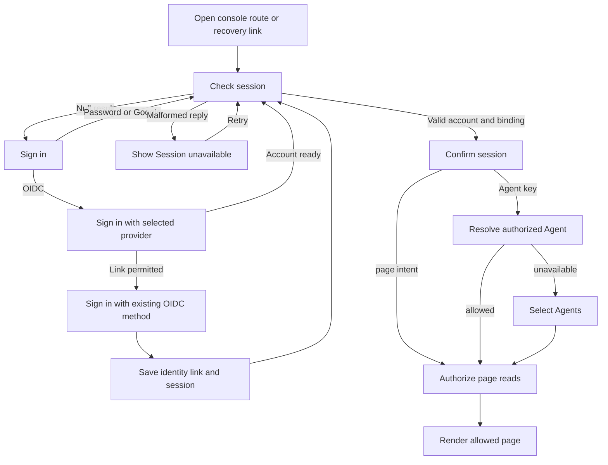

# Console sign-in and destination recovery

## Overview

The console authenticates a browser session and restores a requested supported
page when the user can still access it. Agent recovery resolves an opaque key
only after session admission and ends at ordinary Agent detail.

## Entry Points

- `apps/controller/src/console/console.mts:loadPage` checks the browser session.
- `apps/controller/src/console/console.mts:showLogin` offers available sign-in methods.
- `apps/controller/src/console/navigation.mts:createNavigation` validates page intents.

## Flow

## Execution Trace

### 1. Discover sign-in and bind the session

`apps/controller/src/console/console.mts:loadPage`, `readSession`, `showLogin`

On a cold visit, the shell's static “Loading OpenClaw Enterprise…” status paints
before any script runs; CSS shows it only after 400 ms, so a fast load never
flashes it. The independent async observer in
`apps/controller/src/console/startup-recovery.mts` handles the native entry-module
load error from `#console-entry` in `apps/controller/src/console/index.html`.
If the observer arrives after the error, it checks at window `load` (or immediately
if the document is already complete). While the `.startup-recovery` marker remains,
it reports that the Console could not load and offers **Reload page**. Clicking
the button reloads the same URL. If the observer is unavailable, the static text
still directs the reader to browser Reload. Recovery never automatically reloads
the page or retries API requests.

The healthy `console.mts` entry removes the marker synchronously before session
reads, so a slow or unavailable session follows its own path below. `loadPage`
takes the status over in place while checking the session and announces
“Checking session…” only if still pending after 400 ms.

`readSession` reads `GET /api/auth/session`. Of successful replies, only
`null` confirms that the browser is signed out. A non-null reply must include
`authenticated: true`, a nonblank `sessionKey`, and nonblank account ID, email,
and name. If the reply is malformed, the console shows **Session unavailable**
and withholds private content and reads. **Retry** repeats the session check.

`showLogin` reads `GET /api/auth/providers`. A true `google` flag adds **Continue
with Google**. `oidcProviders` supplies a button label and route for each named
provider. A single-provider installation supplies the `oidc` flag and
`oidcSignIn`. The start URL must match the provider's configured HTTPS origin and
path. Discovery failure keeps password sign-in.
An explicit `password: false` makes the form recovery-only and changes the
provider-error advice from "use your password" to asking an administrator. The
console keeps the password form behind **Recovery sign-in** while discovery is
pending, so early focus or autofill cannot make it the default sign-in method.
Selecting recovery opens the form immediately; a later discovery reply preserves
that choice, its input, and keyboard focus. Discovery that permits passwords or
fails shows the form without requiring the recovery action. If that action has
keyboard focus, focus moves to Email when the form replaces it.

While sign-in is pending, the console ignores repeat password submissions and
provider activations. Keyboard focus stays on the control that started the
request unless the reader moves it. Generations reject late redirects. With
`sessionBinding`, `loadPage`
exchanges the button's stored `attemptId` once for its key. Tabs then send
their pinned `x-occ-session-key`, so a replaced cookie yields login.
A refused callback returns with `authError` and makes no exchange, so a failed
exchange (`providerExchangeFailure`) reports a rate limit, an outage, the
browser-origin check, a provider that the API no longer configures (`403`), or
an attempt that expired or was replaced (`401`), never a refused identity.
Password sign-in reports `429` with the `Retry-After` wait. The provider
budgets send no `Retry-After`, so provider start and the exchange say to wait a
minute. Each reports the origin check with its own text; every other password
`400`, `401` or `403` keeps one message. On the API side, `sendAuthEndpoint`
answers `429` with the wait and `503` with an outage message; every refusal
keeps the endpoint's one message.
When login interrupts a recognized console route, `navigation.mts` records its
page, validated Namespace ID, recognized Agent version and tab, and a Secrets page
link's validated Secret ID, without unrelated query parameters. Password
sign-in carries that intent in the current view; external sign-in stores it in
tab `sessionStorage` with the one-use attempt ID and a ten-minute limit. The
console consumes it only after confirming that attempt and its session, and
clears it on failure or logout. `showExpiredLogin` captures the validated current
route before clearing private state on an API `401` or foreground session
recheck. A null session result in `loadPage` also retains the requested route,
including after a failed check. It says the session expired only when this tab
had one: a mark in tab `sessionStorage`, set when a session resolves and cleared
by logout, tells a reload after expiry from a first visit. Sign-in reauthorizes
that destination; it never restores drafts or replays a mutation. A `403` remains
an access denial and does not start login. The login page accepts no return URL.

The Console shows each configured provider on the sign-in page.
`console.mts:showLogin` offers linking when at least two providers report
`allowSelfLink: true`. The link view shows those providers.

When Maya first uses Keycloak, `human-login.ts:externalProviderEndpoints`
checks the ID token and looks for the Keycloak identity in `occ.account`.
If enrollment permits account creation and the email is available, OpenClaw
creates the account. If Maya already has an account, she can choose **Link an
existing account** before starting. OpenClaw also offers this step when a verified
identity has no link and cannot create an account. Keycloak must permit linking.

OpenClaw writes the verified identity to `occ.human_authentication_links`
with a five-minute expiry. The browser keeps a cookie and the original tab keeps
the attempt ID. Both are necessary to start the proof with another OIDC provider.
Maya signs in again with Okta. OpenClaw checks that Okta permits linking and
is already linked to her account. In one PostgreSQL transaction,
`human-authentication.ts:issueSession`
consumes the pending link, adds the Keycloak row to `occ.account`, ends earlier
sessions, records the audit event, and writes the new session. Maya keeps her
existing user ID and permissions. The tab confirms the new session with the
Okta result route and opens its original destination.

A native Agent recovery link can supply a 32-character lowercase hexadecimal key
in the console root fragment. `loadPage` removes the fragment before sign-in and
retains it across a failed session check, and resolves it only after session
confirmation with `GET /native-admin/return/:key`.
A valid authorized response routes to ordinary Agent detail; failed or malformed
responses open Agents, and a failed lookup says so once. The [native Agent host](../agent-native-admin.md) redirects
a qualifying root or chat navigation here. Opening native chat still requires a separate user action.
`authError=<provider>` shows a generic, one-time error. With Google or OIDC,
`account-disabled` says the account is disabled and to ask
an administrator to enable it; `provider-unavailable` and `unavailable` say to try again
later. The
[authentication flow](../local-password-authentication.md#3-construct-session-authentication)
owns the server side.

`apps/controller/src/auth/index.ts:requireTrustedBrowserOrigin` checks Origin
before sign-in/out, even for SDK calls bypassing Better Auth middleware; headerless
CLI requests remain supported. The browser stores no credentials.

### 2. Authorize the destination

`apps/controller/src/console/console.mts:loadPage` confirms the account and
session binding before loading readable Namespaces or opening the requested
page. Agent and Namespace reads then follow their usual authorization rules.
An inaccessible resource remains unavailable. A foreground recheck of an open
Agent also confirms the session before refreshing private reads.
When the Namespace read fails after the session resolved, the page offers **Sign
out** beside **Retry**, so an account refused with `403` is not stranded.
A session or Namespace read that does not reach the API (the browser is offline,
or the read times out) tells nothing about the session. A signed-in tab keeps its
shell, says that it could not reach OpenClaw Enterprise, and moves focus to
**Retry**. The page and Namespace data are cleared, as for other failures.
See the [parent flow](../platform-console.md#3-authorize-the-selected-page-resource).

## Debugging and Verification

The focused cases in `tests/browser/console.test.ts` exercise the console
against controller sessions and resource reads, including a late startup observer
after a native entry failure and during a pending session read. Their external provider exchange
and recovery endpoint are modeled; they do not establish a deployed OAuth or
native-gateway integration.

The registered case “a session reply missing its binding blocks private reads
until Retry” in `tests/browser/console-refocus-focus.test.ts` checks that a
successful reply without a binding hides private content and sends no private
reads. After **Retry**, Namespace and Agent reads carry the confirmed binding.

`tests/integration/postgres-oidc-linking.test.ts` checks separate enrollment
policies, opt-in linking, administrator attachment, and the two identity rows
for one user.

## Related docs

- [Parent console flow](../platform-console.md)
- [External sign-in reference](../../reference/authentication/external-sign-in.md)

## Manual Notes

[keep this for the user to add notes. do not change between edits]

## Changelog

- 2026-11-10 14:49: Trace provider opt-in for self-service linking. (authoring-run/0a21b7ac-a801-4bfa-991f-4703fe578258 - 3488c97f215ae3f80beb14ca3d11a6a6b8f011)

- 2026-11-10 14:03: Trace named OIDC sign-in and linking with a second provider. (authoring-run/94464a93-4082-414c-853d-34ba1c1c347b - 3488c97f215ae3f80beb14ca3d11a6a6b8f011)

- 2026-11-10 08:33: Keep password entry behind explicit recovery until sign-in discovery settles. (authoring-run/e3f98b7b-fd3a-415b-83f5-7b839709b761 - eef0b3f10d0e0f4ed09fd32086c84628c41f1b93)

- 2026-11-09 15:08: Remove direct GitHub discovery and membership errors in the accompanying changes. (authoring-run/e00c2688-0a25-4443-a852-69dea27e73d0 - daecab29c452af39945f5526257288771a77bdfc)

- 2026-11-04 22:07: Document Console startup failure and reload recovery. (authoring-run/b22db461-d5cf-40f5-b1c1-43443569364c - f18e8948b89cdeaabec5ae0f5824b23b7c82b906)

- 2026-11-04 12:53: Explain keyboard focus while sign-in is pending. (authoring-run/1ca69282-ea7b-4b53-8db4-3fdb81fc30e1 - 15f0c1d443090f1346dc3d94444dad2397cb4fdc)

- 2026-11-04 12:29: Document recovery from a malformed Console session reply. (authoring-run/e5be3034-9c43-4cba-9ba7-e7e2f487f042 - 9f1dcbeb2361006e7bea52d0cee595d9616ed16a)

- 2026-10-26 18:00: A Secrets page link's Secret ID survives sign-in. (2645)

- 2026-10-19 22:11: Document return to the requested page after session expiry. (authoring-run/e63eaa44-e02d-49aa-b1c6-4711bd49d919 - 332455338271720ef29c63e5e7fb209fa3da6ec2)

- 2026-10-15 20:27: Defer console or sign-in until the initial session is known. (authoring-run/98164c0a-da1e-45c5-9d9a-8f6649a3a9c3 - b899534fae0070fab31489d54a8763bb81e4842e)
- 2026-10-15 00:00: Move provider discovery and trace scoped sign-in destination recovery. (authoring-run/05ac6c84-8444-4dc1-8311-13c4e84369a3 - 91ac04d6919860b7d7386444468a3dc0ddc90481)
