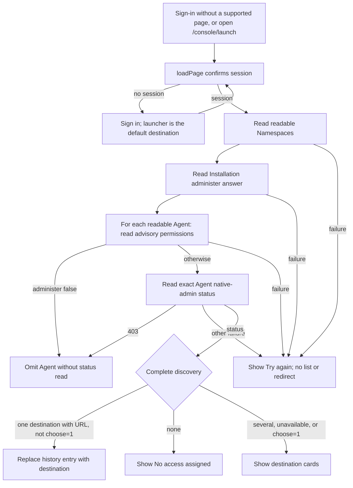

# Console workspace launcher Flow

## Overview

After sign-in, the console's `/console/launch` route discovers the destinations
the signed-in person may open now: each Claw whose native admin UI they
administer, and **Fleet administration** for an Installation administrator. One
available destination opens automatically; otherwise the person chooses. The
flow stops when the browser navigates to a destination or shows a chooser,
no-access, or retry state. The [reference](../../reference/console/launcher.md)
owns user-visible behavior.

## Entry Points

- Trigger: sign-in without a supported destination, an authenticated visit to
  `/console/login`, a direct visit to `/console/launch`, or **Switch destination**
  in the account menu.
- Source: `apps/controller/src/console/console.mjs:loadPage`
- Source: `apps/controller/src/console/launcher.mts:renderLauncher`
- Assumptions: `loadPage` has confirmed the browser session and pinned its
  session key. Every read uses that key and the current view lifetime.

## Flow

## Execution Trace

### 1. Route sign-in to the launcher

`apps/controller/src/console/console.mjs:showLogin`
`apps/controller/src/console/navigation.mts:createNavigation`

`showLogin` uses `launcherIntent` when the caller supplies no validated page
intent. This covers a bare `/console/login`, sign-in after confirmed logout,
external sign-in failures, and an expired session on an unrecognized route.
Password sign-in carries the intent in memory; external sign-in stores it with
the one-use attempt as other intents do. `validIntent` accepts the `launch`
feature without Namespace, version, tab, or Secret fields. A signed-out visit to
`/console/launch` captures the same intent, dropping `choose`.

`loadPage` replaces the URL with the intent after session confirmation. An
authenticated visit to `/console/login` uses the same default. Native Agent
recovery keys and supported page intents keep their existing destinations.

### 2. Render outside the administration shell

`apps/controller/src/console/console.mjs:loadPage`

`launch` is not a shell page, so `loadPage` shows the startup status instead of
holding a shell view. After the session resolves, it stops the shell loading
timer and calls `renderLauncher` with the session, pinned request client, view
lifetime, `choose=1` flag, and `logout`. It reads neither Namespace selection nor
the shell's cached Installation-access answer. The account menu's
**Switch destination** navigates to `launch?choose=1`.

### 3. Discover destinations

`apps/controller/src/console/launcher.mts:discover`

Discovery reads `GET /namespaces`. The first readable Namespace's
`GET /namespaces/:id/permissions` answers Installation `administer` without an
audited denial. With no readable Namespace, `GET /observability` is the probe:
`403` means no administration. For each readable Namespace in name order it reads
the Agents, then each Agent's advisory permissions. An Agent without
`administer` is omitted without a native-admin read. Otherwise
`GET .../native-admin` supplies status and, when available, the native URL.
A `403` there omits the Agent. Reads run one at a time.

Any other failure, including a malformed collection, status, permission answer,
or native URL, discards the whole result and offers **Try again**. Native URLs
must be HTTP or HTTPS without credentials and come only from the status response.

### 4. Navigate or choose

`apps/controller/src/console/launcher.mts:renderLauncher`

With exactly one destination that has a URL and no `choose=1`, the launcher
replaces its history entry: a Claw through `location.replace`, Fleet
administration through `navigate`, which keeps the tab's pinned session key. A
plain click on **Open administration** also stays in the console. One unavailable
destination shows its status card. No destinations show **No access assigned**
with **Check again**. Otherwise cards list each Claw's status and Namespace, then
**Fleet administration**. **Refresh availability**, **Try again**, and
**Check again** repeat discovery; a newer run supersedes an older one. **Sign out**
uses the console's confirmed logout. Nothing is persisted.

## Debugging and Verification

- `node --test tests/browser/console-launcher.test.mjs` signs in through the real
  Fastify app, Better Auth, and native IAM. It covers automatic opening,
  chooser-only mode, revoked `administer`, unavailable Agents, failed discovery,
  no access, Installation-only administration, and default sign-in after logout.
  Only the native gateway document is a stand-in.
- A request ID on the retry panel matches the failed discovery read in controller logs.
- Storybook **Pages/Launcher** is simulated UI proof, not backend or runtime evidence.

## Related docs

- [Workspace launcher reference](../../reference/console/launcher.md)
- [Console sign-in and destination recovery](sign-in-return.md)
- [Agent native admin UI flow](../agent-native-admin.md)
- [Parent console flow](../platform-console.md)

## Manual Notes

[keep this for the user to add notes. do not change between edits]

## Changelog

- 2026-10-26 10:52: Trace launcher discovery and default sign-in destination. (authoring-run/59e116e9-8a97-44aa-a937-ca6ce42b9668 - 7f338874d20460c6eacb63e8c559ae92c09c2703)
