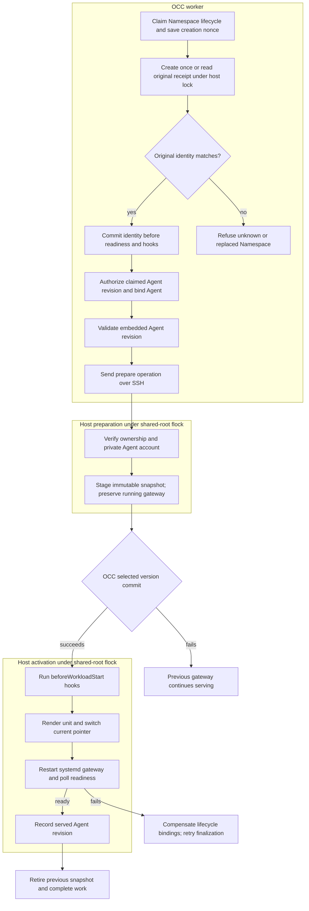

# SSH compute lifecycle

## Overview

The worker realizes an admitted embedded OpenClaw AgentRevision on a configured
Linux host. The SSH Compute Driver sends a controller-owned helper to the host,
which stages the Agent revision and activates the Agent's systemd gateway after OCC
commits its selected version. This trace covers preparation, activation,
retirement, and Agent and Namespace deletion. It stops when
control returns to the worker; gateway request execution is outside this flow.
The [SSH reference](../reference/drivers/ssh-compute.md) owns configuration and
supported boundaries.

## Entry Points

- Trigger: Namespace or AgentRevision work claimed by the controller worker.
- Code pointer: `apps/controller/src/drivers/compute/ssh/index.ts:SshComputeDriver.prepareRevision`.
- Source: [installation-config.ts](../../apps/controller/src/composition/installation-config.ts)
  (`loadInstallationConfiguration`), [worker.ts](../../apps/controller/src/worker.ts)
  (`processRevision`), and [ssh/index.ts](../../apps/controller/src/drivers/compute/ssh/index.ts)
  (`SshComputeDriver`).
- Assumptions: Trusted Installation YAML selects packageless `compute-ssh`;
  the operator provisions Linux, systemd, flock, Node, OpenClaw, root SSH, and a
  account-management tools. Namespace names map to configured hosts. OCC supplies
  authorized, server-owned resource identities and immutable saved versions.

## Flow

## Execution Trace

### 1. Select the driver and bind resource ownership

`installation-config.ts:loadInstallationConfiguration`, `worker.ts:processRevision`,
`ssh/index.ts:preflight`, `bindAgent`, `ensureNamespace`

The exact packageless ID `compute-ssh` selects `occ/ssh`; other packageless
Compute IDs select Kubernetes. Schema and semantic validation reject invalid
host settings and Sandbox composition. Preflight checks the two local SSH
files and probes each host's required executables and account-management tools.

Namespace preparation receives the worker's claim-checked lifecycle journal.
`ssh/index.ts:namespaceTarget` evaluates only the selected trusted profile through
`ssh/executor.ts:resolveNamespaceTarget`. This `ssh -G` evaluation can execute
`Match exec`; it is not passive profile inspection. Matched user/global public
keys and `HostKeyAlias` identify trust without retaining authentication material.
The executor looks up an explicit alias verbatim; without an alias, a nondefault
port uses `[hostname]:port`.
Dynamic trust limitations belong to the [SSH reference](../reference/drivers/ssh-compute.md#namespace-and-revision-lifecycle).

`ensureNamespace` saves its nonce and exact selector before dispatch. Under the
host lock, `remote-helper.cjs:namespaceReceipt` saves that generation outside the
Namespace tree, creates the tree once, and records its original filesystem identity.
The Driver commits that identity before readiness and `afterNamespacePrepared`.
A retry can read the same receipt but cannot create another directory. An attempted
creation without a receipt stays unconfirmed, and a copied tree is refused. After Agent revision authorization and provider
validation, the worker calls `bindAgent`; the driver copies the authoritative
Namespace, Agent, and ServicePrincipal binding into its in-memory maps. Agent revision
operations require matching bindings and the selected Compute identity.
Admission and dispatch require the explicit `runtime` binding. The snapshot
contains only the method: neither source authorization nor credential resolution
runs for it, while Agent/Configuration authorization and worker reauthorization
remain required. `SshComputeDriver.validateHarnessAuth` rejects dedicated
Harnesses (a fixed `409`), then any other method through `requireHarnessAuthMethod`
(`compute/harness-auth-method.ts`), which names `harnessAuth.method` (`400`).
Preparation also rejects OCC Secret delivery and Sandbox use.
SSH dispatches selected `beforeWorkloadStart` hooks during activation, before
starting the candidate workload.

### 2. Cross SSH and serialize host changes

`ssh/index.ts:execute`, `ssh/executor.ts:SystemSshCommandExecutor.execute`,
`ssh/remote-helper.cjs:run`, `acquireLock`

The driver sends its helper on stdin and one base64 JSON argument containing
the operation, resource data, configuration hash, and trusted runtime settings.
The system SSH client uses an explicit identity and known-hosts file, strict
host-key checks, batch mode, and a 180-second operation timeout. The helper
also enforces a 170-second deadline and detects closed output pipes with
heartbeat writes. Cancellation terminates the local client; a systemd job
already submitted can still complete. Once stdout exceeds 64 Ki UTF-16 code
units, the executor stops retaining subsequent chunks and reports
`SSH helper output exceeded its limit.` The crossing chunk can exceed the
threshold. The local client still receives SIGTERM, then SIGKILL after one
second if needed; the operation settles on its close event. One second after
the client exits, the executor closes its output pipes, so a descendant that
inherited them, such as a `ProxyCommand`, cannot hold the operation open for
more than about a second after the client exits.

Host mutations take `<root>/.compute-lock` through a child holding kernel flock,
with a 30-second acquisition timeout. The shared root defines the inventory and
serialization boundary. Namespace, Agent, Agent revision, and unit markers are checked
before use; ownership failures are permanent. `verifyNamespace` checks the original
receipt and filesystem identity for Agent preparation, activation, stop, retirement,
and deletion too. Its marker-only helper avoids recursive receipt validation. The lock releases when its
holder exits. Probe does not take the lock. Deletion of an already-missing
Namespace still holds it while retrying cleanup of remaining owned accounts.

### 3. Create the private account and stage the snapshot

`ssh/remote-helper.cjs:prepare`, `ensureRuntimeIdentity`, `snapshot`

Before host work, `sshGatewayConfigurationDocument` admits only the supported
authentication fields and modes. Omitted auth mode renders explicit password mode with a
managed environment SecretRef; explicit trusted proxy retains its configured trust.

The helper creates or verifies a deterministic per-Agent system user and
private group, then creates the Agent directory and reserves the lowest free
port across the shared root. Root-owned account markers bind the UID/GID to the
exact Driver, Namespace, Agent, and ServicePrincipal. Existing unowned accounts
or conflicting markers fail closed. Agent-owned `home/` and `state/` use mode
`0700` and persist across versions.

The helper creates `gateway-password.env` only when needed and missing,
preserving its value across later versions. It does not migrate historical
credential files.

Snapshots store the Driver-rendered configuration as root-owned,
private-group-readable `openclaw.json`. The helper validates existing bytes
against their hash and rejects a different Agent revision ID with the same version number. An older
candidate returns not-ready. Preparation leaves the running unit and `current`
pointer untouched, so failed OCC publication does not cut over the gateway.

### 4. Commit activation, start the gateway, and retire the prior Agent revision

`worker.ts:observeRevision`, `finalizeRevision`,
`ssh/index.ts:activateRevision`, `retireRevision`,
`ssh/remote-helper.cjs:activate`, `renderUnit`, `waitReady`

SSH uses the default activation order. After successful preparation, OCC
compare-and-sets the Agent's selected version in its database. The worker then
calls `activateRevision`, which invokes selected Configuration and IAM
`beforeWorkloadStart` hooks before sending the activation operation. Accepted
opaque launch placeholders enter the systemd unit's environment. Hook failure
prevents launch; failure after hook preparation invokes workload-stop
compensation with a separate five-second cancellation signal if the original signal was cancelled. Incomplete finalization remains retryable.

The helper renders the unit for the Agent's private Unix account, enables its
absolute path, replaces `current`, restarts the gateway, and polls loopback `/readyz` for up to 120
seconds. It writes `served.json` only after readiness succeeds. A matching
current pointer alone never establishes successful activation. The unit loads
the per-Agent managed `gateway-password.env` for password access and optionally
loads the operator-owned `env` file. Explicit trusted proxy without a password
omits the managed file. The unit has no legacy credential or environment
migration path. The Driver never reads or writes the operator credential
file and never submits a model probe.
Readiness confirms gateway startup only; an invalid key can leave the gateway
ready while model requests fail. Host credential changes may affect an existing
version after restart without a new Agent revision.

Retirement runs `beforeWorkloadStop` hooks and removes the specified snapshot.
If that snapshot is current, `stopOwnedUnit` verifies the configured file's ownership,
links its absolute path into systemd's load path, then stops/disables the unit and removes
`current` and `served.json`. Persistent state, the private account, and other
snapshots remain. `deactivateRevision` only verifies ownership; the worker's
dedicated-only deactivation path is outside SSH's supported topology.
Relinking permits cleanup after `disable` removed a custom directory's load-path link.

### 5. Delete the Namespace host state

`ssh/index.ts:deleteNamespace`, `ssh/remote-helper.cjs:removeNamespace`

A revision-zero empty journal completes deletion without host or hook effects.
Otherwise `deleteNamespace` reloads the saved selector, observes the original host
receipt, and commits any recovered creation identity before cleanup. The helper
checks the receipt, marker generation, and original directory device, inode, and
birth time under the same host lock. Pure comparisons precede filesystem probes.
`verifyFilesystemBirthtime` creates and removes an owned temporary file per device,
then uses the same directory `lstat` path to require positive, unchanged birth time
and changed ctime within two seconds. No named probe remains during waits. A zero or ctime-based fallback fails permanently. A replacement is refused before hooks or
account removal. Unknown checkpoint results withhold later effects until an
authorized read resolves the same journal.

Deletion then runs `beforeNamespaceDelete` hooks and validates every Agent, Agent revision,
and unit in the deletion set before stopping gateways. The helper stops and
disables owned units through `stopOwnedUnit`, removes their unit files, reloads systemd, and removes the
Namespace tree, including persistent state, and its owned runtime accounts. The driver clears its in-memory
bindings only after the host operation succeeds. If account removal fails after
the tree disappears, the retained receipt and lifecycle-tagged account markers
let a restarted Driver retry removal of the exact owned UID/GID.

Agent deletion (`ssh/index.ts:deleteAgentRuntimeCredentials`,
`remote-helper.cjs:removeAgent`) does the same for one Agent after its Agent revisions
retire, which frees its gateway port.

## Debugging and Verification

- Run `node --test tests/conformance/ssh-compute.test.mjs tests/integration/ssh-compute-startup.test.mjs`.
  These exercise the real driver/helper with SSH and systemd fixtures, plus
  configuration loading and worker construction. Account-command fixtures do
  not prove OS isolation. These tests also do not prove live SSH, systemd,
  database reconciliation, or model execution.
- Follow the [disposable real-host procedure](../testing/ssh.md#ssh-raw-hosts) for
  real SSH, systemd, readiness, cutover, persistence, retirement, and deletion.
  Selecting `OCC_TEST_SSH_MODEL=1` adds real valid/invalid provider requests,
  counts zero model calls during deployment/readiness, and checks operator-file
  preservation after redeployment and stop. An unselected skip is not host proof.
- Inspect the exact unit with `systemctl status` and `journalctl -u`, and compare
  `current` with `served.json`. A pointer alone does not establish readiness.
  Keep operator credentials and gateway password files out of diagnostics.
- Ownership/configuration errors fail permanently; SSH, timeout, and unexpected
  helper errors are retryable. Host markers reserve ports only within the
  shared root; operators must reserve the configured range from other services.

## Related docs

- [PR 24](https://github.com/openclaw/openclaw-enterprise/pull/24)
- [SSH Compute reference](../reference/drivers/ssh-compute.md)
- [Driver loading](driver-plugin-loading.md)
- [Controller worker](controller-worker.md)
- [Compute lifecycle hooks](compute-driver-lifecycle-hooks.md)

## Manual Notes

[keep this for the user to add notes. do not change between edits]

## Changelog

- 2026-10-30 10:42: Match OpenSSH verbatim alias lookup and retain default-host port selection. (authoring-run/be3c47b9-e273-4252-94cc-50700db0c396 - 922a031ef91f6dc14329034f50964752757ec29b)

- 2026-10-30 09:55: Reject unavailable creation timestamps and probe the selected owned filesystem after identity checks. (authoring-run/be3c47b9-e273-4252-94cc-50700db0c396 - ef2cf007043819118c83fd8339496a92bcab9fb3)

- 2026-10-30 09:34: Trace durable Namespace binding, receipt recovery, and exact account cleanup in accompanying source changes. (authoring-run/be3c47b9-e273-4252-94cc-50700db0c396 - 536e71d95bf39797f2b60048cb3677e879ed046b)

- 2026-10-14 12:23: Document stdout retention and local-client settlement on overflow. (authoring-run/a404e7a3-9acf-4b50-9307-31e50b1b3582 - 4727e9b109a2127150e03e39e859d45e0668f82f)

- 2026-10-10 06:15: Trace absolute unit enablement and relinking for owned cleanup outside systemd's load path. (authoring-run/f50ad5ce-853f-4d20-9c15-8da39cbe292e - 792304b6a09b5df4f46e3889066f231610b294cf)

- 2026-09-22 22:31: Describe supported auth admission and remove legacy environment migration behavior. (authoring-run/d7126920-6a2a-4126-ad7d-fafd57593855 - c387eef76420f05a060689d2fa04b57a3e416956)
- Removed legacy gateway credential compatibility handling. (NOT_IN_SPEC)

- 2026-09-22 22:02: Trace managed gateway password files and preserve operator credentials during legacy-auth removal. (authoring-run/b91ebd83-2105-4b1e-aad8-6747fe22c2f1 - 01b42feaf8321e231fbe23a80e00ba641bb9fbcb)
- Bundled Compute Drivers use managed passwords or trusted proxy for native gateway authentication. (NOT_IN_SPEC)

- 2026-09-17 19:14: Add explicit runtime credentials, unchanged readiness, and operator-file ownership semantics. (01a0acbf-4d5a-7413-9411-dce911f3ad23 - b8cabaf9a49e069a7668ccf88b9e71a7484227b7)

- 2026-09-08 07:49: Trace private Agent accounts, staging before OCC publication, activation hooks, and systemd cutover. (01a07d92-d866-7731-afe5-abab67d8966c - 4d83087229961f3665b923d2581c0b71b988cc9c)

- 2026-09-07 13:35: Trace the SSH host lifecycle and OCC activation handoff at PR 24's reviewed head. (01a07d92-d866-7731-afe5-abab67d8966c - 5db27746de761abea09f751408c0c28e7e26f654)
