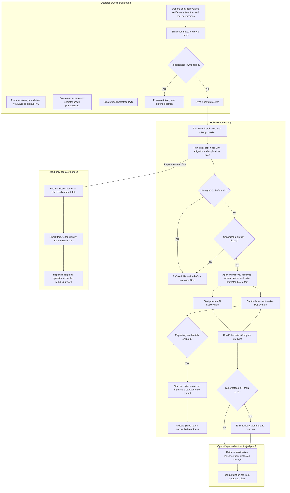

# Production Startup Flow

## Overview

Helm initializes OCE from protected storage and approved inputs. After private
API/worker readiness, authenticate `/installation` with the service key.

[Deployment guide](../guides/deploy.md).

## Entry Points

- Trigger: Run `scripts/prepare-bootstrap-volume`, then
  `occ installation install` with explicit target, local chart, values and receipt.
- Source: `scripts/prepare-bootstrap-volume:53`,
  `deploy/helm/openclaw-enterprise/templates/jobs.yaml:8`, and
  `apps/controller/src/composition/production.ts:28`.
- Assumptions: Explicit kubeconfig/context, enforcing NetworkPolicies, external
  PostgreSQL, approved immutable images, protected operator files, fresh
  bootstrap PVC, exact API/client selectors, `/32` egress hosts,
  reviewed control-plane node labels, and an approved private OCC URL.

## Flow

First install requires [empty OCE history](../reference/settings/operations.md#migration-history).

## Execution Trace

Migration, bootstrap, API and worker use
[`createPostgresPool`](../../packages/occ/src/state/postgres-pool.ts) with
[password or Azure workload-identity authentication](../reference/settings/operations.md#postgresql-connection-authentication).
For each password-mode connection, the factory parses the URL before applying
explicit caller limits and startup options. It retains TLS-file reads and the
effective IP-host certificate check.
Failover, maintenance restart, `idle_session_timeout` or proxy reset discards the
idle client and logs only its error code to stderr as `database.idle-client-error`.
The process continues; the next query opens a new connection.

### 1. Prepare native production inputs

`scripts/diagnose-kubernetes-prerequisites.mjs:diagnose` reads CRDs, controllers,
addresses and object quota headroom. EKS binds account, ARN, endpoint and CA.
[Resolve failed/unknown checks](../guides/deploy/prerequisite-diagnosis.md) before Helm.

`deploy/helm/openclaw-enterprise/values.yaml:1`

Keep values, Installation YAML and bootstrap PVC outside the checkout. Helm
selects images, endpoint, Secrets, claim, selectors and egress.
`openclaw.validate` requires a DNS-1123 release Namespace label (maximum 63 characters).
Installation YAML selects Drivers, Backends, runtime images, projected identity,
networking and storage.

File-backed Secrets supply Installation startup, database URLs/optional CA, Better Auth
signing, and optional ChatGPT administrator credentials. Helm neither synchronizes
inputs, rewrites Driver configuration, nor infers runtime images.

### 2. Prepare the fresh bootstrap volume

`scripts/prepare-bootstrap-volume:124` takes an existing
`bootstrap.password.claimName` PVC, explicit kubeconfig/context/namespace/claim,
an approved Node-capable image and optional `--node-selector KEY=VALUE` labels.
It preserves namespace/selector strings, applying selectors before
WaitForFirstConsumer binding. It requires an empty root except filesystem-owned
`lost+found` and sets UID/GID `1000`, mode `0700`.

If forbidden, storage administrators prepare the claim through approved procedures.
The helper cannot create PVCs, repair used claims, retrieve credentials or
change controller configuration.

### 3. Run Helm initialization

`internal/occcli/installation_receipt.go:installationInstallCommand` snapshots
kubeconfig/chart/values, checks release states and syncs intent and its directory.
A failed stdout notice preserves and names intent, stopping before dispatch or
Helm. Otherwise it syncs the unknown marker and starts Helm.
`observeInstallationJob` records the first recognized attempt-matched Job UID
(installs only). Helm's outcome stays separate; final report write errors fail
the command without changing that outcome or replaying install.

Reported template failures add static [offline-render guidance](../guides/deploy/production-handoff.md#record-the-initialization-job-for-handoff),
including settings for the suffix refusal. Stderr stays in memory (4 MiB); excess is discarded without affecting Helm. Raw diagnostics are never
printed or saved. Receipt and recovery decisions stay unchanged.

`deploy/helm/openclaw-enterprise/templates/bootstrap-networkpolicies.yaml:1`
installs isolation before the Job; it and later policies grant configured
DNS peers UDP/TCP `53` and `5353`
([Helm DNS contract](../reference/settings/production.md#required-production-controller-environment)).

`deploy/helm/openclaw-enterprise/templates/jobs.yaml:8` refuses existing or unreadable
Jobs during connected installs. Offline rendering cannot check this; lookup
neither locks names nor verifies database/volume freshness.

`openclaw.validate` in `deploy/helm/openclaw-enterprise/templates/_helpers.tpl`
checks routing, ports and peer labels. Operators supply GatewayClass, CRDs,
controllers and Secrets. [Disabling routing](../guides/deploy/workspace-routing.md#explicit-opt-out)
omits its resources/mounts and requires disabling native admin and sandbox routing.
Database/API ports accept 1–65535 without leading zeros; worker metrics/repository
ports must differ. The Compute Driver rejects malformed IPv4 hostnames and
numeric/hexadecimal sandbox suffixes. See [refused values](../guides/deploy/production-upgrade-recovery.md#correct-values-the-candidate-refuses).

On upgrades, `deploy/helm/openclaw-enterprise/files/check-installation.mjs` validates
Installation without database/Kubernetes access; refusal stops migration and API
replacement. It uses `apps/controller/src/startup-failure.ts:formatStartupConfigurationFailure`
and the API/worker filter `apps/controller/src/logging.ts:configurationLogDetails`: at most 32 field
diagnostics, without submitted values, except
`apps/controller/src/composition/installation-fields.ts:requireChartListener`:
`CHART_LISTENER_MISMATCH` names ports, hosts or paths refused when
`OCC_EGRESS_AUTHORITY_PORT`/`OCC_OPENSHELL_GIT_PORT` is set.

For chart-managed routing, `openclaw.listenerEnv` passes `OCC_CHART_GATEWAY_ROUTING`
to the hook, API and worker. `requireChartGatewayRouting` compares the Kubernetes
Compute Gateway name, Gateway and Envoy namespaces, and effective hostname.
A mismatch reports the field without its value.

The hook keeps the release name and bounds its suffix to 63 characters. Both
database containers optionally mount the CA. Helm validates distinct application and
migration Secret keys against Kubernetes syntax before use. `installation.key`
and `executionCluster.kubeconfigKey` must be Secret keys at most 253 characters,
not `.` or a `..` prefix.

For [handoff](../guides/deploy/production-handoff.md#resume-an-installation-in-progress),
`internal/occcli/installation_doctor.go:installationHandoffCommand` verifies receipt
namespace/release/cluster connection before reading the named Job.
`initializationEvidence` checks marker, captured UID, chart steps, controller and
terminal status. Missing UID, replacement, refusal or inconclusive status leaves
the checkpoint unknown. Doctor separately reports Helm's outcome; plan adds
read-only recovery. Both check the buffered report's `WriteTo` before returning
Job status. Write errors reach `cmd/occ/main.go:main` for stderr diagnostics and exit `1`.

`scripts/migrate-production.mjs:1`, `scripts/migration-history.mjs:migrateWithHistory`

After source verification, all modes reject PostgreSQL before 17 with
fixed `MIGRATION_SERVER_UNSUPPORTED` recovery guidance, before locking or catalog access
([compatibility](../reference/settings/operations.md#postgresql-server-compatibility)).
Under the advisory lock, the same connection verifies roles and receipts,
then catalogs and grants against native or reviewed restore digests. Unsupported
history fails before DDL/bootstrap. After option guards, completed apply
skips Drizzle only when `SHOW transaction_read_only` returns `off`.
Otherwise Drizzle retains pending migration and read-only refusal.
`finally` releases the lock and client
([history](../reference/settings/operations.md#migration-history)).

`scripts/lib/bootstrap-configuration.mjs:authBaseURL` checks HTTP(S) origin before
database access. Production requires HTTPS except HTTP loopback verification
(`127.0.0.1`, `localhost`, `[::1]`).

`scripts/bootstrap-installation.mjs` creates or verifies Installation,
human/service administrators, IAM seed, audit evidence, and initial service key.
Fresh bootstrap creates `default` via `OpenClawController.createNamespace`
as the bootstrap Principal. Queued reconciliation commits with Installation/IAM
state and audit. Existing Installations add no Namespace; this is not Kubernetes'
`default`. The worker provisions Driver-owned infrastructure; operators provide
tenant RoleBindings. The bootstrap container alone writes protected PVC password/service-key files.
Operators can invoke the same command with [`--verify-existing`](../reference/settings/production.md#production-installation-bootstrap-environment)
to check a populated candidate using the incumbent ID and a read-only database
snapshot. The Helm initialization Job continues to use ordinary bootstrap.
Existing output, unsafe permissions, or inconsistent accounts/IAM identity fail
the Job. Helm failure does not imply database-hook rollback.

### 4. Start private API and worker Deployments

`apps/controller/src/api-startup.mjs:configuration`, `apps/controller/src/worker.ts:312`

`apps/controller/src/drivers/compute/kubernetes/index.ts:KubernetesComputeDriver.preflight`

With [OIDC CA settings](../reference/settings/oidc.md), the API init container
`deploy/helm/openclaw-enterprise/files/assemble-api-ca.mjs` validates and combines
IdP and Gateway roots for `NODE_EXTRA_CA_CERTS`;
`deploy/helm/openclaw-enterprise/files/check-api-database-ca.mjs` preloads to refuse
database TLS not pinned to that CA.

Startup validates the listener, Better Auth, database, Installation YAML,
Drivers, Backend membership, and Compute preflight. The operator-managed endpoint
serves private routes, `/healthz`, and `/readyz`.
`apps/controller/src/composition/postgres-readiness.ts:createPostgresReadinessCheck`
shares one application-pool `SELECT 1` per instance across overlapping `GET` and
implicit `HEAD` probes until PostgreSQL settles. Disconnects cannot release it;
later probes query afresh.
The startup probe allows 120 one-second failures; readiness has a one-second
timeout. Worker exec probes run Node under its CPU limit; 24 five-second startup failures
allow two minutes.

`apps/controller/src/index.ts:createFastifyApp`

On `SIGTERM`, the API stops accepting connections and drains requests with
`Connection: close`, avoiding the 72-second keep-alive wait. Its single `Recreate`
replica has no peer or `preStop`; the 30-second grace cuts off unfinished requests.
Logs show `shutdown.started` (`signal`), then `shutdown.completed` (`durationMs`),
or `shutdown.failed` (exit 1). Only `shutdown.started` means an interrupted drain.

The PostgreSQL API compositions close the exchange binding, protected Driver,
prepared GitHub owner, and database in order, continuing after a close fails.
Shutdown reports the first failure, wrapping a falsey thrown value as an error
with the original value as its cause. Failed startup preserves the startup error.
The exchange binding is independent of the protected Driver. See
`apps/controller/src/composition/production.ts:composeProduction` and
`apps/controller/src/composition/development-postgres.ts:composePostgresDevelopment`.

The worker closes the repository Git sender binding, prepared Git owner, receipt
listener, metrics, and prepared GitHub owner in order, continuing after a close
fails, then stops its loop and database. A listener left open would keep the Pod
running until its grace ends. Any failure logs `worker.error` `SHUTDOWN_FAILED`
(exit 1). See `apps/controller/src/worker/shutdown.ts:closeWorkerComposition`.

Nonempty `controlPlane.nodeSelector` places API, worker, migration and bootstrap
on reviewed control-plane nodes; empty defaults omit it.
`deploy/helm/openclaw-enterprise/templates/gateway-routing.yaml` also applies it
to `EnvoyProxy.spec.provider.kubernetes.envoyDeployment.pod`, keeping the private
proxy on that pool. Tenant gateway and Agent placement remain Compute-owned.

With `database.caSecretName`, `_helpers.tpl` rejects CA destinations aliasing active
client mounts, including relative paths, dot segments and trailing slashes. Linux
otherwise masks startup files. Emitted paths stay unchanged; noncolliding paths
remain available.

The [shared egress policy](../../deploy/helm/openclaw-enterprise/templates/networkpolicies.yaml)
selects only `api`, `worker`, and `initialization` Pods with the release identity.
It allows DNS, database egress to every `database.cidrs` host, and
Kubernetes API egress to every `cluster.cidrs` host. Collectors use their separate
DNS, API, and exporter policy; unknown or missing component labels retain
default-deny. Pre-install initialization has only its hook DNS/database grants.
Destinations must be explicit IPv4 `/32` hosts; refresh them when managed
endpoint addresses change. Chart ports take no leading zeros: `0443` fails.

`deploy/helm/openclaw-enterprise/templates/networkpolicies.yaml` renders separate
API-only TCP 443 policies for `api.modelDiscoveryCidrs` and
`api.pluginDiscoveryCidrs`. Each accepts explicit IPv4 `/32` hosts and defaults to
no egress. Operators maintain addresses for
[model discovery](../reference/console/create-and-deploy.md#create-an-agent) and
[MCP tool discovery](../guides/topics/plugins-configure.md#configure-a-hosted-mcp-plugin)
independently. Console model selection and Harness egress do not depend on these policies.

When `api.channelDirectoryProxyUrl` names an approved HTTP(S) proxy at a
literal IPv4 address and port, the chart passes it to the API and grants only
that Pod egress to the proxy's exact `/32` and TCP port. The proxy must permit
CONNECT to `slack.com:443`. The empty default renders no rule and leaves
production Slack directory lookup unavailable with manual exact-ID entry.

The Kubernetes Compute Driver queries the API server version and verifies
authenticated Namespace access. Below the supported 1.35 baseline, the API logs
`compute.preflight-warning` with both versions and continues. An invalid version
response, unreachable API, or failed Namespace access fails preflight.

The worker independently validates production settings, opens the same
application-role database, loads selected Drivers, validates IAM, runs Compute
preflight with the same advisory warning, emits `worker.started`, and polls
durable Namespace/AgentRevision work. Readiness requires fresh queue-health
observations; neither process mounts the bootstrap PVC.

`apps/controller/src/composition/installation-config.ts:loadInstallationConfiguration`

With `repository` selected, both processes load the same registry and construct
`GitHubRepositoryPolicy`; the GitHub Backend's `drivers.repo` member must equal
`repository.id`. Only native delivery loads the Unix client and CA reader used by
`GitHubNativeRepositorySender`. Startup refuses the retired Installation
`drivers.repo`. API startup performs no control operation and loads no App key.
With prepared repository Git, the worker reads the App key at startup and exits
before readiness with `PREPARED_GITHUB_APP_KEY_INVALID` if it cannot sign.
The worker owns session lifecycle; API readiness remains database-backed.

`apps/controller/src/composition/repository-credentials/projected-inputs.ts:prepareProjectedInputs`

Beside the single worker, the optional service pins a projection generation,
copies config/key/TLS/registry inputs into owned private regular files, validates
the selected Backend and exact Service origin, then starts both listeners through
the protected loader. App/TLS private material stays in its container; only the
worker receives a projected Kubernetes API token. They share only the private
control volume. The Pod uses `Recreate` and a 75-second termination grace period.
Readiness requires both the service's Unix-listener probe and the worker's
queue-health probe. The worker retries unavailable session operations through
its Driver contract. Neither component has independent high availability.
Repository runtime reconciliation continues in the
[Agent repository credential flow](agent-repository-credentials.md).

### 5. Retrieve the key and prove authenticated access

Fresh bootstrap [checks both output paths](../reference/authentication/service-api-keys.md#recover-an-incomplete-bootstrap) before creating credentials.

`internal/occclient/client.go:Client.GetInstallation`

After Helm readiness, retrieve
`initial-admin-service-key.json` from protected bootstrap storage through an
approved reader path into an owner-readable file. A completed Job is
not an exec endpoint, and the API and worker cannot retrieve this file for the
operator.

`occ installation get` reads the protected key file
and displays the Installation. Its `ID` must match the key
response's `meta.installationId`. The operator records that ID in the Installation
startup Secret's `openclaw.dev/installation-id` annotation; coordinated upgrades
use this marker to bind their OCC endpoint to the selected Installation.
The quickstart's `docs/snippets/openshell-quickstart/operator-session.sh:upgrade_installation`
checks Helm's deployed revision and API Pod binding, initializes missing annotations,
patches using UID/resourceVersion preconditions, and sets `controlPlane.installationChecksum`.
Agent runtime, Gateway WebSocket authentication and model calls remain unproven
until tenant deployment/TUI procedures run.

## Debugging and Verification

- `scripts/prepare-bootstrap-volume` should exit `0` only for a fresh claim with
  no bootstrap output files and UID/GID `1000`, mode `0700` root state.
- `kubectl -n openclaw-system wait --for=condition=complete job/oce-initialization`
  should succeed before API and worker rollout checks.
- `pnpm db:migrate:production --check` reports the accepted database history
  without applying SQL. `MIGRATION_HISTORY_UNSUPPORTED` needs the database
  inspected; initialization never repairs its ledger.
- The API emits `listening`; the worker emits `worker.started`, then `worker.health`.
  `listening` reports `startupMs` (since process start) and per-phase `phasesMs`.
- `compute.preflight-warning` code `KUBERNETES_VERSION_BELOW_MINIMUM`: upgrade
  Kubernetes to 1.35 or later for support.
- `startup-error` or `worker.startup-error` with code
  `KUBERNETES_API_UNAVAILABLE`: Compute cannot reach Kubernetes at the logged
  `host` and `port`. Check `cluster.cidrs` and `cluster.port`; restarted
  clusters can move it.
- Code `PRESET_FILE_INVALID`: an invalid `presets.files` entry or file.
- `DRIVER_CONFIGURATION_INVALID`: inspect `details` (JSON Pointer, code, message).
  `/runtime/gatewayStorageClassName` requires a Kubernetes DNS-subdomain name.
  `apps/controller/src/api-startup.mjs:startupFailureFields` passes these diagnostics
  to `server.mjs`.
- `kubectl -n openclaw-system logs job/oce-initialization -c bootstrap` is the
  first check for unsafe output storage, existing outputs, database-role
  failures, auth errors (`AUTH_SECRET_INVALID`, `AUTH_BASE_URL_INVALID`), and
  administrator/IAM mismatch.
- Changing an external startup Secret alone does not restart the API or worker;
  run an explicit rollout and repeat readiness plus authenticated proof.
- `tests/integration/production-kubernetes-packaging.test.mjs` renders the
  chart; it does not prove deployment or model execution.
- `tests/integration/installation-handoff-k3d-real.test.ts` exercises the CLI with
  rendered Jobs, real named-Job RBAC, and replacement UIDs; suspended Jobs avoid
  migration/bootstrap execution. See [Kubernetes tests](../testing/kubernetes.md).

## Related docs

- [Deployment guide: production](../guides/deploy.md#production)
- [Settings reference](../reference/settings.md)
- [Kubernetes Compute Driver](../reference/drivers/kubernetes-compute.md)
- [Backend-managed credential delivery](service-account-driver-credential-delivery.md)
- [Repository credential setup](../guides/repository-credentials.md)
- [Controller worker execution flow](controller-worker.md)
- [Production TUI flow](production-tui.md)
- [Local password authentication flow](local-password-authentication.md)
- [Authoritative platform design](../design.md)

## Manual Notes

[keep this for the user to add notes. do not change between edits]

## Changelog

- 2026-11-13: Document the opt-in check of an existing Installation and its bootstrap administrator. (authoring-run/b1c2409a-da5e-4236-9fd6-3e89f1773b94 - 3c8ee8b97066d1e82a4ba9f95ad6d6f6afea5df8)

- 2026-11-12 09:45: Skip completed writable DDL; preserve read-only refusal. (authoring-run/eedb034b-cdad-4526-af11-0ce3490e267a - 11e22a5dc95b54a4fd7eb05e68a06f732033e7f8)

- 2026-11-12 06:35: Document static Helm template refusal guidance without changing recovery. (authoring-run/da0f3f3f-c550-48b6-8ef4-60e3f2d1b973 - 64358aae61847dea8a3834fbe06bed079b5727cc)

- 2026-11-11 17:05: Coalesce database readiness. (authoring-run/89773c17-5c87-4c2d-aa19-3b5a0af84b68 - 755ebc38280f84b3ec420cc0b2a475ed1fb2be0a)

- 2026-11-11 15:06: Preserve explicit PostgreSQL caller options after URL parsing. (authoring-run/8367ab20-ba98-4ec6-9700-296442c6eb96 - ee419a1969d414d4aa934c59b39b868e8777b127)

- 2026-11-07 21:10: Stop install dispatch on intent output failure and return final report write errors. (authoring-run/f573af51-9766-49f8-88ff-2c6294283466 - 9b23338c49448b9fc56d637a53bd0d71ec3be76b)

- 2026-11-08 07:15: Clarify receipt directory. (authoring-run/ef34e45f-633b-49fb-8884-cdf519ed7d40 - 7e2eb23a7f55b5f375e52883fcb6a7bb0f10049e)

- 2026-11-08 05:16: Document the preserved intent and stop before dispatch when the receipt notice write fails. (authoring-run/5809b7e1-70ee-4446-8c3a-020e78a0e7af - e0d329d9ad9560e954ce94889079ef55ba43080f)

- 2026-11-04 23:30: Check complete handoff reports, including receipt outcomes. (authoring-run/48787d5f-913a-4fa5-910a-2f9ec35e504a - ce06d47cfb0b4fb29495ad4bc85bb71aa5941975)

- 2026-11-04 23:14: Document report write failures. (authoring-run/58196aeb-45b5-4ea5-850d-e368b48f15f9 - 582236adfbbb392c2247995dde054eef929ca6c1)

- 2026-11-04 23:07: Require the captured UID for original Job completion. (authoring-run/6c8eb7c1-4921-456d-bd96-cf1e8303b58b - 80b9e2c5238385ff8a8f52e9ab047b76da4c8fb4)

- 2026-11-04 23:05: Trace durable first-install receipts and read-only attempt reconciliation. (authoring-run/1b2cbf33-0aef-45e7-bac1-2b40f26eeb3e - 80b9e2c5238385ff8a8f52e9ab047b76da4c8fb4)

- 2026-11-04 22:57: Trace prerequisite diagnosis. (authoring-run/9ad2db0a-6b05-4873-aeda-52d96af2405e - 80b9e2c5238385ff8a8f52e9ab047b76da4c8fb4)

[Production startup documentation history](production-startup/history.md) preserves the older dated entries.
