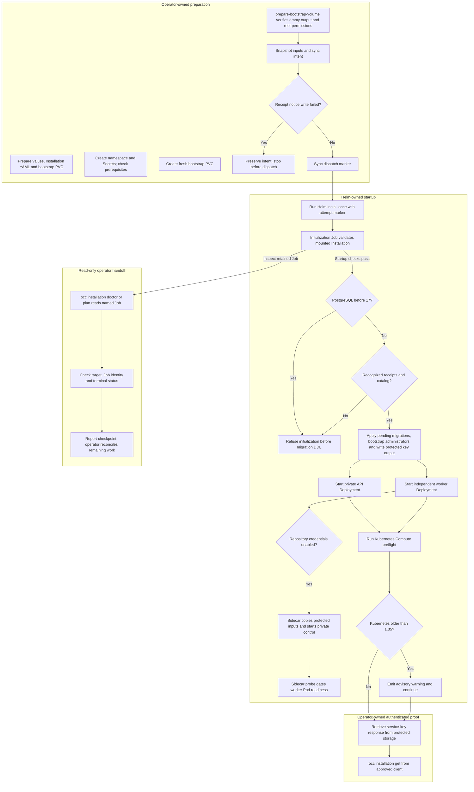

# Production Startup Flow

## Overview

Helm initializes OCE from protected storage and approved inputs. After private
API/worker readiness, authenticate `/installation` with the service key.

[Deployment guide](../guides/deploy.md).

## Entry Points

- Trigger: Run `scripts/prepare-bootstrap-volume`, then
  `occ installation install` with explicit target, local chart, values and receipt.
- Source: `scripts/prepare-bootstrap-volume:53`,
  `deploy/helm/openclaw-enterprise/templates/jobs.yaml:8`, and
  `apps/controller/src/composition/production.ts:28`.
- Assumptions: Explicit kubeconfig/context, enforcing NetworkPolicies, external
  PostgreSQL, approved immutable images, protected operator files, fresh
  bootstrap PVC, exact API/client selectors, `/32` egress hosts,
  reviewed control-plane node labels, and an approved private OCC URL.

## Flow

First install requires [empty OCE history](../reference/settings/operations.md#migration-history).

## Execution Trace

Migration, bootstrap, API and worker use
[`createPostgresPool`](../../packages/occ/src/state/postgres-pool.ts) with
[password or Azure workload-identity authentication](../reference/settings/operations.md#postgresql-connection-authentication).
For each password-mode connection, the factory parses the URL before applying
explicit caller limits and startup options. It retains TLS-file reads and the
effective IP-host certificate check.
Failover, maintenance restart, `idle_session_timeout` or proxy reset discards the
idle client and logs only its error code to stderr as `database.idle-client-error`.
The process continues; the next query opens a new connection.

### 1. Prepare native production inputs

`scripts/diagnose-kubernetes-prerequisites.ts:diagnose` reads CRDs, controllers,
addresses and object quota headroom. EKS binds account, ARN, endpoint and CA.
[Resolve failed/unknown checks](../guides/deploy/prerequisite-diagnosis.md) before Helm.

`deploy/helm/openclaw-enterprise/values.yaml:1`

Keep values, Installation YAML and bootstrap PVC outside the checkout. Helm
selects images, endpoint, Secrets, claim, selectors and egress.
`openclaw.validate` requires a DNS-1123 release Namespace label (maximum 63 characters).
Installation YAML selects Drivers, Backends, runtime images, projected identity,
networking and storage.

File-backed Secrets supply Installation startup, database URLs/optional CA, Better Auth
signing, and optional ChatGPT administrator credentials. Helm neither synchronizes
inputs, rewrites Driver configuration, nor infers runtime images.

### 2. Prepare the fresh bootstrap volume

`scripts/prepare-bootstrap-volume:124` takes an existing
`bootstrap.password.claimName` PVC, explicit kubeconfig/context/namespace/claim,
an approved Node-capable image and optional `--node-selector KEY=VALUE` labels.
It preserves namespace/selector strings, applying selectors before
WaitForFirstConsumer binding. It requires an empty root except filesystem-owned
`lost+found` and sets UID/GID `1000`, mode `0700`.

If forbidden, storage administrators prepare the claim through approved procedures.
The helper cannot create PVCs, repair used claims, retrieve credentials or
change controller configuration.

### 3. Run Helm initialization

`internal/occcli/installation_receipt.go:installationInstallCommand` snapshots
kubeconfig/chart/values, checks release states and syncs intent and its directory.
A failed stdout notice preserves and names intent, stopping before dispatch or
Helm. Otherwise it syncs the unknown marker and starts Helm.
`observeInstallationJob` records the first recognized attempt-matched Job UID
(installs only). Helm's outcome stays separate; final report write errors fail
the command without changing that outcome or replaying install.

Template failures add [offline-render guidance](../guides/deploy/production-handoff.md#record-the-initialization-job-for-handoff).
Helm stderr is bounded to 4 MiB in memory; raw diagnostics are not printed or saved.

`deploy/helm/openclaw-enterprise/templates/bootstrap-networkpolicies.yaml:1`
installs isolation before the Job; it and later policies grant configured
DNS peers UDP/TCP `53` and `5353`
([Helm DNS contract](../reference/settings/production.md#required-production-controller-environment)).

`deploy/helm/openclaw-enterprise/templates/jobs.yaml:8` refuses existing or unreadable
Jobs during connected installs. Offline rendering cannot check this; lookup
neither locks names nor verifies database/volume freshness.

`openclaw.validate` in `deploy/helm/openclaw-enterprise/templates/_helpers.tpl`
checks routing, ports and peer labels. See [routing opt-out](../guides/deploy/workspace-routing.md#explicit-opt-out)
and [refused values](../guides/deploy/production-upgrade-recovery.md#correct-values-the-candidate-refuses).

Helm runs `deploy/helm/openclaw-enterprise/files/check-installation.mjs`
(generated from `deploy/helm/src/check-installation.ts`) before migration, bootstrap and
API rollout. The migration container evaluates the chart's
`files/migrate-selected-image.cjs` program. It validates the selected image's
`db:migrate:production` package command, forwards the exact mode argument, and imports
that image's migration entry point in the same Node process.
`formatStartupConfigurationFailure` and `configurationLogDetails` report
up to 32 fields without values. When `OCC_EGRESS_AUTHORITY_PORT` or
`OCC_OPENSHELL_GIT_PORT` is set, `requireChartListener` reports refused
ports, hosts or paths as `CHART_LISTENER_MISMATCH`.

`openclaw.listenerEnv` passes routing settings to the hook, API and worker.
`requireChartGatewayRouting` reports mismatched fields without values.

The hook validates its name and distinct database Secret keys; both database containers can mount the CA. See [production settings](../reference/settings/production.md).

For [handoff](../guides/deploy/production-handoff.md#resume-an-installation-in-progress),
`internal/occcli/installation_doctor.go:installationHandoffCommand` verifies the receipt
target before reading the Job. `initializationEvidence` checks its marker, UID, exact chart
steps, controller and terminal status. A separate-upgrade Job verifies schema before bootstrap.
Missing, replaced, refused or inconclusive evidence leaves the checkpoint unknown.
Doctor reports Helm separately; report write errors exit `1`.

`scripts/migrate-production.ts:1`, `scripts/migration-history.mjs:migrateWithHistory`

After source verification, all modes reject PostgreSQL before 17 with
`MIGRATION_SERVER_UNSUPPORTED` before locking or reading the catalog
([compatibility](../reference/settings/operations.md#postgresql-server-compatibility)).
On SIGINT or SIGTERM, the command uses a second migrator connection to terminate
its uniquely named database session and waits for cleanup. If that connection
fails, it reports `migration.cancellation-failed` and waits for migration to return.
Under the advisory lock, the migrator verifies roles, receipts, catalogs and
grants against the native or reviewed restore history. Unsupported history fails
before migration SQL or bootstrap.

- Canonical history through `0080` adds request credential approvals at `0081`.
- For verified approvals first applied at `0077`, migration preserves the
  existing receipts and applies missing stock migrations `0077`–`0080`. It
  verifies the completed catalog and receipts before committing the SQL and new
  receipts together.

Completed apply skips Drizzle only for a writable session. Pending migrations
and read-only sessions keep their normal checks. Cleanup releases the lock and client
([history](../reference/settings/operations.md#migration-history)).

`scripts/lib/bootstrap-configuration.ts:bootstrapConfiguration` requires an HTTPS
Console origin before database access, including during `--verify-existing`.

`scripts/bootstrap-installation.mjs` creates or verifies Installation,
human/service administrators, IAM seed, audit evidence, and initial service key.
Fresh bootstrap creates `default` via `OpenClawController.createNamespace`
as the bootstrap Principal. Queued reconciliation commits with Installation/IAM
state and audit. Existing Installations add no Namespace; this is not Kubernetes'
`default`. The worker provisions Driver-owned infrastructure; operators provide
tenant RoleBindings. The bootstrap container alone writes protected PVC password/service-key files.
Operators can invoke the same command with [`--verify-existing`](../reference/settings/production.md#production-installation-bootstrap-environment)
to check a populated candidate using the incumbent ID and a read-only database
snapshot. The Helm initialization Job continues to use ordinary bootstrap.
Existing output, unsafe permissions, or inconsistent accounts/IAM identity fail
the Job. Helm failure does not imply database-hook rollback.

### 4. Start private API and worker Deployments

`apps/controller/src/api-startup.ts:configuration`, `apps/controller/src/worker.ts:312`

`apps/controller/src/drivers/compute/kubernetes/index.ts:KubernetesComputeDriver.preflight`

With [OIDC CA settings](../reference/settings/oidc.md), generated
[`assemble-api-ca.mjs`](../layout.md#deployment-tooling-and-checks) combines
validated IdP and Gateway roots for `NODE_EXTRA_CA_CERTS`.
The `check-api-database-ca.mjs` preload requires the selected CA and DNS hostname
verification for PostgreSQL.

`apps/controller/src/auth/configuration.ts:validateAuthSecret` rejects short
secrets before Driver construction or PostgreSQL access. `composeProduction` and
the auth factory repeat it. Endpoints include `/healthz` and `/readyz`.
`apps/controller/src/composition/postgres-readiness.ts:createPostgresReadinessCheck`
shares one application-pool `SELECT 1` per instance across overlapping `GET` and
implicit `HEAD` probes. The query stays active when probes disconnect. Subsequent
probes query again once PostgreSQL returns.
API startup allows 120 one-second failures. API readiness times out after one
second. [Worker startup](../../scripts/production-healthcheck.ts) allows 24
five-second failures.

`apps/controller/src/index.ts:createFastifyApp`

On `SIGTERM`, the API stops accepting connections and drains requests with
`Connection: close`, avoiding the 72-second keep-alive wait. Its single `Recreate`
replica has no peer or `preStop`; the 30-second grace cuts off unfinished requests.
Logs show `shutdown.started` (`signal`), then `shutdown.completed` (`durationMs`),
or `shutdown.failed` (exit 1). Only `shutdown.started` means an interrupted drain.

The PostgreSQL API compositions close the exchange binding, protected Driver,
prepared GitHub owner, and database in order, continuing after a close fails.
Shutdown reports the first failure, wrapping a falsey thrown value as an error
with the original value as its cause. Failed startup preserves the startup error.
The exchange binding is independent of the protected Driver. See
`apps/controller/src/composition/production.ts:composeProduction` and
`apps/controller/src/composition/development-postgres.ts:composePostgresDevelopment`.

The worker closes the repository Git sender binding, prepared Git owner, receipt
listener, metrics, and prepared GitHub owner in order, continuing after a close
fails, then stops its loop and database. A listener left open would keep the Pod
running until its grace ends. Any failure logs `worker.error` `SHUTDOWN_FAILED`
(exit 1). See `apps/controller/src/worker/shutdown.ts:closeWorkerComposition`.
Failed startup closes an installed Driver package, refused or loaded, before the
worker loop owns it, keeping the original error.

When set, `controlPlane.nodeSelector` places the API, worker, migration,
bootstrap, and private proxy on reviewed control-plane nodes. The
`deploy/helm/openclaw-enterprise/templates/gateway-routing.yaml` template sets
`EnvoyProxy.spec.provider.kubernetes.envoyDeployment.pod`. Compute owns tenant
Gateway and Agent placement.

With `database.caSecretName`, `_helpers.tpl` rejects CA paths that would mask
active client mounts. It normalizes relative paths, dot segments, and trailing
slashes for comparison and emits accepted paths as supplied.

The [shared egress policy](../../deploy/helm/openclaw-enterprise/templates/networkpolicies.yaml)
selects only `api`, `worker`, and `initialization` Pods with the release identity.
It allows DNS, database egress to every `database.cidrs` host, and
Kubernetes API egress to every `cluster.cidrs` host. Collectors use their separate
DNS, API, and exporter policy; unknown or missing component labels retain
default-deny. Pre-install initialization has only its hook DNS/database grants.
Destinations must be explicit IPv4 `/32` hosts; refresh them when managed
endpoint addresses change. Chart ports take no leading zeros: `0443` fails.

`deploy/helm/openclaw-enterprise/templates/networkpolicies.yaml` renders separate
API-only TCP 443 policies for `api.modelDiscoveryCidrs` and
`api.pluginDiscoveryCidrs`. Each accepts explicit IPv4 `/32` hosts and defaults to
no egress. Operators maintain addresses for
[model discovery](../reference/console/create-and-deploy.md#create-an-agent) and
[MCP tool discovery](../guides/topics/plugins-configure.md#configure-a-hosted-mcp-plugin)
independently. Console model selection and Harness egress do not depend on these policies.

When `api.channelDirectoryProxyUrl` names an approved HTTP(S) proxy at a
literal IPv4 address and port, the chart passes it to the API and grants only
that Pod egress to the proxy's exact `/32` and TCP port. The proxy must permit
CONNECT to `slack.com:443`. The empty default renders no rule and leaves
production Slack directory lookup unavailable with manual exact-ID entry.

The Kubernetes Compute Driver queries the API server version and verifies
authenticated Namespace access. Below the supported 1.35 baseline, the API logs
`compute.preflight-warning` with both versions and continues. An invalid version
response, unreachable API, or failed Namespace access fails preflight.

The worker independently validates production settings, opens the same
application-role database, loads selected Drivers, validates IAM, runs Compute
preflight with the same advisory warning, emits `worker.started`, and polls
durable Namespace/AgentRevision work. Readiness requires fresh queue-health
observations; neither process mounts the bootstrap PVC.

`apps/controller/src/composition/installation-config.ts:loadInstallationConfiguration`

With `repository` selected, both processes load the same registry and construct
`GitHubRepositoryPolicy`; the GitHub Backend's `drivers.repo` member must equal
`repository.id`. Only native delivery loads the Unix client and CA reader used by
`GitHubNativeRepositorySender`. Startup refuses the retired Installation
`drivers.repo`. API startup performs no control operation and loads no App key.
With prepared repository Git, the worker reads the App key at startup and exits
before readiness with `PREPARED_GITHUB_APP_KEY_INVALID` if it cannot sign.
The worker owns session lifecycle; API readiness remains database-backed.

`apps/controller/src/composition/repository-credentials/projected-inputs.ts:prepareProjectedInputs`

Beside the single worker, the optional service pins a projection generation,
copies config/key/TLS/registry inputs into owned private regular files, validates
the selected Backend and exact Service origin, then starts both listeners through
the protected loader. App/TLS private material stays in its container; only the
worker receives a projected Kubernetes API token. They share only the private
control volume. The Pod uses `Recreate` and a 75-second termination grace period.
Readiness requires both the service's Unix-listener probe and the worker's
queue-health probe. The worker retries unavailable session operations through
its Driver contract. Neither component has independent high availability.
Repository runtime reconciliation continues in the
[Agent repository credential flow](agent-repository-credentials.md).

### 5. Retrieve the key and prove authenticated access

Fresh bootstrap [checks both output paths](../reference/authentication/service-api-keys.md#recover-an-incomplete-bootstrap) before creating credentials.

`internal/occclient/client.go:Client.GetInstallation`

After Helm readiness, use the approved reader to save
`initial-admin-service-key.json` from protected bootstrap storage to an
owner-readable file. A completed Job cannot serve the file via exec. The API and
worker cannot retrieve it for the operator.

Use `occ installation get` with the service key. The Installation's `ID` must
match `meta.installationId` from the key response. Its startup Secret annotation
`openclaw.dev/installation-id` binds upgrades to the selected Installation.

The operator session's `upgrade_installation` checks Helm's deployed revision
and API Pod binding. The scoped `docs/snippets/openshell-quickstart/request.mts`
requires a string path that stays under `/namespaces` after URL normalization,
or a bodyless `GET /installation` to verify the Installation before the patch.
The shell initializes the missing annotation, patches with UID and
`resourceVersion` preconditions, and sets `controlPlane.installationChecksum`.

## Debugging and Verification

- `scripts/prepare-bootstrap-volume` exits `0` for a fresh claim with no bootstrap
  outputs and root state owned by UID/GID `1000` with mode `0700`.
- `kubectl -n openclaw-system wait --for=condition=complete job/oce-initialization`
  should succeed before API and worker rollout checks.
- `pnpm db:migrate:production --check` reports history without applying SQL.
  For `MIGRATION_HISTORY_UNSUPPORTED`, inspect the receipts and catalog.
- API `listening` reports `startupMs` (since process start) and per-phase
  `phasesMs`. The worker emits `worker.started`, then `worker.health`.
- For `compute.preflight-warning` code `KUBERNETES_VERSION_BELOW_MINIMUM`,
  upgrade Kubernetes to 1.35 or later for support.
- For `KUBERNETES_API_UNAVAILABLE`, compare the logged `host` and `port` with
  `cluster.cidrs` and `cluster.port`. A cluster restart can change its address.
- Code `PRESET_FILE_INVALID` indicates an invalid `presets.files` entry or file.
- For `DRIVER_CONFIGURATION_INVALID`, inspect `details` (JSON Pointer, code,
  message) in `startup-error` or `worker.startup-error`.
  Use a DNS-subdomain name for `/runtime/gatewayStorageClassName`. Remove
  `/drivers/credential_proxy/configuration/authorityScope` when
  `repository.openShell` and `tokenGrant` are configured.
  `apps/controller/src/api-startup.ts:startupFailureFields` passes the API
  diagnostics to `apps/controller/src/server.mjs`.
- `kubectl -n openclaw-system logs job/oce-initialization -c bootstrap` is the
  first check for unsafe output storage, existing outputs, database-role
  failures, auth errors (`AUTH_SECRET_INVALID`, `AUTH_BASE_URL_INVALID`), and
  administrator/IAM mismatch.
- After changing an external startup Secret, roll out the API and worker. Repeat
  readiness and authenticated checks.
- `tests/integration/production-kubernetes-packaging.test.mjs` renders the
  chart; it does not prove deployment or model execution.
- `tests/integration/installation-handoff-k3d-real.test.ts` exercises the CLI with
  rendered Jobs, real named-Job RBAC, and replacement UIDs; suspended Jobs avoid
  migration/bootstrap execution. See [Kubernetes tests](../testing/kubernetes.md).

## Related docs

- [Deployment guide: production](../guides/deploy.md#production)
- [Settings reference](../reference/settings.md)
- [Kubernetes Compute Driver](../reference/drivers/kubernetes-compute.md)
- [Backend-managed credential delivery](service-account-driver-credential-delivery.md)
- [Repository credential setup](../guides/repository-credentials.md)
- [Controller worker execution flow](controller-worker.md)
- [Production TUI flow](production-tui.md)
- [Local password authentication flow](local-password-authentication.md)
- [Authoritative platform design](../design.md)

## Manual Notes

[keep this for the user to add notes. do not change between edits]

## Changelog

- 2026-11-18 02:53: Select the migration entry point from each controller image and retain signal handlers through cleanup. (authoring-run/4bed3583-f449-4bab-a6c6-2e8af70a39e9 - 4616630e8ab5edf25de29af948e80c72627af9c4)

- 2026-11-18 02:26: Run the migration entry directly and distinguish separate-upgrade verification. (authoring-run/c3b46e7f-1066-4c87-9808-34e281ccaa98 - 8e8474eec4c7027bb45b5fe470e675e2e3e321cf)

- 2026-11-18 01:53: Reconcile the generated Installation check with the production migration command. (authoring-run/d1d2f3b0-6dbf-4fce-b8d6-94df71d391b8 - 0bd8061ff988a0847541fa3d890f676f1a57a676)

- 2026-11-17 21:06: Trace production migration for stock and historical request credential approvals. (authoring-run/13aee116-8880-41d5-b55f-83a0152d7460 - 7e7cb6005e6fe7f94463524ad36ae93fa8e2097a)

- 2026-11-16 09:47: Document the request helper’s scoped path validation. (authoring-run/04994f45-a986-442f-8747-1595e124325f - b4a03d909a2815bbf6c44eb6e195d4503a59fe70)

- 2026-11-14 17:11: Identify the generated API CA programs and link their TypeScript source layout. (authoring-run/6b781d32-d772-4aed-beb9-1598b28632b4 - 4ecdd59c5a64f217f0b7fafdf7a034e74b890ffc)

- 2026-11-14 12:25: Document the TypeScript worker probe. (authoring-run/1be06605-515e-4261-8b21-d0d796809916 - f0bfd8b1834a7a07fc008fa822fed9035f12ffbe)

- 2026-11-13 19:24: Validate auth. (authoring-run/e8f36db7-807b-453f-8274-f89ca52fcb7c - 795a920ef266c1246d7774ceb0188a0ee206fe17)

- 2026-11-13 16:21: Document the combined OpenShell authority scope startup diagnostic. (authoring-run/33abde1a-eb90-429b-8b94-af7f0b901c3f - 5ff90623c3f24ba9c0efc1b3ca511a12121109f1)

- 2026-11-13: Document the opt-in check of an existing Installation and its bootstrap administrator. (authoring-run/b1c2409a-da5e-4236-9fd6-3e89f1773b94 - 3c8ee8b97066d1e82a4ba9f95ad6d6f6afea5df8)

- 2026-11-12 09:45: Skip completed writable DDL; preserve read-only refusal. (authoring-run/eedb034b-cdad-4526-af11-0ce3490e267a - 11e22a5dc95b54a4fd7eb05e68a06f732033e7f8)

- 2026-11-12 06:35: Document static Helm template refusal guidance without changing recovery. (authoring-run/da0f3f3f-c550-48b6-8ef4-60e3f2d1b973 - 64358aae61847dea8a3834fbe06bed079b5727cc)

- 2026-11-11 17:05: Coalesce database readiness. (authoring-run/89773c17-5c87-4c2d-aa19-3b5a0af84b68 - 755ebc38280f84b3ec420cc0b2a475ed1fb2be0a)

[Production startup documentation history](production-startup/history.md) preserves the older dated entries.
