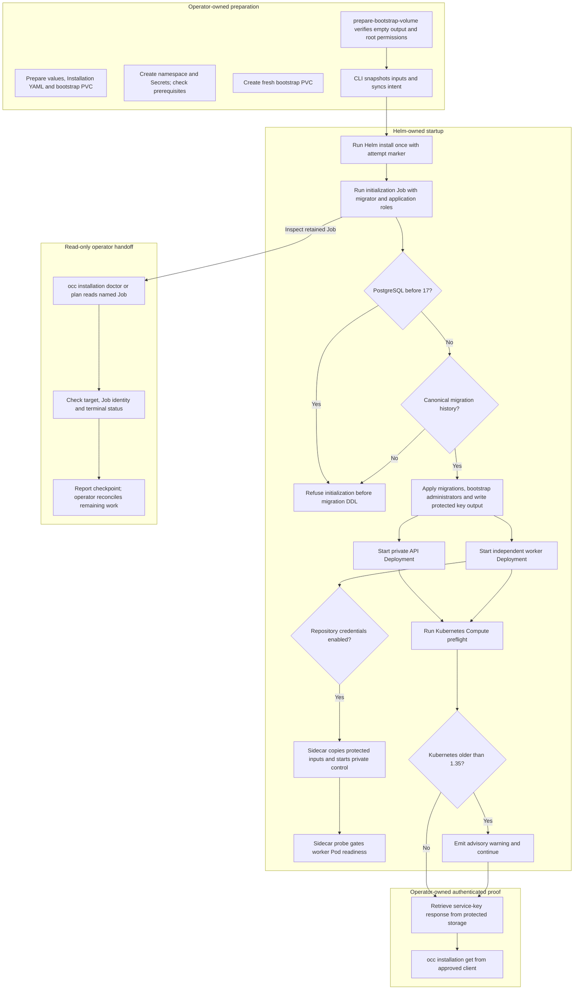

# Production Startup Flow

## Overview

Prepare a fresh protected bootstrap PVC and install Helm with approved images,
PostgreSQL/authentication credentials, trusted Installation YAML and policies.
After private API/worker readiness, authenticate `/installation` with the service key.

[Deployment guide](../guides/deploy.md).

## Entry Points

- Trigger: Run `scripts/prepare-bootstrap-volume`, then
  `occ installation install` with explicit target, local chart, values and receipt.
- Source: `scripts/prepare-bootstrap-volume:53`,
  `deploy/helm/openclaw-enterprise/templates/jobs.yaml:8`, and
  `apps/controller/src/composition/production.ts:28`.
- Assumptions: Explicit kubeconfig/context, enforcing NetworkPolicies, external
  PostgreSQL, approved immutable images, protected operator files, fresh
  bootstrap PVC, exact API/client selectors, `/32` egress hosts,
  reviewed control-plane node labels, and an approved private OCC URL.

## Flow

First install requires [empty OCE history](../reference/settings/operations.md#migration-history).

## Execution Trace

Migration, bootstrap, API and worker use
[`createPostgresPool`](../../packages/occ/src/state/postgres-pool.ts) with
[password or Azure workload-identity authentication](../reference/settings/operations.md#postgresql-connection-authentication).
Failover, maintenance restart, `idle_session_timeout` or proxy reset discards the
idle client and logs only its error code to stderr as `database.idle-client-error`.
The process continues; the next query opens a new connection.

### 1. Prepare native production inputs

`scripts/diagnose-kubernetes-prerequisites.mjs:diagnose` reads CRDs, controllers,
addresses and object quota headroom. EKS binds account, ARN, endpoint and CA.
[Resolve failed/unknown checks](../guides/deploy/prerequisite-diagnosis.md) before Helm.

`deploy/helm/openclaw-enterprise/values.yaml:1`

Keep values, Installation YAML and bootstrap PVC outside the checkout. Helm
selects images, endpoint, Secrets, claim, selectors and egress.
`openclaw.validate` requires a DNS-1123 release Namespace label (maximum 63 characters).
Installation YAML selects Drivers, Backends, runtime images, projected identity,
networking and storage.

File-backed Secrets supply Installation startup, database URLs/optional CA, Better Auth
signing, and optional ChatGPT administrator credentials. Helm neither synchronizes
inputs, rewrites Driver configuration, nor infers runtime images.

### 2. Prepare the fresh bootstrap volume

`scripts/prepare-bootstrap-volume:124`

Create the `bootstrap.password.claimName` PVC and run the helper with explicit
kubeconfig, context, namespace, claim,
approved Node-capable image, and optional `--node-selector KEY=VALUE` labels.
The Pod preserves string namespaces and selector keys; selectors precede
WaitForFirstConsumer binding. The helper requires an empty root except
for filesystem-owned `lost+found`, and sets UID/GID `1000` with mode `0700`.

If the Pod is forbidden, storage administration prepares the claim through an
approved workflow for Helm. The helper neither creates PVCs nor
repairs used claims, retrieves credentials, or changes controller configuration.

### 3. Run Helm initialization

`internal/occcli/installation_receipt.go:installationInstallCommand` snapshots the
kubeconfig, chart and values privately and checks all release states. It syncs
the intent, receipt directory entry and unknown dispatch marker before starting
Helm. While Helm waits, `observeInstallationJob` records the first recognized
install Job UID whose annotation matches the attempt. Upgrades omit the marker.
Helm's exit outcome has a separate record.

`deploy/helm/openclaw-enterprise/templates/bootstrap-networkpolicies.yaml:1`
installs isolation before the Job; it and later policies grant configured
DNS peers UDP/TCP `53` and `5353`
([Helm DNS contract](../reference/settings/production.md#required-production-controller-environment)).

`deploy/helm/openclaw-enterprise/templates/jobs.yaml:8` stops a connected install
if its named Job exists or cannot be read. Offline rendering cannot check this.
The lookup neither locks the name nor verifies database or volume freshness.

`openclaw.validate` in `deploy/helm/openclaw-enterprise/templates/_helpers.tpl`
checks private routing inputs, port syntax and peer labels. Operators supply the
GatewayClass, CRDs, controllers and Secrets. Disabling routing omits its resources
and mounts and requires disabling native admin and sandbox routing. Database and
API ports accept 1–65535 without leading zeros. The Compute Driver rejects malformed
IPv4 hostnames and numeric or hexadecimal sandbox domain suffixes.
See [routing prerequisites and opt-out](../guides/deploy/workspace-routing.md#explicit-opt-out)
and [values the candidate refuses](../guides/deploy/production-upgrade-recovery.md#correct-values-the-candidate-refuses).
The metrics and repository listeners share a worker Pod and need different ports.

On upgrades, `deploy/helm/openclaw-enterprise/files/check-installation.mjs` validates
Installation without database/Kubernetes access; refusal stops migration and API
replacement. It uses `apps/controller/src/startup-failure.ts:formatStartupConfigurationFailure`
and the API/worker filter `apps/controller/src/logging.ts:configurationLogDetails`: at most 32 field
diagnostics, without submitted values, except
`apps/controller/src/composition/installation-fields.ts:requireChartListener`:
`CHART_LISTENER_MISMATCH` names ports, hosts or paths refused when
`OCC_EGRESS_AUTHORITY_PORT`/`OCC_OPENSHELL_GIT_PORT` is set.

For chart-managed routing, `openclaw.listenerEnv` passes `OCC_CHART_GATEWAY_ROUTING`
to the hook, API and worker. `requireChartGatewayRouting` compares the Kubernetes
Compute Gateway name, Gateway and Envoy namespaces, and effective hostname.
A mismatch reports the field without its value.

The hook keeps the release name and bounds its suffix to 63 characters. Both
database containers optionally mount the CA. Helm validates distinct application and
migration Secret keys against Kubernetes syntax before use. `installation.key`
and `executionCluster.kubeconfigKey` must be Secret keys at most 253 characters,
not `.` or a `..` prefix.

For [handoff](../guides/deploy/production-handoff.md#resume-an-installation-in-progress),
`internal/occcli/installation_doctor.go:installationHandoffCommand` verifies the
receipt namespace, release and reader's cluster connection before a named Job read.
`initializationEvidence` checks the marker, captured UID, chart steps, controller
and terminal status. Missing UID, replacement, refusal or inconclusive status
leaves the original checkpoint unknown. Doctor reports Helm's recorded outcome
separately. Plan adds read-only recovery steps. Both buffer their report, including
Helm outcome, and check `WriteTo` before returning Job status. Returned write
errors reach `cmd/occ/main.go:main`, which reports stderr diagnostics and exits `1`.

`scripts/migrate-production.mjs:1`, `scripts/migration-history.mjs:migrateWithHistory`

After verifying SQL source, migration checks the server version before locking
or reading catalogs. PostgreSQL
before 17 fails with `MIGRATION_SERVER_UNSUPPORTED` and a fixed recovery message;
the same guard covers first install, upgrade, and `--check`. See
[server compatibility](../reference/settings/operations.md#postgresql-server-compatibility).
Migration then verifies the dedicated role, receipts and catalog under
one advisory lock on Drizzle's transaction connection. For a recognized history, it accepts the native catalog digest or
the reviewed restore digest bound to it. Unsupported histories fail before
migration DDL and bootstrap. See [migration history and recovery](../reference/settings/operations.md#migration-history).

`scripts/lib/bootstrap-configuration.mjs:authBaseURL` checks HTTP(S) origin before
database access. Production requires HTTPS except HTTP loopback verification
(`127.0.0.1`, `localhost`, `[::1]`).

`scripts/bootstrap-installation.mjs` creates or verifies Installation,
human/service administrators, IAM seed, audit evidence, and initial service key.
Fresh bootstrap creates `default` via `OpenClawController.createNamespace`
as the bootstrap Principal. Queued reconciliation commits with Installation/IAM
state and audit. Existing Installations add no Namespace; this is not Kubernetes'
`default`. The worker provisions Driver-owned infrastructure; operators provide
tenant RoleBindings. The bootstrap container alone writes protected PVC password/service-key files.
Existing output, unsafe permissions, or inconsistent accounts/IAM identity fail
the Job. Helm failure does not imply database-hook rollback.

### 4. Start private API and worker Deployments

`apps/controller/src/api-startup.mjs:configuration`, `apps/controller/src/worker.ts:312`

`apps/controller/src/drivers/compute/kubernetes/index.ts:KubernetesComputeDriver.preflight`

With [OIDC CA settings](../reference/settings/oidc.md), the API init container
`deploy/helm/openclaw-enterprise/files/assemble-api-ca.mjs` validates and combines
IdP and Gateway roots for `NODE_EXTRA_CA_CERTS`;
`deploy/helm/openclaw-enterprise/files/check-api-database-ca.mjs` preloads to refuse
database TLS not pinned to that CA.

After initialization, API readiness requires listener, Better Auth, database,
Installation YAML, Driver, Backend membership, and Compute preflight validation. Private routes, `/healthz` and
database-backed `/readyz` use the operator-managed endpoint. The startup probe
allows 120 one-second failures: two minutes to listen, then readiness within a second.
The worker's exec probes start Node inside its CPU limit, so each has a 5-second
timeout; its startup probe allows 24 five-second failures, the same two minutes.

`apps/controller/src/index.ts:createFastifyApp`

On `SIGTERM`, the API stops accepting connections and drains requests with
`Connection: close`, avoiding the 72-second keep-alive wait. Its single `Recreate`
replica has no peer or `preStop`; the 30-second grace cuts off unfinished requests.
Logs show `shutdown.started` (`signal`), then `shutdown.completed` (`durationMs`),
or `shutdown.failed` (exit 1). Only `shutdown.started` means an interrupted drain.

The PostgreSQL API compositions close the exchange binding, protected Driver,
prepared GitHub owner, and database in order, continuing after a close fails.
Shutdown reports the first failure, wrapping a falsey thrown value as an error
with the original value as its cause. Failed startup preserves the startup error.
The exchange binding is independent of the protected Driver. See
`apps/controller/src/composition/production.ts:composeProduction` and
`apps/controller/src/composition/development-postgres.ts:composePostgresDevelopment`.

The worker closes the repository Git sender binding, prepared Git owner, receipt
listener, metrics, and prepared GitHub owner in order, continuing after a close
fails, then stops its loop and database. A listener left open would keep the Pod
running until its grace ends. Any failure logs `worker.error` `SHUTDOWN_FAILED`
(exit 1). See `apps/controller/src/worker/shutdown.ts:closeWorkerComposition`.

Nonempty `controlPlane.nodeSelector` places API, worker, migration and bootstrap
on reviewed control-plane nodes; empty defaults omit it.
`deploy/helm/openclaw-enterprise/templates/gateway-routing.yaml` also applies it
to `EnvoyProxy.spec.provider.kubernetes.envoyDeployment.pod`, keeping the private
proxy on that pool. Tenant gateway and Agent placement remain Compute-owned.

With `database.caSecretName`, `_helpers.tpl` rejects CA destinations aliasing active
client mounts, including relative paths, dot segments and trailing slashes. Linux
otherwise masks startup files. Emitted paths stay unchanged; noncolliding paths
remain available.

The [shared egress policy](../../deploy/helm/openclaw-enterprise/templates/networkpolicies.yaml)
selects only `api`, `worker`, and `initialization` Pods with the release identity.
It allows DNS, database egress to every `database.cidrs` host, and
Kubernetes API egress to every `cluster.cidrs` host. Collectors use their separate
DNS, API, and exporter policy; unknown or missing component labels retain
default-deny. Pre-install initialization has only its hook DNS/database grants.
Destinations must be explicit IPv4 `/32` hosts; refresh them when managed
endpoint addresses change. Chart ports take no leading zeros: `0443` fails.

`deploy/helm/openclaw-enterprise/templates/networkpolicies.yaml` renders separate
API-only TCP 443 policies for `api.modelDiscoveryCidrs` and
`api.pluginDiscoveryCidrs`. Each accepts explicit IPv4 `/32` hosts and defaults to
no egress. Operators maintain addresses for
[model discovery](../reference/console/create-and-deploy.md#create-an-agent) and
[MCP tool discovery](../guides/topics/plugins-configure.md#configure-a-hosted-mcp-plugin)
independently. Console model selection and Harness egress do not depend on these policies.

When `api.channelDirectoryProxyUrl` names an approved HTTP(S) proxy at a
literal IPv4 address and port, the chart passes it to the API and grants only
that Pod egress to the proxy's exact `/32` and TCP port. The proxy must permit
CONNECT to `slack.com:443`. The empty default renders no rule and leaves
production Slack directory lookup unavailable with manual exact-ID entry.

The Kubernetes Compute Driver queries the API server version and verifies
authenticated Namespace access. Below the supported 1.35 baseline, the API logs
`compute.preflight-warning` with both versions and continues. An invalid version
response, unreachable API, or failed Namespace access fails preflight.

The worker independently validates production settings, opens the same
application-role database, loads selected Drivers, validates IAM, runs Compute
preflight with the same advisory warning, emits `worker.started`, and polls
durable Namespace/AgentRevision work. Readiness requires fresh queue-health
observations; neither process mounts the bootstrap PVC.

`apps/controller/src/composition/installation-config.ts:loadInstallationConfiguration`

With `repository` selected, both processes load the same registry and construct
`GitHubRepositoryPolicy`; the GitHub Backend's `drivers.repo` member must equal
`repository.id`. Only native delivery loads the Unix client and CA reader used by
`GitHubNativeRepositorySender`. Startup refuses the retired Installation
`drivers.repo`. API startup performs no control operation and loads no App key.
With prepared repository Git, the worker reads the App key at startup and exits
before readiness with `PREPARED_GITHUB_APP_KEY_INVALID` if it cannot sign.
The worker owns session lifecycle; API readiness remains database-backed.

`apps/controller/src/composition/repository-credentials/projected-inputs.ts:prepareProjectedInputs`

Beside the single worker, the optional service pins a projection generation and
copies its authority's inputs into owned private files: prepared GitHub uses
config, key, TLS, and registry; GitLab uses config, TLS, and token. It validates
the Backend and exact Service origin, then starts both listeners through the
protected loader. Private repository material stays in its container; only the
worker receives a projected Kubernetes API token. They share only the private
control volume. The Pod uses `Recreate` and a 75-second termination grace period.
Readiness requires both the service's Unix-listener probe and the worker's
queue-health probe. The worker retries unavailable session operations through
its Driver contract. Neither component has independent high availability.
Repository runtime reconciliation continues in the
[Agent repository credential flow](agent-repository-credentials.md).

### 5. Retrieve the key and prove authenticated access

Fresh bootstrap [checks both output paths](../reference/authentication/service-api-keys.md#recover-an-incomplete-bootstrap) before creating credentials.

`internal/occclient/client.go:Client.GetInstallation`

After Helm readiness, retrieve
`initial-admin-service-key.json` from protected bootstrap storage through an
approved reader path into an owner-readable file. A completed Job is
not an exec endpoint, and the API and worker cannot retrieve this file for the
operator.

`occ installation get` reads the protected key file
and displays the Installation. Its `ID` must match the key
response's `meta.installationId`. The operator records that ID in the Installation
startup Secret's `openclaw.dev/installation-id` annotation; coordinated upgrades
use this marker to bind their OCC endpoint to the selected Installation.
Agent runtime, Gateway WebSocket authentication and model calls remain unproven
until tenant deployment/TUI procedures run.

## Debugging and Verification

- `scripts/prepare-bootstrap-volume` should exit `0` only for a fresh claim with
  no bootstrap output files and UID/GID `1000`, mode `0700` root state.
- `kubectl -n openclaw-system wait --for=condition=complete job/oce-initialization`
  should succeed before API and worker rollout checks.
- `pnpm db:migrate:production --check` reports the accepted database history
  without applying SQL. `MIGRATION_HISTORY_UNSUPPORTED` needs the database
  inspected; initialization never repairs its ledger.
- The API emits `listening`; the worker emits `worker.started`, then `worker.health`.
  `listening` reports `startupMs` (since process start) and per-phase `phasesMs`.
- `compute.preflight-warning` code `KUBERNETES_VERSION_BELOW_MINIMUM`: upgrade
  Kubernetes to 1.35 or later for support.
- `startup-error` or `worker.startup-error` with code
  `KUBERNETES_API_UNAVAILABLE`: Compute cannot reach Kubernetes at the logged
  `host` and `port`. Check `cluster.cidrs` and `cluster.port`; restarted
  clusters can move it.
- Code `PRESET_FILE_INVALID`: an invalid `presets.files` entry or file.
- `DRIVER_CONFIGURATION_INVALID`: inspect `details` (JSON Pointer, code, message).
  `/runtime/gatewayStorageClassName` requires a Kubernetes DNS-subdomain name.
  `apps/controller/src/api-startup.mjs:startupFailureFields` passes these diagnostics
  to `server.mjs`.
- `kubectl -n openclaw-system logs job/oce-initialization -c bootstrap` is the
  first check for unsafe output storage, existing outputs, database-role
  failures, auth errors (`AUTH_SECRET_INVALID`, `AUTH_BASE_URL_INVALID`), and
  administrator/IAM mismatch.
- Changing an external startup Secret alone does not restart the API or worker;
  run an explicit rollout and repeat readiness plus authenticated proof.
- `tests/integration/production-kubernetes-packaging.test.mjs` renders the
  chart; it does not prove deployment or model execution.
- `tests/integration/installation-handoff-k3d-real.test.ts` exercises the CLI with
  rendered Jobs, real named-Job RBAC, and replacement UIDs; suspended Jobs avoid
  migration/bootstrap execution. See [Kubernetes tests](../testing/kubernetes.md).

## Related docs

- [Deployment guide: production](../guides/deploy.md#production)
- [Settings reference](../reference/settings.md)
- [Kubernetes Compute Driver](../reference/drivers/kubernetes-compute.md)
- [Backend-managed credential delivery](service-account-driver-credential-delivery.md)
- [Repository credential setup](../guides/repository-credentials.md)
- [Controller worker execution flow](controller-worker.md)
- [Production TUI flow](production-tui.md)
- [Local password authentication flow](local-password-authentication.md)
- [Authoritative platform design](../design.md)

## Manual Notes

[keep this for the user to add notes. do not change between edits]

## Changelog

- 2026-11-04 23:30: Check complete handoff reports, including receipt outcomes. (authoring-run/48787d5f-913a-4fa5-910a-2f9ec35e504a - ce06d47cfb0b4fb29495ad4bc85bb71aa5941975)

- 2026-11-04 23:14: Document report write failures. (authoring-run/58196aeb-45b5-4ea5-850d-e368b48f15f9 - 582236adfbbb392c2247995dde054eef929ca6c1)

- 2026-11-04 23:07: Require the captured UID for original Job completion. (authoring-run/6c8eb7c1-4921-456d-bd96-cf1e8303b58b - 80b9e2c5238385ff8a8f52e9ab047b76da4c8fb4)

- 2026-11-04 23:05: Trace durable first-install receipts and read-only attempt reconciliation. (authoring-run/1b2cbf33-0aef-45e7-bac1-2b40f26eeb3e - 80b9e2c5238385ff8a8f52e9ab047b76da4c8fb4)

- 2026-11-04 22:57: Trace prerequisite diagnosis. (authoring-run/9ad2db0a-6b05-4873-aeda-52d96af2405e - 80b9e2c5238385ff8a8f52e9ab047b76da4c8fb4)

- 2026-11-04 07:10: Trace read-only initialization handoff and exact current chart recognition. (authoring-run/e3fc74c0-9f4f-42b6-ac25-a9757e382446 - 0c39ae057d294e7c1a244666fb6b98a1200b7f52)

- 2026-11-04 00:26: Check chart-managed private Gateway identity and hostname before rollout. (authoring-run/a85b1fc7-d58e-4c10-b80c-6464a0aaaa4f - c8a9b55bd67175e0d1ae3fbb7fefe1a0de44f573)

- 2026-11-03 18:03: Separate managed MCP discovery egress from model discovery. (authoring-run/0e69d668-c39a-4a60-b4ce-5556acb848b0 - c6be564e9f8b6186c53874ea26833a36f037c3db)

- 2026-11-03 11:28: Reconcile PostgreSQL compatibility checks with default Helm private routing. (authoring-run/e9eeaa5b-19a6-4496-9c6e-98357b25ef83 - ccc8f0359924ed62b12e619b2ef9f3ef57a3dd7a)

- 2026-11-02 15:26: Refuse incompatible PostgreSQL servers before catalog checks and migration. (authoring-run/c6926504-08f3-4eb6-ba6c-28b3e113eede - 9138a0f9617742d9c4997156e7a6cf19f6241c10)

- 2026-11-02 14:57: Enable Helm private routing by default and retain prerequisite validation and explicit opt-out. (authoring-run/4fcd344c-7374-490d-979d-a6995b6a19dc - cf67413c378cce3989d28fa8178ed29a405b9ce6)

- 2026-10-30 14:36: Attempt every worker resource close in order after a close fails. (authoring-run/b8400fae-dc1a-49fd-be49-5d07e9dbb899 - 2b3b206b63525e31a6170e239991394b7909fc15)

- 2026-10-30 05:46: Attempt every PostgreSQL API resource close in order and preserve the original error. (authoring-run/3277ff6a-7559-43e6-842d-93513c8dd124 - 60b6beb56d038c012d318cc6249003707c7ec9d5)

- 2026-10-30 03:58: Load the native repository transport only for explicit native delivery. (authoring-run/43b61103-4082-4fc2-b9a0-511a18ebc761 - 87ed6c37e543e5501eae6285450d01d03d8abe7d)

- 2026-10-28: Give the worker a startup probe and 5-second exec probe timeouts.

[Production startup documentation history](production-startup/history.md) preserves the older dated entries.
