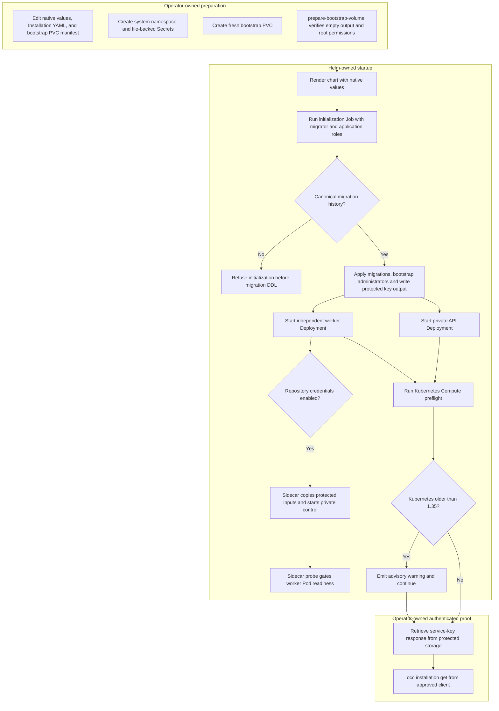

# Production Startup Flow

## Overview

Prepare a fresh protected bootstrap PVC; install Helm with approved images,
PostgreSQL/authentication credentials, trusted Installation YAML and network
policies. Wait for private API/worker readiness; authenticate `/installation`
with the service key.

[Deployment guide](../guides/deploy.md).

## Entry Points

- Trigger: Run `scripts/prepare-bootstrap-volume`, then
  `helm upgrade --install oce deploy/helm/openclaw-enterprise`.
- Source: `scripts/prepare-bootstrap-volume:53`,
  `deploy/helm/openclaw-enterprise/templates/jobs.yaml:8`, and
  `apps/controller/src/composition/production.ts:28`.
- Assumptions: Explicit kubeconfig/context, enforcing NetworkPolicies, external
  PostgreSQL, approved immutable images, protected operator files, fresh
  bootstrap PVC, exact API/client selectors, `/32` egress hosts,
  reviewed control-plane node labels, and an approved private OCC URL.

## Flow

First install requires [empty OCE history](../reference/settings/operations.md#migration-history).

## Execution Trace

Migration, bootstrap, API and worker use
[`createPostgresPool`](../../packages/occ/src/state/postgres-pool.ts) with
[password or Azure workload-identity authentication](../reference/settings/operations.md#postgresql-connection-authentication).
Failover, maintenance restart, `idle_session_timeout` or proxy reset discards the
idle client and logs only its error code to stderr as `database.idle-client-error`.
The process continues; the next query opens a new connection.

### 1. Prepare native production inputs

`deploy/helm/openclaw-enterprise/values.yaml:1`

Prepare values, Installation YAML and bootstrap PVC outside the checkout. Helm
selects controller images, API endpoint, Secrets, claim,
client/node selectors and egress. `openclaw.validate` requires a DNS-1123
release Namespace label up to 63 characters. Installation YAML selects IAM,
Configuration, Compute, optional Backends, gateway/Agent images, projected
workload identity and runtime networking/storage.

File-backed Kubernetes Secrets supply Installation startup, database URLs/optional
CA, Better Auth signing, and optional ChatGPT administrator credentials. These
inputs are not synchronization targets. Helm neither rewrites Driver
configuration nor infers gateway/Agent images.

### 2. Prepare the fresh bootstrap volume

`scripts/prepare-bootstrap-volume:124`

Create the `bootstrap.password.claimName` PVC and run the helper with explicit
kubeconfig, context, namespace, claim,
approved Node-capable image, and optional `--node-selector KEY=VALUE` labels.
The Pod preserves string namespaces and selector keys; selectors precede
WaitForFirstConsumer binding. The helper requires an empty root except
for filesystem-owned `lost+found`, and sets UID/GID `1000` with mode `0700`.

If the Pod is forbidden, storage administration prepares the claim through an
approved workflow for Helm. The helper neither creates PVCs nor
repairs used claims, retrieves credentials, or changes controller configuration.

### 3. Run Helm initialization

`deploy/helm/openclaw-enterprise/templates/jobs.yaml:8`

`deploy/helm/openclaw-enterprise/templates/bootstrap-networkpolicies.yaml:1`
installs isolation before the Job; it and later policies grant configured
DNS peers UDP/TCP `53` and `5353`
([Helm DNS contract](../reference/settings/production.md#required-production-controller-environment)).

Server-connected first installs check the named Job; if present or unreadable,
stop; preserve it; reconcile. Offline `helm template` cannot check it.
This is no lock or freshness proof for database, identity or storage; upgrades
are unchanged.

`deploy/helm/openclaw-enterprise/templates/_helpers.tpl:openclaw.validate` matches Compute routing validation. `database.port`,
`cluster.port`, and `executionCluster.apiPort` must be 1–65535 without leading zeros.
Empty hosts retain Service DNS for listeners and Certificate SANs.

`apps/controller/src/drivers/compute/kubernetes/index.ts:validateDnsHostname`
refuses rewritten/parser-invalid IPv4 with `ConfigurationFailure` before persistence.
IPv4 admission does not establish TLS.
`validateSandboxDomain` refuses numeric/hex suffixes, including canonical IPv4.
Correct Helm values and Installation YAML with the
[hostname correction procedure](../guides/deploy/breaking-changes.md#2026-10-14-gateway-hostnames-must-not-be-rewritten-ipv4)
before upgrade/restart.

`deploy/helm/openclaw-enterprise/templates/_network-policies.tpl:openclaw.networkPolicy.matchLabels`
rejects invalid Kubernetes peer maps, preserving null/empty semantics and accepted labels.

On upgrades, `deploy/helm/openclaw-enterprise/files/check-installation.mjs` validates
Installation without database/Kubernetes access; refusal stops migration and API
replacement. The check uses `apps/controller/src/startup-failure.ts:formatStartupConfigurationFailure`
and the API/worker filter `apps/controller/src/logging.ts:configurationLogDetails`: at most 32 field
diagnostics, without submitted values, except
`apps/controller/src/composition/installation-fields.ts:requireChartListener`:
`CHART_LISTENER_MISMATCH` names ports, hosts or paths refused when
`OCC_EGRESS_AUTHORITY_PORT`/`OCC_OPENSHELL_GIT_PORT` is set.

The hook keeps the release name and bounds its suffix to 63 characters. Both
database containers optionally mount the CA. Helm validates distinct application and
migration Secret keys against Kubernetes syntax before use. `installation.key`
and `executionCluster.kubeconfigKey` must be Secret keys at most 253 characters,
not `.` or a `..` prefix.

`scripts/migrate-production.mjs:1`, `scripts/migration-history.mjs:migrateWithHistory`

Migration verifies the complete SQL source manifest, dedicated role and canonical
receipt/catalog state, and holds an advisory lock on Drizzle's transaction
connection. It accepts fresh databases, canonical history through 0023, or completed
history through 0025; unsupported or mixed development histories fail before
migration DDL and bootstrap. See [migration history and recovery](../reference/settings/operations.md#migration-history).

`scripts/lib/bootstrap-configuration.mjs:authBaseURL` checks HTTP(S) origin before
database access. Production requires HTTPS except HTTP loopback verification
(`127.0.0.1`, `localhost`, `[::1]`).

`scripts/bootstrap-installation.mjs` creates or verifies Installation,
human/service administrators, IAM seed, audit evidence, and initial service key.
Fresh bootstrap creates `default` via `OpenClawController.createNamespace`
as the bootstrap Principal. Queued reconciliation commits with Installation/IAM
state and audit. Existing Installations add no Namespace; this is not Kubernetes'
`default`. The worker provisions Driver-owned infrastructure; operators provide
tenant RoleBindings. The bootstrap container alone writes protected PVC password/service-key files.
Existing output, unsafe permissions, or inconsistent accounts/IAM identity fail
the Job. Helm failure does not imply database-hook rollback.

### 4. Start private API and worker Deployments

`apps/controller/src/api-startup.mjs:configuration`, `apps/controller/src/worker.ts:312`

`apps/controller/src/drivers/compute/kubernetes/index.ts:KubernetesComputeDriver.preflight`

With [OIDC CA settings](../reference/settings/oidc.md), the API init container
`deploy/helm/openclaw-enterprise/files/assemble-api-ca.mjs` validates and combines
IdP and Gateway roots for `NODE_EXTRA_CA_CERTS`;
`deploy/helm/openclaw-enterprise/files/check-api-database-ca.mjs` preloads to refuse
database TLS not pinned to that CA.

After initialization, API readiness requires listener, Better Auth, database,
Installation YAML, Driver, Backend membership, and Compute preflight validation. Private routes, `/healthz` and
database-backed `/readyz` use the operator-managed endpoint. The startup probe
allows 120 one-second failures: two minutes to listen, then readiness within a second.

`apps/controller/src/index.ts:createFastifyApp`

On `SIGTERM`, the API stops accepting connections and drains requests with
`Connection: close`, avoiding the 72-second keep-alive wait. Its single `Recreate`
replica has no peer or `preStop`; the 30-second grace cuts off unfinished requests.
Logs show `shutdown.started` (`signal`), then `shutdown.completed` (`durationMs`),
or `shutdown.failed` (exit 1). Only `shutdown.started` means an interrupted drain.

Nonempty `controlPlane.nodeSelector` places API, worker, migration and bootstrap
on reviewed control-plane nodes; empty defaults omit it.
`deploy/helm/openclaw-enterprise/templates/gateway-routing.yaml` also applies it
to `EnvoyProxy.spec.provider.kubernetes.envoyDeployment.pod`, keeping the private
proxy on that pool. Tenant gateway and Agent placement remain Compute-owned.

With `database.caSecretName`, `_helpers.tpl` rejects CA destinations aliasing active
client mounts, including relative paths, dot segments and trailing slashes. Linux
otherwise masks startup files. Emitted paths stay unchanged; noncolliding paths
remain available.

The [shared egress policy](../../deploy/helm/openclaw-enterprise/templates/networkpolicies.yaml)
selects only `api`, `worker`, and `initialization` Pods with the release identity.
It allows DNS, database egress to every `database.cidrs` host, and
Kubernetes API egress to every `cluster.cidrs` host. Collectors use their separate
DNS, API, and exporter policy; unknown or missing component labels retain
default-deny. Pre-install initialization has only its hook DNS/database grants.
Each configured database or API destination must be an explicit IPv4 `/32`;
refresh the values when a managed endpoint's addresses change.

`deploy/helm/openclaw-enterprise/templates/networkpolicies.yaml` also renders
an API-only TCP 443 egress policy when `api.modelDiscoveryCidrs` contains
provider IPv4 `/32` hosts. Empty defaults grant no provider egress. Operators
maintain those addresses for the optional
[model-discovery API](../reference/console/create-and-deploy.md#create-an-agent);
Console model selection and Harness egress do not depend on this policy.

When `api.channelDirectoryProxyUrl` names an approved HTTP(S) proxy at a
literal IPv4 address and port, the chart passes it to the API and grants only
that Pod egress to the proxy's exact `/32` and TCP port. The proxy must permit
CONNECT to `slack.com:443`. The empty default renders no rule and leaves
production Slack directory lookup unavailable with manual exact-ID entry.

The Kubernetes Compute Driver queries the API server version and verifies
authenticated Namespace access. Below the supported 1.35 baseline, the API logs
`compute.preflight-warning` with both versions and continues. An invalid version
response, unreachable API, or failed Namespace access fails preflight.

The worker independently validates production settings, opens the same
application-role database, loads selected Drivers, validates IAM, runs Compute
preflight with the same advisory warning, emits `worker.started`, and polls
durable Namespace/AgentRevision work. Readiness requires fresh queue-health
observations; neither process mounts the bootstrap PVC.

`apps/controller/src/composition/repository-credentials/platform.ts:composeRepoDriver`

When selected, both processes load the same canonical registry and public CA,
construct the GitHub Backend with a lazy Unix client, and register
`GitHubRepoDriver` under the optional `repo` capability. The configured Backend
member and `drivers.repo` must select the same Driver ID. API startup performs no control operation and loads no App key or
session engine. The worker owns subsequent session lifecycle calls through the
selected Driver; API readiness remains database-backed.

`apps/controller/src/composition/repository-credentials/projected-inputs.ts:prepareProjectedInputs`

The optional service runs beside the single worker. Its own process pins a
projection generation, copies the known config/key/TLS/registry files into owned
private regular files, validates the selected Backend and exact Service origin,
then uses the protected loader and starts both listeners. App/TLS private
material stays in that container. Only the worker receives an explicitly
projected Kubernetes API token. The service's private health probe checks the
Unix listener; it performs no provider operation. The service and worker share
only the private control volume, and the Pod uses `Recreate` with a 75-second
termination grace period. Both containers must pass readiness for the Pod to be
ready; the worker keeps its queue-health probe and retries unavailable session
operations through its ordinary Driver contract. Worker and service have no
independent high availability. Repository runtime reconciliation continues in the
[Agent repository credential flow](agent-repository-credentials.md).

### 5. Retrieve the key and prove authenticated access

Fresh bootstrap [checks both output paths](../reference/authentication/service-api-keys.md#recover-an-incomplete-bootstrap) before creating credentials.

`internal/occclient/client.go:Client.GetInstallation`

After Helm readiness, retrieve
`initial-admin-service-key.json` from protected bootstrap storage through an
approved reader path into an owner-readable file. A completed Job is
not an exec endpoint, and the API and worker cannot retrieve this file for the
operator.

From an approved client, `occ installation get` reads the protected key file
and displays the Installation. Its `ID` must match the key
response's `meta.installationId`. The operator records that ID in the Installation
startup Secret's `openclaw.dev/installation-id` annotation; coordinated upgrades
use this marker to bind their OCC endpoint to the selected Installation.
Agent runtime, Gateway WebSocket authentication and model calls remain unproven
until tenant deployment/TUI procedures run.

## Debugging and Verification

- `scripts/prepare-bootstrap-volume` should exit `0` only for a fresh claim with
  no bootstrap output files and UID/GID `1000`, mode `0700` root state.
- `kubectl -n openclaw-system wait --for=condition=complete job/oce-initialization`
  should succeed before API and worker rollout checks.
- `pnpm db:migrate:production --check` reports the accepted database history
  without applying SQL. `MIGRATION_HISTORY_UNSUPPORTED` needs the database
  inspected; initialization never repairs its ledger.
- The API emits `listening`; the worker emits `worker.started`, then `worker.health`.
  `listening` reports `startupMs` (since process start) and per-phase `phasesMs`.
- `compute.preflight-warning` code `KUBERNETES_VERSION_BELOW_MINIMUM`: upgrade
  Kubernetes to 1.35 or later for support.
- `startup-error` or `worker.startup-error` with code
  `KUBERNETES_API_UNAVAILABLE`: Compute cannot reach Kubernetes at the logged
  `host` and `port`. Check `cluster.cidrs`; restarted clusters can move it.
- Code `PRESET_FILE_INVALID`: an invalid `presets.files` entry or file.
- `DRIVER_CONFIGURATION_INVALID`: inspect `details` (JSON Pointer, code, message).
  `/runtime/gatewayStorageClassName` requires a Kubernetes DNS-subdomain name.
  `apps/controller/src/api-startup.mjs:startupFailureFields` passes these diagnostics
  to `server.mjs`.
- `kubectl -n openclaw-system logs job/oce-initialization -c bootstrap` is the
  first check for unsafe output storage, existing outputs, database-role
  failures, auth errors (`AUTH_SECRET_INVALID`, `AUTH_BASE_URL_INVALID`), and
  administrator/IAM mismatch.
- `occ installation get` must display an `ID` equal to `meta.installationId`
  from the retrieved key file.
- Changing an external startup Secret alone does not restart the API or worker;
  run an explicit rollout and repeat readiness plus authenticated proof.
- `tests/integration/production-kubernetes-packaging.test.mjs` renders the
  chart; it does not prove deployment or model execution.

## Related docs

- [Deployment guide: production](../guides/deploy.md#production)
- [Settings reference](../reference/settings.md)
- [Kubernetes Compute Driver](../reference/drivers/kubernetes-compute.md)
- [Backend-managed credential delivery](service-account-driver-credential-delivery.md)
- [Repository credential setup](../guides/repository-credentials.md)
- [Controller worker execution flow](controller-worker.md)
- [Production TUI flow](production-tui.md)
- [Local password authentication flow](local-password-authentication.md)
- [Authoritative platform design](../design.md)

## Manual Notes

[keep this for the user to add notes. do not change between edits]

## Changelog

- 2026-10-21 19:06: Preserve shared configuration diagnostics through the rebased API startup entry point. (authoring-run/445d1431-dae8-461a-8559-e95dfa03b4f6 - d4e78cadca361efaf089a31972f084a91ff307e1)

- 2026-10-20 01:48: Trace safe typed startup refusals. (authoring-run/9d1ff825-b9f4-492a-9420-1e316d820e28 - e7e5f3321cb0a8471d74964eba56ddd069a4e4c5)

- 2026-10-18 14:40: Compare database CA mount destinations before rendering. (authoring-run/01a10a81-070c-7aa3-97d0-fbce8f285d4d - bcf4fbcf0)

- 2026-10-18: Check the Installation before upgrade migration.
- 2026-10-15 22:24: Validate sandbox suffixes. (authoring-run/13774107-9c73-4561-8bb0-6e910588052a - 417cb2b7b57f)

- 2026-10-14 21:02: Document hostname refusal and correction. (authoring-run/4a613194-6dc8-454f-9cf8-c2a6b46b25af - 44252f8544beb031bf9f9b4d5f9e8093d0b10176)

- 2026-10-13: Trace OIDC CA assembly and the database trust preload.
- 2026-10-11 18:29: Validate database URL Secret keys. (authoring-run/a5a228f3-a952-4e1f-bbba-1a113599bb93 - 19304cadb9a8b8c6473a22b183055ff7b5852e02)

- 2026-10-10 08:22: Retain Namespace and bootstrap guidance with peer-map validation. (authoring-run/3cecc2d2-5f5c-4ce3-9901-928542c3d370 - ac237c12f504fd8f49a5e66c05a8d3865b13444e)

- 2026-10-10 07:58: Preserve landed Namespace admission alongside database ports. (authoring-run/cf8f1d6f-c7a3-4864-8ece-9fc5834ac8b5 - c425fbb8a24df83efdfb1615cfb26a609f0749ca)

- 2026-10-10 07:41: Merge hostname/database-CA guidance and bounded database ports. (authoring-run/714d166d-82e8-4e99-a0ae-a49c8ee235c7 - 3bfadece19cdbea1a23574549265953f9d0e54fc)
- 2026-10-09 22:28: Refuse invalid database ports before rendering NetworkPolicies. (authoring-run/4363ed9a-5724-4d4f-a14d-f1bc0485443e - dc95c2261d4b46cff8aca703e13e43cdd71d153e)

- 2026-10-10 02:11: Validate active production peer matchLabels before submission, preserving accepted values. (authoring-run/e1243091-f075-4ff3-b6e2-0ee47714a472 - dd8bbacc9b974b77f416d48f6783e3e113faa2f9)

- 2026-10-09 23:51: Refuse custom Gateway hostnames Compute rejects during production configuration loading. (authoring-run/0d8da3d8-474a-4801-9887-230406a6b7bd - 5b9dd76c497c1b552a2651ee4b984978cdef0a93)

- 2026-10-09 22:22: Validate release Namespace labels before Helm rendering. (authoring-run/25ae11d6-4539-4513-9b2a-24d10996f971 - 7f358117e68076912a6062411d363e920a0e6adb)

- 2026-10-09 22:25: Refuse database CA paths that duplicate active database-client mounts before Kubernetes admission. (codex/01a12074-7896-7f63-99fe-9f42e9041d02 - 7f358117e)

- 2026-10-09 21:04: Refuse fractional routing ports before Helm emits Kubernetes resources. (authoring-run/b1433176-2fef-435b-bc30-c52bc7fa09e4 - 78677c21f)

- 2026-10-06 16:25: Admit IPv6 HTTP loopback origins through the existing production bootstrap verification exception. (authoring-run/f8a921de-7cd3-48d1-8355-98e3a6d05d02 - 3395f6f8e71757319b566f369fe0ad2853051bc5)
- 2026-10-05 12:10: Bound initialization hook names for valid long Helm releases. (authoring-run/54e33467-f3d2-4f4e-afad-952157ec12f0 - 4cda6515736280ca39f0fbe92cff78194b2c3638)
- 2026-10-05 06:59: Preserve bootstrap Pod namespace strings. (01a0f9e4-a0bf-76f1-acdb-e6b55ada490a - 66a4a07028fd0a08c29ea80e8f95cadc48a74932)
- 2026-10-05: Name Preset file failures `PRESET_FILE_INVALID`.
- 2026-10-04: Poll the startup probe every second.
- 2026-10-04: Time API startup phases in `listening`.
- 2026-10-04: Add the API startup probe.
- 2026-10-04: Log the API's shutdown start and completion.
- 2026-10-04: Describe API shutdown timing against the Pod termination grace.
- 2026-10-01 16:32: Trace scoped OpenShift DNS backend grants for Helm-managed production workloads. (authoring-run/e288dbbe-6d08-4251-adaa-860443c31b44 - 4070b6ad5ec6aff03c9c5e49e504a90393ffe091)
- 2026-09-29: Merge current main into release-scoped shared egress documentation. (PR-187)

- 2026-09-24 08:54: Describe release-scoped shared egress and dedicated collector/bootstrap policies. (PR-187 - 5ebd7305b0876db33276a249934bc82073b63424)

- 2026-09-27 08:51: Document API-only Slack directory proxy egress and disabled default. (01a0df20-f340-7810-bb59-b1df6c0bbbd3 - 1a2764952c421bfee00ed6892714366292c2741a)

- 2026-09-24: Record the post-bootstrap Kubernetes Installation identity marker used by coordinated upgrades.

- 2026-09-25 12:02: Document optional API model-discovery egress in the accompanying chart change. (01a0cf72-6985-7712-ba92-d8cc32470f24 - b2521074873ca46e1a5024248852a32b97cfc8a9)

- 2026-09-24 18:02: Trace private Envoy placement on the control-plane pool in the accompanying chart change. (01a0cf72-6985-7712-ba92-d8cc32470f24 - 92fb7cdfdf672fe476993e2cfd96a73a75c43ac2)

- 2026-09-21 05:32: Reconcile accompanying platform credential documentation with current source history and native Git boundaries. (authoring-run/fba2d7fa-6603-465e-a7c8-df0375ad202d - a051a2406eec7cafde2e0dd5e2ec63dba6ce1581)

- 2026-09-19 23:54: Reconcile RepoDriver ownership, private status projection, and separate emitted service/client paths. (public authoring-run/73c80a5e-4d0c-4e72-b989-0cf9963c6593 - e5b5a5489f078d08272523476bdbcd0b9162c946)

- 2026-09-18 03:03: Trace optional repository Driver composition and service-only projected input startup. (8500b2da103063b4503b62e5529f3910513e84a9)

- 2026-09-21 03:38: Trace canonical migration preflight and fail-closed initialization. (authoring-run/10020664-226c-401f-a499-199fb7f18c9c - 5f9a9903239a84224a755610339f3bf0443c171f)
- 2026-09-18 21:48: Clarify that control-plane node placement is optional unless configured. (authoring-run/23a79228-a1f4-4d9d-adb6-4c2a77d6b43f - db8547ffe19cd3317309b526d80e1d19af4c8a9a)
- 2026-09-18 17:09: Document multi-endpoint Helm egress values and control-plane node placement. (authoring-run/6fe8e24c-8bd5-489b-b76c-ca7d0a22c14b - 724dcb5cb80b5e76a62e8267a21185a2e91a85c2)
- 2026-09-17 12:56: Trace the advisory Kubernetes 1.35 startup preflight and warning handoff. (authoring-run/a6571e7c-996e-4f11-9c4c-f61418a8d109 - 324fe2d17f3856cd1602a57e4d8aa99a34d6514c)
- 2026-09-01 19:09: Document initial default Namespace creation and unchanged repeat-bootstrap behavior. (codex/01a05ef1-ee29-7941-80f2-448bb0789969 - 872fa544c98bb7ad11b2d92d777e49229ececbf5) (01a05f95-dd80-7011-990f-d1c46b5bb3cc - aa366c49c44834d59f74994c5fd37fb8096f169f)
- 2026-09-01 12:58: Trace production bootstrap-volume preparation, Helm startup, and authenticated Installation proof. (codex/01a05e87-6c64-7960-b9c2-f444d4a3d737 - bdb846c38d5dae6085a8841f720c93068ba8ad15)
- 2026-09-01 10:19: Validate Provider configuration at startup and exact saved ownership at use, preserving API repair access. (01a05d6b-e21d-7fc0-b1bd-b5cb15b365c6 - 1c7eae4d11e6c474cc7f1bbbb05d2c2e7052a158)
- 2026-09-01 08:47: Trace Provider membership, API-only client injection, and persisted ownership checks. (01a05d97-f2b0-71d0-bfc3-01ee7d6d58f9 - b079c4b755ef336a9c65bb4eb737e3aedbfdaa7d)
- 2026-08-31 22:29: Remove automatic bootstrap recovery; preserve artifacts after any error and require manual repair. (01a05a3d-526f-7553-8cd8-070bd1847acb - 94a5440898bf331987148d7733f0075506af64a6)
- 2026-08-31 20:33: Trace the shared installation initializer, startup ordering, and initializer-owned credential delivery. (01a05a3d-526f-7553-8cd8-070bd1847acb - b6f213cbcee11ba3dd69886c936c7e5abe233eb3)
- 2026-08-31 17:43: Document fresh human/service administrator bootstrap, private key delivery, and operator recovery. (codex/01a05a69-3fbe-7441-9e6d-20394758cf94 - 0797098646028ac00cb26cd4afcbc9b2cf8bcb24)
- 2026-08-28 17:54: Separated Helm execution from the deployment walkthrough and included optional Sandbox Driver startup ownership. (01a036f4-cf1d-7cc1-bbc1-000879038ac8 - 4270aa29b7015562049f46c6027962fd85b584a9)
- 2026-08-25 03:43: Added the production Helm initialization, protected administrator bootstrap, private OCC API, independent worker, and readiness startup flow. (01a036f4-cf1d-7cc1-bbc1-000879038ac8 - 2e9769c751d7)
