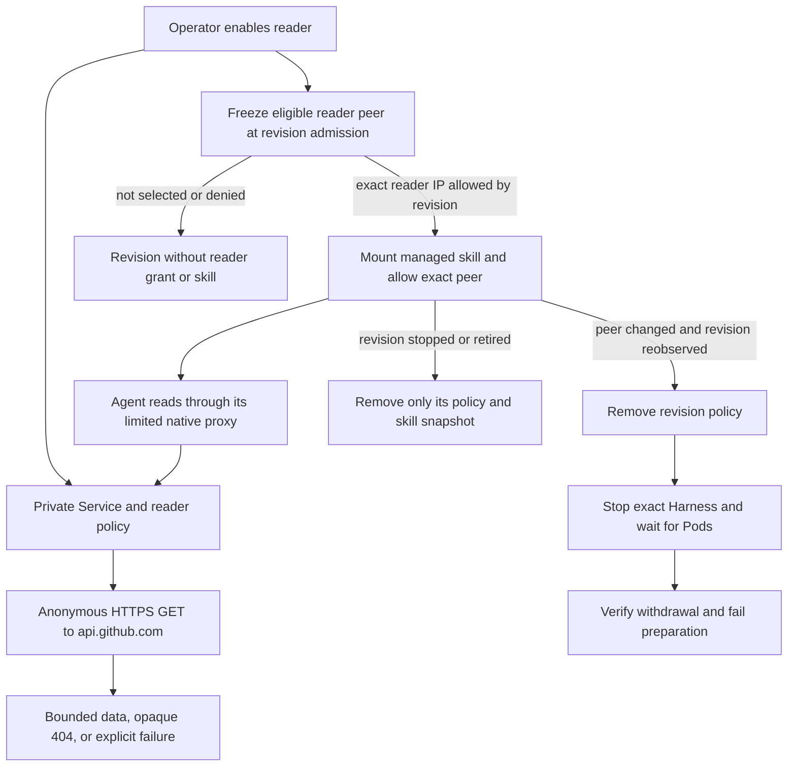

# Public GitHub read flow

## Overview

An Installation can let a dedicated Codex Agent inspect a known public GitHub
repository. Compute owns the revision's skill and exact network peer. The separate
reader knows no credentials; GitHub owns visibility at the time of the read.

## Entry Points

- `scripts/render-installation-profile.mjs:buildRendered` pairs Helm and Compute configuration.
- `apps/controller/src/drivers/compute/kubernetes/index.ts:pluginRuntimeSnapshot` prepares the revision.
- A user asks the deployed Agent to read a known public repository.

## Flow

## Execution Trace

### 1. Compose a private Service and an eligible revision

`packages/occ/src/index.ts` asks the selected Compute Driver for side-effect-free
admission facts before storing the revision. Kubernetes Compute freezes a digest of
the configured reader peer only for a dedicated Codex revision with an explicit
IP allow in its authored proxy. A deny that might match withholds the capability.
`apps/controller/src/drivers/compute/kubernetes/index.ts:publicGithubReadForRevision`
requires the stored fact to match the current peer. An older revision without the
fact stays unselected, including when its runtime projection is rebuilt. For a selected revision,
Compute creates the managed skill's parent as the runtime user before projecting
the read-only file. It uses the same immutable plugin-runtime snapshot to write a
revision-owned egress policy to the exact reader Pod peer and port.

### 2. Resolve the skill and use the actual tool network

`apps/controller/src/drivers/plugin/runtime-translator.ts:codexOpenClawConfiguration`
adds the skill file to native read paths and preserves the authored Service IP allow.
The existing workspace node serves managed skill discovery. The skill asks the
Harness to use its proxy even if a shell client normally bypasses private addresses.

### 3. Recheck public visibility and bound the result

`apps/controller/src/drivers/repo/github/public-read/server.ts:createPublicGithubReadServer`
accepts only approved GET paths. The fixed anonymous provider request carries
neither caller headers nor credentials. In-flight work and rate-limit backoff are process-local;
no completed representation, bearer, repository session or durable state is kept.
List links retain the original local path and filters; issue links carry a validated
provider cursor. An unsafe or out-of-range next link reports an incomplete listing.

### 4. Retire the revision's access

`apps/controller/src/drivers/compute/kubernetes/index.ts:deleteRetiredRevisionArtifacts`
removes the revision's reader policy and skill snapshot after its Pods have
terminated. Preparing or activating a successor does not change that grant.
If preparation or activation observes that the operator disabled or changed the
admitted peer, `revokeUnavailablePublicGithubRead` removes the revision policy to
narrow new connections. It foreground-deletes the owned Harness Deployment with
its UID, waits for the Deployment and its Pods to terminate, and verifies that
the policy and Deployment have not reappeared before failing with a configuration
error. An incomplete observation leaves withdrawal unfinished. Policy deletion
alone does not guarantee existing connections close; an in-flight GET may drain
before Pod termination completes. Reconfiguring the peer
alone does not schedule a reconciliation; the operator can stop the Agent or deploy
an unselected successor and retire the old revision. A new revision is needed to
select a replacement peer.

## Debugging and Verification

- Inspect the revision's skill mount, proxy domain and egress policy, then the reader's policy and Service IP.
- Reader readiness checks `/healthz` locally; a successful Agent read must also reach GitHub.
- Ordinary Image Runtime Startup requires stock Codex to read the projected skill and recover a title present only at its TLS provider.
- The gateway-routing integration uses a public pull title absent from its prompt and substitutes only the external provider.

## Related docs

- [Supported public reads, operator setup and retirement](../reference/public-github-reads.md)
- [Managed Agent repository credentials](agent-repository-credentials.md)

## Manual Notes

[keep this for the user to add notes. do not change between edits]

## Changelog

- 2026-10-15 09:55: Stop the selected Harness before withdrawing its reader grant (authoring-run/47f5b717-62d4-4f46-8310-770057b70134 - 97044717385c2af34c6a611e74203f3a2734f4c5)

- 2026-10-15 09:27: Preserve bounded issue pagination cursors (authoring-run/6399ddc9-8441-4407-8b0f-9ee9755a1cc0 - c620c8372898c4720998445f7f7df89b2799336e)

- 2026-10-15 09:03: Freeze reader selection at admission and revoke changed peers (authoring-run/acd06c56-509b-44d8-9dd3-0858ab106ad0 - 07d2178e530c07883a24c17efc950378c52e2b86)
- 2026-10-15 05:37: Bind reader access and retirement to the selected revision (authoring-run/0da590a9-3bb3-4aa3-a005-25ff485692db - 00bbc7cd976ab7be317ce1e0a9d36ad72ce10567)
- 2026-10-15 05:04: Document public reader revision, proxy and provider boundaries (authoring-run/20c735e1-24ca-4e55-9f8c-8c362173c58a - 00bbc7cd976ab7be317ce1e0a9d36ad72ce10567)
