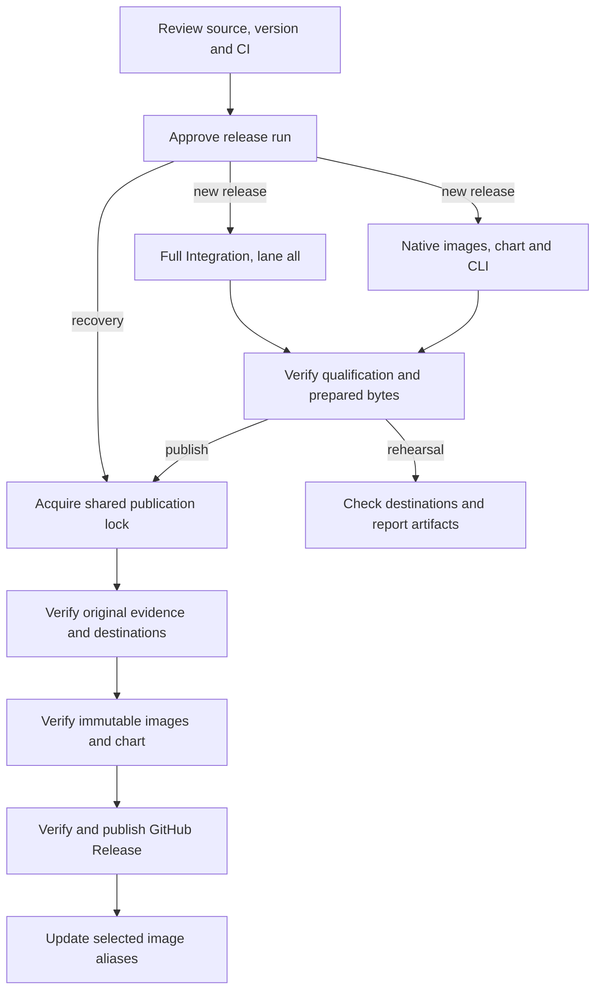

# OpenClaw Enterprise release flow

## Overview

A maintainer dispatches **Release OCE** on protected `main` to qualify one OCE
commit. In publish mode, the workflow releases both images, the Helm chart, and
the CLI for that commit. A rehearsal ends after the read-only
destination checks. Publication ends when both selected image aliases point
to the tested image digests.

## Entry Points

- `.github/workflows/release-oce.yml:jobs.validate` accepts the source commit, CI run ID,
  optional image alias, publication choice, and optional recovery run ID.
- `scripts/ci/full-integration-preflight.ts:validateManualApproval` verifies
  the protected environment, reviewer team, and dispatcher's approval.

## Flow

## Execution Trace

### 1. Bind approval to the reviewed release

`scripts/ci/container-release/admission.ts:verifyCi` checks the requested CI
push run and its required job for the exact commit. A new release must match
the workflow commit. The workflow records the CI attempt, validates the
versions in the root package and chart, and shows the selected alias before
approval. `scripts/ci/full-integration-preflight.ts:validateManualApproval`
checks the dispatcher against the approval history of the release run.

### 2. Qualify one set of artifacts

`.github/workflows/full-integration-execution.yml:jobs.full-aggregate` checks
the results for `lane=all`, including any eligible CI results reused for the
same commit. `scripts/ci/release-oce.ts:validateQualification` requires positive
evidence that the full suite passed for this source, run, and attempt. A skipped or targeted aggregate cannot
authorize a release.

`scripts/ci/container-release/oci.ts:assemble` joins the natively tested
controller and runtime exports into two Linux AMD64/ARM64 indexes. Their
digests identify the exact images for the packaged chart.
`scripts/ci/cli-release.ts:packageCli` builds and verifies four OCC binaries.
Artifacts in Actions preserve the prepared bytes for publication and recovery.
The qualification job saves `release.json` in
`qualified-release-<run-id>-1`. A rehearsal checks registry and CLI
destinations with read permissions, then ends.

### 3. Verify each public write

`scripts/ci/cli-release.ts:publish` runs after verification of the immutable
source and version tags and the chart. The caller holds the shared
`enterprise-container-publish` lock from its evidence checks through both
alias updates. Keep external writers off these tags during the release. Package jobs can write
GHCR packages. The CLI publisher can write repository contents. It verifies
the release tag, uploads missing draft assets, and compares the downloaded
files to the prepared binaries and checksum file before publishing the draft.
Release OCE also downloads the five public assets without credentials.
`scripts/ci/release-registry.ts:advanceReleaseAliases` then verifies each alias
against its recorded prior digest or the intended release digest before moving it.

### 4. Recover from an interrupted publication

`scripts/ci/release-oce.ts:verifyProducer` checks the producer for a fresh recovery dispatch with the
original publish run ID. It checks that the source still belongs to `main` and
verifies the original approval, full-suite result, and artifact evidence.
Recovery uses the original bytes. It verifies completed steps and stops at a
conflicting immutable object or an alias that another release has moved. Each
registry or GitHub write can succeed before the next one fails.

## Debugging and Verification

- For an admission failure, compare the source SHA, workflow SHA, CI run ID,
  and CI attempt. Inspect the release run's environment review and aggregate.
- For a partial publication, inspect the protected jobs and compare registry
  digests, the Git tag target, and the five release assets with the original
  preparation evidence. Follow [release recovery](../release/README.md#recover-a-partial-release).
- Staging qualification and Docker Hub promotion have separate entry points
  and evidence.

## Related docs

- [Release OpenClaw Enterprise](../release/README.md)
- [Container publication](container-publication.md)
- [OCC CLI publication](cli-publication.md)
- [Full Integration coverage](../testing/ci/full-integration.md)

## Manual Notes

[keep this for the user to add notes. do not change between edits]

## Changelog

- 2026-11-24 11:31: Document release qualification, publication order, and recovery. (authoring-run/90c31b49-3d89-43f7-922e-ba48b6f34371 - 6908216b29038bd850b44f084b07ba7f886614d5)
