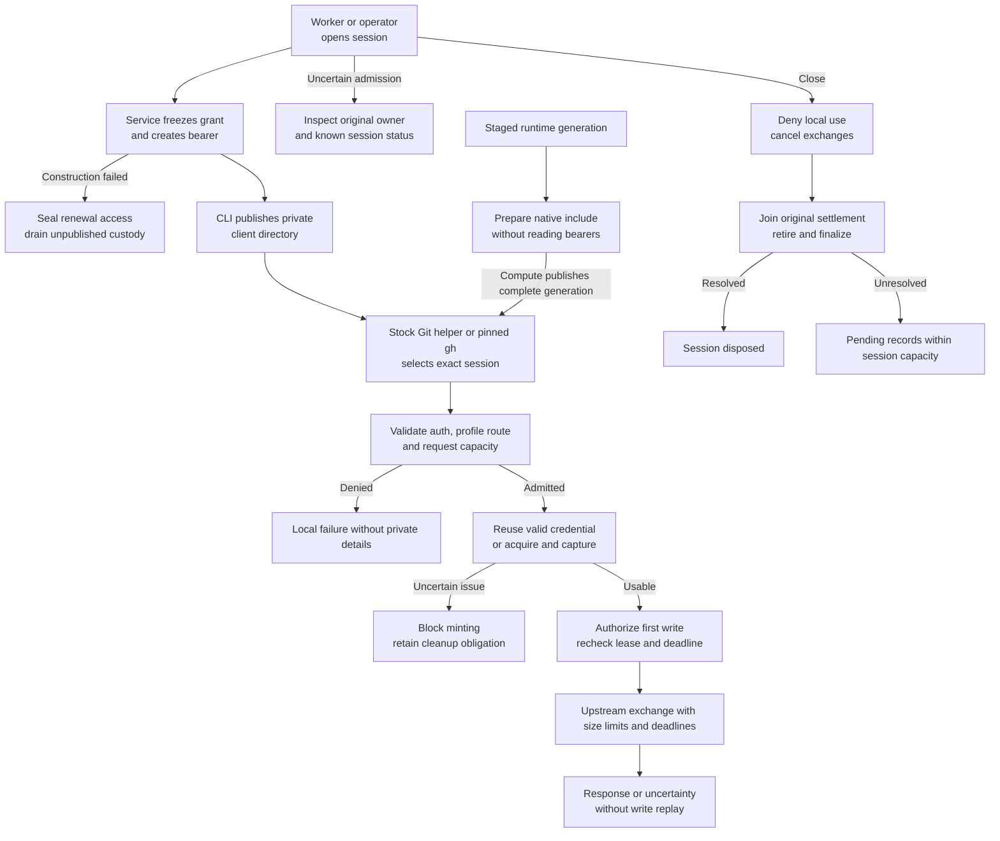

# Repository credential service flow

## Overview

Operators or workers admit sessions over a private Unix control socket.
Sessions have a maximum duration and a capped count.
Clients send Git or selected API requests over HTTPS with a gateway bearer. This trace
covers forwarding, closure and cleanup in the separate credential process. The
[Agent flow](agent-repository-credentials.md) owns admission and material delivery.

## Entry Points

- `apps/controller/src/repository-credentials.ts:main` delegates protected-path startup to `startCredentialService` in controller composition.
- `apps/controller/src/drivers/repo/github/credentials/client/operator.ts:callControl` carries operator admission/status/close requests over the private Unix socket.
- `apps/controller/src/drivers/repo/credentials/server.ts:startListeners` accepts HTTPS client traffic after protected startup succeeds.

Standalone configuration selects one repository; the registry supports several
under one App installation. Sessions bind exactly one repository. Operators own
protected files and control; clients receive session files and public connection/trust settings.

## Flow

## Execution Trace

### 1. Load protected startup inputs

`apps/controller/src/composition/repository-credentials/check-config.ts:checkConfiguration` and
`apps/controller/src/composition/repository-credentials/service.ts:startCredentialService` load protected configuration through
`apps/controller/src/composition/repository-credentials/protected-file.ts:readProtectedFile`.
The [configuration flow](repository-credential-configuration.md) traces its
root-to-leaf protected-path validation and Kubernetes projection snapshots.
`apps/controller/src/drivers/repo/credentials/configuration.ts:validateServiceConfig`
validates gateway, session and capacity settings. The standalone check emits a
safe summary without session/listener imports. Startup selects the system clock
and configured backend; `apps/controller/src/composition/repository-credentials/service.ts:runService`
composes service and listeners without the controller API or worker.
For the development token backend,
`apps/controller/src/drivers/repo/github/credentials/factory.ts:createGitHubDriverFactory`
composes session-bound backends. It delegates grant resolution to
`apps/controller/src/drivers/repo/github/credentials/grants.ts:createGrantResolver`
and client authentication to
`apps/controller/src/drivers/repo/github/credentials/gateway-authentication.ts:createGatewayAuthentication`.
A registry-selected factory retains the frozen repository identity and access profile.
The production native sender consumes READY material from the worker Token Service.
It owns no App signing key, cannot issue installation tokens and does not load the
development static-token implementation. The development backend requires both
`developmentOnly: true` and the `--development-authority` process flag.
`packages/contracts/src/repo.ts` owns public `RepositoryPolicyDriver` and
`NativeRepositorySender`, grant identity and four-field status. Private contracts under
`apps/controller/src/drivers/repo/credentials/` separate full status/admission/bearer
results (`service-contracts.ts`), the dependency-free six-field client DTO
(`client-contracts.ts`), and backend protocol/custody handles (`backend-contracts.ts`).
Type-only imports keep service initialization out of Compute and the Git/gh bundle.
The frozen runtime facade exposes `open`, `status`, `close` and `shutdown`;
listeners own exchanges. The [Agent flow](agent-repository-credentials.md) owns
platform session-control and local policy.

Registry startup selects
`apps/controller/src/drivers/repo/github/credentials/warm-registry-factory.ts:createPreparedGitHubRegistryFactory`
from the same canonical registry loaded by API and worker. The worker owns the
App key; only the sender receives its TLS private key. `startListeners` can reclaim only an owned,
private, refused stale Unix socket after checking that its identity is unchanged;
a live or ambiguously owned socket fails startup. Neither listener admits requests
until the control socket has mode `0600` and its identity is recorded.

### 2. Admit and publish a client session

`apps/controller/src/drivers/repo/credentials/control.ts:handleControl` validates the local
request method, target, content type, and body before invoking the common
service. The body limit is the smaller of 16,384 bytes and `controlBodyBytes`. `apps/controller/src/drivers/repo/credentials/service.ts:createCredentialService`
checks duration, allowed profile and capacity, then freezes the resolved binding.
Profiles are opaque to the common service. GitHub resolves `git-read`, `git-write`
and `git-full` to the [permission maps](../reference/repository-credentials.md#configuration)
and includes the profile in grant identity. Startup rejects unknown names,
including `read-write`; the example defaults to `git-write`. Bearer lookup stores
a digest; only the original admission response contains the bearer.

`apps/controller/src/drivers/repo/credentials/server.ts:startListeners` owns the
correlation registry from
`apps/controller/src/drivers/repo/credentials/control.ts:createControlAdmission`.
The registry holds at most twice the configured `sessions` count.
Admission IDs bind the complete request: platform Namespace, repository reference,
normalized profile, expected grant and absolute deadline. Registry mode requires
this binding and independently resolves its fingerprint. The broker holds one
local session slot and freezes the selected route before the worker-owned private
journal reserves the original attempt. It constructs that route only after the
reservation succeeds, using the original deadline. A capacity or shutdown refusal
before reservation leaves no receipt; a missing or uncertain reservation creates no
session. Recovery durably fences a missing admission. If the broker cannot open or
bind after reservation, it fences its own reservation. An uncommitted fence stays
with its admission for the next open or recovery; past the admission window a sweep
retries it and forgets it once committed, so it stops counting toward capacity.
Known nondelivery closes the session.
Reconciliation cannot recover a bearer, change its binding or replay provider work.
Keep the original admission ID and inspect its owner and any known session after an
uncertain response. Status observes expiry without closing the session or starting
disposal; clock rollback cannot restore use. If a disposal acknowledgement is lost,
status, close and shutdown resend the same status; the journal records it once and
refuses a different one.

The receipt and operator control clients reject private-socket replies over
16,384 bytes and destroy the response without waiting for its end.
[`RepositoryReceiptClient.call`](../../apps/controller/src/drivers/repo/credentials/receipt-client.ts)
reports `RECEIPT_UNAVAILABLE`;
[`callControl`](../../apps/controller/src/drivers/repo/github/credentials/client/operator.ts)
retains the admission ID in `control-request-failed` and also closes the request.

Factory failure or an invalid binding closes construction admission before
`apps/controller/src/drivers/repo/credentials/custody.ts:disposeAllRenewal`.
All handles are sealed before awaiting callbacks. Unpublished custody occupies
the configured session capacity until callbacks settle and bytes are disposed.

`apps/controller/src/drivers/repo/github/credentials/client/config.ts:writeClientConfiguration`
stages private files, synchronizes writes and renames the directory into place.
CLI output reports status and location. After a write failure, the CLI attempts
closure and reports the admitted session ID for operator follow-up.

### 3. Authenticate the selected client

`apps/controller/src/drivers/repo/github/credentials/client/native-git.ts:prepareNativeGitConfiguration`
prepares staged material through
`apps/controller/src/drivers/repo/github/credentials/client/manifest.ts:readRuntimeRepositoryManifest`
which validates complete-generation public identities, final paths and metadata.
The renderer requires same-origin CA agreement and one gateway origin per
canonical host, then emits deterministic rewrites and origin-scoped credential/TLS
defaults. Exclusive no-follow creation writes staged `gitconfig`; the receiver
rechecks deadlines and publishes atomically. Source does not qualify installed images or receivers.

Stock Git reads the resulting include with its normal semantics. On authentication,
`apps/controller/src/drivers/repo/github/credentials/client/git-helper.ts`
parses credential protocol input of at most 16 KiB and verifies the embedded generation.
`apps/controller/src/drivers/repo/github/credentials/client/targets.ts:selectGitCredential`
matches effective HTTPS origin and case-insensitive owner/repository with optional
`.git`. Explicit reference/session pins must match. Ambiguity, stale pins and
expired selections release no bearer. The helper reads only the selected bearer,
clears its buffer after use, and leaves material unchanged for store/erase.

`apps/controller/src/drivers/repo/github/credentials/client/router.ts:routeRepositoryClient`
handles only gh. It validates the supported API/explicit-head PR invocation,
selects a binding from its explicit target, inherited pin or native Git remotes,
and propagates the exact generation/reference/session pin to children.
Before launching gh, the router and single-session launcher compare the private
bearer and generated host configuration and check the deadline again after
reading them. A mismatch or unsafe file refuses the launch. This preflight is
not an atomic snapshot or authorization.
`apps/controller/src/drivers/repo/github/credentials/client/environment.ts:createClientEnvironment`
keeps gh token/config isolation while preserving normal HOME and system Git
configuration. `apps/controller/src/drivers/repo/github/credentials/client/commands.ts:prepareGhCommand`
checks gh 2.103.2 and the canonical host/port profile.
`apps/controller/src/drivers/repo/github/credentials/client/launch.ts:launchClient`
provides single-session stock Git execution, signal forwarding and original child
exit status. `executeClientCommand` preserves numeric exits and maps signal
termination to `128 + signal number` (SIGINT 130; SIGTERM 143), without Git
command parsing or temporary-HOME cleanup. The
[reference](../reference/repository-credentials.md#client-routing-and-limits)
owns configuration overrides and generation limits.

### 4. Reserve, acquire and dispatch

`apps/controller/src/drivers/repo/credentials/server.ts:startListeners` bounds
sockets per listener, preserving control admission under public saturation.
HTTPS separately bounds handshakes and starts `headerMs` on the `TLSSocket` at
`secureConnection`; Unix control retains its raw-socket timer.
`apps/controller/src/drivers/repo/credentials/transport/agent.ts:createAgentHandler`
clears the TLS timer after authenticated capacity reservation, before acquisition;
the exchange deadline remains enforced.

`createAgentHandler` checks framing and delegates authentication to the bound
factory. Unauthenticated valid Git routes receive a Basic challenge; authenticated
requests reserve capacity before forwarding bodies. Each refusal of an authenticated
request, and each framing refusal whose credential names an open session, emits one
[`repository-credentials.denied`](../reference/repository-credentials/prepared-native-git.md#read-broker-refusals)
record. GitHub plans routes through
`apps/controller/src/drivers/repo/github/credentials/routes.ts:createRoutePolicy`, using
`apps/controller/src/drivers/repo/github/credentials/routes/classification.ts:classifyRoute`
to classify target, method, profile and query. All profiles admit upload-pack discovery and execution;
`git-read` rejects receive-pack, including discovery. Git paths match admitted
owner/repository case-insensitively with one optional `.git` suffix, then use the
canonical identity upstream. A literal `.git` repository keeps its suffix.
Raw-target, endpoint, method, media, query and profile checks remain. All profiles
admit selected repository, README, PR, issue and comment reads, `GET /meta` and
`POST /graphql`. REST writes require the matching profile permission; Reader
rejects them before dispatch. The shared PR/issue comment routes also rely on
GitHub's resource authorization. Raw README and diff/patch replies retain the configured API response-size limit
and bypass JSON rewriting. GraphQL uses the exact installation-token grant without
field-level or branch-only authorization. GitHub may return permitted public
information; every GraphQL POST is a possible write. The GraphQL plan carries
`apps/controller/src/drivers/repo/github/credentials/graphql-input.ts:allowsGraphqlInput`:
`apps/controller/src/drivers/repo/credentials/transport/agent.ts:createAgentHandler`
buffers the body within the input bounds before credential use and refuses
invalid JSON or any decoded string naming `tempCloneToken` with 400.

`apps/controller/src/drivers/repo/credentials/service.ts:createCredentialService`
reserves the exchange.
`apps/controller/src/drivers/repo/credentials/lifecycle/exchange.ts:executeExchange`
reuses a valid credential or acquires one through
`apps/controller/src/drivers/repo/credentials/lifecycle.ts:createLifecycle`.
Concurrent misses share acquisition; the last departing waiter cancels it. Until
settlement, dependent requests return `not-dispatched` without new acquisition.
The original owner retains capture, settlement and cleanup obligations. Use
lifetime starts at capture and cannot exceed cleanup expiry; wall-clock changes
cannot shorten custody or restart use lifetime. An exchange retains its selected
credential through replacement. Its selected authenticator gets a temporary copy,
cleared after use; a reference alone cannot retrieve authentication bytes.
Production native requests use
`apps/controller/src/drivers/repo/github/credentials/warm-use.ts:authorizePreparedGitSend`.
The worker validates the live grant and lends prepared material for that exchange.
`executeExchange` checks the session before and after prepared authorization.
`apps/controller/src/drivers/repo/credentials/transport/upstream.ts:createUpstreamSender`
checks it again at the first HTTP write. If an issued permit cannot be submitted,
the original settlement receives `not-submitted`.
Missing or uncertain material does not cause request-time issuance. The explicit
development token factory instead borrows its process-owned static token.

Handler and sender capture allowed origins independently.
`apps/controller/src/drivers/repo/credentials/transport/request-headers.ts:createUpstreamHeaders`
validates adapter fields within byte and field-count limits, rejects case-insensitive
duplicates, and removes reserved fields such as `Expect` before request construction.
After verified TLS, owned exchanges recheck configured standing before first write.
Prepared sends check their original one-use permit, cancellation and send deadline
there. Gate denial or confirmed pre-write socket close prevents HTTP writes. The response-header timer starts
after upload unless headers arrived. Connection, upload, stall and total deadlines
apply. Upload-pack has separate response-byte, first-header, stall and total
budgets; other requests retain ordinary limits. Every plan obeys `maxExchangeMs` and
the session deadline; static-token upload-pack also obeys its lease. The byte counter
applies backpressure without buffering the pack.

### 5. Deliver an outcome and release ownership

`apps/controller/src/drivers/repo/credentials/transport/response-headers.ts:responseHeaders`
checks upstream header bounds and framing. The GitHub route plan carries the
policy from `apps/controller/src/drivers/repo/github/credentials/response.ts:createResponsePolicy`
for response headers, pagination and followed resource fields, composing
`apps/controller/src/drivers/repo/github/credentials/response-urls.ts:createUrlRewriter`
and `rewritePaginationLinks` with
`apps/controller/src/drivers/repo/github/credentials/response-resources.ts:createResourceRewriter`.
Before releasing JSON within the configured response-size limit, it removes `temp_clone_token` from repository
objects, their `parent`/`source` relationships and PR `head.repo`/`base.repo`
objects. GraphQL cannot select the equivalent `tempCloneToken` (see above).
This is not a generic credential-string scanner.
The URL owner maps the configured repository ID to admitted
`/repos/owner/repository` before checking route and resource purpose; other IDs
are refused. Issue pagination accepts `after`/`before` cursors with 1–1,024 allowed
characters and up to two trailing `=` characters. Rewritten
gateway links require subsequent session/profile checks.
Informational nested labels, milestones, repository metadata and human content
remain unchanged. Transport applies
`apps/controller/src/drivers/repo/credentials/transport/response-headers.ts:safeResponseHeaders`
before writing response headers to the client.

After successful input, upstream failure before response headers stops upstream
I/O, then sends fixed `502 exchange-uncertain` after settlement. Cancellation,
deadlines, input failure and post-header failure destroy the incoming connection,
including later cancellation while error delivery remains owned.

`apps/controller/src/drivers/repo/credentials/lifecycle/exchange.ts:executeExchange`
closes a rejecting authenticator's gate, drains its admitted sender, then classifies
the result: completed, not-dispatched or possibly-dispatched. Committed writes stay
possibly dispatched and are never replayed. The exchange joins tracked I/O before releasing credential use and capacity. The handler
ignores response `close` after `writableFinished`; premature close cancels the
exchange. Original provider settlement and cleanup outlive requests.

### 6. Close locally and finish cleanup

`apps/controller/src/drivers/repo/credentials/service.ts:createCredentialService` closes the
session before cancelling its exchanges and advancing lifecycle cleanup. A
session becomes disposed only after exchanges, original actions, captures,
renewal state and auxiliary finalization are resolved. If the provider queue is
full before cleanup dispatch, `apps/controller/src/drivers/repo/credentials/lifecycle.ts`
keeps retirement/finalization unattempted and registers one capacity waiter per
session through `apps/controller/src/drivers/repo/credentials/provider-queue.ts`. Available
capacity wakes cleanup; queue rejection alone does not mark an action uncertain.

`apps/controller/src/composition/repository-credentials/service.ts:runService`
stops admission, closes sessions and bounds cleanup with an independent timer.
Grace expiry reports unresolved obligations without proving disposal. The original
broker writes `DISPOSED` to the worker's receipt journal before reporting it,
and gives pending terminal writes a separate ten-second window before graceful exit. The Helm worker is a
restartable init container so its receipt listener outlives broker shutdown.
Only a committed observation survives restart. Uncommitted or uncertain
provider inventory remains unknown. The original issuer retains token cleanup;
the sender closes its TLS and session material after shutdown disposition.

Failed construction custody joins shutdown drainage: its pending obligation
counts in `pendingAuxiliary` without a published or disposed session; disposal
wakes shutdown waiters.

## Emitted packaging

`scripts/build-repository-credentials.mjs` follows the credential entrypoints in
the controller's emitted tree into separate service/client artifacts.

| Artifact context                        | Runtime entrypoints beneath `dist/`                                                        |
| --------------------------------------- | ------------------------------------------------------------------------------------------ |
| `.build/repository-credentials/service` | `repository-credentials.js`, `composition/repository-credentials/check-config.js`          |
| `.build/repository-credentials/client`  | `drivers/repo/github/credentials/client/{launch,operator,git-helper,native-git,router}.js` |

The Dockerfiles under `deploy/runtime/repository-credentials/` consume these
contexts. `deploy/examples/repository-credentials/compose.yaml` separates service
inputs/control from client session/workspace mounts. The
[operator guide](../guides/repository-credentials/standalone-service.md#container-images) covers image
builds and entrypoints. The
[test guide](../testing/repository-credentials.md#record-each-evidence-boundary)
distinguishes packaging, container, live-provider and platform proof.

## Debugging and Verification

Run `pnpm credentials:build` and `pnpm credentials:check-config CONFIG_FILE` for
the separate emitted startup path. Run the client configuration and package
integration tests for private files, actual Git helper behavior and detached
runtime loading. Inspect session status after close: a closed session can still
have pending or uncertain cleanup.

A helper failure reports a fixed category without credentials. Diagnose the
configured HTTPS host/path and private file ownership first. API failures also
require checking that the session uses `git-full`, then the pinned CLI, canonical
host, gateway DNS/SAN and port 443.
For a local gh launch refusal, inspect the selected private session files and
their ownership without exposing credential contents.
The [test guide](../testing/repository-credentials.md) covers controlled upstream,
client and alternate-adapter checks; live-provider behavior requires separate qualification.

## Related docs

- [Ordinary Agent admission and runtime delivery](agent-repository-credentials.md)
- [Supported behavior and configuration](../reference/repository-credentials.md)
- [Operator procedures](../guides/repository-credentials.md)
- [Qualification and test setup](../testing/repository-credentials.md)

## Manual Notes

[keep this for the user to add notes. do not change between edits]

## Changelog

- 2026-10-27 17:25: Resend a disposal whose acknowledgement was lost with its original status. (fix-3873-dispose)

- 2026-10-27 16:36: Preserve original receipt recovery and observed expiry with prepared route admission. (authoring-run/2af9e346-e424-4bb7-8b0e-a6e1126f9832 - 759e6312f4e5939c17837132ef51d26c84146517)

- 2026-10-27 16:17: Reconcile selected route admission and disposal observation. (authoring-run/09fabde1-4f6f-46b0-9d37-943815810d11 - cf476a1b8303c5c24a2ec0c6fd7bc82df501115f)

- 2026-10-27 16:03: Preserve the original attempt and selected prepared route during integration. (authoring-run/0a7454c1-6227-4251-b631-3bcfc0621c5a - 00e9ac0c0a6c4cbdf6a4bb7eb4b600e0d3d27322)

- 2026-10-27 14:38: Preserve observed expiry at the first upstream write for owned and prepared exchanges. (authoring-run/dadaaea1-48d6-4917-ab44-18b1cfbeccb8 - b9fe4f8bb5b3321d1c0965297443fa174520c481)

- 2026-10-27 14:12: Enforce observed expiry throughout prepared authorization and dispatch. (authoring-run/d086ce54-15b3-490d-8361-a992c4445d7f - 7e2feb0a3388f35364d943f0de778a5a5af8e944)

- 2026-10-27 14:02: Classify failed authentication after sender drainage. (authoring-run/53fbc611-31df-40b6-b106-b4035812ccb6 - 9d53c40b47afc7915d22a011ba721a880101b5ba)

- 2026-10-27 13:43: Reserve the original attempt before constructing the selected prepared route. (authoring-run/c791ff25-9d48-4b6a-b400-315fa09ba049 - af7b0b904719bc1e1b238985d3db7cda8a3f7515)

- 2026-10-27 13:32: Retain observed session expiry through wall-clock correction. (authoring-run/190e7ec1-f80f-46f3-8a1c-06a9976abbc4 - bc4d77fb896d89b02b561a7e5f213e713ee40d13)

- [Earlier entries](repository-credentials/history.md) are preserved in the documentation history.
