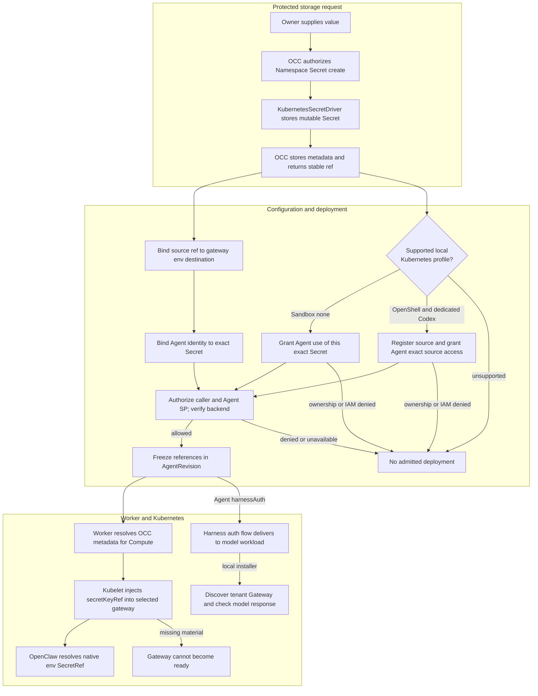

# Secret Storage and Gateway Delivery Flow

## Overview

An authorized owner stores a Namespace-owned Secret before any Agent exists,
binds its stable reference in Configuration for gateway delivery, then grants, assigns
and deploys a consuming Agent. For these Configuration bindings, OCC admits
references and Kubernetes supplies values only to each selected gateway.
Harness model authentication uses the
[shared Agent binding flow](native-service-account-credential-delivery.md).
The local installer also grants a new Agent access and verifies a model response.
Credential issuance and provider internals are outside this flow.

## Entry Points

`apps/controller/src/index.ts:createFastifyApp`

- `POST /namespaces/:namespaceId/secrets`: a ready Namespace and caller
  authorization to create the Secret in that Namespace.
- Configuration create/update, Agent create/update assignment, and the existing
  Agent deployment action: authorized exact Secret references, same-Namespace
  bindings, exact Agent assignment authority, and an approved Harness/Compute
  selection.
- Local installer: `scripts/first-agent.mjs:main` uses the bootstrap service key.
- Source: [HTTP handlers](../../apps/controller/src/index.ts),
  [OpenClawController](../../packages/occ/src/index.ts), and
  [KubernetesSecretDriver](../../apps/controller/src/drivers/secret/kubernetes/index.ts).
- The console and [OCC CLI](../guides/cli.md#provision-integration-secrets)
  call these HTTP operations. They initiate OCC-authorized mutations; neither
  writes directly to SQL, Kubernetes, or credential backends.

## Flow

## Execution Trace

### 1. Authorize storage without requiring a gateway

`packages/occ/src/index.ts:OpenClawController.createSecret`

[OpenClawController.createSecret](../../packages/occ/src/index.ts) validates
nonempty UTF-8 input of at most 65,536 bytes and locks the Namespace. The caller needs `create`
on the Namespace's Secret collection. The Namespace must already be ready; an
Agent record does not need to exist. OCC selects the
Installation SecretDriver, generates the Secret identity, and prevents the
caller from choosing Kubernetes backend identity. The value stays in protected
request/driver memory, never in the reconciliation queue or resource metadata.

### 2. Store material and commit safe identity

`apps/controller/src/drivers/secret/kubernetes/index.ts:KubernetesSecretDriver.create`

[KubernetesSecretDriver.create](../../apps/controller/src/drivers/secret/kubernetes/index.ts)
uses Compute-owned verified tenant storage placement. It creates a mutable Opaque Secret with
a Namespace-derived name, exact Namespace ownership metadata, and a fixed
`value` key. Its result contains only backend identity, including UID. [OCC state](../../packages/occ/src/state/postgres-state.ts)
persists immutable Namespace, driver, and backend metadata while public metadata
omits the backend locator and returns `{ kind: "secret", namespaceId, id }`.

Known OCC transaction failure can compensate the exact created object. An
unknown commit outcome must not trigger destructive compensation. A failed create
deletes the owned object it may have stored under its name. A create refused because
its stored object was rewritten deletes it, pinned to the answered UID and
resourceVersion. There is no value journal or automatic replay; a create still in
flight can require operator recovery.

### 3. Bind a source, then admit references

`packages/occ/src/index.ts:OpenClawController.deployAgent`

The Agent response exposes its immutable `servicePrincipalId`. An administrator
grants that identity `operate` on the exact Secret before deployment. OCC checks
Installation administration, Namespace scope, and target access through the
selected IAM Driver; policy and audit commit together.

[createConfiguration and updateConfiguration](../../packages/occ/src/index.ts)
keep `secretBindings` in OCC metadata, separate from native `values`. Each binding
has a Secret source and an env delivery destination; omitted delivery normalizes
to `env`. Unsupported sources, substitution modes, and reserved environment
variables fail closed. All sources must belong to the same Namespace as the
Configuration. A Configuration create/update whose resulting document contains
bindings requires `operate` on every selected Secret, including retained bindings
when PATCH omits `secretBindings`.

[createAgent and updateAgent](../../packages/occ/src/index.ts) require the normal
Agent mutation permission plus `operate` on each exact Secret when selecting a
Configuration with bindings.

[deployAgent](../../packages/occ/src/index.ts) separately authorizes the deploying
caller and consuming Agent service principal to `operate` every Secret, then
checks live backend identity through the API-side driver. Namespace locking
serializes binding/admission changes against deletion. Admission freezes
normalized refs and the selected SecretDriver identity, not backend locators or
values, in the Agent revision. Enabled native channel environment SecretRefs must have
matching bindings at admission; disabled channel provider blocks do not require
them.

Model-auth environment destinations are reserved for Agent `harnessAuth`;
Configuration bindings cannot select or override model credentials in either
execution topology.

### 4. Grant the first local Agent access to its model credential

`scripts/first-agent.mjs:main`;
`scripts/first-agent.mjs:assertManagedRevision`;
`internal/occdev/kubernetes.go:openShellInstallationConfiguration`;
`scripts/first-agent-database.mjs:grantFirstAgentSecret`

The [tool](../../scripts/first-agent.mjs) uses the persistent `./bin/occ dev up` installation.
Before Kubernetes or OCC API calls, it requires the current v3 development marker
and state from the same checkout.
The state must select Kubernetes Compute. The default `sandboxDriver: "none"`
path uses embedded OpenClaw; OpenShell requires explicit `--harness codex`.
`scripts/first-agent.mjs:loadLocalInstallation` uses the recorded Unix socket and
removes inherited Docker TLS settings for container-engine calls. Compose setup
queries the recorded controller port and PostgreSQL service without another
daemon's certificates.
With the [bootstrap service key](../../packages/iam/src/index.ts), it creates a
Secret, Configuration, and named Agent through the OCC HTTP API. A new Agent uses
`openai/gpt-6-astra` unless `OPENCLAW_FIRST_AGENT_MODEL` selects another authorized
plain model ID; a repeat without an override keeps the recorded model, and a
conflicting override is rejected. Bootstrap already has Secret `operate`; the
Agent does not.

Without OpenShell, the tool opens the recorded local PostgreSQL service. One
transaction verifies the Namespace, Agent, and Secret, then grants the Agent's
existing principal `operate` on that exact Secret. It verifies the bootstrap
identity, honors IAM restrictions, and audits a new grant.

With OpenShell, the tool registers the Secret as an `openai` or `codex-pat`
CredentialSource and uses the public Namespace IAM API to grant the Agent principal exact
`credential_source:operate`. It does not grant Secret access. `--replace-key`
updates the Secret and asks the Credential Gateway to reread it before deploying
a new version. The private helper record freezes the Harness and Sandbox Driver
choices so a rerun cannot silently change topology.

The tool provisions runtime credentials and requests deployment through
OCC. The check requires the local OpenShell profile's Driver-owned
workspace, `/sandbox/enterprise`, and frozen Codex policy:
`sandbox: "danger-full-access"` with `approvalsReviewer: "user"` for either API-key
or PAT sources. It can recognize a prior PAT Agent revision frozen with
`workspace-write`; a new deployment uses the current policy. Other workspace or
Configuration differences fail the drift check. Once OCC selects the version,
[`findGateway`](../../scripts/first-agent-model.mjs) discovers the canonical
tenant namespace through `openclaw.dev/namespace`. The supported local setup is
single-cluster, so embedded and dedicated Gateways share that physical namespace
with the provider-owned Harness. The verifier requires the exact Agent labels,
Agent revision ConfigMap mount, and a Running, Ready Gateway Pod before it sends the
prompt. Kubernetes Compute owns any experimental two-cluster placement; this
local helper does not infer physical placement from the Agent execution mode.
The tool retains installation resources on exit.

### 5. Render only the exact gateway's projection

`apps/controller/src/worker.ts:ControllerWorker.resolveRevisionSecretContext`

[ControllerWorker](../../apps/controller/src/worker.ts) rechecks
consumption authority and resolves Agent revision refs from OCC metadata before each
preparation and activation. It passes an ephemeral `ComputeRevisionContext`; it
does not add backend metadata to the Agent revision. Its Compute Driver performs
the physical Secret reads and scoped runtime delivery.

[KubernetesComputeDriver.prepareRevision](../../apps/controller/src/drivers/compute/kubernetes/index.ts)
checks the Agent revision, source UIDs, projection identities and verified storage Namespace.
Dedicated Gateways directly reference admitted canonical Secrets. It renders `env[].valueFrom.secretKeyRef` with `optional: false` only in each
selected consuming gateway. Model-auth projections are prepared separately from
Agent `harnessAuth`. ConfigMaps retain native references only. A missing
Secret/key prevents startup; normal readiness and cutover rules still control
activation. Dispatch checks OCC metadata; Compute also rejects a replaced source UID before
delivery. Kubernetes environment references themselves bind a name and key, so
Kubernetes administrators remain trusted.

For an embedded replacement, preparation stages its immutable ConfigMap without
requiring the old gateway to be healthy. The worker commits the selected Agent revision
before activation replaces the gateway Deployment and checks readiness. This lets
an explicit corrected deployment recover from a native SecretRef startup failure;
preparation alone is not proof that the replacement runtime is ready.

Kubelet obtains the bytes and creates the process environment. OpenClaw resolves
its existing `{ source: "env", provider, id }` reference. This is the handoff to
the native consumer, not a new OpenClaw provider or OCC text-substitution engine.
Native channel credentials follow these same admitted bindings. No legacy
per-Agent channel Secret injects additional values. Dedicated gateways receive
channel bytes; the dedicated Harness receives only its separately admitted model
authentication. Embedded channel credentials remain unsupported.

The trusted worker reads canonical sources and manages Harness runtime projections; workload
ServiceAccounts have no Secret API verbs. A trusted workload writer can still
project namespace Secrets, so controller compromise remains outside workload isolation.

### 6. Update, restart, or remove

`packages/occ/src/index.ts:OpenClawController.updateSecret`

[updateSecret](../../packages/occ/src/index.ts) serializes the write and uses
Kubernetes concurrency/ownership checks. It changes only the stored value; the
response retains the same ref. No Agent revision, binding, or running environment is
updated, and no controller automatically restarts the gateway. A successful update
means stored, not delivered.

For coordinated channel replacement, stop the Agent and wait for shutdown before
updating each Secret. A partial update leaves it stopped until repaired; there is
no multi-Secret transaction or rollback of stored bytes.

For model-key replacement, update the OCC Secret and explicitly deploy each
consuming Agent through OCE. The new Agent revision's preparation calls
`KubernetesComputeDriver.deliverHarnessAuth`, which reads the current canonical source
and writes the DP Secret for that Agent revision before the Harness starts. Wait for
activation and verify a real model request before revoking the old key upstream.
A Harness Pod recreation reads its existing DP projection; it does not deliver
current source values. This remains true when the Configuration and Secret reference
are unchanged.

Dedicated Gateway infrastructure restarts read canonical channel Secrets
directly. Failed cutover does not restore old source values. Revoking `operate`
blocks new OCC admission, not kubelet process starts or already delivered bytes.

[deleteSecret](../../packages/occ/src/index.ts) rejects current Configuration,
Agent harness-binding draft, selected version, and pending-work dependencies under the same serialization
boundary. One `listReferences` query returns at most 50 of them, ordered by kind and ID;
`secretConsumers` checks `read` on each referencing resource, names the readable ones in
the `409`, and counts the rest. `readSecret` returns the same result as `consumers`.
Once unreferenced, it deletes only the exact Namespace-owned backend and metadata.
A partial delete can retry; missing or foreign objects cannot be
adopted or recreated. Gateway replacement does not garbage-collect
Secrets, so immediate revocation requires stopping workloads or revoking the
credential at its issuer.

## Debugging and Verification

- Read public Secret metadata without requesting or dumping values. Inspect safe
  ownership/UID metadata separately as an authorized operator; do not print
  `Secret.data`, complete process environments, or credential-bearing requests.
- A stored Secret with no ready gateway is valid. Update success does not imply
  delivery. Compare Agent revision/Pod identities and use noncredential sentinel values
  for restart assertions.
- On local failure, rerun the tool with the same Agent name. It prints the Agent
  and Agent revision IDs only after the model responds.
- Source selection, exact Namespace ownership, consumption authorization, missing
  material, and concurrent backend mutations fail closed. Do not retry a denial
  against another driver or model-key source.
- [Real Agent acceptance](../../tests/integration/harness-topology-k3d-real.test.mjs)
  requires explicitly selected PostgreSQL/Kubernetes, digest-pinned real runtime
  images, and an authorized model key. It must prove the native-ref negative control,
  genuine turn, and env restart behavior; mocked rendering is not that proof.
- Run focused conformance, API, startup, Helm, PostgreSQL Secret-state, real
  Compute, and real Agent suites when changing this flow's implementation. State
  skipped credentials, infrastructure, or runtime hooks as verification gaps
  rather than replacing them with mocked rendering.

## Related docs

- [SecretDriver implementation specification](../../specs/.archive/14-secret-driver.md)
- [Secret access architecture](../design/safeguards.md#secret-access)
- [Kubernetes deployment](../guides/deploy.md)
- [Deploy your first Agent](../guides/first-agent.md)
- [Configuration](../reference/configuration.md)
- [Kubernetes Secret Driver](../reference/drivers/kubernetes-secret.md)

## Manual Notes

[keep this for the user to add notes. do not change between edits]

## Changelog

- 2026-10-16 01:36: Combine the OpenShell workspace guard with credential-independent Codex permissions. (authoring-run/3cfe533a-7ff7-4f25-ba91-7a0fc8bc35b6 - 5af46154157b7da222e2dd9839fd1bcb741c3056)

- 2026-10-16 00:10: Align the first-Agent revision guard with the selected OpenShell workspace while preserving exact drift checks. (01a11d95-ebef-76e1-b9b9-9d3d2e88e99e - 22e779fab82cccc65cadf5b518a881278f2f62f9)

- 2026-10-15 09:40: Align first-Agent revision validation with OpenShell full access for API-key and PAT sources. (authoring-run/7eb24321-3670-4154-adde-41a0f1b36728 - 7d777fb82e9af717fe40c46b6602df9851ec519e)

- 2026-10-13 15:07: Align the first-Agent revision check with OpenShell's explicit user approval reviewer in the accompanying helper fix. (authoring-run/503e74ea-e82a-4d1a-8081-fcf4fc4e6868 - 05a515c7f57faf3a870b7265b2792c407c0c4305)

[Secret storage and delivery documentation history](secret-storage-and-delivery/history.md) preserves the older dated entries.
