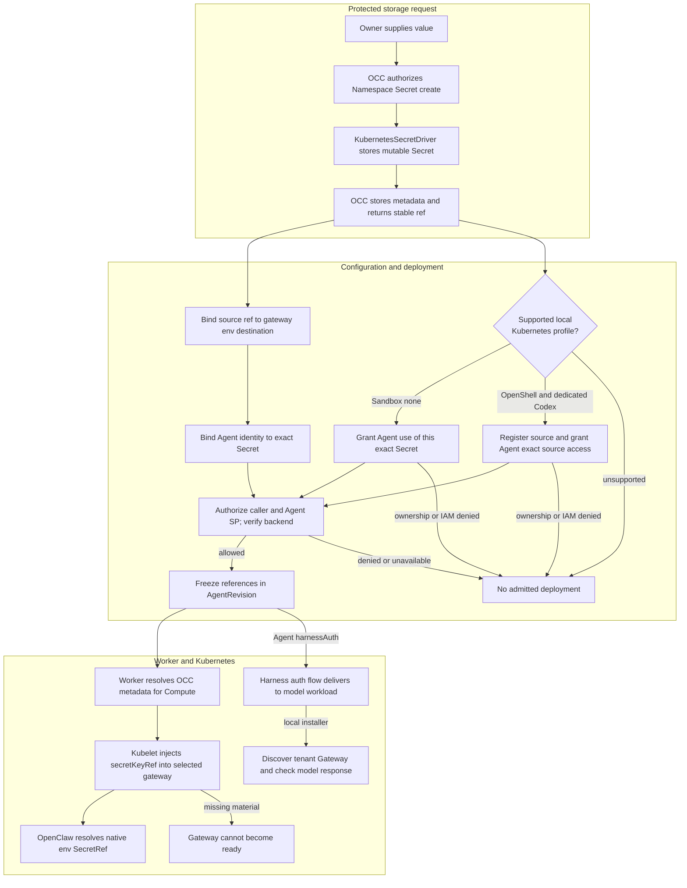

# Secret Storage and Gateway Delivery Flow

## Overview

An authorized owner stores a Namespace-owned Secret, binds its stable reference
in Configuration, grants and assigns an Agent, then deploys it. OCC admits
references; Kubernetes delivers values only to selected gateways. Harness model
authentication follows the [shared Agent binding flow](native-service-account-credential-delivery.md).
The local installer verifies a model response. Credential issuance and provider
internals are out of scope.

## Entry Points

`apps/controller/src/index.ts:createFastifyApp`

- `POST /namespaces/:namespaceId/secrets`: a ready Namespace and caller
  authorization to create the Secret in that Namespace.
- `GET /namespaces/:namespaceId/secrets`: metadata for readable Secrets.
- `GET /namespaces/:namespaceId/secrets/:secretId`: exact Secret metadata and
  readable consumer references.
- Configuration/Agent create or update and deployment: exact Secret and assignment
  authority, same-Namespace bindings, and approved Harness/Compute selection.
- Local installer: `scripts/first-agent.ts:main` uses the bootstrap service key.
- Source: [HTTP handlers](../../apps/controller/src/index.ts),
  [OpenClawController](../../packages/occ/src/controller.ts), and
  [KubernetesSecretDriver](../../apps/controller/src/drivers/secret/kubernetes/index.ts).
- The console and [OCC CLI](../guides/cli.md#provision-integration-secrets) write
  through OCC-authorized HTTP operations.

## Flow

## Execution Trace

### 1. Authorize storage without requiring a gateway

`packages/occ/src/secret-operations.ts:createSecret`

[createSecret](../../packages/occ/src/secret-operations.ts) accepts nonempty UTF-8
input up to 65,536 bytes. OCC checks Secret `create` before and after locking the
ready Namespace; no Agent is required. OCC generates the Secret ID, the selected
Driver supplies the backend reference, and the value stays in request and Driver memory.

### 2. Store material and commit safe identity

`apps/controller/src/drivers/secret/kubernetes/index.ts:KubernetesSecretDriver.create`

[KubernetesSecretDriver.create](../../apps/controller/src/drivers/secret/kubernetes/index.ts)
uses verified Compute-owned tenant placement to create a mutable Opaque Secret
with a Namespace-derived name, exact ownership metadata, and `value` key. It returns
backend identity, including UID. [OCC state](../../packages/occ/src/state/postgres-state.ts)
persists immutable Namespace, Driver, and backend metadata; public metadata omits
the locator and returns `{ kind: "secret", namespaceId, id }`.

A definite OCC transaction failure can compensate creation; an unknown commit
cannot. Failed creation removes the owned object by requested name; a confirmed
but refused create uses its returned UID and resourceVersion. No value journal
or automatic replay exists; pending creation can require operator recovery.

`privateSecretStore` conditionally removes confirmed but refused OAuth-client
creates. OCC retains the hidden registration and selected Driver until
`cleanupOAuthClients` confirms deletion or absence; private ownership checks and
unknown SQL outcomes remain unchanged. See
[private registration behavior](../reference/drivers/kubernetes-secret.md#installation-private-oauth-client-secrets).

Secret mutations use the 12-second Kubernetes budget for
[Configuration writes](configuration-driver/persistence-and-revisions.md). With
less than 2 seconds left, a write returns `503` unsent. Unsent creates need no
cleanup read; sent-create cleanup runs outside the budget.

### 3. Bind a source, then admit references

`packages/occ/src/agent-deployment-admission.ts:admitAgentDeployment`

Before deployment, an administrator grants the Agent's immutable
`servicePrincipalId` exact Secret `operate`. OCC checks Installation
administration, Namespace scope, and target access through the selected IAM Driver;
policy and audit commit together.

[createConfiguration and updateConfiguration](../../packages/occ/src/configuration-operations.ts)
store `secretBindings` separately from native `values`. Bindings select a
same-Namespace Secret and env destination; omitted delivery becomes `env`.
Unsupported sources, substitution modes, and reserved environment variables fail
closed. Create/update requires `operate` on every resulting binding, including
retained bindings when PATCH omits `secretBindings`.

[createAgent and updateAgent](../../packages/occ/src/agent-drafts.ts) require Agent
mutation permission and `operate` on each Secret in the selected Configuration.

[deployAgent](../../packages/occ/src/agent-deployment-admission.ts) checks `operate`
for both caller and Agent service principal on every Secret, then verifies live
backend identity through the API-side Driver. Namespace locking serializes binding
and admission against deletion. The Agent revision freezes normalized refs and
SecretDriver identity, without locators or values. Enabled channel environment
SecretRefs need matching bindings; disabled provider blocks do not.

Agent `harnessAuth` reserves model-auth destinations; Configuration bindings
cannot select or override model credentials in either topology.

### 4. Grant the first local Agent access to its model credential

`scripts/first-agent.ts:main`;
`scripts/first-agent.ts:assertManagedRevision`;
`internal/occdev/kubernetes.go:openShellInstallationConfiguration`;
`scripts/first-agent.ts:ensureModelCredentialGrant`

The [tool](../../scripts/first-agent.ts) requires this checkout's v3 Kubernetes
state and marker. Both Sandbox Drivers require the recorded HTTPS Console origin,
browser port, and Agent domain; OCC uses recorded loopback HTTP. Embedded
OpenClaw uses `sandboxDriver: "none"`; OpenShell requires `--harness codex`, and
`--control-ui` requires OpenShell. `loadLocalInstallation` uses the recorded Unix
socket and clears inherited Docker TLS settings before Compose queries the
controller port and PostgreSQL service. Before provisioning through OCC HTTP, the
tool checks Local Setup's privately saved authenticated Installation ID against OCC
and reads only `data.key` from the credential file. It creates the Secret, Configuration, and named Agent.
New Agents default to `openai/gpt-6-astra`; `OPENCLAW_FIRST_AGENT_MODEL` accepts
an authorized plain model ID. Reruns retain the choice and reject conflicts.

Without OpenShell, Namespace IAM grants the returned `servicePrincipalId` exact
`secret:operate`. The server resolves the caller from its key, authorizes, and
audits mutations. Reruns reuse exact bindings and check Role permissions, including
Roles left by failed bindings. Database access reads only existing Secret metadata.

With OpenShell, IAM grants exact `credential_source:operate` on a registered
`openai` or `codex-pat` CredentialSource, not Secret access. `--replace-key`
updates the Secret and requests a Credential Gateway reread before deployment.
The record rejects Harness or Sandbox Driver changes on reruns.
`scripts/first-agent.ts:withRecord` creates the PID lock and atomically
replaces the record; both use owner read/write mode `0600` regardless of umask. An existing lock stops execution
before record access or provisioning; the helper never reads or removes another
invocation's lock. Only exclusive creation registers cleanup, including on
initialization failure. Release failure reports the path and fails the command
without replacing the action error. A crash can leave a lock requiring
[inspected recovery](../guides/operate/local-setup-troubleshooting.md#first-agent-reports-an-existing-lock).
The helper closes the temporary record before rename and removes failed temporary
output without replacing the previous record.

The tool provisions credentials and requests OCC deployment. Reruns follow newer
revisions after drift checks; a stopped Agent fails with `occ agent deploy`.
Local OpenShell requires Driver-owned `/sandbox/enterprise` and frozen Codex
`sandbox: "danger-full-access"`, `approvalsReviewer: "user"` policy for API keys
and PATs. Earlier PAT revisions with `workspace-write` are recognized; new
deployments use current policy. Other workspace or Configuration drift fails.
After OCC selects the version, [findGateway](../../scripts/first-agent-model.ts)
uses `openclaw.dev/namespace`; both modes use one provider-owned Harness namespace.
It requires exact Agent labels, the revision ConfigMap mount, and a Running, Ready
Pod. `kubectl exec` sends the nonce and optional prompt to the type-stripped
verifier on stdin. A refusal-free reply must match the whole nonce after trimming whitespace,
removing one final period, and removing one quote pair, backtick pair, or multiline
fence. Custom answers remain verbatim. The key stays in the embedded OpenClaw
Gateway container or dedicated Codex Pod or Sandbox. Kubernetes Compute owns experimental
two-cluster placement; the helper ignores execution mode for placement.
`scripts/first-agent.ts:main` distinguishes credential rejection from policy refusal
before verification. See [deployment recovery](../guides/operate/local-setup-troubleshooting.md#first-agent-deployment-fails).
On model failure, the CLI prints the original error and [revision diagnostics](../../scripts/first-agent-diagnostics.ts).
The API resolves Kubernetes and OpenShell Harness ownership; changed Pod UIDs or
restart counts suppress log attribution. Diagnostics include container state,
admitted startup fields, and fixed Codex connection, fallback, and retry classes,
not free-form logs or provider bodies. Collection permits ten seconds, 64 KiB per
response, and two container streams per role. Same-stream gaps leave valid but
incomplete evidence. Missing or incomplete evidence preserves the original failure;
startup observations cannot establish cause. Installation resources remain on exit.

### 5. Render only the exact gateway's projection

`apps/controller/src/worker/revision-inputs.ts:createRevisionCredentialResolver`

Before preparation and activation, [ControllerWorker](../../apps/controller/src/worker.ts)
rechecks consumption authority and resolves OCC references into an ephemeral
`ComputeRevisionContext`. Backend metadata stays outside the Agent revision;
Compute reads and delivers the Secret.

[KubernetesComputeDriver.prepareRevision](../../apps/controller/src/drivers/compute/kubernetes/index.ts)
checks the Agent revision, source UIDs, projection identities, and verified storage
Namespace. Dedicated Gateways reference admitted canonical Secrets through
`env[].valueFrom.secretKeyRef` with `optional: false`, scoped to each consumer.
Agent `harnessAuth` supplies separate model-auth projections; ConfigMaps retain
native references only. Missing Secrets or keys prevent startup; readiness and
cutover control activation. Dispatch checks OCC metadata, and Compute rejects
replaced UIDs before delivery. Kubernetes references bind name and key, so
administrators remain trusted.

Embedded replacement stages an immutable ConfigMap even if the old gateway is
unhealthy. The worker commits the selected Agent revision, then activation replaces
the Deployment and checks readiness. An explicit corrected deployment can recover
from SecretRef startup failure; preparation does not prove runtime readiness.

Kubelet creates the process environment from Secret bytes. OpenClaw resolves its
native `{ source: "env", provider, id }` reference; OCC does not substitute text or
add a provider. Channel credentials use the admitted bindings, without legacy
per-Agent injection. Dedicated gateways receive channel bytes; the dedicated
Harness receives only separately admitted model authentication. Embedded channel
credentials remain unsupported.

The trusted worker reads canonical sources and manages Harness projections.
Workload ServiceAccounts have no Secret API verbs, but trusted workload writers
can project Namespace Secrets; workload isolation excludes controller compromise.

### 6. Update, restart, or remove

`packages/occ/src/secret-operations.ts:updateSecret`

[updateSecret](../../packages/occ/src/secret-operations.ts) serializes the write,
checks Kubernetes concurrency and ownership, and changes only the stored value.
The ref, Agent revisions, bindings, and running environments stay unchanged; the
controller does not restart gateways. Success proves storage, not delivery.

For channel replacement, stop the Agent, wait for shutdown, then update each
Secret. Partial updates leave it stopped until repair; no multi-Secret transaction
or byte rollback exists.

For model-key replacement, update the OCC Secret and explicitly deploy each
consumer through OCE. Preparation calls `KubernetesComputeDriver.deliverHarnessAuth`
to read the current canonical source and write the new Agent revision's DP Secret
before Harness startup. Wait for activation and verify a real model request before
revoking the old key upstream. A recreated Harness Pod reads its existing DP projection, not current source
values, even with unchanged Configuration and Secret refs.

Dedicated Gateway restarts read canonical channel Secrets directly. Failed cutover
does not restore source values. Revoking `operate` blocks new OCC admission, not
kubelet starts or delivered bytes.

Collection GET validates the exact Namespace identity, authorizes Namespace `read`,
resolves the Namespace, lists metadata, and filters by exact Secret `read` in one
State read. Detail GET authorizes the exact Secret before lookup, then enumerates
and authorizes names in its consumer page within that read. With PostgreSQL State
and Native IAM, authorization and metadata share a read-only, repeatable-read State unit.
A response can complete under its observed policy; a later request uses a fresh State read.

[deleteSecret](../../packages/occ/src/secret-operations.ts) rejects Configuration,
Agent harness-binding draft, selected version, and pending-work dependencies under
the same serialization boundary. `listReferences` returns at most 50, ordered by kind and ID.
`secretConsumers` checks each resource's `read`, names readable consumers in the
`409`, and counts the rest; `readSecret` returns the same `consumers` result.
Unreferenced deletion removes only the exact Namespace-owned backend and metadata.
Partial deletion can retry; missing or foreign objects cannot be adopted or
recreated. Gateway replacement does not collect Secrets. Immediate revocation
requires stopping workloads or revoking the credential at its issuer.

## Debugging and Verification

- Read public metadata without values. Authorized operators inspect ownership/UID
  metadata separately; never print `Secret.data`, full environments, or
  credential-bearing requests.
- Storage does not require a ready gateway or prove delivery. Compare Agent
  revision/Pod identities and use noncredential sentinels for restart assertions.
- Resolve reported locks before rerunning the same Agent name. Agent and Agent
  revision IDs print only after the model responds.
- Source selection, exact Namespace ownership, consumption authorization, missing
  material, and concurrent backend mutations fail closed. Do not retry a denial
  against another driver or model-key source.
- [Real Agent acceptance](../../tests/integration/harness-topology-k3d-real.test.mjs)
  requires explicitly selected PostgreSQL/Kubernetes, digest-pinned real runtime
  images, and an authorized model key. It must prove the native-ref negative control,
  genuine turn, and env restart behavior; mocked rendering is not that proof.
- For implementation changes, run focused conformance, API, startup, Helm,
  PostgreSQL Secret-state, real Compute, and real Agent suites. Report missing
  credentials, infrastructure, or runtime hooks as gaps; mocked rendering cannot
  replace them.

## Related docs

- [SecretDriver implementation specification](../../specs/.archive/14-secret-driver.md)
- [Secret access architecture](../design/safeguards.md#secret-access)
- [Kubernetes deployment](../guides/deploy.md)
- [Set up an OpenShell Codex Agent](../guides/deploy/local-setup.md)
- [Configuration](../reference/configuration.md)
- [Kubernetes Secret Driver](../reference/drivers/kubernetes-secret.md)

## Manual Notes

[keep this for the user to add notes. do not change between edits]

## Changelog

- 2026-11-21 16:05: Allow simple formatting in assistant nonce proof. (authoring-run/1065fff4-04fa-4b9e-b140-4ed9dbdde80f - ff770f5bef21b30cc12018e776add31a606d6f0d)

- 2026-11-20 19:04: Refresh sources. (authoring-run/8a8bde8b-71de-4de5-80bf-e32f0e335c34 - 220f62d86ceb3dfc6f66dbee7c6f86cda50e5d05)
- 2026-11-20 16:35: Point Configuration binding writes to their OCC module. (authoring-run/a6c7283a-ee8f-4603-ad88-67df4c2f9eea - 81cdb33c3d2d2ba64dfd783b0216b5dbcfebe395)
- 2026-11-20 16:31: Update OCC Secret operation source pointers. (authoring-run/458791ca-cb2c-4838-b771-39a35c8aa29c - 8eb97c71e0aa0b84779e19f9bbacc2d37f22fa14)
- 2026-11-16 14:46: Bind the first-Agent helper to confirmed Installation state and use authenticated IAM operations for exact model credential grants. (authoring-run/c2d26d3b-d809-484b-b391-f6736ce6c822 - 6255bbe8fe564e52941b311a7ce8ce8699d1f236)

- 2026-11-11 08:41: Compensate confirmed but refused Installation-private Secret creation without changing ordinary ownership or cleanup custody. (authoring-run/ed486d39-4be4-45b1-a9ac-46e7f93d38bc - 228632a152f96c22a4d7c9aa7554c6ba22911bd4)

- 2026-11-10 17:23: Require inspected recovery for existing first-Agent locks; preserve creator-only cleanup. (authoring-run/d6e637ad-6f81-4bcd-9a8e-c6bc1e9bff7b - 6e4cf8ff54412aa15773039ffc471e029a8dbfa8)

- 2026-11-10 12:13: Distinguish first-Agent deployment policy refusal, authentication failure, and other failure advice. (authoring-run/c16642a2-889c-409e-833b-d6afc7957d68 - 3c5686897dcb09293562aa30d1a2cecaacc71353)
- 2026-11-09 22:31: Document bounded first-Agent failure evidence, fixed diagnostic classifications, and exact Gateway stream ownership. (authoring-run/9e4bd520-55c8-4edd-bde2-4c149544135a - 3eae65fcdfe89b0ee7c1d6eaf757c8dddcdfefb9)
- 2026-11-09 13:02: Require current Local Setup browser settings independently of the Sandbox Driver in the accompanying first-Agent fix. (authoring-run/4c855680-1f37-4507-8ded-fa8be08d1be2 - 8adaa729fa03df318246a2ba3318aae51c603f8d)

- 2026-11-01: A Secret create refused as not sent runs no cleanup read and keeps its `503`. (fix-3108, finding 3108)

- 2026-11-01 08:10: Secret create, update and delete send no Kubernetes call after the 12-second write budget. (fix-3106b, finding 3106)

- 2026-10-29 19:38: Keep local first-Agent records owner-readable under restrictive umasks. (authoring-run/d5feb6ab-c39d-4b0f-9af9-d6aec0acfb42 - cadab7afee966df8ff7a13250df443404ae76314)

- 2026-10-16 01:36: Combine the OpenShell workspace guard with credential-independent Codex permissions. (authoring-run/3cfe533a-7ff7-4f25-ba91-7a0fc8bc35b6 - 5af46154157b7da222e2dd9839fd1bcb741c3056)

- 2026-10-16 00:10: Align the first-Agent revision guard with the selected OpenShell workspace while preserving exact drift checks. (01a11d95-ebef-76e1-b9b9-9d3d2e88e99e - 22e779fab82cccc65cadf5b518a881278f2f62f9)

- 2026-10-15 09:40: Align first-Agent revision validation with OpenShell full access for API-key and PAT sources. (authoring-run/7eb24321-3670-4154-adde-41a0f1b36728 - 7d777fb82e9af717fe40c46b6602df9851ec519e)

- 2026-10-13 15:07: Align the first-Agent revision check with OpenShell's explicit user approval reviewer in the accompanying helper fix. (authoring-run/503e74ea-e82a-4d1a-8081-fcf4fc4e6868 - 05a515c7f57faf3a870b7265b2792c407c0c4305)

[Secret storage and delivery documentation history](secret-storage-and-delivery/history.md) preserves the older dated entries.
