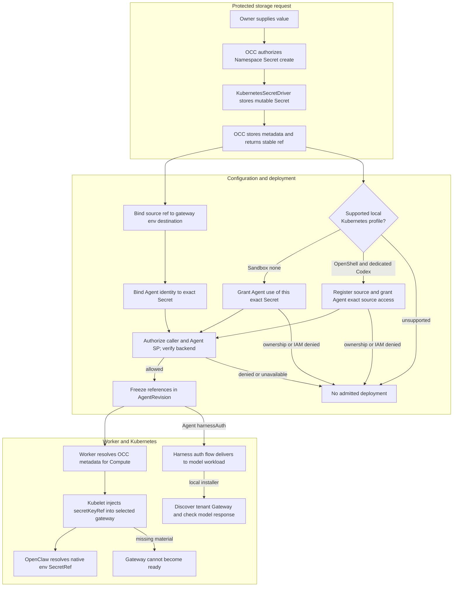

# Secret Storage and Gateway Delivery Flow

## Overview

An authorized owner stores a Namespace-owned Secret before any Agent exists,
binds its stable reference in Configuration for gateway delivery, then grants, assigns
and deploys a consuming Agent. For these Configuration bindings, OCC admits
references and Kubernetes supplies values only to each selected gateway.
Harness model authentication uses the
[shared Agent binding flow](native-service-account-credential-delivery.md).
The local installer also grants a new Agent access and verifies a model response.
Credential issuance and provider internals are outside this flow.

## Entry Points

`apps/controller/src/index.ts:createFastifyApp`

- `POST /namespaces/:namespaceId/secrets`: a ready Namespace and caller
  authorization to create the Secret in that Namespace.
- Configuration create/update, Agent create/update assignment, and the existing
  Agent deployment action: authorized exact Secret references, same-Namespace
  bindings, exact Agent assignment authority, and an approved Harness/Compute
  selection.
- Local installer: `scripts/first-agent.ts:main` uses the bootstrap service key.
- Source: [HTTP handlers](../../apps/controller/src/index.ts),
  [OpenClawController](../../packages/occ/src/index.ts), and
  [KubernetesSecretDriver](../../apps/controller/src/drivers/secret/kubernetes/index.ts).
- The console and [OCC CLI](../guides/cli.md#provision-integration-secrets)
  call these HTTP operations. They initiate OCC-authorized mutations; neither
  writes directly to SQL, Kubernetes, or credential backends.

## Flow

## Execution Trace

### 1. Authorize storage without requiring a gateway

`packages/occ/src/index.ts:OpenClawController.createSecret`

[OpenClawController.createSecret](../../packages/occ/src/index.ts) validates
nonempty UTF-8 input of at most 65,536 bytes and locks the Namespace. The caller needs `create`
on the Namespace's Secret collection. The Namespace must already be ready; an
Agent record does not need to exist. OCC selects the
Installation SecretDriver, generates the Secret identity, and prevents the
caller from choosing Kubernetes backend identity. The value stays in protected
request/driver memory, never in the reconciliation queue or resource metadata.

### 2. Store material and commit safe identity

`apps/controller/src/drivers/secret/kubernetes/index.ts:KubernetesSecretDriver.create`

[KubernetesSecretDriver.create](../../apps/controller/src/drivers/secret/kubernetes/index.ts)
uses Compute-owned verified tenant storage placement. It creates a mutable Opaque Secret with
a Namespace-derived name, exact Namespace ownership metadata, and a fixed
`value` key. Its result contains only backend identity, including UID. [OCC state](../../packages/occ/src/state/postgres-state.ts)
persists immutable Namespace, driver, and backend metadata while public metadata
omits the backend locator and returns `{ kind: "secret", namespaceId, id }`.

A definite OCC transaction failure can compensate the created object; an unknown
commit cannot. A failed create deletes the owned object under its requested name.
A successful but refused create uses the returned UID and resourceVersion.
There is no value journal or automatic replay; a pending create can require
operator recovery.

`privateSecretStore` applies the same conditional removal to confirmed but
refused OAuth-client creates. OCC keeps the hidden registration and selected
Driver until `cleanupOAuthClients` confirms deletion or absence. Ordinary private
ownership checks and unknown SQL outcomes remain unchanged. See
[private registration behavior](../reference/drivers/kubernetes-secret.md#installation-private-oauth-client-secrets).

Secret mutations share the 12-second Kubernetes budget of
[Configuration writes](configuration-driver/persistence-and-revisions.md).
A write needs at least 2 seconds remaining; otherwise it returns `503` without
being sent. Cleanup for a sent create runs outside that budget. A create refused
before sending needs no cleanup read.

### 3. Bind a source, then admit references

`packages/occ/src/index.ts:OpenClawController.deployAgent`

The Agent response exposes its immutable `servicePrincipalId`. An administrator
grants that identity `operate` on the exact Secret before deployment. OCC checks
Installation administration, Namespace scope, and target access through the
selected IAM Driver; policy and audit commit together.

[createConfiguration and updateConfiguration](../../packages/occ/src/index.ts)
keep `secretBindings` in OCC metadata, separate from native `values`. Each binding
has a Secret source and an env delivery destination; omitted delivery normalizes
to `env`. Unsupported sources, substitution modes, and reserved environment
variables fail closed. All sources must belong to the same Namespace as the
Configuration. A Configuration create/update whose resulting document contains
bindings requires `operate` on every selected Secret, including retained bindings
when PATCH omits `secretBindings`.

[createAgent and updateAgent](../../packages/occ/src/index.ts) require the normal
Agent mutation permission plus `operate` on each exact Secret when selecting a
Configuration with bindings.

[deployAgent](../../packages/occ/src/index.ts) separately authorizes the deploying
caller and consuming Agent service principal to `operate` every Secret, then
checks live backend identity through the API-side driver. Namespace locking
serializes binding/admission changes against deletion. Admission freezes
normalized refs and the selected SecretDriver identity, not backend locators or
values, in the Agent revision. Enabled native channel environment SecretRefs must have
matching bindings at admission; disabled channel provider blocks do not require
them.

Model-auth environment destinations are reserved for Agent `harnessAuth`;
Configuration bindings cannot select or override model credentials in either
execution topology.

### 4. Grant the first local Agent access to its model credential

`scripts/first-agent.ts:main`;
`scripts/first-agent.ts:assertManagedRevision`;
`internal/occdev/kubernetes.go:openShellInstallationConfiguration`;
`scripts/first-agent-database.mjs:grantFirstAgentSecret`

The [tool](../../scripts/first-agent.mjs) uses the persistent `./bin/occ dev up`
installation. Before Kubernetes or OCC calls, it requires same-checkout v3
Kubernetes development state and marker. Both Sandbox Drivers require the
recorded canonical HTTPS Console origin, browser port, and cluster Agent domain.
API requests use the recorded loopback HTTP endpoint. With `sandboxDriver: "none"`,
the helper defaults to embedded OpenClaw. Use `--harness codex` for dedicated Codex.
OpenShell requires `--harness codex`, and `--control-ui` requires OpenShell.
`scripts/first-agent.ts:loadLocalInstallation` selects the recorded Unix socket
and removes inherited Docker TLS settings. Compose queries the recorded
controller port and PostgreSQL service without another daemon's certificates.
With the [bootstrap service key](../../packages/iam/src/index.ts), it creates a
Secret, Configuration, and named Agent through the OCC HTTP API. A new Agent uses
`openai/gpt-6-astra` unless `OPENCLAW_FIRST_AGENT_MODEL` selects another authorized
plain model ID; a repeat without an override keeps the recorded model, and a
conflicting override is rejected. Bootstrap already has Secret `operate`; the
Agent does not.

Without OpenShell, the tool opens the recorded local PostgreSQL service. One
transaction verifies the Namespace, Agent, and Secret, then grants the Agent's
existing principal `operate` on that exact Secret. It verifies the bootstrap
identity, honors IAM restrictions, and audits a new grant.

With OpenShell, the tool registers the Secret as an `openai` or `codex-pat`
CredentialSource and uses the public Namespace IAM API to grant the Agent principal exact
`credential_source:operate`. It does not grant Secret access. `--replace-key`
updates the Secret and asks the Credential Gateway to reread it before deploying
a new version. The private helper record freezes the Harness and Sandbox Driver
choices so a rerun cannot silently change topology.
`scripts/first-agent.ts:withRecord` creates the PID lock and atomic record
replacement with explicit owner read/write mode `0600`, independent of the
process umask. An existing lock stops the command before record access or
provisioning; the helper neither reads nor removes another invocation's lock.
Only successful exclusive creation registers cleanup, including initialization
failures. A release failure reports the lock path and sets a failing exit status
without replacing the original action error. A crash can leave a lock that needs
[inspected recovery](../guides/operate/local-setup-troubleshooting.md#first-agent-reports-an-existing-lock).
The helper closes the temporary record before renaming and removes a failed
temporary output without replacing the previous record.

The tool provisions runtime credentials and requests deployment through OCC.
Reruns follow newer revisions after drift checks. A stopped Agent fails immediately
with the `occ agent deploy` command. Local OpenShell requires the Driver-owned
`/sandbox/enterprise` workspace and frozen Codex policy: `sandbox: "danger-full-access"`
and `approvalsReviewer: "user"` for API-key and PAT sources. Prior PAT revisions
with `workspace-write` are recognized; new deployments use current policy.
Other workspace or Configuration differences fail drift checks.
After OCC selects the version, [`findGateway`](../../scripts/first-agent-model.mjs)
resolves `openclaw.dev/namespace`. In this single-cluster setup, embedded and
dedicated Gateways share the provider-owned Harness namespace. It requires exact Agent
labels, the revision ConfigMap mount, and a Running, Ready Gateway Pod before
sending the prompt. Embedded OpenClaw requires the key in the Gateway container;
dedicated Codex keeps it in its Pod or Sandbox. Experimental two-cluster placement
belongs to Kubernetes Compute; this helper never infers placement from execution mode.
`scripts/first-agent.ts:main` distinguishes credential rejection from policy refusal
when reporting failed deployment, before model verification. See [deployment recovery](../guides/operate/local-setup-troubleshooting.md#first-agent-deployment-fails).
After a model failure, the CLI prints the original error, then a
[diagnostic snapshot](../../scripts/first-agent-diagnostics.ts) from revision-scoped
runtime status and logs. The API resolves Kubernetes and OpenShell Harness
ownership. Changed Gateway Pod UID or restart count suppresses log attribution.
Output includes container state, admitted startup fields, and fixed Codex connection,
fallback and retry classifications; never free-form logs or provider bodies.
Collection permits ten seconds, 64 KiB per response, and two container streams per
role. Same-stream gaps retain valid observations but mark evidence incomplete.
Missing or incomplete evidence preserves the original failure; startup observations
do not establish the failed request's cause.
The tool retains installation resources on exit.

### 5. Render only the exact gateway's projection

`apps/controller/src/worker.ts:ControllerWorker.resolveRevisionSecretContext`

[ControllerWorker](../../apps/controller/src/worker.ts) rechecks
consumption authority and resolves Agent revision refs from OCC metadata before each
preparation and activation. It passes an ephemeral `ComputeRevisionContext`; it
does not add backend metadata to the Agent revision. Its Compute Driver performs
the physical Secret reads and scoped runtime delivery.

[KubernetesComputeDriver.prepareRevision](../../apps/controller/src/drivers/compute/kubernetes/index.ts)
checks the Agent revision, source UIDs, projection identities and verified storage Namespace.
Dedicated Gateways directly reference admitted canonical Secrets. It renders `env[].valueFrom.secretKeyRef` with `optional: false` only in each
selected consuming gateway. Model-auth projections are prepared separately from
Agent `harnessAuth`. ConfigMaps retain native references only. A missing
Secret/key prevents startup; normal readiness and cutover rules still control
activation. Dispatch checks OCC metadata; Compute also rejects a replaced source UID before
delivery. Kubernetes environment references themselves bind a name and key, so
Kubernetes administrators remain trusted.

For an embedded replacement, preparation stages its immutable ConfigMap without
requiring the old gateway to be healthy. The worker commits the selected Agent revision
before activation replaces the gateway Deployment and checks readiness. This lets
an explicit corrected deployment recover from a native SecretRef startup failure;
preparation alone is not proof that the replacement runtime is ready.

Kubelet obtains the bytes and creates the process environment. OpenClaw resolves
its existing `{ source: "env", provider, id }` reference. This is the handoff to
the native consumer, not a new OpenClaw provider or OCC text-substitution engine.
Native channel credentials follow these same admitted bindings. No legacy
per-Agent channel Secret injects additional values. Dedicated gateways receive
channel bytes; the dedicated Harness receives only its separately admitted model
authentication. Embedded channel credentials remain unsupported.

The trusted worker reads canonical sources and manages Harness runtime projections; workload
ServiceAccounts have no Secret API verbs. A trusted workload writer can still
project namespace Secrets, so controller compromise remains outside workload isolation.

### 6. Update, restart, or remove

`packages/occ/src/index.ts:OpenClawController.updateSecret`

[updateSecret](../../packages/occ/src/index.ts) serializes the write and uses
Kubernetes concurrency/ownership checks. It changes only the stored value; the
response retains the same ref. No Agent revision, binding, or running environment is
updated, and no controller automatically restarts the gateway. A successful update
means stored, not delivered.

For coordinated channel replacement, stop the Agent and wait for shutdown before
updating each Secret. A partial update leaves it stopped until repaired; there is
no multi-Secret transaction or rollback of stored bytes.

For model-key replacement, update the OCC Secret and explicitly deploy each
consuming Agent through OCE. The new Agent revision's preparation calls
`KubernetesComputeDriver.deliverHarnessAuth`, which reads the current canonical source
and writes the DP Secret for that Agent revision before the Harness starts. Wait for
activation and verify a real model request before revoking the old key upstream.
A Harness Pod recreation reads its existing DP projection; it does not deliver
current source values. This remains true when the Configuration and Secret reference
are unchanged.

Dedicated Gateway infrastructure restarts read canonical channel Secrets
directly. Failed cutover does not restore old source values. Revoking `operate`
blocks new OCC admission, not kubelet process starts or already delivered bytes.

[deleteSecret](../../packages/occ/src/index.ts) rejects current Configuration,
Agent harness-binding draft, selected version, and pending-work dependencies under the same serialization
boundary. One `listReferences` query returns at most 50 of them, ordered by kind and ID;
`secretConsumers` checks `read` on each referencing resource, names the readable ones in
the `409`, and counts the rest. `readSecret` returns the same result as `consumers`.
Once unreferenced, it deletes only the exact Namespace-owned backend and metadata.
A partial delete can retry; missing or foreign objects cannot be
adopted or recreated. Gateway replacement does not garbage-collect
Secrets, so immediate revocation requires stopping workloads or revoking the
credential at its issuer.

## Debugging and Verification

- Read public Secret metadata without requesting or dumping values. Inspect safe
  ownership/UID metadata separately as an authorized operator; do not print
  `Secret.data`, complete process environments, or credential-bearing requests.
- A stored Secret with no ready gateway is valid. Update success does not imply
  delivery. Compare Agent revision/Pod identities and use noncredential sentinel values
  for restart assertions.
- On local failure, resolve any reported lock before rerunning with the same
  Agent name. Agent and Agent revision IDs print only after the model responds.
- Source selection, exact Namespace ownership, consumption authorization, missing
  material, and concurrent backend mutations fail closed. Do not retry a denial
  against another driver or model-key source.
- [Real Agent acceptance](../../tests/integration/harness-topology-k3d-real.test.mjs)
  requires explicitly selected PostgreSQL/Kubernetes, digest-pinned real runtime
  images, and an authorized model key. It must prove the native-ref negative control,
  genuine turn, and env restart behavior; mocked rendering is not that proof.
- Run focused conformance, API, startup, Helm, PostgreSQL Secret-state, real
  Compute, and real Agent suites when changing this flow's implementation. State
  skipped credentials, infrastructure, or runtime hooks as verification gaps
  rather than replacing them with mocked rendering.

## Related docs

- [SecretDriver implementation specification](../../specs/.archive/14-secret-driver.md)
- [Secret access architecture](../design/safeguards.md#secret-access)
- [Kubernetes deployment](../guides/deploy.md)
- [Set up an OpenShell Codex Agent](../guides/deploy/local-setup.md)
- [Configuration](../reference/configuration.md)
- [Kubernetes Secret Driver](../reference/drivers/kubernetes-secret.md)

## Manual Notes

[keep this for the user to add notes. do not change between edits]

## Changelog

- 2026-11-11 08:41: Compensate confirmed but refused Installation-private Secret creation without changing ordinary ownership or cleanup custody. (authoring-run/ed486d39-4be4-45b1-a9ac-46e7f93d38bc - 228632a152f96c22a4d7c9aa7554c6ba22911bd4)

- 2026-11-10 17:23: Require inspected recovery for existing first-Agent locks; preserve creator-only cleanup. (authoring-run/d6e637ad-6f81-4bcd-9a8e-c6bc1e9bff7b - 6e4cf8ff54412aa15773039ffc471e029a8dbfa8)

- 2026-11-10 12:13: Distinguish first-Agent deployment policy refusal, authentication failure, and other failure advice. (authoring-run/c16642a2-889c-409e-833b-d6afc7957d68 - 3c5686897dcb09293562aa30d1a2cecaacc71353)
- 2026-11-09 22:31: Document bounded first-Agent failure evidence, fixed diagnostic classifications, and exact Gateway stream ownership. (authoring-run/9e4bd520-55c8-4edd-bde2-4c149544135a - 3eae65fcdfe89b0ee7c1d6eaf757c8dddcdfefb9)
- 2026-11-09 13:02: Require current Local Setup browser settings independently of the Sandbox Driver in the accompanying first-Agent fix. (authoring-run/4c855680-1f37-4507-8ded-fa8be08d1be2 - 8adaa729fa03df318246a2ba3318aae51c603f8d)

- 2026-11-01: A Secret create refused as not sent runs no cleanup read and keeps its `503`. (fix-3108, finding 3108)

- 2026-11-01 08:10: Secret create, update and delete send no Kubernetes call after the 12-second write budget. (fix-3106b, finding 3106)

- 2026-10-29 19:38: Keep local first-Agent records owner-readable under restrictive umasks. (authoring-run/d5feb6ab-c39d-4b0f-9af9-d6aec0acfb42 - cadab7afee966df8ff7a13250df443404ae76314)

- 2026-10-16 01:36: Combine the OpenShell workspace guard with credential-independent Codex permissions. (authoring-run/3cfe533a-7ff7-4f25-ba91-7a0fc8bc35b6 - 5af46154157b7da222e2dd9839fd1bcb741c3056)

- 2026-10-16 00:10: Align the first-Agent revision guard with the selected OpenShell workspace while preserving exact drift checks. (01a11d95-ebef-76e1-b9b9-9d3d2e88e99e - 22e779fab82cccc65cadf5b518a881278f2f62f9)

- 2026-10-15 09:40: Align first-Agent revision validation with OpenShell full access for API-key and PAT sources. (authoring-run/7eb24321-3670-4154-adde-41a0f1b36728 - 7d777fb82e9af717fe40c46b6602df9851ec519e)

- 2026-10-13 15:07: Align the first-Agent revision check with OpenShell's explicit user approval reviewer in the accompanying helper fix. (authoring-run/503e74ea-e82a-4d1a-8081-fcf4fc4e6868 - 05a515c7f57faf3a870b7265b2792c407c0c4305)

[Secret storage and delivery documentation history](secret-storage-and-delivery/history.md) preserves the older dated entries.
