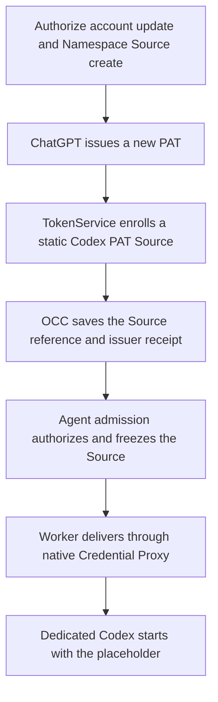

# Service Account Driver Credential Delivery Flow

OCC creates the provider account and issues its Codex PAT in separate
operations. The selected TokenService stores the PAT as a static Source.
The ServiceAccount Driver records the provider credential ID for revocation.
The Agent receives a Proxy placeholder tied to the Source.

## Entry Points

- Create the account with `POST /namespaces/:namespaceId/service-accounts`.
- Issue the PAT with `POST /namespaces/:namespaceId/service-accounts/:id/credentials`.
- Bind the returned Source to the Agent and deploy through the ordinary Agent API.

## Flow

## Issue and store the PAT

The API composes the selected ChatGPT ServiceAccount Driver with the Backend
client and mounted admin key. Account creation stores the exact upstream
account, workspace and Driver in a private binding. The Worker has only
nonsecret Backend configuration.

[Account operations](../../packages/occ/src/service-account-operations.ts)
check the exact account update grant, the Namespace Source create grant,
Namespace readiness and selected TokenService support before minting.
The [ChatGPT Driver](../../apps/controller/src/drivers/service-account/chatgpt.ts)
passes the fresh bearer in-process to the selected TokenService, which commits
static `codex-pat` custody in its own Namespace transaction. OCC checks the
returned ready Source, binds the creator's Source grants, and saves the account's `credentialSourceId` and issuance audit. If enrollment or finalization fails
with a known outcome, the Driver revokes the exact new issuer credential and
OCC cleans up the unfinished Source when one was enrolled.

## Bind the Source and deploy

The Agent saves `harnessAuth: { method: "credential_source", sourceId }`.
Admission and the Worker authorize that Source and use the ordinary
[native credential delivery flow](credential-source-lifecycle.md).
Dedicated Codex uses the PAT login mode and a Credential Proxy placeholder.
Only configured HTTPS requests from the admitted Codex executable qualify for
substitution.

## Revoke and retire

Deleting the ServiceAccount revokes the exact issuer credential and removes
the upstream account. A saved Source binding can still exist on the Agent.
Withdraw or retire the Source separately through the ordinary Source API.

## Verification

Run the focused ServiceAccount issuance test in the `postgres-platform` lane.
It covers the real account route and selected TokenService with a controlled
issuer. Use the [native Agent verification](../testing/manual-tests.md) for
a model turn in an installed runtime.

## Manual Notes

[keep this for the user to add notes. do not change between edits]

## Changelog

- 2026-11-25 06:40: Record the issued Source directly on the ServiceAccount. (authoring-run/4d9407a1-7805-45fe-a064-3c6084ef4a36 - a6321ae62c96d1a56154d82755e21eeea83ffc5b)

- 2026-11-20 19:04: Refresh sources. (authoring-run/8a8bde8b-71de-4de5-80bf-e32f0e335c34 - 220f62d86ceb3dfc6f66dbee7c6f86cda50e5d05)
- 2026-11-20 16:54: Point to Agent draft operations. (authoring-run/1d1eaa12-f12f-4086-bf6e-c99b882c7f39 - 193c5644e642321ea5c5f626cdf1d49729637cab)

- 2026-11-20 16:31: Update OCC ServiceAccount operation source pointers. (authoring-run/458791ca-cb2c-4838-b771-39a35c8aa29c - 8eb97c71e0aa0b84779e19f9bbacc2d37f22fa14)
- 2026-11-11 02:28: Confirm exact Secret readback and revoke provider credentials before deleting failed-issuance recovery receipts. (authoring-run/18242737-895e-484c-a1a9-29c2cd289d43 - 7fed115af7b57060bba5c6e276ad4cf316b9b58d)
- 2026-11-04 09:42: Remove the retired hosted Provider Account test from verification instructions; retain service-account implementation coverage. (authoring-run/390095eb-01a9-4e24-b609-791b49f19f81 - e2311f4d2250874d622ab12c2fe8588a076bd19b)
- 2026-10-15 05:30: Issuance and account deletion reclaim the token Secret and provider credential of an issuance that never committed. (fix-1397, finding 1397)
- 2026-10-14 18:44: Cancel oversized chunked ChatGPT Admin API responses while reading, before complete buffering. (issue-2411 - 1dae0cc9b76f034f5ca8e1ff500c9b545aa44501)

- 2026-10-09 18:30: `DELETE ...?force=true` removes an account whose issued token no ChatGPT Backend can revoke, deletes its token Secret, and audits the token as unrevoked; with a Backend configured, force is ignored. (q33-force-delete, finding 835)
- 2026-10-08 17:45: Deleting an account that holds an issued access token, with no ChatGPT Backend, answers `409 SERVICE_ACCOUNT_DRIVER_NOT_CONFIGURED` naming the fix instead of a generic `503`. (fix-816-819)
- 2026-10-08 13:00: Issuance, and deploying an account without an access token, on an Installation with no ChatGPT Backend answer `409 SERVICE_ACCOUNT_DRIVER_NOT_CONFIGURED` naming the fix instead of a generic `503` or `409`. (fix-780-781/d540)

- 2026-10-07 12:07: Unify imported and managed PAT authentication while preserving source ownership and existing OAuth behavior. (01a0e5ec-d802-7800-9eb6-8022c1ac0d06 - be5006e62)

- 2026-10-05 20:51: Trace rejected Backend HTTP response disposal and native HTTPS recovery coverage. (c0a8f27c-4c0f-42ed-b6e8-be41aff648c7 - b5b3ba296f38dd5090c1f4bb1287ed87ae3f9eba)

- 2026-09-23 12:22: Move canonical credential sources to CP and describe revision-scoped Harness delivery in the accompanying change. (codex/01a0cf72-6985-7712-ba92-d8cc32470f24 - 623d56dec26a8ef0f72b562254687cabecdbbf82)

- 2026-09-17 00:31: Align credential selection and delivery with Agent harnessAuth and the shared Kubernetes rendering path. (01a0acc2-a404-77e3-b1a0-9fa4ffbbdb04 - d2bcbd1c53acb2582a774b5158f254d726abd33f)

- 2026-09-01 19:09: Merged Provider and Driver lifecycle details into the managed credential delivery flow, including nullable Agent Provider references and worker metadata checks. (01a05f95-dd80-7011-990f-d1c46b5bb3cc - aa366c49c44834d59f74994c5fd37fb8096f169f)
- 2026-09-01 08:47: Trace Provider membership, API-only client injection, and persisted ownership checks. (01a05d97-f2b0-71d0-bfc3-01ee7d6d58f9 - b079c4b755ef336a9c65bb4eb737e3aedbfdaa7d)

- 2026-08-28 17:58: Updated moved feature-reference links for the documentation organization. (01a036f4-cf1d-7cc1-bbc1-000879038ac8 - 4270aa29b7015562049f46c6027962fd85b584a9)
- 2026-08-24 23:35: Documented API-only provider integration, private transactional account and credential bindings, scoped Kubernetes Secret ownership, immutable account association, dedicated Codex token login, compensation boundaries, and genuine provider-backed verification. (01a03542-30ff-77a1-9967-587d55548ace - 51033bee121374332df2791e90e2290a5c892e5d)
- 2026-08-25 00:27: Consolidated the execution trace around the direct Driver-owned binding and shared API initialization while preserving security, rollback, and verification boundaries. (01a03542-30ff-77a1-9967-587d55548ace - 96a841f)
- 2026-08-25: Consolidated repeated implementation and security detail into the canonical service-account and security guides.
