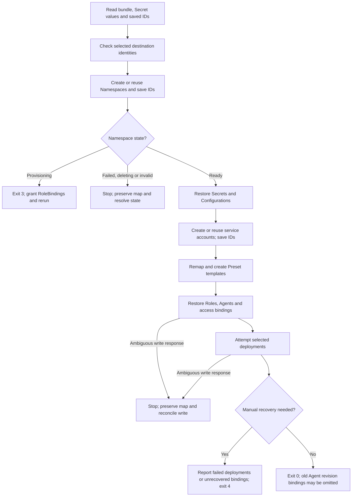

# Tenant restore flow

## Overview

The split-layout migration helper re-creates exported tenants through the OpenClaw
Control Plane (OCC) API. It records new resource IDs so an interrupted import can
resume. This flow starts at import and ends with the import result; it does not
cover storage adoption, external credential issuance, or workspace recovery.

## Entry Points

- Trigger: an administrator runs `node scripts/split-layout-tenants.ts import`
  with an exported bundle, Secret values, and a saved-map path.
- Source: `scripts/split-layout-tenants.ts:main` and
  `scripts/split-layout-tenants.ts:importTenants`.
- Assumptions: the operator has completed the export and upgrade procedure,
  selected separate destination Namespaces, and can create their tenant resources.

## Flow

## Execution Trace

### 1. Select destinations and wait for readiness

`scripts/split-layout-tenants.ts:importTenants`

Successful responses require the OCC `data` and request metadata envelope without
an `error` field. The client does not follow HTTP redirects, so a redirect cannot
replay a credentialed request. Collection reads must return an array in `data`. A successful HTTP status with
a non-array collection stops the import at that read; it is not an empty
Namespace inventory. The error reports a bounded request path, not response content.
Keep the original bundle and map, if present. Correct the OCC endpoint and
reconcile any earlier writes before resuming the original operation. This check
also applies to export and discard; do not blindly retry a partially completed
operation. Exact resource reads with unreadable saved settings and bundles missing
required restoration fields are refused. Credential sources need a type; Roles
need permissions. OCC still validates the submitted configuration and grants.
Workspace export accepts only the requested file's validated response. Only a
verified OCC `404 NOT_FOUND` means absent; all other unreadable responses remain
recorded so discard requires the explicit unread-workspace override.
Discard validates every collection and deletion ID before its first DELETE,
then uses the precomputed paths. Each ID must survive URL encoding as one exact
segment; dot segments and unencodable text are refused. Opaque IAM IDs retain
their 1–200-code-point contract, without trimming whitespace. Invalid private JSON is reported by input
name without quoting its contents.

The importer rejects duplicate source Namespace IDs across the whole bundle,
including skipped tenants, before any request or map save. Its flat ID map also
refuses defining source IDs shared across resource kinds or Namespaces, including
skipped tenants whose mappings may remain from an earlier run;
ordinary references to one identity may repeat. Discard applies the same check
before any request, preserving resources the importer cannot restore. Export
still preserves those opaque identities for recovery. It checks required
Secret values and refuses selected sources that share a destination name or
saved destination ID. Saved destinations remain
reserved even when their sources are skipped. Every saved ID must be a nonempty
string before any API request. It creates missing Namespaces or
reuses eligible empty ones, records each ID, and waits for readiness. Pending
provisioning Namespaces return an incomplete result; `main` exits 3 without
importing children. Failed, deleting, or invalid Namespace states stop the import
with the saved map preserved.

### 2. Restore dependencies before Preset templates

`scripts/split-layout-tenants.ts:importTenants`

The importer creates or reuses named resources and saves mappings after each
accepted create. Configurations follow Secrets and credential sources. Service
accounts follow Configurations and precede Presets, so their new IDs exist when
`remap` rewrites a Preset's Harness authentication source. A released
`chatgpt_service_account` selection first becomes `codex_pat` with a
`service_account` source. Both its Namespace and account ID are remapped.
A service-account record is restored without issued provider credentials.

Saved IDs skip completed creates. An existing named resource can be adopted and
is left unchanged; moving this order does not rewrite a Preset already created
by an earlier import. Inspect such a template before retrying a historical import.

### 3. Restore Agents and report remaining work

`scripts/split-layout-tenants.ts:importTenants`

Roles and service accounts exist before Agent creation. Agent IDs and service
principal IDs enter the map before access bindings are restored. The helper logs
and omits bindings to old Agent revisions for every subject. It reports other
unsupported bindings, including group, Installation-wide, and resource-less
bindings, for manual recovery without creating grants.

Running source Agents are deployed unless `--no-deploy` was selected. Failed
deployments or bindings that require manual recovery cause `main` to exit 4.
Only a valid OCC error envelope with the operation's known refusal status and
code can be reported this way, including unsupported repository Git profiles.
Creates require HTTP 201; deploy requires HTTP 202 with the requested Agent's
revision identity. Returned resource IDs and Namespace ownership must match the
operation before a mapping is saved. An ambiguous write response, including a
malformed Namespace refusal, stops the import before later work; reconcile the
write before resuming.
The map does not record reported bindings, so each rerun reports them again and
exits 4, also after the operator re-creates them by hand. Exit 0 does not mean
old Agent revision bindings were restored. Workspace recovery
and issuing service-account credentials remain operator steps in the migration
guide.

## Debugging and Verification

Compare a restored Preset's `template.agent.harnessAuth.source` with the saved
Namespace and service-account IDs. Read that account in the destination Namespace;
a stale source ID returns 404 even when the import command completed successfully.
The conformance workflow exercises real controller HTTP handlers with in-memory
state, including current and released authentication spellings, resumed imports,
and the `import` command's exit codes over loopback HTTP.
It does not establish PostgreSQL persistence, issued credentials, or live deployment.

## Related docs

- [Split-layout upgrade procedure](../guides/deploy/split-layout-upgrade.md#export-and-re-create)
- [Production upgrade flow](coordinated-production-upgrade.md)
- [Service-account reference](../reference/service-accounts.md)

## Manual Notes

[keep this for the user to add notes. do not change between edits]

## Changelog

- 2026-11-10 17:23: Clarify route ID validation, source isolation and confirmed write responses. (authoring-run/288b94a6-271e-40a0-b2e0-20e938ee9df2 - fe8766253c5c614d856bebe64c59f903687ce949)

- 2026-11-10 17:03: Document input validation, terminal Namespace states and ambiguous-write recovery. (authoring-run/288b94a6-271e-40a0-b2e0-20e938ee9df2 - 6c18c81d754f7c4acead23e5ab41f5a973fe5068)

- 2026-10-29 18:49: State that reported access bindings are reported again on every rerun. (authoring-run/afb2c16f-3c1e-4c3e-997c-7980211797c2 - 2de02b7f99)
- 2026-10-29 18:02: Report access bindings that require manual recovery and distinguish omitted Agent revision bindings. (authoring-run/f406ee95-ac9b-425f-a93b-40517d3ca6d4 - ce529eed9989d495816d222fa6b383d18e0a5281)
- 2026-10-28 22:27: Record tenant restore ordering and remap Preset authentication after service-account IDs exist. (authoring-run/a5ca040d-695b-43c5-b18c-d6b1938aa6c5 - 478e0cfcda4849e519a3224f5d05b2a4fb6a5bca)

- 2026-11-10 17:32: Validate successful OCC envelopes and preserve unverified workspace reads as unread. (authoring-run/288b94a6-271e-40a0-b2e0-20e938ee9df2 - 9fac3e11786d23b9ebb73cf2eece61a0257157dc)

- 2026-11-10 17:43: Preserve exact IAM identifiers, preflight destructive URLs and stop credentialed redirects. (authoring-run/288b94a6-271e-40a0-b2e0-20e938ee9df2 - 03e992cea59ddd82b0f0bf1ecbb3a70c5a45f596)

- 2026-11-10 17:52: Refuse ambiguous source identities before creating an import ID map. (authoring-run/288b94a6-271e-40a0-b2e0-20e938ee9df2 - f2a43c7c0195b23eb8e21bf2252caa3d5c4fd795)

- 2026-11-10 17:58: Check restorable identity mappings before discarding source resources. (authoring-run/288b94a6-271e-40a0-b2e0-20e938ee9df2 - c73c87cc8f0bb04e7233337d7f51c26a84ed8990)

- 2026-11-10 18:05: Preserve skipped tenants in the retained identity index. (authoring-run/288b94a6-271e-40a0-b2e0-20e938ee9df2 - d8b4d60f867432d23dc7225cd40899733affceff)
