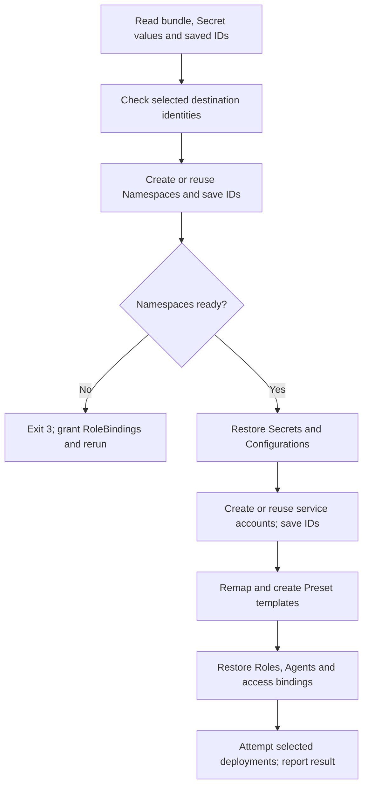

# Tenant restore flow

## Overview

The split-layout migration helper re-creates exported tenants through the OpenClaw
Control Plane (OCC) API. It records new resource IDs so an interrupted import can
resume. This flow starts at import and ends with the import result; it does not
cover storage adoption, external credential issuance, or workspace recovery.

## Entry Points

- Trigger: an administrator runs `node scripts/split-layout-tenants.mjs import`
  with an exported bundle, Secret values, and a saved-map path.
- Source: `scripts/split-layout-tenants.mjs:main` and
  `scripts/split-layout-tenants.mjs:importTenants`.
- Assumptions: the operator has completed the export and upgrade procedure,
  selected separate destination Namespaces, and can create their tenant resources.

## Flow

## Execution Trace

### 1. Select destinations and wait for readiness

`scripts/split-layout-tenants.mjs:importTenants`

The importer checks required Secret values and refuses selected sources that
share a destination name or saved destination ID. Saved destinations remain
reserved even when their sources are skipped. It creates missing Namespaces or
reuses eligible empty ones, records each ID, and waits for readiness. Pending
Namespaces return an incomplete result; `main` exits 3 without importing children.

### 2. Restore dependencies before Preset templates

`scripts/split-layout-tenants.mjs:importTenants`

The importer creates or reuses named resources and saves mappings after each
accepted create. Configurations follow Secrets and credential sources. Service
accounts follow Configurations and precede Presets, so their new IDs exist when
`remap` rewrites a Preset's Harness authentication source. A released
`chatgpt_service_account` selection first becomes `codex_pat` with a
`service_account` source. Both its Namespace and account ID are remapped.
A service-account record is restored without issued provider credentials.

Saved IDs skip completed creates. An existing named resource can be adopted and
is left unchanged; moving this order does not rewrite a Preset already created
by an earlier import. Inspect such a template before retrying a historical import.

### 3. Restore Agents and report remaining work

`scripts/split-layout-tenants.mjs:importTenants`

Roles and service accounts exist before Agent creation. Agent IDs and service
principal IDs enter the map before access bindings are restored. Running source
Agents are deployed unless `--no-deploy` was selected. The helper reports failed
deployments and access bindings requiring manual recovery; `main` exits 4 for
those results. Workspace recovery and issuing service-account credentials remain
operator steps in the migration guide.

## Debugging and Verification

Compare a restored Preset's `template.agent.harnessAuth.source` with the saved
Namespace and service-account IDs. Read that account in the destination Namespace;
a stale source ID returns 404 even when the import command completed successfully.
The conformance workflow exercises real controller HTTP handlers with in-memory
state, including current and released authentication spellings and resumed imports.
It does not establish PostgreSQL persistence, issued credentials, or live deployment.

## Related docs

- [Split-layout upgrade procedure](../guides/deploy/split-layout-upgrade.md#export-and-re-create)
- [Production upgrade flow](coordinated-production-upgrade.md)
- [Service-account reference](../reference/service-accounts.md)

## Manual Notes

[keep this for the user to add notes. do not change between edits]

## Changelog

- 2026-10-28 22:27: Record tenant restore ordering and remap Preset authentication after service-account IDs exist. (authoring-run/a5ca040d-695b-43c5-b18c-d6b1938aa6c5 - 478e0cfcda4849e519a3224f5d05b2a4fb6a5bca)
