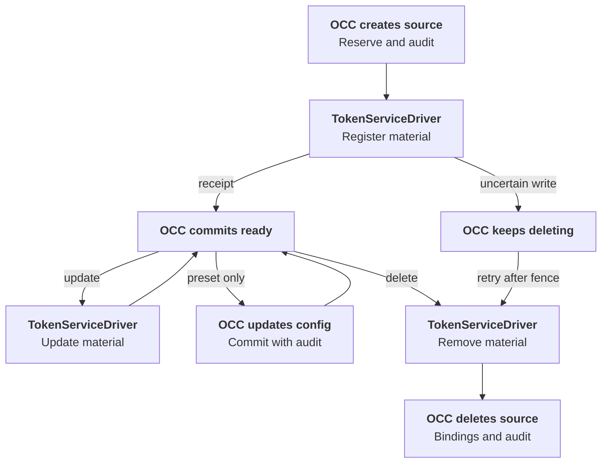

# Internal static TokenService custody flow

## Overview

OpenClaw Control Plane (OCC) creates, updates, and deletes an internal
CredentialSource. The selected TokenServiceDriver registers, updates, and removes
its credential material through the SecretDriver's Installation-private store.
The lifecycle type `static` does not identify a provider or destination.
OCC can separately associate an approved provider preset with the source. A
source without that association grants no destination authority.

## Entry Points

- Trigger: startup selects `token_service: occ`; an internal caller requests a
  source operation in a ready Namespace.
- Source: `apps/controller/src/composition/token-service.ts:installTokenServiceDriver`
- Source: `packages/occ/src/index.ts:createManagedCredentialSource`
- Source: `packages/occ/src/index.ts:deleteManagedCredentialSource`
- Permissions: `create` on the Namespace's source collection; `update` or `delete`
  on the exact CredentialSource.

## Flow

## Execution Trace

### 1. Select the Driver

`apps/controller/src/composition/token-service.ts:installTokenServiceDriver`

Startup binds the selected TokenServiceDriver to the SecretDriver's
`installationSecrets` store. OCC records the store identity and Driver selection
in `token_service_instances`; each source pins that instance.

### 2. Create the source and register material

`packages/occ/src/index.ts:createManagedCredentialSource`,
`apps/controller/src/drivers/token-service/occ.ts:registerSource`

OCC authorizes creation, locks the Namespace, and commits a `registering` source,
its creator binding, and the start audit. It then commits a separate dispatch
claim before calling `TokenServiceDriver.registerSource`. The Driver stores one nonempty UTF-8 value
through SecretDriver under the instance and source reference. OCC commits the
receipt, configuration, `ready` state, and completion audit together. The source
record contains no credential value. The optional `providerPreset` input must
name an approved preset. OCC saves it once as `config.provider_preset`; it does
not send the association in lifecycle settings or the registration receipt.
The completion audit identifies the approved preset on the exact source.

### 3. Update the source

`packages/occ/src/index.ts:updateManagedCredentialSource`

OCC requires `update` on the exact source and checks its recorded instance under
the source lock. A preset-only update changes the source config and commits its
audit in the same transaction without calling TokenService. Omitting
`providerPreset` preserves the association; `null` removes it. Empty or
unknown IDs fail before persistence. The completion audit records the new preset
or `null` for removal.

An effective preset change or removal requires an unbound source. OCC checks
existing references while it holds the Namespace and source locks, before it
changes config or calls the owner. Repeating the current preset and rotating
material without changing the preset remain allowed while bound.

For a material or lifecycle update, OCC first audits the attempt, then rechecks
authority and calls `TokenServiceDriver.updateSource`. It preserves the preset
when lifecycle settings change. An effective preset change must be a separate
operation because a TokenService write cannot roll back with the source audit.
The Driver receives only material and lifecycle settings.
Static sources accept only empty lifecycle settings and cannot refresh.

### 4. Delete the source

`packages/occ/src/index.ts:deleteManagedCredentialSource`,
`apps/controller/src/drivers/token-service/occ.ts:removeSource`

OCC rejects blocking references, marks the source `deleting`, and audits the
attempt. `TokenServiceDriver.removeSource` erases the value through SecretDriver
before deleting its storage object. On confirmation, OCC deletes the source and
bindings with the completion audit.

### 5. Recover failures

`packages/occ/src/index.ts:retireCredentialSourceMaterial`

An undispatched or definitively refused registration needs no Driver cleanup. A
possibly dispatched write without a receipt remains `deleting` until the dispatch fence passes and the recorded
Driver confirms removal. A missing Driver or uncertain removal retains the
source for an internal deletion retry.

## Debugging and Verification

Inspect `token_service_instance_id`, `registration`, and
`registration_dispatched_at` in private persistence to identify the owner and
dispatch state. The [PostgreSQL lifecycle test](../../tests/integration/postgres-static-token-service-lifecycle.test.ts)
uses direct controller calls, Native IAM, PostgreSQL, and concrete Drivers with a
simulated Kubernetes API transport. Startup installs the Driver, but no production
caller creates these sources. Public source routes hide or reject them.
[Agent draft admission](native-service-account-credential-delivery.md) can save a
ready source for Harness authentication; deployment refuses it before saving a
revision or queuing work. The test does not prove live Secret storage or Agent
delivery.

## Related docs

- [Serving credential-source lifecycle](credential-source-lifecycle.md)
- [Driver selection](../reference/drivers/selection.md#supported-selections)
- [PostgreSQL test environment](../testing/postgresql.md#postgresql-test-environment)

## Manual Notes

[keep this for the user to add notes. do not change between edits]

## Changelog

- 2026-11-20 15:57: Require separate preset and custody changes to prevent partial authority updates. (authoring-run/3d03cbe0-452f-4e38-baa5-5098e9a89002 - 8094be8535ce7ac130fe9d5f766bb9309bded408)

- 2026-11-20 15:45: Describe OCC-owned provider preset approval and atomic metadata updates. (authoring-run/e2439242-c252-46cd-a0c0-40604e02ddc5 - 8f5b739756f9236e7ada9238a31a2b8ed6164667)

- 2026-11-20 15:38: Distinguish Agent draft admission from unavailable TokenService delivery. (authoring-run/922d4131-eefa-4719-8498-697c4e791e10 - fbbcd30f4a327a476e2135757713c06ebd921bac)

- 2026-11-20 07:27: Clarify source and material ownership, normal lifecycle, failure recovery, and staged caller limits. (authoring-run/8c4ffb5f-88b8-465b-8e80-8b9fe00ece27 - 37424ee93acd777b7358f8b09674a3bfe4e6e5c2)

- 2026-11-20 06:40: Describe generic static custody without provider or consumption metadata. (authoring-run/14d74b53-196d-48d9-acc2-99f736399ebd - 03953946b50d68a6f2fc69d41936db039d8bff2e)

- 2026-11-20 04:20: Document internal static custody and its serving boundary. (authoring-run/1a7c3a53-041d-40fe-bdea-664eca7f6d97 - edd728580)
