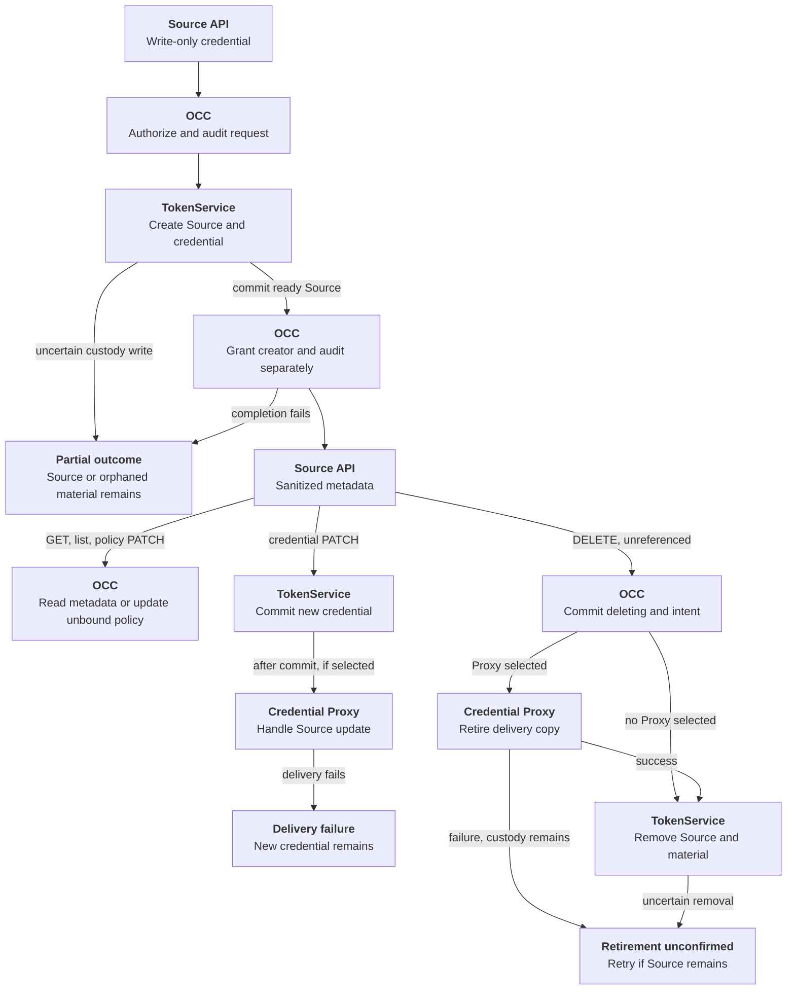

# Managed static credential source custody flow

## Overview

A caller enrolls a credential through the authenticated Namespace Source API. The selected TokenService creates and owns the CredentialSource and its credential. OpenClaw Control Plane (OCC) authorizes requests and governs IAM, Agent bindings, destination policy, and audit. This flow covers Source custody; the [credential lifecycle flow](credential-source-lifecycle.md#3-bind-and-admit-an-agent-revision) owns staged Agent admission and delivery.

## Entry Points

- Trigger: Source POST with write-only `secret`, exact GET or PATCH, Namespace list, or exact DELETE.
- Source: `apps/controller/src/http/credential-sources.ts:credentialSourceHandlers`
- Source: `packages/occ/src/managed-credential-sources.ts:createManagedCredentialSource`
- Source: `apps/controller/src/drivers/token-service/occ.ts:createSource`
- Permissions: collection `credential_source:create`; exact Source `read`, `update`, or `delete`. Listing requires Namespace `read` and filters by exact Source `read`.
- Context: a ready Namespace for enrollment and a selected TokenService instance for credential operations. Metadata reads do not require TokenService availability.

## Flow

## Execution Trace

### 1. Select the owner

`apps/controller/src/composition/token-service.ts:installTokenServiceDriver`

Startup binds the selected TokenService instance to the Secret Driver's Installation-private store and the PostgreSQL Source catalog. API composition takes the `credential_proxy_delivery` capability from the validated registration with `require`, so it can bind update notifications before Sandbox selection. Worker installs TokenService for Source resolution and does not bind the native Proxy’s Source placement resolver. A Source pins the TokenService instance that created it. Changing Driver selection does not transfer custody.

### 2. Create the Source

`packages/occ/src/managed-credential-sources.ts:createManagedCredentialSource`, `apps/controller/src/drivers/token-service/occ.ts:createSource`

The OCC Source manager authorizes the collection request, then checks the ready Namespace and approved provider preset. It commits registration intent and releases its locks before calling TokenService. TokenService assigns the Source ID, creates the canonical ready record and private credential in its own operation, commits its PostgreSQL transaction, and returns the Source. OCC uses the returned Source to commit creator IAM and completion audit separately. An operation admitted before IAM revocation may finish after revocation. The credential never enters public metadata, Namespace Secret references, logs, or audit details.

An uncertain private-store write can leave material without a Source record. A failure after TokenService commits can leave a Source without its creator grant or completion audit. POST reports failure; the committed request intent remains. The private store has no inventory operation.

### 3. Read or update the Source

`packages/occ/src/managed-credential-sources.ts:updateManagedCredentialSource`, `apps/controller/src/drivers/token-service/occ.ts:updateSource`

After exact IAM authorization, OCC reads Source metadata directly from the shared PostgreSQL catalog. Namespace listing filters catalog records by exact Source read authority. These reads work when TokenService is unavailable; they do not resolve credentials or prove live credential readiness. Any request for a usable credential goes through TokenService. OCC separately validates `config.provider_preset`; a Source without an approved preset supplies no destination authority. An effective preset change requires an unbound Source and a separate request from credential replacement. OCC commits policy-only changes with the unbound check and audit in its own transaction.

For a credential change, OCC commits intent and releases its locks before it calls TokenService, including when an active staged Agent revision uses the Source. TokenService commits the new credential, then notifies the selected Credential Proxy with the exact Source reference and version. The notification contains no credential. The Proxy can resolve that Source through the same TokenService instance when it needs the value. The native Proxy updates an existing Provider; if no Provider exists, it returns without resolving or creating one. OCC records completion after the owner returns. If delivery fails, OCC audits the committed Source update and the `CREDENTIAL_DELIVERY_FAILED` outcome separately. The new credential remains in custody. Driver failures are sanitized before responses, logs, or audit.

### 4. Retire the Source

`packages/occ/src/managed-credential-sources.ts:deleteCredentialSource`, `apps/controller/src/drivers/token-service/occ.ts:removeSource`

OCC authorizes exact DELETE, refuses blocking references, and commits `deleting` and retirement intent. It releases its locks before Driver calls. If a Proxy is selected, OCC asks it to retire the owned delivery copy and profile first. If that call fails, the Source stays `deleting` and TokenService keeps custody for a retry. After retirement succeeds, or when no Proxy is selected, TokenService locks the Namespace and Source in its own transaction, rechecks references, erases private material, and deletes the Source and its IAM bindings. TokenService returns the actual removed AccessBindings, and OCC records them in completion audit separately. An uncertain removal can leave `deleting` for retry. If TokenService commits before completion audit fails, the Source and its exact IAM bindings are gone. A retry can return `403` if the caller lost delete authority, or `404` if still authorized. Retirement intent remains.

### 5. Stop at the Agent delivery boundary

`packages/occ/src/agent-credential-access.ts:authorizeAgentCredentialSources`

An authorized Agent draft can bind a ready same-Namespace Source by ID without resolving credentials. Admission can freeze its approved model route in a revision. During deployment, the Worker provisions an idle Sandbox, the Proxy attaches the Provider, and the Sandbox applies the admitted credential policy before the Harness starts. Source creation and draft binding do not establish runtime credential delivery or a model turn. The [credential lifecycle flow](credential-source-lifecycle.md#4-resolve-the-source-at-dispatch) owns deployment details.

## Debugging and Verification

Run `node --test tests/integration/postgres-staged-agent-credential-binding.test.ts` with the [PostgreSQL test environment](../testing/postgresql.md#postgresql-test-environment). It exercises real Fastify routes, PostgreSQL application-role persistence, Native IAM, concrete TokenService custody, sanitized reads, updates, denial audit, retirement, and Agent draft binding. Source DELETE coverage uses the selected OpenShell Proxy and production gRPC client against a controlled loopback service. The Secret Driver's Kubernetes API transport is also controlled. This does not establish live Kubernetes storage, native OpenShell deletion, runtime delivery, or model execution.

## Related docs

- [Managed static Source reference](../reference/credential-sources/managed-static.md)
- [Credential source lifecycle](credential-source-lifecycle.md)
- [Agent draft admission](native-service-account-credential-delivery.md)
- [Driver selection](../reference/drivers/selection.md#supported-selections)

## Manual Notes

[keep this for the user to add notes. do not change between edits]

## Changelog

- 2026-11-22 12:28: Retire the selected Proxy delivery copy before TokenService removes Source custody. (authoring-run/81ce6a62-aa40-44d2-8f4f-48c6b97428fc - 802c9adb9)

- 2026-11-22 12:16: Combine staged deployment with Source updates through the selected native Proxy. (authoring-run/c68f6f42-f163-4903-80e4-815e23cd470d - 403ad1bbacb79d2c504026c696a343d29bfa948a)

- 2026-11-21 21:55: Link staged Agent admission to its lifecycle owner. (01a1ec21-b384-7472-887f-945ae0ab16fc - 91de87598)

- 2026-11-21 21:33: Authorize Source creation in the manager and clarify DELETE retry authority. (authoring-run/7d36e4b0-9d69-4099-8f8b-50144697a78a - 930293d2b18205276dcd78aec52414e0c9fdc616)

- 2026-11-21 21:26: Finalize creator IAM and audit directly from the returned Source. (authoring-run/bcb909b1-f021-43ea-95b6-2a657e3d0ea4 - 5f52a10691de0b183726bb34698cd82a705f2254)

- 2026-11-21 21:14: Separate TokenService transactions from OCC admission, IAM, policy, and audit. (authoring-run/e9a8f5b4-f521-4f22-ab7b-1639413a47a4 - f7a5c4b60d7902f6d13a41faaf13386931648795)

- 2026-11-21 20:56: Read authorized Source metadata from the shared catalog and keep credential operations with TokenService. (authoring-run/d087964b-7e67-4a03-9579-11901c232afe - 5beb75a4bb840120f4676cfb26b41a51a0f84d7a)

- 2026-11-21 20:34: Describe TokenService-owned Source creation, observation, update, and retirement without an OCC reservation. (authoring-run/8bfb022d-2367-4ffc-b161-e5ea19cb7a80 - 55c444f3735a372e9f76a8f7e85a8ec4396ef7c7)

- 2026-11-21 11:54: Derive the managed dispatch and retirement fence from the TokenService timeout and focus the diagram on managed custody. (authoring-run/22722819-a3e4-4a6e-ae08-9e23bde479dd - 15794c3860bcf982b500774d8c700fbcd19aaf71)

- 2026-11-21 11:45: Point the public static Source lifecycle to its extracted Manager and Driver modules. (authoring-run/16cfa409-7c14-4f52-9167-3e897f919125 - 7533013d1061c433e27883818cf69f955239c43f)

- 2026-11-21 08:07: Focus the flow on the static custody lifecycle. (authoring-run/e7385b8d-4142-4c92-a621-97ae799ade24 - bd0cc5d3436f0882fbea9d1e0d647ac49ecf4a56)

- 2026-11-20 16:50: Correct PATCH lock ownership and return not found before owner selection on a DELETE retry after retirement. (authoring-run/9bb61048-2680-4355-9169-bd7a6dd316af - 00881f668ea8c2857f4e20ae562be7aa2d18a4da)

- 2026-11-20 16:18: Connect public enrollment, observation, update, and retirement to the selected Source owner; describe staged proof limits. (authoring-run/9bb61048-2680-4355-9169-bd7a6dd316af - 27b47ccbf7223c303b844af151c9712082380919)

- 2026-11-20 15:57: Require separate preset and custody changes to prevent partial authority updates. (authoring-run/3d03cbe0-452f-4e38-baa5-5098e9a89002 - 8094be8535ce7ac130fe9d5f766bb9309bded408)

- 2026-11-20 15:45: Describe OCC-owned provider preset approval and atomic metadata updates. (authoring-run/e2439242-c252-46cd-a0c0-40604e02ddc5 - 8f5b739756f9236e7ada9238a31a2b8ed6164667)

- 2026-11-20 15:38: Distinguish Agent draft admission from unavailable TokenService delivery. (authoring-run/922d4131-eefa-4719-8498-697c4e791e10 - fbbcd30f4a327a476e2135757713c06ebd921bac)

- 2026-11-20 07:27: Clarify source and material ownership, normal lifecycle, failure recovery, and staged caller limits. (authoring-run/8c4ffb5f-88b8-465b-8e80-8b9fe00ece27 - 37424ee93acd777b7358f8b09674a3bfe4e6e5c2)

- 2026-11-20 06:40: Describe generic static custody without provider or consumption metadata. (authoring-run/14d74b53-196d-48d9-acc2-99f736399ebd - 03953946b50d68a6f2fc69d41936db039d8bff2e)

- 2026-11-20 04:20: Document internal static custody and its serving boundary. (authoring-run/1a7c3a53-041d-40fe-bdea-664eca7f6d97 - edd728580)
