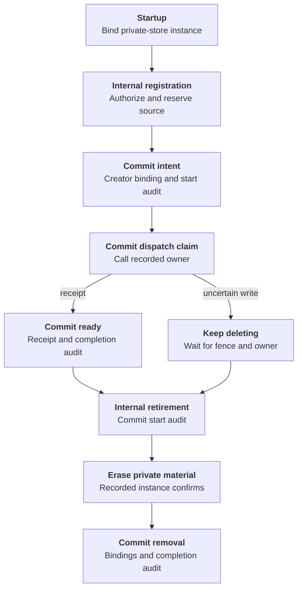

# Internal static TokenService custody flow

## Overview

OpenClaw Control Plane (OCC) can select an internal TokenService owner that holds
static credentials in Installation-private Secret storage. Internal controller
calls register, update, and retire these sources. The serving credential-source
API, Console, CLI, and Agent delivery continue to use their existing owners;
they do not expose or consume these registrations.
Custody does not select a provider, endpoint, authentication method, or consumer.

## Entry Points

- Trigger: trusted Installation startup or an internal controller call.
- Source: `apps/controller/src/composition/token-service.ts:installTokenServiceDriver`
- Source: `packages/occ/src/index.ts:registerManagedCredentialSource`
- Source: `packages/occ/src/index.ts:deleteManagedCredentialSource`
- Assumptions: the Installation selects `token_service` with ID `occ`; its selected
  Secret Driver provides an Installation-private store; the Namespace is ready;
  registration requires create on the Namespace source collection; update or
  deletion requires the corresponding permission on the exact source.

## Flow

## Execution Trace

### 1. Bind the owner to its private store

`apps/controller/src/composition/token-service.ts:installTokenServiceDriver`,
`packages/occ/src/index.ts:activateTokenServiceInstance`

Startup reads or creates a private-store marker keyed by the selected Secret
Driver. OCC records the selected TokenService Driver and that store identity in
`token_service_instances`. Sources pin the resulting instance ID, so startup
cannot replace an instance while sources still reference it.

### 2. Reserve and register the source

`packages/occ/src/index.ts:registerManagedCredentialSource`,
`apps/controller/src/drivers/token-service/occ.ts:registerSource`

OCC authorizes source creation, locks the ready Namespace, reserves a
`registering` source, binds the creator, and commits a source-targeted
registration-start audit. It commits a dispatch claim before sending credential
material to the selected owner. The internal lifecycle type is `static`, with no
settings. The owner requires one nonempty UTF-8 secret value; its field name has
no provider meaning. The owner stores that value under the exact instance and
source reference. The registration receipt is empty because those identities
already locate the material. OCC commits the receipt, configuration, `ready`
state, and completion audit together. The source row contains no Namespace
Secret reference or credential value.

If no write was sent, OCC removes the reservation and bindings. If the write may
have happened without a receipt, OCC leaves the source `deleting`; retirement
waits for the dispatch fence and requires the recorded owner to confirm removal.
A failed cleanup also leaves the source `deleting` for a later internal retry.

### 3. Update or retire through the recorded instance

`packages/occ/src/index.ts:updateManagedCredentialSource`,
`packages/occ/src/index.ts:deleteManagedCredentialSource`,
`apps/controller/src/drivers/token-service/occ.ts:removeSource`

Update rechecks the caller's exact grant and the recorded instance under the
source lock before replacing private material. Retirement refuses live references,
marks the source `deleting`, and commits its start audit before the owner erases
the value. After the owner confirms removal, OCC removes the source and its bindings
with the completion audit. A missing owner or uncertain erasure retains the source.
Static credentials do not support refresh. Serving list, GET, PATCH, and DELETE
operations cannot access these records.

## Debugging and Verification

- Check `token_service_instances` and the source's `token_service_instance_id`,
  `registration`, and `registration_dispatched_at` to distinguish a reservation,
  an uncertain dispatch, and a completed registration. These fields are private
  persistence state, not serving API fields.
- The [PostgreSQL lifecycle test](../../tests/integration/postgres-static-token-service-lifecycle.test.ts)
  exercises internal controller calls, Native IAM, PostgreSQL, and the concrete
  TokenService and Secret Drivers. It also checks serving API refusal. The
  Kubernetes API transport is simulated; this does not prove a live Secret store
  or Agent credential delivery. The [test environment](../testing/postgresql.md#postgresql-test-environment)
  describes its application and migrator roles.

## Related docs

- [Serving credential-source lifecycle](credential-source-lifecycle.md)
- [Driver selection](../reference/drivers/selection.md#supported-selections)
- [Database entities](../reference/cheatsheets/database-entities.md#token_service_instances)

## Manual Notes

[keep this for the user to add notes. do not change between edits]

## Changelog

- 2026-11-20 06:40: Describe generic static custody without provider or consumption metadata. (authoring-run/14d74b53-196d-48d9-acc2-99f736399ebd - 03953946b50d68a6f2fc69d41936db039d8bff2e)

- 2026-11-20 04:20: Document internal static custody and its serving boundary. (authoring-run/1a7c3a53-041d-40fe-bdea-664eca7f6d97 - edd728580)
