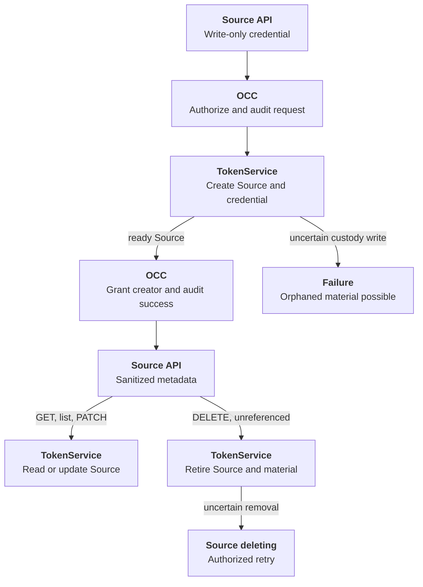

# Managed static credential source custody flow

## Overview

A caller enrolls a credential through the authenticated Namespace Source API. The selected TokenService creates and owns the CredentialSource and its credential. OpenClaw Control Plane (OCC) authorizes requests and governs IAM, Agent bindings, destination policy, and audit. This flow ends at Source retirement; managed Agent runtime delivery remains unavailable.

## Entry Points

- Trigger: Source POST with write-only `secret`, exact GET or PATCH, Namespace list, or exact DELETE.
- Source: `apps/controller/src/http/credential-sources.ts:credentialSourceHandlers`
- Source: `packages/occ/src/managed-credential-sources.ts:createManagedCredentialSource`
- Source: `apps/controller/src/drivers/token-service/occ.ts:createSource`
- Permissions: collection `credential_source:create`; exact Source `read`, `update`, or `delete`. Listing requires Namespace `read` and filters by exact Source `read`.
- Context: a ready Namespace and a selected TokenService instance.

## Flow

## Execution Trace

### 1. Select the owner

`apps/controller/src/composition/token-service.ts:installTokenServiceDriver`

Startup binds the selected TokenService instance to the Secret Driver's Installation-private store and the canonical PostgreSQL Source catalog. A Source pins the instance that created it. Changing Driver selection does not transfer custody.

### 2. Create the Source

`packages/occ/src/managed-credential-sources.ts:createManagedCredentialSource`, `apps/controller/src/drivers/token-service/occ.ts:createSource`

OCC checks the ready Namespace, collection permission, and approved provider preset. It commits a collection-scoped registration intent audit without creating a Source. Inside the mutation transaction, it rechecks authority and calls TokenService with the Namespace, name, lifecycle settings, admitted configuration, and write-only credential. TokenService assigns the Source ID, inserts its canonical ready record, writes the credential to its private store, and returns the Source. OCC commits the creator IAM binding and success audit with the Source metadata. The credential does not enter Namespace Secret references, public metadata, logs, or audit details.

The database and private Secret store do not share a transaction. An uncertain private-store write or a later database failure can leave credential material without a Source record. The request audit remains, and POST reports failure. The private store currently has no inventory operation; no automatic orphan discovery is claimed.

### 3. Read or update the Source

`packages/occ/src/credential-source-operations.ts:readCredentialSource`, `packages/occ/src/managed-credential-sources.ts:updateManagedCredentialSource`

After exact IAM authorization, OCC delegates managed reads and updates to TokenService. Namespace listing filters TokenService's Sources by exact read authority. Metadata reads do not resolve credentials or prove live credential readiness. OCC separately validates `config.provider_preset`; a Source without an approved preset supplies no destination authority. An effective preset change requires an unbound Source and a separate request from credential replacement. TokenService applies the admitted configuration or credential update, and OCC records completion audit. Driver failures are sanitized before responses, logs, or audit.

### 4. Retire the Source

`packages/occ/src/managed-credential-sources.ts:deleteCredentialSource`, `apps/controller/src/drivers/token-service/occ.ts:removeSource`

OCC authorizes exact DELETE, refuses blocking references, and records retirement intent. TokenService prepares retirement by locking and rechecking the Source, then commits `deleting`. OCC calls TokenService removal inside the transaction that deletes the canonical record and IAM bindings and appends completion audit. An uncertain removal or rejected audit leaves `deleting` for an authorized retry. A repeated DELETE after retirement returns `404`.

### 5. Stop at the Agent delivery boundary

`packages/occ/src/agent-credential-access.ts:authorizeAgentCredentialSources`

An authorized Agent draft can bind a ready same-Namespace Source by ID without resolving credentials. Managed deployment refuses before saving a revision or queuing work. Source creation and draft binding do not establish runtime credential delivery or a model turn.

## Debugging and Verification

Run `node --test tests/integration/postgres-staged-agent-credential-binding.test.ts` with the [PostgreSQL test environment](../testing/postgresql.md#postgresql-test-environment). It exercises real Fastify routes, PostgreSQL application-role persistence, Native IAM, concrete TokenService custody, sanitized reads, updates, denial audit, retirement, and Agent draft binding. The Secret Driver's Kubernetes API transport is simulated; this does not establish live Kubernetes storage, runtime delivery, or model execution.

## Related docs

- [Managed static Source reference](../reference/credential-sources/managed-static.md)
- [Credential source lifecycle](credential-source-lifecycle.md)
- [Agent draft admission](native-service-account-credential-delivery.md)
- [Driver selection](../reference/drivers/selection.md#supported-selections)

## Manual Notes

[keep this for the user to add notes. do not change between edits]

## Changelog

- 2026-11-21 20:34: Describe TokenService-owned Source creation, observation, update, and retirement without an OCC reservation. (authoring-run/8bfb022d-2367-4ffc-b161-e5ea19cb7a80 - 55c444f3735a372e9f76a8f7e85a8ec4396ef7c7)

- 2026-11-21 11:54: Derive the managed dispatch and retirement fence from the TokenService timeout and focus the diagram on managed custody. (authoring-run/22722819-a3e4-4a6e-ae08-9e23bde479dd - 15794c3860bcf982b500774d8c700fbcd19aaf71)

- 2026-11-21 11:45: Point the public static Source lifecycle to its extracted Manager and Driver modules. (authoring-run/16cfa409-7c14-4f52-9167-3e897f919125 - 7533013d1061c433e27883818cf69f955239c43f)

- 2026-11-21 08:07: Focus the flow on the static custody lifecycle. (authoring-run/e7385b8d-4142-4c92-a621-97ae799ade24 - bd0cc5d3436f0882fbea9d1e0d647ac49ecf4a56)

- 2026-11-20 16:50: Correct PATCH lock ownership and return not found before owner selection on a DELETE retry after retirement. (authoring-run/9bb61048-2680-4355-9169-bd7a6dd316af - 00881f668ea8c2857f4e20ae562be7aa2d18a4da)

- 2026-11-20 16:18: Connect public enrollment, observation, update, and retirement to the selected Source owner; describe staged proof limits. (authoring-run/9bb61048-2680-4355-9169-bd7a6dd316af - 27b47ccbf7223c303b844af151c9712082380919)

- 2026-11-20 15:57: Require separate preset and custody changes to prevent partial authority updates. (authoring-run/3d03cbe0-452f-4e38-baa5-5098e9a89002 - 8094be8535ce7ac130fe9d5f766bb9309bded408)

- 2026-11-20 15:45: Describe OCC-owned provider preset approval and atomic metadata updates. (authoring-run/e2439242-c252-46cd-a0c0-40604e02ddc5 - 8f5b739756f9236e7ada9238a31a2b8ed6164667)

- 2026-11-20 15:38: Distinguish Agent draft admission from unavailable TokenService delivery. (authoring-run/922d4131-eefa-4719-8498-697c4e791e10 - fbbcd30f4a327a476e2135757713c06ebd921bac)

- 2026-11-20 07:27: Clarify source and material ownership, normal lifecycle, failure recovery, and staged caller limits. (authoring-run/8c4ffb5f-88b8-465b-8e80-8b9fe00ece27 - 37424ee93acd777b7358f8b09674a3bfe4e6e5c2)

- 2026-11-20 06:40: Describe generic static custody without provider or consumption metadata. (authoring-run/14d74b53-196d-48d9-acc2-99f736399ebd - 03953946b50d68a6f2fc69d41936db039d8bff2e)

- 2026-11-20 04:20: Document internal static custody and its serving boundary. (authoring-run/1a7c3a53-041d-40fe-bdea-664eca7f6d97 - edd728580)
