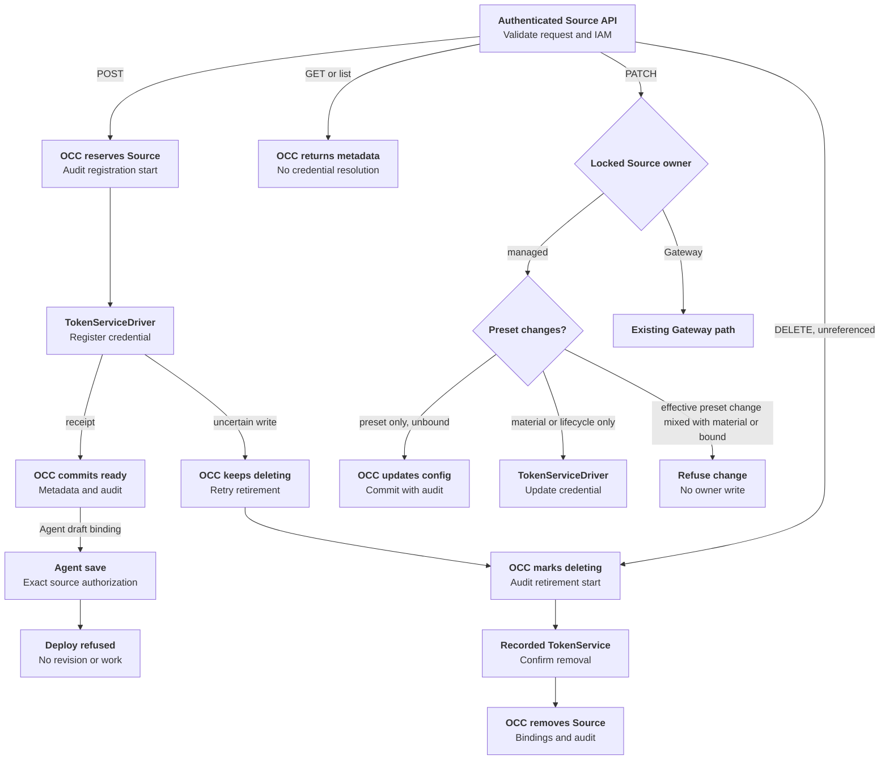

# Managed static credential source custody flow

## Overview

A caller enrolls a managed static credential source through the authenticated
Namespace Source API. OpenClaw Control Plane (OCC) owns the Source identity,
configuration, IAM bindings, and audit. The selected TokenServiceDriver owns the
usable credential. The `static` lifecycle type does not identify a provider or
destination. OCC can separately record an approved provider preset. This flow
ends at Source retirement; Agent revision delivery remains unavailable.

## Entry Points

- Trigger: `POST /namespaces/:namespaceId/credential-sources` with a singular
  write-only `secret`; `GET` or `PATCH` the exact Source, list the Namespace's
  Sources, or `DELETE` the exact Source.
- Source: `apps/controller/src/http/credential-sources.ts:credentialSourceHandlers`
- Source: `packages/occ/src/index.ts:createManagedCredentialSource`
- Source: `packages/occ/src/index.ts:deleteCredentialSource`
- Permissions: `credential_source:create` on the Namespace Source collection;
  exact `credential_source:read`, `update`, or `delete` for the corresponding
  operation. Listing requires Namespace `read` and filters by exact Source `read`.
- Assumptions: a ready Namespace and a selected TokenService instance.

## Flow

## Execution Trace

### 1. Select the owner

`apps/controller/src/composition/token-service.ts:installTokenServiceDriver`

Startup binds the selected TokenServiceDriver to the SecretDriver's
Installation-private store. OCC records the store identity and Driver selection
in `token_service_instances`. A Source pins that instance; changing a selected
Driver does not transfer custody.

### 2. Register the Source

`apps/controller/src/http/credential-sources.ts:createCredentialSource`,
`packages/occ/src/index.ts:createManagedCredentialSource`

The route distinguishes the validated managed request by singular `secret`.
OCC authorizes `credential_source:create`, locks the Namespace, and commits a
`registering` Source, creator binding, and `registration_started` audit before
material can leave the controller. It commits a dispatch claim, rechecks IAM and
the Source, and calls `TokenServiceDriver.registerSource`. The selected static
adapter accepts one nonempty UTF-8 credential and no lifecycle settings. OCC
commits the private receipt, metadata, `ready` state, and completion audit.

`config.provider_preset` accepts the exact approved ID `openai`. OCC removes it
from lifecycle settings and records it as Source configuration; it is not a
TokenService registration field. A Source without an approved preset grants no
destination authority. The write-only material does not enter Namespace Secret
references, responses, logs, or audit details.

### 3. Observe or update the Source

`packages/occ/src/index.ts:credentialSourceUpdateIdentity`,
`packages/occ/src/index.ts:readCredentialSource`,
`packages/occ/src/index.ts:updateManagedCredentialSource`

A managed exact GET returns sanitized metadata and record state; it does not
resolve a credential or claim live credential readiness. The list returns only
readable Sources and never asks the owner for material.

For PATCH, OCC authorizes exact `credential_source:update`, checks the Namespace,
locks the Source, and rechecks authorization before returning its immutable owner
classification and lifecycle type. The handler rejects a request shape that does
not match that owner. The managed mutation then locks the Namespace and Source and
rechecks IAM and instance ownership. Gateway updates retain their existing
transaction and audit.

Omitting `config` preserves the preset. `config: {}` removes it. A preset-only
change commits config and audit together without calling TokenService. An
effective preset change or removal requires an unbound Source and a separate
request from material or lifecycle changes. Repeating the same preset or
updating material without an effective preset change remains allowed while
bound. For a material or lifecycle update, OCC commits `update_started` first,
then calls the owner and commits completion audit. Driver errors are reduced to
fixed platform messages before they can reach responses, logs, or audit.

### 4. Retire the Source

`packages/occ/src/index.ts:deleteCredentialSource`,
`packages/occ/src/index.ts:retireCredentialSourceMaterial`

OCC authorizes exact `credential_source:delete` and locks the Namespace and Source.
A missing Source returns `404` before OCC selects an owner. OCC rejects blocking
Agent, revision, deployment, provisioning, or withdrawal references. It marks
the Source `deleting` and commits `retirement_started` before the recorded
TokenService removes material. On confirmation, OCC removes
the Source and its IAM bindings with completion audit. The Namespace remains
nonempty until that removal commits.

An undispatched or definitively refused registration needs no owner cleanup. A
possibly dispatched write without a receipt stays `deleting` until its dispatch
fence passes and the recorded owner confirms removal. Missing ownership or an
uncertain removal retains the record for an authorized DELETE retry. Denied
mutations receive attributable authorization-denial audit without material.

### 5. Stop at the Agent delivery boundary

`packages/occ/src/index.ts:authorizeAgentCredentialSources`

An authorized Agent draft can bind a ready managed Source for Harness
authentication. Deployment refuses the Source before it saves an Agent revision
or queues deployment work. Source enrollment and draft binding do not prove
credential delivery, a running Harness, or a model turn.

## Debugging and Verification

Run `node --test tests/integration/postgres-staged-agent-credential-binding.test.ts`
with the [PostgreSQL test environment](../testing/postgresql.md#postgresql-test-environment).
A passing run checks the actual Fastify routes, PostgreSQL application role,
Native IAM, concrete TokenService and Secret Drivers, public read sanitization,
update and denial audit, retirement, authorized Agent binding, and staged deploy
refusal. The Kubernetes API transport is simulated. This does not prove live
Kubernetes Secret storage, runtime delivery, or model execution.

## Related docs

- [Managed static Source reference](../reference/credential-sources/managed-static.md)
- [Gateway and protected source lifecycle](credential-source-lifecycle.md)
- [Agent draft admission](native-service-account-credential-delivery.md)
- [Driver selection](../reference/drivers/selection.md#supported-selections)

## Manual Notes

[keep this for the user to add notes. do not change between edits]

## Changelog

- 2026-11-21 08:07: Focus the flow on the static custody lifecycle. (authoring-run/e7385b8d-4142-4c92-a621-97ae799ade24 - bd0cc5d3436f0882fbea9d1e0d647ac49ecf4a56)

- 2026-11-20 16:50: Correct PATCH lock ownership and return not found before owner selection on a DELETE retry after retirement. (authoring-run/9bb61048-2680-4355-9169-bd7a6dd316af - 00881f668ea8c2857f4e20ae562be7aa2d18a4da)

- 2026-11-20 16:18: Connect public enrollment, observation, update, and retirement to the selected Source owner; describe staged proof limits. (authoring-run/9bb61048-2680-4355-9169-bd7a6dd316af - 27b47ccbf7223c303b844af151c9712082380919)

- 2026-11-20 15:57: Require separate preset and custody changes to prevent partial authority updates. (authoring-run/3d03cbe0-452f-4e38-baa5-5098e9a89002 - 8094be8535ce7ac130fe9d5f766bb9309bded408)

- 2026-11-20 15:45: Describe OCC-owned provider preset approval and atomic metadata updates. (authoring-run/e2439242-c252-46cd-a0c0-40604e02ddc5 - 8f5b739756f9236e7ada9238a31a2b8ed6164667)

- 2026-11-20 15:38: Distinguish Agent draft admission from unavailable TokenService delivery. (authoring-run/922d4131-eefa-4719-8498-697c4e791e10 - fbbcd30f4a327a476e2135757713c06ebd921bac)

- 2026-11-20 07:27: Clarify source and material ownership, normal lifecycle, failure recovery, and staged caller limits. (authoring-run/8c4ffb5f-88b8-465b-8e80-8b9fe00ece27 - 37424ee93acd777b7358f8b09674a3bfe4e6e5c2)

- 2026-11-20 06:40: Describe generic static custody without provider or consumption metadata. (authoring-run/14d74b53-196d-48d9-acc2-99f736399ebd - 03953946b50d68a6f2fc69d41936db039d8bff2e)

- 2026-11-20 04:20: Document internal static custody and its serving boundary. (authoring-run/1a7c3a53-041d-40fe-bdea-664eca7f6d97 - edd728580)
