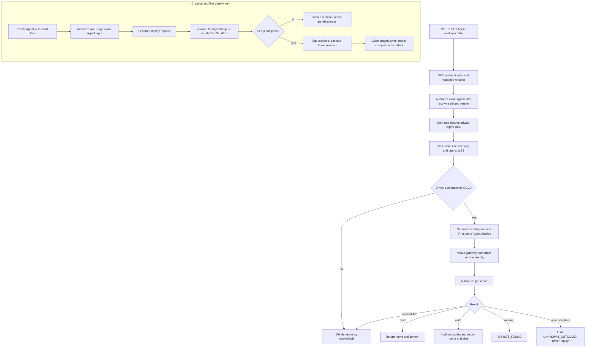

# Agent Workspace Files Flow

## Overview

OCC privately stages authenticated creation inputs: `AGENTS.md`, `SOUL.md`,
`IDENTITY.md`, and `USER.md`. Compute prepares storage; the execution provider
initializes it before activation.

Subsequent file operations authorize the exact active Agent and use its
Compute-resolved private endpoint through Envoy Gateway.

Dedicated execution initializes the Harness workspace for Codex and native
OpenClaw; see [workspace and launcher boundaries](../reference/drivers/kubernetes-compute/storage-and-credentials.md#shared-contracts-and-the-codex-implementation).

See [two-cluster transport](../testing/kubernetes.md#two-cluster-validation) for CP/DP routing.

## Entry Points

- `apps/controller/src/index.ts:createFastifyApp` accepts initial contents through
  `POST /namespaces/:namespaceId/agents` and handles live `GET` and
  `PUT /namespaces/:namespaceId/agents/:agentId/workspace/files/:name`.
- `packages/occ/src/index.ts:createAgent` authorizes creation and persists private
  setup state; `deployAgentWithAuthorization` rechecks it, completed too, before
  each revision.

Live access requires the Agent's private HTTPRoute and native gateway. Configure
Envoy Gateway, trust, and network restrictions through
[deployment](../guides/deploy/workspace-routing.md#agent-workspace-files); the
[routing contract](../reference/gateway-routing.md) covers credentials, hostnames,
and CAs.

## Flow

## Execution Trace

### 1. Creation validates and privately stages the inputs

`apps/controller/src/console/agents/create.mts` fills four textareas from
`workspace-defaults.mjs` and submits their values with `WORKSPACE_DEFAULTS_ID`.
`apps/controller/src/index.ts:createFastifyApp` rejects a stale defaults identity;
`packages/contracts/src/workspace-setup.ts:normalizeInitialWorkspaceFiles`
rejects unknown names, invalid Unicode, NUL, and values above 16 KiB UTF-8.
An absent or empty map follows ordinary startup without setup state; see
the [create body limit](../reference/agents.md#initial-contents-at-creation).

`packages/occ/src/index.ts:createAgent` checks Namespace-scoped Agent creation,
exact Configuration read, and existing binding permissions. Its transaction
creates a stopped Agent and, when keys were supplied, a private `workspaceSetups`
record keyed by exact Namespace/Agent. No AgentRevision is created. Inputs do
not enter the Agent, Configuration, Agent revision snapshot, public response, or
metadata-only create audit. API strings are preserved; Console textareas use LF newlines.

### 2. Deployment initializes storage before execution

`apps/controller/src/worker.ts` reads private setup state into
`ComputeRevisionContext`. A Driver without `supportsWorkspaceSetup` returns
`WORKSPACE_SETUP_UNSUPPORTED`. The worker serializes Agent startup and passes `workspaceSetup` to Compute.

Bundled Drivers use
`apps/controller/src/drivers/compute/workspace-setup-runtime.ts:WORKSPACE_SETUP_RUNTIME`.
Kubernetes delivers an Agent-owned Secret to the workspace owner's init container
(Gateway when embedded, Harness when dedicated); Docker uses a setup container
and durable volumes; SSH uses the protected Agent directory. Provider-owned
Harnesses require the Sandbox's `validateWorkspaceSetup(harness, configuration)`:
Compute delegates validation of the relocated workspace, or returns `409` before
staging inputs. Preparation repeats this check.

OpenShell separately prepares native OpenClaw's private writable PVC subpaths,
preserving retained entries. Ownership/mode checks, UID-fenced deletion and writer
termination precede Sandbox creation. This permission setup carries no documents;
see [OpenShell preparation](openshell-sandbox-provisioning.md#3-validate-and-serialize-the-sandbox).

`apps/controller/src/drivers/compute/kubernetes/index.ts:harnessRequirementsFromDeployment`
hands Sandbox the [setup identity and exact Secret reference](../reference/drivers/sandbox.md#provisioning-inputs).
After Sandbox readiness, `apps/controller/src/drivers/sandbox/openshell.ts:initializeWorkspace`
verifies the Secret's Namespace, Agent and setup identity, then calls authenticated
`ExecSandbox` with a fixed initializer and JSON stdin. Contents stay out of provider
configuration, arguments and environment; remote output is discarded. The launcher
waits for completion. A workspace `flock` serializes attempts after lost
acknowledgments. The verifier uses `OPENCLAW_WORKSPACE_DIR` after relocation.

The runner validates identity, paths, OpenClaw `2026.9.9`, and template digest
against Console defaults; identities must match, and links or conflicts fail.
Native `setup` initializes workspace/Git without starting Gateway. Kubernetes init
containers use Gateway resource budgets. Supplied files, including empty strings,
atomically replace only absent, stock, or already-submitted content. The runner
reruns setup for `BOOTSTRAP.md`, verifies results, and atomically writes
`.oce-workspace-setup.json`.

Matching markers skip replay; incomplete writes retry the same checks.
Missing or mismatched markers after recorded completion block startup, preserving
later edits. Errors omit document contents.

`apps/controller/src/drivers/compute/kubernetes/index.ts:safeRuntimeFailureObservation`
reports a refusal (exit 2) as `WORKSPACE_SETUP_REFUSED`, failing at once, as
does `SandboxWorkspaceSetupRefusedError` (OpenShell). Kubernetes restarts other
failures (`WORKSPACE_SETUP_RETRYING`). `checkedAt` is termination or observation time.

### 3. Activation clears staged contents and keeps completion metadata

`apps/controller/src/worker.ts` completes setup in the activation-completion
transaction only after checking the selected Agent revision ID and work claim.
`workspaceSetups.complete` removes document bytes and retains identity and
completion metadata. Drivers remove or replace private delivery bytes with
metadata; subsequent startup verifies the durable workspace marker.

Failed or never-deployed Agents retain pending inputs. Agent deletion removes
the setup record through `packages/occ/src/index.ts:deleteAgent`; Driver
cleanup owns runtime storage. No public endpoint reads or updates setup, and
live edits after activation do not update it.

### 4. Composition configures private access

`apps/controller/src/api-startup.mjs:startApi` validates the optional absolute
`OCC_GATEWAY_API_KEY_PATH` before opening the database. Production and
PostgreSQL development composition bind the selected Compute Driver to
`createWorkspaceFilesAccess`. The worker uses the same mounted service key
for native node enrollment.

API and worker Pods wait for the root Secret and load only public CA trust through `NODE_EXTRA_CA_CERTS` at
startup, never the CA signing key; the
[TLS lifecycle](../reference/gateway-routing.md#tls-and-certificate-lifecycle)
covers the automatic CA and explicit issuers.

Kubernetes derives endpoints from admitted IDs and Installation routing; Drivers
without endpoint support cannot serve workspace files.

### 5. OCC admits one exact-Agent file operation

`apps/controller/src/index.ts:createFastifyApp` requires a valid user
session or scoped service API key. Native Agent credentials cannot invoke this
administration surface. `GET` needs Agent `read`; `PUT` needs Agent `operate`
and, for session callers, passes the browser CSRF boundary. OCC resolves the
selected AgentRevision before Compute endpoint resolution. After that grant, an
Agent with no running version (stopped, never deployed, or still activating)
gets `409 RESOURCE_CONFLICT` naming the Agent and the next step.

Names, the `PUT` body, and content and body limits follow the
[live file contract](../reference/agents.md#live-file-access). The deadline and
disconnect signal cover admission and native access.

### 6. Compute resolves a route and OCC loads the current key

`apps/controller/src/composition/workspace-files.ts:createWorkspaceFilesAccess`
uses `ComputeDriver.getGatewayEndpoint(revision)` to resolve
`wss://<hostname>[:<endpointPort>]/namespaces/<namespaceId>/agents/<agentId>`.
Hostname defaults to Helm's Service DNS, port to `443`; resolution does not
prove readiness.

`kubernetes/index.ts:reconcileGatewayRoute` provisions operator routing plus an
exact `/node` HTTPRoute and SecurityPolicy for dedicated runtimes.
Only operator routes allow native admin UI subpaths; both strip authorization
and cookies.
The [node endpoint contract](../reference/gateway-routing.md#native-node-endpoint)
owns route ownership across preparation, activation, stop and retirement.

`prepareWorkspaceNode` calls
`gateway/node-enrollment-client.ts:createGatewayNodeEnrollment` after Gateway
readiness. An Agent-owned Secret per Harness kind keeps the setup code and
device ID; preparation renews expired setup codes.
A Codex Harness reads the code from an optional Secret volume, so
enrollment restarts neither workload ([Harness storage](../reference/drivers/kubernetes-compute/storage-and-credentials.md#harness-storage)).
Other Harnesses are replaced, restarting their Gateway.

- Readiness requires `file.fetch`, `file.stat`, `file.write`, `file.create`,
  `dir.list`, `workspace.memory`, and `workspace.skills`. Gateway admits these
  commands before pairing, preserving explicit denies.
- `addNodeEnrollmentState` mounts Agent-scoped identity at `/home/node/.openclaw-node`
  from the existing Harness PVC volume (`0700`, nonroot initializer), preserving it
  across versions until Agent deletion.
- `AGENT_WITH_NODE_ENTRYPOINT` runs native `setup --baseline` before supervising
  Codex and the node under `tini`. It passes admitted bootstrap options, preserves
  existing edits, and stops on setup failure. Codex starts at once with the
  managed PATH; the node waits for a complete code. Neither gets OCC's key.
- With the status proxy, a Codex Gateway hot-loads `file-transfer` from an
  Agent-owned ConfigMap (replacing the Codex plugin runtime); activation awaits
  OpenClaw's report or fails with its cause. The wrapper queries `plugins.list`
  through the public Gateway SDK, not a CLI process; each query has an
  eight-second deadline and cancels its connection on timeout, and later polls
  can retry. Acknowledging the binding still requires an active plugin in the
  newly loaded registry. A Gateway that refuses that SDK connection's own
  credentials (a fixed auth refusal such as `AUTH_UNAUTHORIZED`, not rate
  limiting or pairing) reports `GATEWAY_UNAUTHORIZED` at once, and activation
  fails with `AGENT_GATEWAY_UNAUTHORIZED`.
  Otherwise the ID is set at Gateway start; losing it fails.
- The Gateway's own `/home/node/workspace` stays empty. Through
  `codexDynamicToolsExclude` (keeping owner entries) Codex loses OpenClaw tools
  acting in the Gateway Pod (`ls`, `read`, `write`, `edit`, `apply_patch`,
  `exec`, `process`, `gateway_exec`, `gateway_process`, `terminal`, `portal`) or
  change the Gateway with operator authority (`openclaw`, `plugins`, `gateway`
  self-update). Stream schedules and trigger scripts run in the Gateway, so
  `cron.triggers.enabled` is `false`; timed automations still run Codex turns.
  The memory flush run gets Gateway-local `read` and `write`, so
  `agents.defaults.compaction.memoryFlush.enabled` is `false`. Codex's native
  tools act in the Harness; file-transfer reaches it through the node.
- The Harness reaches the model itself, so the Gateway's `codex` and `openai`
  provider rows keep only their models: overrides (`request`, `headers`,
  `params`, `localService`) are dropped, and an authored transport (always for
  `codex`) becomes the `http://127.0.0.1:9` stub. A session switched to
  OpenClaw's built-in runtime with
  `/model <ref> --runtime openclaw` runs in the Gateway with no reachable model,
  and Codex never hands that runtime a turn.
- At each start the Gateway logs one `runtime.gateway_settings_overridden`
  event naming (never valuing) the owner settings it replaced or dropped.
  `occ agent logs` shows the setting names; the Collector exports only the
  [event name](common-logging.md#7-collector-exports-only-operational-classes).
  Deployment admission rejects the shapes it cannot rewrite: a non-list
  `codexDynamicToolsExclude`, a non-object Codex plugin `config`, `cron`,
  `cron.triggers`, `models`, `models.providers`, or a non-object on the
  `agents.defaults.compaction.memoryFlush` path. The deploy fails with
  `400 INVALID_REQUEST` naming the setting path, and no Agent revision is created.
  OCC's model check refuses earlier, with the same error, a provider row that is
  not an object or whose `models` is not a catalog list for the Agent's models.
- Default reads cover the enrolled Agent's Harness workspace and managed skill
  roots for previews, browsing, bootstrap and outputs. Symlinks are not followed;
  explicit policies remain authoritative.
- `runtime-entrypoints.ts:configureWorkspaceNodePlugins` defaults writes to
  owner documents, memory, `skills/**`, the two ClawHub lockfiles,
  `.openclaw/skill-installs/**`, and staged inbound files. It leaves explicit
  node and wildcard policies unchanged. `file.create` preserves existing files.
  Reads above 16 MiB retain caller and node limits; command admission does not replace path authorization.

The chart supplies worker credentials/public trust and Compute installs node
access to Envoy. Memory uses node duplex with existing native file workers;
index and embedding configuration stay on Gateway. Skills uses remote discovery,
reads and policy-checked dependency installation. Each host initializes its own
image assets. Gateway-provided Skill sources stay local; native worker turns can
receive temporary resource copies. See the
[ownership table](../../specs/plans/30-storage-split-integration.md#where-data-lives).
Remote channel menus remain deferred to [#241](https://github.com/openclaw/openclaw-enterprise/issues/241).

Only Harness mounts the dedicated workspace, generated images and Codex rollouts.
Rollouts retain execution history, not a guarantee of restart recovery; see
[restart limits](../reference/harness-execution.md#isolation-and-activation).
The rest of `CODEX_HOME` stays Pod-local. External OAuth uses ephemeral placeholders
and metadata; the token service owns refresh. Codex's remote-media reader retrieves
reply artifacts before cleanup. Embedded storage is unchanged.
`KubernetesComputeDriver.verifyPersistentVolumeClaim` rejects RWX claims without
mutating them. The worker stops predecessors and suppresses their maintenance
before dedicated preparation. The [storage contract](../reference/drivers/kubernetes-compute/storage-and-credentials.md#harness-storage)
owns RWO, downtime and recovery limits. These contracts require matching runtime
images; local checks do not prove deployed acceptance.

The API reads the mounted key per operation, so new connections pick up
Secret rotation without a restart. Missing routing or keys, invalid keys,
expired deadlines, and unavailable targets fail closed. No URL or credential
comes from the caller.

### 7. Envoy authenticates and routes the native connection

`apps/controller/src/gateway/workspace-files-client.ts:requestNativeWorkspaceFile` opens WSS with only the
service key in `x-api-key`. The client verifies the server hostname and CA;
there is no leaf pin, device enrollment, native token, or client-certificate
option. It connects as a backend operator with `deviceIdentity: null` and no
self-asserted scopes.

The Gateway-level Envoy SecurityPolicy verifies and strips the key. The exact
Agent HTTPRoute overwrites `x-occ-identity`, removes forwarded and native-scope
headers, and sets `X-Real-IP` to Envoy's direct downstream socket address. It
rewrites the upgrade path to `/` for the same-namespace Agent gateway Service. Namespace attachment labels, route ownership checks, and
restricted Kubernetes RBAC protect this mapping.

Kubernetes Compute renders
[native trust](../reference/gateway-routing.md#service-key-and-native-identity)
from Installation `network.gatewayTrustedProxyCidrs`; conflicting tenant trust
settings fail deployment. `allowRealIpFallback` accepts the genuine nonloopback
OCC connection address even within a shared Pod CIDR. NetworkPolicy admits only
Envoy to the native gateway; the CIDR is not an independent authentication
boundary. Native
hello grants `operator.admin`; reads also accept `operator.read`.

### 8. Native file access limits reads to 16 KiB

`apps/controller/src/gateway/workspace-files-client.ts:requestNativeWorkspaceFile` uses Hello's
`sessionDefaults.defaultAgentId` when embedded OpenClaw composition opts in and native ownership
is `sole` with `selectionRequired: false`. Other rosters retain the explicit
`main` target; other callers retain their targets. Dedicated Codex
binds only `main` to its workspace node, so deployment refuses a roster without
it (`requireDedicatedMainAgentDefault`). No roster RPC or
additional scope is required. The client invokes `agents.files.get` or `agents.files.set`. Reads enforce the response content limit and return
`{ name, content }`; writes return `{ name, size }`. There is no list, delete,
compare-and-swap, generic RPC, chat bridge, or PostgreSQL file copy.

Certificate renewal under the same CA reaches new WSS connections without an
OCC restart. Root-CA replacement follows the
[trust rotation requirements](../reference/gateway-routing.md#tls-and-certificate-lifecycle).

Writes audit only the Agent resource, authorization action, outcome, reason
when present, and file name. If a dispatched write has an unknown outcome,
OCC returns `503 UNKNOWN_OUTCOME`, attempts the corresponding audit, and never
replays it. Cleanup closes the native client.

## Debugging and Verification

- For setup failure, check Agent revision and work status, the selected Driver's
  support, native release, defaults identity and durable workspace placement.
  Do not delete a completion marker to force a replay; missing initialized
  storage needs operator recovery, not the creation payload.
- A stale `workspaceDefaultsId` rejects creation with `409 RESOURCE_CONFLICT`;
  reload the Console create form and resubmit. Creation
  does not prove runtime initialization; verify the selected version and live content.
- First use, retry, and redeploy require
  [real-workflow proof](../../specs/plans/34-agent-workspace-files-setup.md#verification).
- For `503 DEPENDENCY_UNAVAILABLE`, check the Compute routing settings and key
  mount, then the Gateway, Certificate, SecurityPolicy, and HTTPRoute status.
  Check DNS/CA trust and exact NetworkPolicy peers before changing native auth.
- `403 FORBIDDEN` can indicate missing exact-Agent IAM or session PUT CSRF
  rejection. Granting a native service scope does not change human IAM.
- An authenticated native upgrade failure can indicate missing trusted-proxy
  configuration, a simultaneous token, a loopback real IP, or absent native
  identity scopes. Do not fix it by inventing a forwarded address.
- [Testing](../testing/README.md) distinguishes fixture and runtime proof: a
  calculated URL, ready proxy or rendered chart does not prove file writes or
  model use.

## Related docs

- [Agents](../reference/agents.md#workspace-files)
- [Kubernetes Compute Driver](../reference/drivers/kubernetes-compute.md)
- [Settings reference](../reference/settings/production.md#required-production-controller-environment)
- [Production deployment](../guides/deploy/workspace-routing.md#agent-workspace-files)
- [HTTP API](../reference/api.md)

## Manual Notes

[keep this for the user to add notes. do not change between edits]

## Changelog

- 2026-10-26: An Agent with no running version answers `409` instead of `503`. (fix-dogfood-r51)

- 2026-10-14: Merge current contracts with native provisioning and retained-workspace preparation. (Codex/01a13654-be66-7741-b54f-f8ae80f2d496)

- 2026-10-13 09:37: Reconcile current admission and lifecycle behavior with external OAuth custody in the accompanying merge. (authoring-run/fd902939-ed58-4508-8d33-95a863d966af - e8d39978d801e7a5a8ac7242f32035f426da94e1)

- 2026-10-12 22:30: Initial workspace files in a Sandbox are refused at save with a `409`. (fix-1144-1145b - 8aa391300)

- 2026-10-10 12:04: Preserve SDK initializer timestamps. (authoring-run/0e9aadda-36b5-4f99-af17-ffde7a3cd26d - f8a837e33b5c03bc0c92065e979485ee06960150)

- 2026-10-10 01:26: Follow embedded sole-roster Hello metadata while retaining explicit and dedicated targets. (authoring-run/20e38f57-7665-4641-bd09-f3a162733d69 - 5d3c6ac0ca3dc5ab3a6ffc46de8f054da3f7df2d)

[Agent workspace files documentation history](workspace-files/history.md) preserves the older dated entries.
