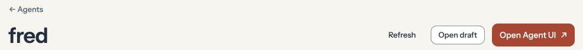
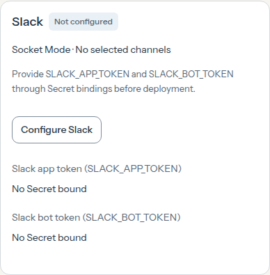
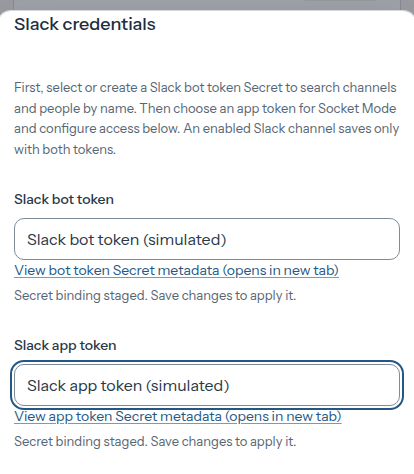
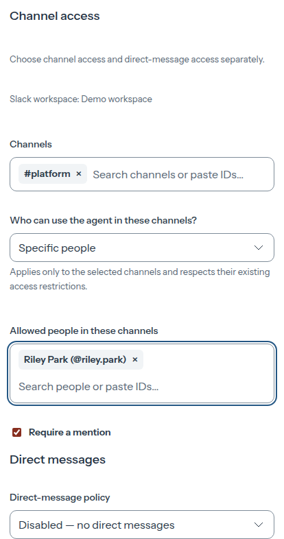
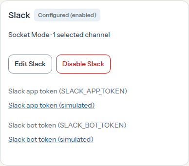
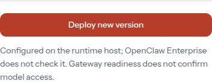
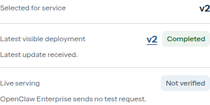
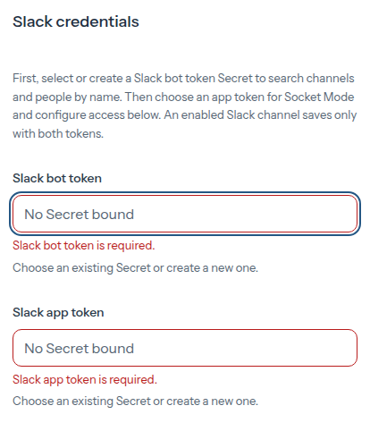
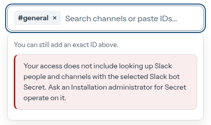

# Channels

Connect an existing Agent to Slack, then verify that it replies in a channel.
The example uses a dedicated Codex Agent named **fred**. The Slack setup screens
show simulated Console data from Storybook.

## Before you start

- Use a **dedicated Codex** Agent on Kubernetes with working model
  authentication. [Deploy your first Agent](../deploy/deploy-first-agent.md)
  if you do not have one. Embedded OpenClaw Harnesses cannot use external
  channels. Keep Slack disabled on the Standard OpenClaw preset.
- Ask your Installation operator to confirm that
  [managed channel egress](../deploy/channel-egress.md) is ready. Private
  workspace routing alone does not provide Slack access.
- Prepare one Slack app for this Agent. Follow the
  [Slack app and permission requirements](slack.md#before-you-start) for Socket
  Mode, token scopes, event subscriptions, and Console permissions. Keep its app
  and bot tokens available for Secret creation. Do not run another Agent or
  local process with the same app's Socket Mode token.
- In Slack, invite the app to the channel where you will test it. Use a channel
  and sender that you are authorized to connect to this Agent.

## Add Slack in the Console

1. In **Agents**, select your Agent and choose **Open draft**. Open **Channels**
   and choose **Configure Slack**. For an existing setup, choose **Edit Slack**.

   

   _In the quickstart example, Open draft is beside Refresh._

   

   _Start in the draft. The running version stays unchanged while you edit._

2. Select **Enable Slack** if it’s unchecked. Under **Slack credentials**,
   select the bot token Secret first, then the app token Secret. To create one,
   choose **Create new Secret...**, enter a name, and keep the prefilled key.
   Paste the token into **Value** and choose **Create Secret**.

   

   _Both bindings are staged. Creating a Secret stores it immediately.
   Cancelling the drawer discards your selections and keeps the Secret._

3. Under **Channels**, search for the channel you invited the bot to and select
   it. Use **Next page** for more results, or paste an exact channel ID and
   press Enter. The bot Secret enables name lookup. If a token is missing or
   lookup is denied, [resolve the setup error](#resolve-setup-errors).
4. Under **Who can use the agent in these channels?**, keep **Specific people**
   and select the people the Agent should respond to, including your test sender.
   Choose **Everyone in these channels** only if all members should have access.
5. Leave **Require a mention** enabled. For channel-only access, set
   **Direct-message policy** to **Disabled — no direct messages**. The default
   for a new setup is **Allowlist — selected users only**.

   

   _In #platform, fred responds to Riley’s mentions. Direct messages are off._

6. Choose **Save configuration**. If other Agents share this Configuration,
   their next deployments will use the saved settings.

   

   _Configured (enabled) confirms the saved settings. It does not verify the
   tokens or a connection to Slack._

7. Above the tabs, find **Prepare this version** and choose **Deploy new version**.
   Check that **Selected for service** shows your new version and **Latest visible
   deployment** shows **Completed** for that version. Deploy again after changing
   a channel or its token value.

   

   _In this example the operator manages fred’s model credentials on the runtime host._

   

   _The deployment of v2 completed. Live serving still shows “Not verified”
   because the Console sends no test message._

## Verify a reply

Wait for the Gateway and Harness to become Ready. In the selected Slack
channel, mention the app from an allowed account. For example, send
`@YourAgent Reply with channels check 7319`. Use your app’s mention and a fresh
phrase. Open the thread and confirm the Agent replies with that phrase.

If no reply arrives, check the bot’s channel membership, allowed sender, mention,
and deployed version. In **Deployment**, [run diagnostics for this version](../console/agent-details.md#browse-versions-or-create-a-new-version)
to check Slack authentication and connectivity. Follow the [Slack guide](slack.md)
to check scopes, Socket Mode, and managed egress. Keep mention filtering enabled
unless you intend to [allow channel messages without mentions](slack.md#enable-channel-messages-without-mentions-optional).

## Resolve setup errors

### Missing tokens

To save with Slack enabled, select or create both token Secrets. If a Secret is
disabled in the picker, ask your Installation administrator for `operate` on it.

_Each empty picker identifies the binding you need to supply._

### Directory access denied

Check the selected bot Secret and the permission named in the message. To skip
name lookup, paste an exact channel or user ID and press Enter. Entering an ID
doesn’t grant access to the Secret.

_To search by name in this example, ask an Installation administrator for
`operate` on the selected bot Secret._
